# Offensive Security Assessment Report: Delivery


**Offensive Security Assessment & Penetration Testing Report** conducted on the target environment **Delivery** hosted on **Hack The Box**, executed in accordance with **OffSec PEN-200 (OSCP)** and **PTES (Penetration Testing Execution Standard)** methodologies.

---

## 📑 1. Executive Summary

* **Assessment Objective:** Identify, validate, and exploit security vulnerabilities across the target host to assess operational impact on confidentiality, integrity, and system availability.
* **Risk Rating:** `CRITICAL` (Unauthenticated remote exploit vector leading to complete host compromise and administrative takeover).
* **Initial Access Vector:** osTicket Email Trick + Mattermost Credential Leak
* **Privilege Escalation Vector:** Mattermost MySQL DB + Hashcat Rule-Based Cracking (bcrypt)
* **Engagement Outcome:** Complete Host Compromise (`User Proof` and `Root / SYSTEM Proof` successfully retrieved and verified).

### Target Technical Specifications

| Parameter | Technical Detail |
| :--- | :--- |
| **Target Host** | Delivery |
| **Platform** | Hack The Box |
| **Operating System** | Linux |
| **Difficulty Rating** | Easy |
| **Associated CVE(s)** | N/A |
| **Initial Foothold Vector** | osTicket Email Trick + Mattermost Credential Leak |
| **Privilege Escalation Vector** | Mattermost MySQL DB + Hashcat Rule-Based Cracking (bcrypt) |
| **Lead Penetration Tester** | Pedro Araiz (`araizcorp`) |

---

## 🎯 2. Attack Path & Kill Chain Workflow

```
[ Phase 1: Reconnaissance & Port Scanning ]
         │─── TCP SYN scanning and service fingerprinting (Nmap)
         └─── Attack surface mapping and daemon enumeration
         │
         ▼
[ Phase 2: Vulnerability Analysis & Service Enumeration ]
         │─── Web directory fuzzing, parameter discovery, and banner analysis
         └─── CVE identification and credential harvesting
         │
         ▼
[ Phase 3: Exploitation & Initial Foothold ]
         │─── Exploit delivery: osTicket Email Trick + Mattermost Credential Leak
         └─── Establishing an interactive reverse shell with unprivileged user context
         │
         ▼
[ Phase 4: Local Privilege Escalation ]
         │─── Internal audit: Mattermost MySQL DB + Hashcat Rule-Based Cracking (bcrypt)
         └─── Elevation to superuser / administrator privileges (root / SYSTEM)
         │
         ▼
[ Phase 5: Evidence & Flag Retrieval ]
         └─── Capture and cryptographic verification of user.txt and root.txt
```

---

## 🔬 3. Technical Walkthrough & Step-by-Step Proof of Concept

| Field | Detail |
| --- | --- |
| Name | Delivery |
| OS | Linux (Debian) |
| Difficulty | Easy |
| CVE | N/A |
| Initial Access | osTicket Email Trick + Mattermost Credential Leak |
| Privilege Escalation | Mattermost MySQL DB + Hashcat Rule-Based Cracking |

---

## Reconnaissance

An Nmap scan reveals 3 open TCP ports: SSH (22), HTTP (80), and Mattermost (8065). The web server on port 80 hosts a company page with a link to a helpdesk at `helpdesk.delivery.htb`.


* **Technical Finding (Phase 1):** Initial network reconnaissance and service detection exposing active daemons and communication endpoints.


## Enumeration

The helpdesk runs osTicket, an open-source support ticket system, at `helpdesk.delivery.htb`. A Mattermost instance is available on port 8065 and requires a `@delivery.htb` email address to register.


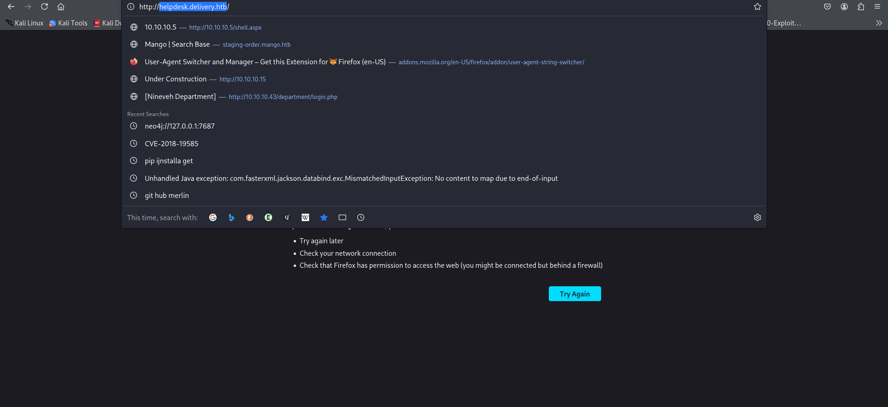
* **Technical Finding (Phase 2):** Attack surface enumeration, directory discovery, or parameter analysis identifying potential vulnerability vectors.


## Exploitation

Tickets can be created on osTicket without authentication. When a ticket is created, osTicket assigns a ticket-specific email address (e.g., `1234567@delivery.htb`). Any email sent to this address is appended to the ticket thread, which can be viewed without logging in.


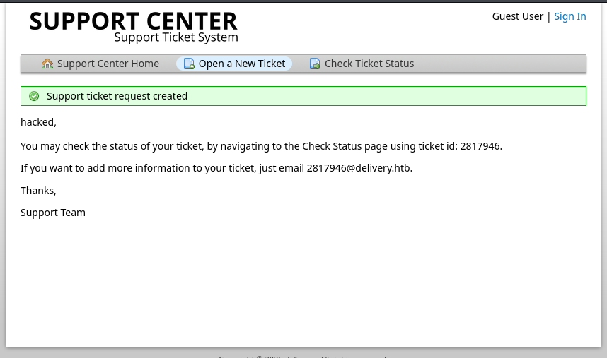
* **Assessment Step 03:** Command execution output, exploit delivery proof, or auxiliary evidence.


This means the ticket email address can be used to receive Mattermost's account verification email. The verification link is captured through the ticket update thread, allowing registration on Mattermost with a valid `@delivery.htb` address.


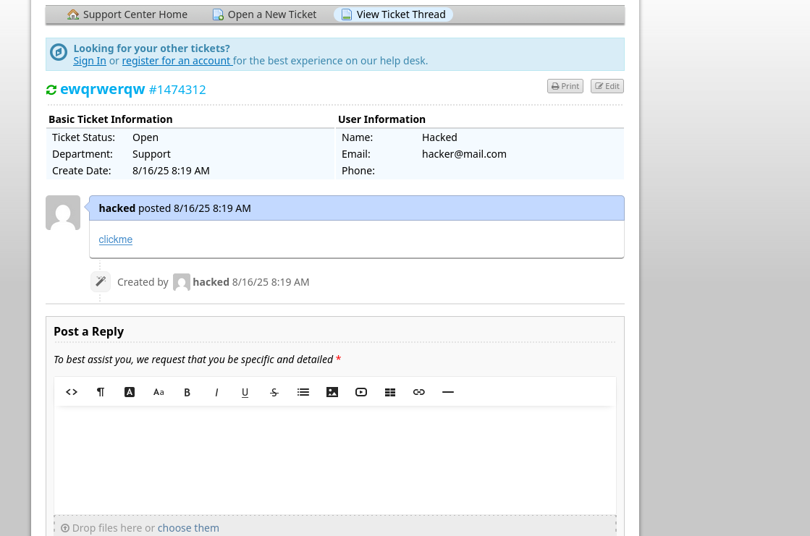
* **Assessment Step 04:** Command execution output, exploit delivery proof, or auxiliary evidence.


Mattermost, an open-source Slack alternative, runs on TCP 8065.


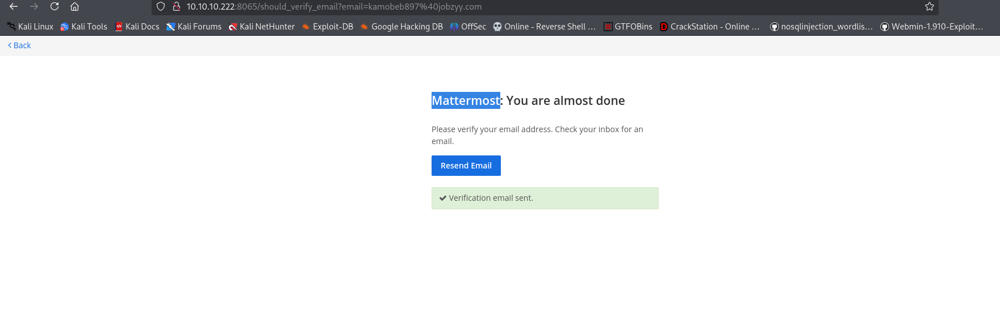
* **Assessment Step 05:** Command execution output, exploit delivery proof, or auxiliary evidence.


Once registered and logged in, the Internal channel reveals messages from the `root` user containing SSH credentials for the `maildeliverer` account.


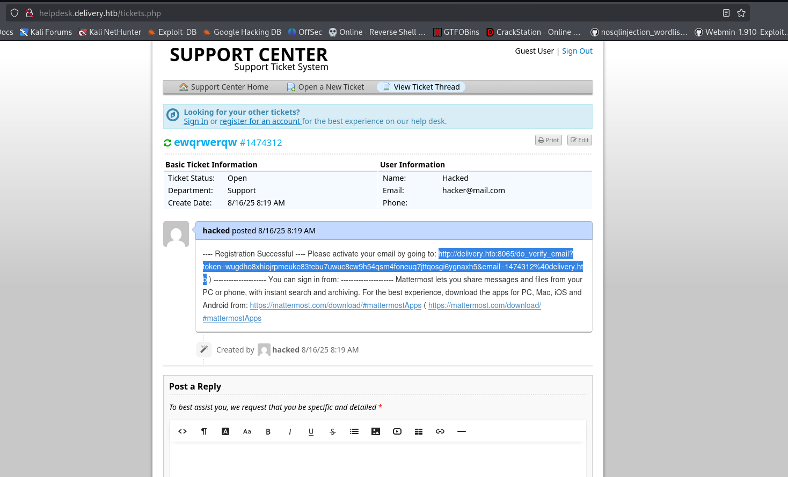
* **Assessment Step 06:** Command execution output, exploit delivery proof, or auxiliary evidence.


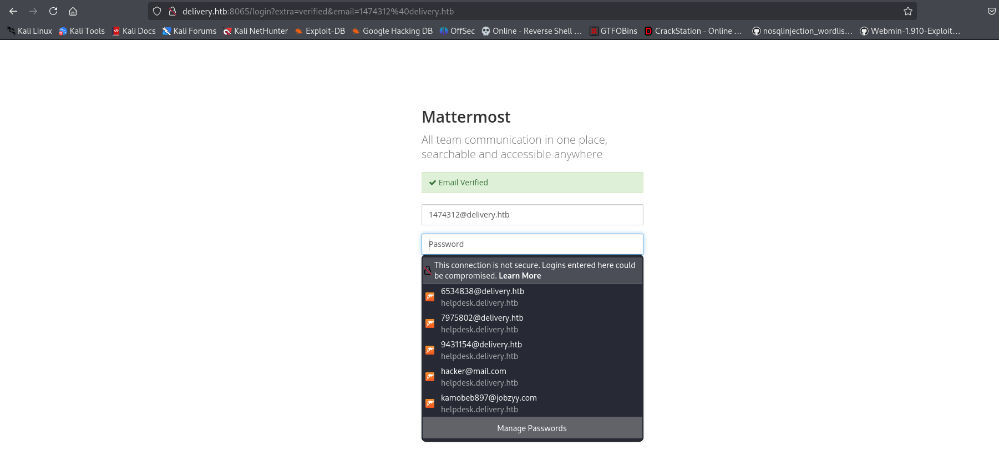
* **Assessment Step 07:** Command execution output, exploit delivery proof, or auxiliary evidence.


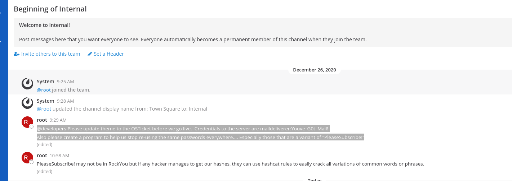
* **Assessment Step 08:** Command execution output, exploit delivery proof, or auxiliary evidence.


### Phase 5: Proof of Compromise & Flag Capture

#### User Proof Flag Verification


* **Assessment Step 09:** Command execution output, exploit delivery proof, or auxiliary evidence.


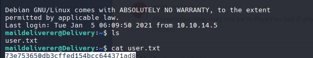
* **Assessment Step 10:** Command execution output, exploit delivery proof, or auxiliary evidence.


## Privilege Escalation

The Mattermost configuration file contains MySQL credentials for the `mmuser` database user with the password `Crack_The_MM_Admin_PW`. Connecting to MySQL reveals the Mattermost users table with bcrypt password hashes.


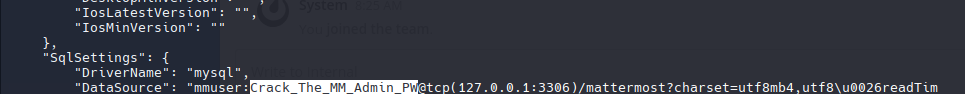
* **Assessment Step 11:** Command execution output, exploit delivery proof, or auxiliary evidence.


The root user's bcrypt hash is extracted from the database. The Internal channel hint mentions that variations of `PleaseSubscribe!` are used as passwords.


* **Assessment Step 12:** Command execution output, exploit delivery proof, or auxiliary evidence.


Using Hashcat with the `best64.rule` ruleset against the base word `PleaseSubscribe!` generates variations. The cracked password is `PleaseSubscribe!21`. Using `su root` with this password grants root access.

```jsx
echo PleaseSubscribe! | hashcat -r /usr/share/hashcat/rules/best64.rule --stdout
john hash --wordlist=word.txt
```


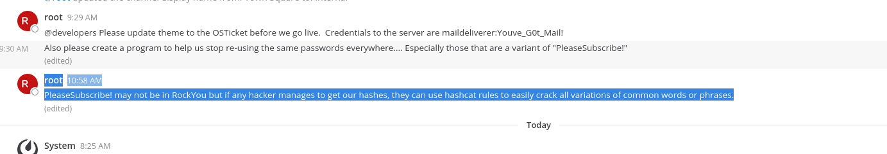
* **Assessment Step 13:** Command execution output, exploit delivery proof, or auxiliary evidence.


* **Assessment Step 14:** Command execution output, exploit delivery proof, or auxiliary evidence.


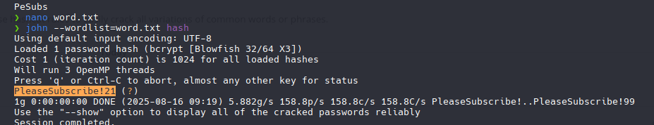
* **Privilege Escalation PoC (Phase 4):** Exploitation of misconfiguration, SUID binary, or vulnerability leading to elevated privileges.


#### Root / System Proof Flag Verification


* **Evidence Verification (Phase 5):** Final administrative validation confirming root/SYSTEM access and retrieval of system flags.

---

## 🛡️ 4. Strategic Remediation & Hardening Roadmap

### Immediate Tactical Actions (P1)
1. **Patch Management & Software Upgrades:** Immediately apply official security updates and patches for all vulnerable software components and exposed services (N/A).
2. **Access Control & SUID Audit:** Remove unnecessary SUID/SGID bits, audit `/etc/sudoers` rules, and enforce strict Access Control Lists (ACLs) on sensitive files and administrative scripts.
3. **Attack Surface Reduction:** Configure host-based firewalls (e.g., `iptables` / `ufw` / Windows Firewall) to restrict exposure of management services and internal ports to trusted administrative subnets only.

### Architectural & Defensive Hardening (P2)
1. **Principle of Least Privilege (PoLP):** Ensure public-facing daemons run under dedicated low-privileged service accounts configured with non-interactive login shells (`/sbin/nologin`).
2. **Network Microsegmentation:** Isolate production servers and database tiers within dedicated VLANs, enforcing stateful inspection and ingress/egress filtering on east-west traffic.
3. **Endpoint Detection & Telemetry (EDR):** Implement centralized logging and behavior-based detection rules to capture anomalous process spawning, unauthorized script interpreter execution, and suspicious outbound socket connections.

---

## 📊 5. MITRE ATT&CK Enterprise Framework Mapping

| Tactic | Technique ID | Technique Name | Technical Application in Engagement |
| :--- | :--- | :--- | :--- |
| **Reconnaissance** | `T1595.002` | Active Scanning: Vulnerability Scanning | Automated and manual port scanning, banner grabbing, and service discovery |
| **Initial Access** | `T1190` | Exploit Public-Facing Application | Exploitation of exposed network/web service (osTicket Email Trick + Mattermost Credential Leak) |
| **Execution** | `T1059` | Command and Scripting Interpreter | Interactive reverse shell execution and remote command dispatch |
| **Privilege Escalation** | `T1068 / T1548` | Abuse Elevation Control Mechanism / Exploitation | Local elevation to administrative/root privileges (Mattermost MySQL DB + Hashcat Rule-Based Cracking (bcrypt)) |

---

© 2026 **araizcorp** — Technical documentation and security assessment portfolio developed for **OffSec** certification preparation (OSCP, OSEP, OSWE) and commercial penetration testing enablement.
