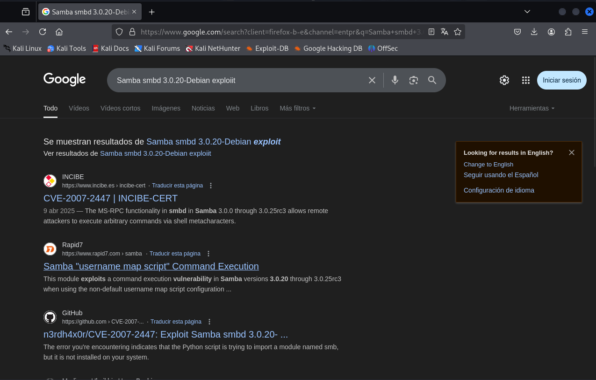
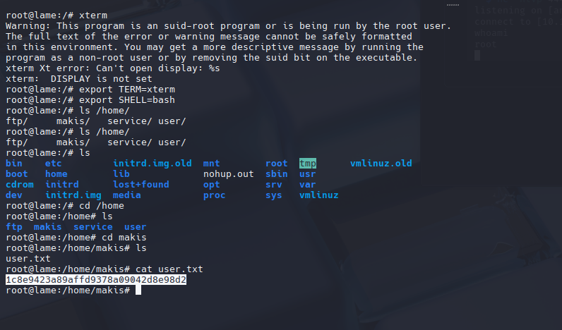
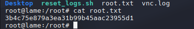
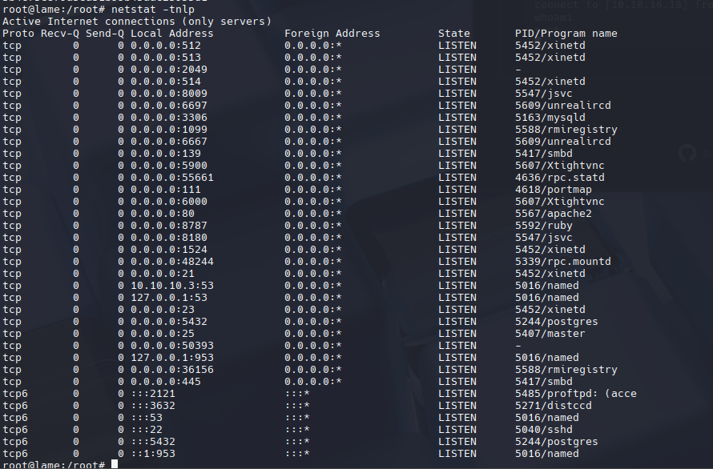

# Informe Técnico de Seguridad Ofensiva: Lame


**Evaluación de Seguridad Ofensiva y Penetration Testing** realizada sobre el entorno de laboratorio **Lame** de **Hack The Box**, siguiendo los estándares de ejecución metodológica **OffSec PEN-200 (OSCP)** y **PTES (Penetration Testing Execution Standard)**.

---

## 📑 1. Resumen Ejecutivo (Executive Summary)

* **Objetivo de la Evaluación:** Identificar, documentar y explotar debilidades de seguridad en el host objetivo para evaluar el impacto sobre la confidencialidad, integridad y disponibilidad del sistema.
* **Calificación de Riesgo:** `CRÍTICO` (Acceso no autenticado que deriva en compromiso completo de la máquina y obtención de máximos privilegios administrativos).
* **Vector de Acceso Inicial:** Samba 3.0.20 username map script RCE
* **Vector de Elevación de Privilegios:** N/A - Exploit otorga root directamente
* **Estado Final:** Compromiso total del objetivo (`User Proof` y `Root/System Proof` obtenidas exitosamente).

### Ficha Técnica de la Evaluación

| Parámetro | Detalle Técnico |
| :--- | :--- |
| **Host Objetivo** | Lame |
| **Plataforma** | Hack The Box |
| **Sistema Operativo** | Linux |
| **Nivel de Dificultad** | Easy |
| **CVE(s) Involucrados** | CVE-2007-2447 |
| **Vector de Entrada** | Samba 3.0.20 username map script RCE |
| **Mecanismo de Escalada** | N/A - Exploit otorga root directamente |
| **Consultor / Auditor** | Pedro Araiz (`araizcorp`) |

---

## 🎯 2. Diagrama del Flujo de Compromiso (Attack Path)

```
[ Fase 1: Reconocimiento ]
         │
         ▼
[ Fase 2: Enumeración & Identificación de Vectores ]
         │─── Descubrimiento de servicios y análisis de superficie de ataque
         └─── Verificación de configuraciones erróneas y CVEs conocidos
         │
         ▼
[ Fase 3: Explotación Inicial (Foothold) ]
         │─── Ejecución del vector: Samba 3.0.20 username map script RCE
         └─── Establecimiento de Reverse Shell / Acceso de usuario
         │
         ▼
[ Fase 4: Escalada de Privilegios Local ]
         │─── Auditoría interna: N/A - Exploit otorga root directamente
         └─── Elevación a privilegios de superusuario (root / SYSTEM)
         │
         ▼
[ Fase 5: Evidencia & Banderas ]
         └─── Captura de User Flag y Root Flag
```

---

## 🔬 3. Procedimiento Técnico y Evidencias Paso a Paso

CVE(s): CVE-2007-2447
GTFOBins/Abusos (sudo/SUID): N/A
Initial Access Exploit (Ingreso): Samba 3.0.20 username map script RCE

Privilege Escalation (Escalada): N/A - Exploit otorga root directamente


| Campo | Detalle |
| --- | --- |
| Nombre | Lame |
| OS | Linux |
| Dificultad | Easy |
| CVE | CVE-2007-2447 |
| Acceso Inicial | Samba 3.0.20 username map script RCE |
| Escalada | N/A - Exploit otorga root directamente |

---

## Reconocimiento

Se realizo un escaneo de puertos con Nmap identificando **4 puertos TCP abiertos** entre los top 1000. Los servicios incluyen FTP (vsftpd 2.3.4), SSH, y SMB (Samba 3.0.20):


## Enumeracion

Se identifico **VSFTPd version 2.3.4** corriendo en el puerto 21. Esta version tiene un backdoor conocido, pero en este caso no es explotable:


El backdoor de VSFTPd 2.3.4 **no funciona** en esta maquina. Aunque el servicio es vulnerable, un firewall bloquea la conexion al puerto 6200 que el backdoor abre. Esto se confirma mas adelante con acceso root:


Se identifico **Samba version 3.0.20** corriendo en el servicio SMB, que resulta ser el vector de ataque viable:


## Explotacion

Samba 3.0.20 es vulnerable a **CVE-2007-2447**, que permite ejecucion remota de codigo a traves de metacaracteres de shell en la funcion `SamrChangePassword` cuando la opcion "username map script" esta habilitada en `smb.conf`:



La explotacion de CVE-2007-2447 otorga acceso directo como **root**, sin necesidad de escalada de privilegios adicional:


Exploit utilizado: CVE-2007-2447

## Flags

### User Flag (makis)

Con acceso root, se obtuvo la flag del usuario makis: `1c8e9423a89affd9378a09042d8e98d2`



### Root Flag

La flag de root: `3b4c75e879a3ea31b99b45aac23955d1`



## Notas Adicionales - Beyond Root

Con acceso root se investigo por que el exploit de VSFTPd fallo. Aunque `netstat -tnlp` muestra multiples puertos escuchando (incluyendo en 0.0.0.0), un **firewall** esta bloqueando las conexiones a estos puertos:



Cuando el backdoor de VSFTPd se activa, el puerto **6200** comienza a escuchar:


El puerto 6200 efectivamente comienza a escuchar en Lame cuando se activa el backdoor, pero el firewall impide la conexion externa, haciendo inutil el exploit de VSFTPd como vector de ataque.

---

## 🛡️ 4. Plan de Remediación y Recomendaciones de Hardening

### Acciones Tácticas Inmediatas
1. **Aplicación de Parches y Actualización:** Actualizar todos los servicios obsoletos y aplicar los parches correspondientes a las vulnerabilidades documentadas (CVE-2007-2447).
2. **Revisión de Permisos Críticos:** Eliminar permisos SUID/sudo innecesarios y auditar listas de control de acceso (ACLs) en directorios y archivos sensibles.
3. **Cierre de Superficie de Exposición:** Configurar firewalls a nivel de host para denegar puertos de administración o de depuración que no deban estar expuestos públicamente.

### Acciones Estratégicas y de Arquitectura
1. **Principio de Mínimo Privilegio (PoLP):** Configurar servicios y aplicaciones para que se ejecuten bajo cuentas de servicio con privilegios limitados sin acceso a shells interactivas.
2. **Segmentación de Red:** Aislar componentes críticos y servidores de aplicaciones en VLANs dedicadas con inspección de tráfico Este-Oeste.
3. **Monitorización Continua y EDR:** Implementar reglas de detección basadas en comportamiento para identificar ejecuciones anómalas de comandos, spawning de shells y tráfico de red no autorizado.

---

## 📊 5. Mapeo con Matriz MITRE ATT&CK

| Táctica | ID de Técnica | Nombre de Técnica | Aplicación en el Ejercicio |
| :--- | :--- | :--- | :--- |
| **Reconnaissance** | `T1595.002` | Vulnerability Scanning | Detección automatizada y manual de servicios mediante escaneo de puertos |
| **Initial Access** | `T1190` | Exploit Public-Facing Application | Explotación de vulnerabilidad en servicio de red expuesto (Samba 3.0.20 username map script RCE) |
| **Execution** | `T1059` | Command and Scripting Interpreter | Spawning de reverse shell interactiva para control del endpoint |
| **Privilege Escalation** | `T1068 / T1548` | Abuse Elevation Mechanism / Exploitation | Elevación de privilegios hacia superusuario (N/A - Exploit otorga root directamente) |

---

© 2026 **araizcorp** — Documentación técnica desarrollada para preparación y consultoría de certificaciones **OffSec** (OSCP, OSEP, OSWE).
