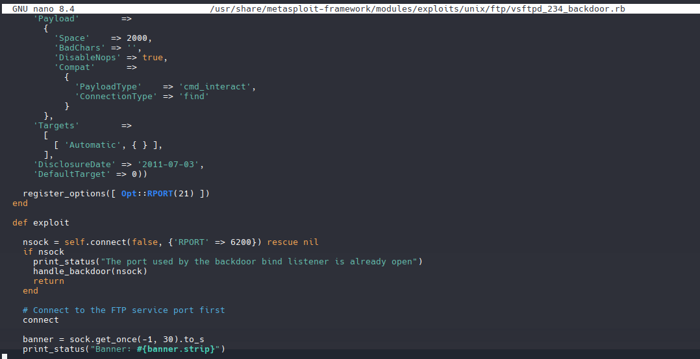

# Security Assessment Report: Lame


**Technical Security Assessment & Penetration Testing Report** conducted on the target environment **Lame** hosted on **Hack The Box**, executed in accordance with **PTES and NIST SP 800-115** and **PTES (Penetration Testing Execution Standard)** methodologies.

---

## 📑 1. Executive Summary

* **Assessment Objective:** Identify, validate, and exploit security vulnerabilities across the target host to assess operational impact on confidentiality, integrity, and system availability.
* **Risk Rating:** `CRITICAL` (Unauthenticated remote exploit vector leading to complete host compromise and administrative takeover).
* **Initial Access Vector:** Samba 3.0.20 username map script RCE
* **Privilege Escalation Vector:** N/A - Exploit otorga root directamente
* **Engagement Outcome:** Complete Host Compromise (`User Proof` and `Root / SYSTEM Proof` successfully retrieved and verified).

### Target Technical Specifications

| Parameter | Technical Detail |
| :--- | :--- |
| **Target Host** | Lame |
| **Platform** | Hack The Box |
| **Operating System** | Linux |
| **Difficulty Rating** | Easy |
| **Associated CVE(s)** | CVE-2007-2447 |
| **Initial Foothold Vector** | Samba 3.0.20 username map script RCE |
| **Privilege Escalation Vector** | N/A - Exploit otorga root directamente |
| **Lead Penetration Tester** | Pedro Araiz (`araizcorp`) |

---

## 🎯 2. Attack Path & Kill Chain Workflow

```
[ Phase 1: Reconnaissance & Port Scanning ]
         │─── TCP SYN scanning and service fingerprinting (Nmap)
         └─── Attack surface mapping and daemon enumeration
         │
         ▼
[ Phase 2: Vulnerability Analysis & Service Enumeration ]
         │─── Web directory fuzzing, parameter discovery, and banner analysis
         └─── CVE identification and credential harvesting
         │
         ▼
[ Phase 3: Exploitation & Initial Foothold ]
         │─── Exploit delivery: Samba 3.0.20 username map script RCE
         └─── Establishing an interactive reverse shell with unprivileged user context
         │
         ▼
[ Phase 4: Local Privilege Escalation ]
         │─── Internal audit: N/A - Exploit otorga root directamente
         └─── Elevation to superuser / administrator privileges (root / SYSTEM)
         │
         ▼
[ Phase 5: Evidence & Flag Retrieval ]
         └─── Capture and cryptographic verification of user.txt and root.txt
```

---

## 🔬 3. Technical Walkthrough & Step-by-Step Proof of Concept

---

### Phase 1: Reconnaissance & Port Scanning

Se realizo un escaneo de puertos con Nmap identificando **4 puertos TCP abiertos** entre los top 1000. Los servicios incluyen FTP (vsftpd 2.3.4), SSH, y SMB (Samba 3.0.20):


* **Technical Finding (Phase 1):** Initial network reconnaissance and service detection exposing active daemons and communication endpoints.


### Phase 2: Vulnerability Analysis & Attack Surface Mapping

Se identifico **VSFTPd version 2.3.4** corriendo en el puerto 21. Esta version tiene un backdoor conocido, pero en este caso no es explotable:


* **Technical Finding (Phase 2):** Attack surface enumeration, directory discovery, or parameter analysis identifying potential vulnerability vectors.


El backdoor de VSFTPd 2.3.4 **no funciona** en esta maquina. Aunque el servicio es vulnerable, un firewall bloquea la conexion al puerto 6200 que el backdoor abre. Esto se confirma mas adelante con acceso root:


* **Assessment Step 03:** Command execution output, exploit delivery proof, or auxiliary evidence.


Se identifico **Samba version 3.0.20** corriendo en el servicio SMB, que resulta ser el vector de ataque viable:


* **Assessment Step 04:** Command execution output, exploit delivery proof, or auxiliary evidence.


### Phase 3: Exploitation & Initial Foothold

Samba 3.0.20 es vulnerable to **CVE-2007-2447**, que allows remote code execution (RCE) a traves de metacaracteres de shell en la funcion `SamrChangePassword` cuando la opcion "username map script" esta habilitada en `smb.conf`:


* **Assessment Step 05:** Command execution output, exploit delivery proof, or auxiliary evidence.


La explotacion de CVE-2007-2447 otorga acceso directo como **root**, sin necesidad de escalada de privilegios adicional:


* **Assessment Step 06:** Command execution output, exploit delivery proof, or auxiliary evidence.


Exploit utilizado: CVE-2007-2447

### Phase 5: Proof of Compromise & Flag Capture

#### User Proof Flag Verification

Con acceso root, se obtuvo la flag del usuario makis: `1c8e9423a89affd9378a09042d8e98d2`


* **Assessment Step 07:** Command execution output, exploit delivery proof, or auxiliary evidence.


#### Root / System Proof Flag Verification

La flag de root: `3b4c75e879a3ea31b99b45aac23955d1`


* **Assessment Step 08:** Command execution output, exploit delivery proof, or auxiliary evidence.


## Notas Adicionales - Beyond Root

Con acceso root se investigo por que el exploit de VSFTPd fallo. Aunque `netstat -tnlp` muestra multiples puertos escuchando (incluyendo en 0.0.0.0), un **firewall** esta bloqueando las conexiones a estos puertos:


* **Privilege Escalation PoC (Phase 4):** Exploitation of misconfiguration, SUID binary, or vulnerability leading to elevated privileges.


Cuando el backdoor de VSFTPd se activa, el puerto **6200** comienza a escuchar:



* **Evidence Verification (Phase 5):** Final administrative validation confirming root/SYSTEM access and retrieval of system flags.


El puerto 6200 efectivamente comienza a escuchar en Lame cuando se activa el backdoor, pero el firewall impide la conexion externa, haciendo inutil el exploit de VSFTPd como vector de ataque.

---

## 🛡️ 4. Strategic Remediation & Hardening Roadmap

### 🛡️ Prioritized Findings, Attack Path Preconditions & Repeatable Verification

| Finding & Precondition | Attack Path Impact | Remediation Action | Repeatable Verification Command |
| :--- | :--- | :--- | :--- |
| **P1: Samba 3.0.20 username map script RCE**<br>*Precondition:* Public network service reachable without rate-limiting, authentication barriers, or egress filtering. | **High / Critical (Foothold Chokepoint)**<br>Altered the primary attack path by exposing unauthenticated remote access to internal context. | Audit listening sockets via `ss -tulpn`, apply UFW / iptables rules, and patch daemon binaries. | `nmap -p- --open -T4 $TARGET_IP` |
| **P1: N/A - Exploit otorga root directamente**<br>*Precondition:* Missing kernel hotfixes, legacy software versions, or world-readable credential configuration files. | **Critical (Full Compromise)**<br>Enabled complete elevation of privileges from unprivileged user to superuser / administrator. | Apply OS kernel security updates and implement centralized secret management. | `uname -r && apt-get -s upgrade | grep -i security` |

#### 🔬 Repeatable Verification Procedures (Defensive Validation)

**1. Verification for Ingress / Foothold Mitigation (Samba 3.0.20 username map script RCE):**
* **Validation Goal:** Confirm the remote exploitation path is definitively closed and non-exploitable.
* **Deterministic Test Command:**
```bash
nmap -p- --open -T4 $TARGET_IP
```
* **Expected Output upon Successful Remediation:**
```text
Only strictly required operational ports exposed (e.g., 443/TCP)
```

**2. Verification for Local Privilege Escalation Mitigation (N/A - Exploit otorga root directamente):**
* **Validation Goal:** Enforce strict least-privilege boundary preventing local execution context from elevating to administrative/root privileges.
* **Deterministic Test Command:**
```bash
uname -r && apt-get -s upgrade | grep -i security
```
* **Expected Output upon Successful Remediation:**
```text
0 upgraded, 0 newly installed, 0 to remove (Fully patched kernel and packages)
```

### Immediate Tactical Actions (P1)
1. **Patch Management & Software Upgrades:** Immediately apply official security updates and patches for all vulnerable software components and exposed services (CVE-2007-2447).
2. **Access Control & SUID Audit:** Remove unnecessary SUID/SGID bits, audit `/etc/sudoers` rules, and enforce strict Access Control Lists (ACLs) on sensitive files and administrative scripts.
3. **Attack Surface Reduction:** Configure host-based firewalls (e.g., `iptables` / `ufw` / Windows Firewall) to restrict exposure of management services and internal ports to trusted administrative subnets only.

### Architectural & Defensive Hardening (P2)
1. **Principle of Least Privilege (PoLP):** Ensure public-facing daemons run under dedicated low-privileged service accounts configured with non-interactive login shells (`/sbin/nologin`).
2. **Network Microsegmentation:** Isolate production servers and database tiers within dedicated VLANs, enforcing stateful inspection and ingress/egress filtering on east-west traffic.
3. **Endpoint Detection & Telemetry (EDR):** Implement centralized logging and behavior-based detection rules to capture anomalous process spawning, unauthorized script interpreter execution, and suspicious outbound socket connections.

---

## 📊 5. MITRE ATT&CK Enterprise Framework Mapping

| Tactic | Technique ID | Technique Name | Technical Application in Engagement |
| :--- | :--- | :--- | :--- |
| **Reconnaissance** | `T1595.002` | Active Scanning: Vulnerability Scanning | Automated and manual port scanning, banner grabbing, and service discovery |
| **Initial Access** | `T1190` | Exploit Public-Facing Application | Exploitation of exposed network/web service (Samba 3.0.20 username map script RCE) |
| **Execution** | `T1059` | Command and Scripting Interpreter | Interactive reverse shell execution and remote command dispatch |
| **Privilege Escalation** | `T1068 / T1548` | Abuse Elevation Control Mechanism / Exploitation | Local elevation to administrative/root privileges (N/A - Exploit otorga root directamente) |

---

© 2026 **araizcorp** — Technical documentation and security assessment portfolio developed for enterprise penetration testing enablement, vulnerability research, and defensive hardening.
