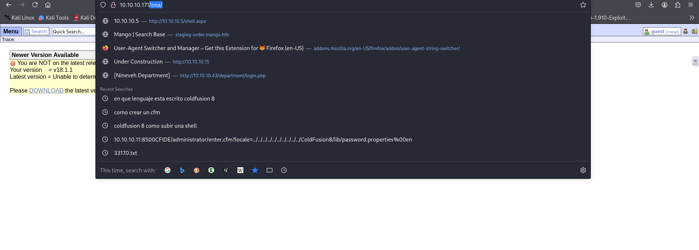
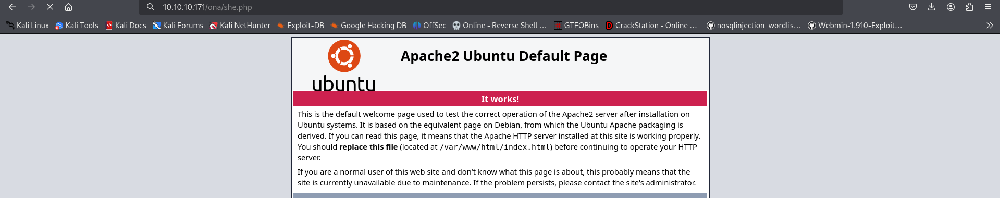
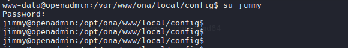
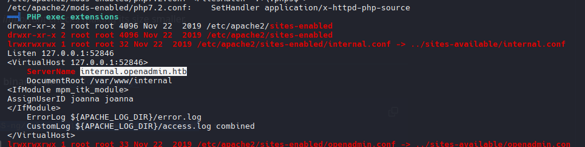
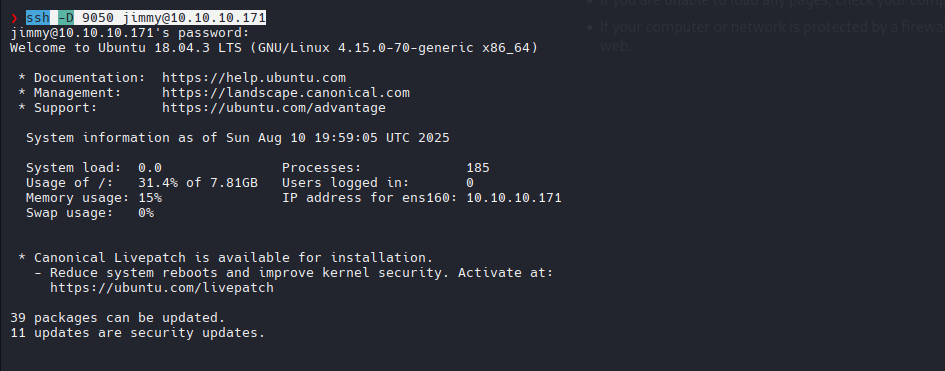
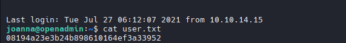
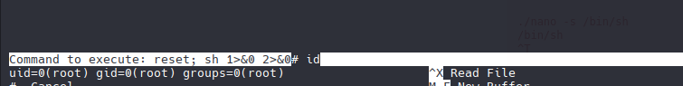

# Informe Técnico de Seguridad Ofensiva: OpenAdmin


**Evaluación de Seguridad Ofensiva y Penetration Testing** realizada sobre el entorno de laboratorio **OpenAdmin** de **Hack The Box**, siguiendo los estándares de ejecución metodológica **OffSec PEN-200 (OSCP)** y **PTES (Penetration Testing Execution Standard)**.

---

## 📑 1. Resumen Ejecutivo (Executive Summary)

* **Objetivo de la Evaluación:** Identificar, documentar y explotar debilidades de seguridad en el host objetivo para evaluar el impacto sobre la confidencialidad, integridad y disponibilidad del sistema.
* **Calificación de Riesgo:** `CRÍTICO` (Acceso no autenticado que deriva en compromiso completo de la máquina y obtención de máximos privilegios administrativos).
* **Vector de Acceso Inicial:** OpenNetAdmin 18.1.1 RCE
* **Vector de Elevación de Privilegios:** sudo nano (GTFOBins)
* **Estado Final:** Compromiso total del objetivo (`User Proof` y `Root/System Proof` obtenidas exitosamente).

### Ficha Técnica de la Evaluación

| Parámetro | Detalle Técnico |
| :--- | :--- |
| **Host Objetivo** | OpenAdmin |
| **Plataforma** | Hack The Box |
| **Sistema Operativo** | Linux |
| **Nivel de Dificultad** | Easy |
| **CVE(s) Involucrados** | CVE-2019-43818 |
| **Vector de Entrada** | OpenNetAdmin 18.1.1 RCE |
| **Mecanismo de Escalada** | sudo nano (GTFOBins) |
| **Consultor / Auditor** | Pedro Araiz (`araizcorp`) |

---

## 🎯 2. Diagrama del Flujo de Compromiso (Attack Path)

```
[ Fase 1: Reconocimiento ]
         │
         ▼
[ Fase 2: Enumeración & Identificación de Vectores ]
         │─── Descubrimiento de servicios y análisis de superficie de ataque
         └─── Verificación de configuraciones erróneas y CVEs conocidos
         │
         ▼
[ Fase 3: Explotación Inicial (Foothold) ]
         │─── Ejecución del vector: OpenNetAdmin 18.1.1 RCE
         └─── Establecimiento de Reverse Shell / Acceso de usuario
         │
         ▼
[ Fase 4: Escalada de Privilegios Local ]
         │─── Auditoría interna: sudo nano (GTFOBins)
         └─── Elevación a privilegios de superusuario (root / SYSTEM)
         │
         ▼
[ Fase 5: Evidencia & Banderas ]
         └─── Captura de User Flag y Root Flag
```

---

## 🔬 3. Procedimiento Técnico y Evidencias Paso a Paso

CVE(s): CVE-2019-43818
GTFOBins/Abusos (sudo/SUID): nano
Initial Access Exploit (Ingreso): OpenNetAdmin 18.1.1 RCE

Privilege Escalation (Escalada): sudo nano (GTFOBins)


| Campo | Detalle |
| --- | --- |
| Nombre | OpenAdmin |
| OS | Linux (Ubuntu) |
| Dificultad | Easy |
| CVE | CVE-2019-43818 |
| Acceso Inicial | OpenNetAdmin 18.1.1 RCE |
| Escalada | sudo nano (GTFOBins) |

---

## Reconocimiento

El escaneo de puertos revela un servidor web Apache con tres directorios principales: `/artwork`, `/sierra` y `/music`.


## Enumeracion

Navegando a `/music`, se encuentra un enlace que apunta a `/ona`, una instancia de **OpenNetAdmin** (ONA), una herramienta de administracion de red.



La version de OpenNetAdmin que corre en la maquina es **18.1.1**, la cual es vulnerable a Remote Code Execution (CVE-2019-43818).


## Explotacion

Se explota la vulnerabilidad RCE en OpenNetAdmin 18.1.1 para obtener ejecucion de comandos como el usuario **www-data**.





## Movimiento Lateral

Revisando los archivos de configuracion de ONA, se encuentra la contrasena de la base de datos que resulta ser reutilizada por el usuario **jimmy**: `n1nj4W4rri0R!`. Se accede al sistema via SSH como jimmy.




Enumerando la configuracion de Apache, se descubre un virtual host interno llamado **internal.openadmin.htb** que corre bajo el usuario **joanna** en un puerto local.



Accediendo al vhost interno mediante port forwarding, se encuentra una pagina que revela la clave privada SSH de joanna.


La clave privada esta protegida con passphrase. Se extrae el hash con ssh2john y se crackea con john, obteniendo la passphrase: **bloodninjas**. Con esto se accede por SSH como joanna.




## Flags

### User Flag (joanna)



## Escalada de Privilegios

Ejecutando `sudo -l`, se descubre que joanna puede ejecutar **nano** como root sobre `/opt/priv`. Siguiendo la tecnica de GTFOBins para nano, se obtiene una shell como root ejecutando comandos desde dentro del editor.


### Root Flag





---

## 🛡️ 4. Plan de Remediación y Recomendaciones de Hardening

### Acciones Tácticas Inmediatas
1. **Aplicación de Parches y Actualización:** Actualizar todos los servicios obsoletos y aplicar los parches correspondientes a las vulnerabilidades documentadas (CVE-2019-43818).
2. **Revisión de Permisos Críticos:** Eliminar permisos SUID/sudo innecesarios y auditar listas de control de acceso (ACLs) en directorios y archivos sensibles.
3. **Cierre de Superficie de Exposición:** Configurar firewalls a nivel de host para denegar puertos de administración o de depuración que no deban estar expuestos públicamente.

### Acciones Estratégicas y de Arquitectura
1. **Principio de Mínimo Privilegio (PoLP):** Configurar servicios y aplicaciones para que se ejecuten bajo cuentas de servicio con privilegios limitados sin acceso a shells interactivas.
2. **Segmentación de Red:** Aislar componentes críticos y servidores de aplicaciones en VLANs dedicadas con inspección de tráfico Este-Oeste.
3. **Monitorización Continua y EDR:** Implementar reglas de detección basadas en comportamiento para identificar ejecuciones anómalas de comandos, spawning de shells y tráfico de red no autorizado.

---

## 📊 5. Mapeo con Matriz MITRE ATT&CK

| Táctica | ID de Técnica | Nombre de Técnica | Aplicación en el Ejercicio |
| :--- | :--- | :--- | :--- |
| **Reconnaissance** | `T1595.002` | Vulnerability Scanning | Detección automatizada y manual de servicios mediante escaneo de puertos |
| **Initial Access** | `T1190` | Exploit Public-Facing Application | Explotación de vulnerabilidad en servicio de red expuesto (OpenNetAdmin 18.1.1 RCE) |
| **Execution** | `T1059` | Command and Scripting Interpreter | Spawning de reverse shell interactiva para control del endpoint |
| **Privilege Escalation** | `T1068 / T1548` | Abuse Elevation Mechanism / Exploitation | Elevación de privilegios hacia superusuario (sudo nano (GTFOBins)) |

---

© 2026 **araizcorp** — Documentación técnica desarrollada para preparación y consultoría de certificaciones **OffSec** (OSCP, OSEP, OSWE).
